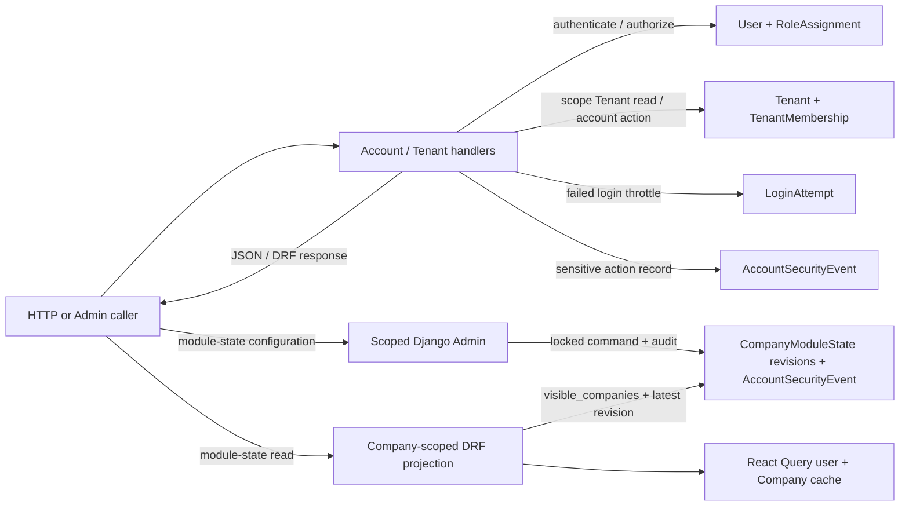

# 01 — Data Flow

> Phase 1 corrections candidate after `cac26195`: self authentication context includes effective Investor Company scope independently of business reads. Branch-scoped role context requires a current matching Branch assignment. Migration 0012 prevents a finite authorization end from being removed or extended, including a future scheduled end; a new authorization uses a new history row. Bootstrap reuses current finite or open scope and rejects future or overlapping current scope for review. See the current verification in [the execution report](../docs/phase1-execution-progress.md).

> Earlier candidate snapshot — 2026-11-01: the accounts/tenants suite passed 172/172 on disposable PostgreSQL 15.19 before the subsequent B1/B2/B3 corrections. Current correction status and the final 199-test result are in [the execution report](../docs/phase1-execution-progress.md). The accepted legacy migration cutover procedure still requires pausing legacy writers; no cutover or deployment is authorized.

> Correction audit: current scoped lifecycle, same-row temporal authorization, bounded uniform login admission, safe required lifecycle reasons and audit Branch scope are recorded in [docs/phase1-audit-corrections.md](../docs/phase1-audit-corrections.md). Earlier completion/test-count statements below are historical snapshots.

> HISTORICAL SNAPSHOT — 2026-11-02. The following Phase 1/2 integration note is superseded by the Phase 3 checkpoint below.

> Local integration state — 2026-11-02: the `codex/audit` integration line includes the accepted Phase 1 account/Company/Branch foundation and Phase 2 React session/context integration, plus P2-13–P2-22 role-navigation and Investor mock-data boundary corrections. Phase 1 account/tenant suite: 210/210 passed on disposable PostgreSQL; Phase 2 React suite: 74/74 passed, with configured lint/build and isolated browser acceptance. The remote remains at the earlier `f266803acd5e86caa2286fb8eae41df6cadfcb86` baseline until a separately authorized push; staging was not updated. Business-domain data remains synthetic and no business APIs were added. The roadmap's Phase 3 Main Operations Foundation is not started; Garage is Phase 6 after Phases 4 and 5. See [roadmap](../planning/V2-DEVELOPMENT-ROADMAP.md), [Phase 1 report](../docs/phase1-execution-progress.md), and [Phase 2 report](../docs/phase2-execution-progress.md).

> Phase 3 implementation checkpoint — 2026-11-03: the Company module-state model/migration, scoped Platform Admin configuration and audit, Company-scoped read projection, and React shared query/bootstrap are implemented. Commit 73797b16aa35db776b5601fe1483c2be8de6c100 is pushed to origin/codex/audit; local and fetched remote heads matched. Local verification: Django 232/232 and React 89/89, lint/build/system/migration checks; fresh migration and history-preservation checks passed. GitHub status/run lists were empty at inspection. No staging/production runtime, deployed database role, or deployment was verified.

## 2026-10-31 verified Phase 1 state

One ordinary Company User UUID is protected to one Company by the `accounts.0007_one_company_account` PostgreSQL guard and by provisioning/Admin policy. The same human may have separate UUID accounts in other Companies; credentials, sessions, epochs, grants, Branch scope, and audit history stay independent. Existing databases are still unverified: migration preflight fails closed on multi-Company business accounts, and no account is auto-split. `login_id` and email remain globally unique; login has no Company selector.

## Historical 2026-10-31 implementation snapshot

The dated 2026-10-19 material below is a historical baseline. The current worktree completes P1-11 through P1-19: account provisioning and lifecycle use Company-scoped policy; Login ID admission is bounded; Company/Branch readers use membership, scoped grants and effective assignments; Django Admin routes use scoped adapters; errors, request IDs and health probes are implemented; migrations include explicit legacy mapping and cutover safeguards. Final validation on disposable PostgreSQL 15.19 passed 129 accounts/tenants tests after the read-query audit additions, plus fresh migration and schema-drift checks. The exact result is recorded in `docs/phase1-execution-progress.md`. No finance module, frontend, persistent database or deployment was added or verified.

## 0. Historical verification header — 2026-10-19 baseline

- Repository/worktree: `D:/VIRMS`, dirty `staging`; reviewed 2026-10-19. Tracked documentation HEAD: `b4a40772edec567297e96d72bf037df73ea0cae6`. The local Django foundation and these maps are untracked, so HEAD does not attest to their contents.
- **CURRENT APPROVED/TARGET:** `/docs-final-v2/` is the current intended V2 business architecture for these maps, established by the user's explicit 2026-10-19 direction and reinforced by `docs-final-v2/01` calling `/docs-final/` a previous baseline. V2 still labels itself draft and leaves specific business decisions open; this map does not claim every V2 action is ready to implement.
- **CURRENT IMPLEMENTED:** source-inspected Django account/Tenant foundation only. **HISTORICAL / SUPERSEDED:** `/docs-final/` V1 model and non-authoritative `/docs-legacy/`. **PROPOSED:** no additional model is introduced here.
- **UNVERIFIED:** test execution, applied PostgreSQL migrations, live API, runtime, deployment and previous production data. **BUSINESS DECISION REQUIRED:** the V2 items listed below. Governance files now use the V2 authority model. System Design body content remains V1-derived, historicalized and unreconciled; see [03](03-ARCHITECTURE-CONFLICT-MAP.md).

## 1. Architecture state classification

| State | Meaning here | Evidence boundary |
|---|---|---|
| CURRENT IMPLEMENTED | Phase 1 User/scope and Phase 3 Company module-state paths | `apps/accounts/`, `apps/tenants/`, `core/`; tracked source at 73797b16; local source/tests verified, deployed state UNVERIFIED |
| CURRENT APPROVED/TARGET | Intended V2 Platform → Company/Tenant → Branch architecture and its defined workflows | User direction; `docs-final-v2/01`–`10` and `supporting/`; open decisions remain explicit |
| HISTORICAL / SUPERSEDED | V1 Garage=Tenant, global Investor/Fund, per-deal Owner distribution and formula Loss; older legacy material | `/docs-final/`, `/docs-legacy/`; historical documentation, not current target |
| PROPOSED | Optional future changes outside V2 | None asserted by this map |
| UNVERIFIED | Applied schema, live rows, deployed behavior and historical transactions | No database/runtime/deployment check in this task |
| BUSINESS DECISION REQUIRED | V2 has insufficient meaning for specific payout, Loss, correction, distribution and access actions | V2's explicit open items; see section 9 and [03](03-ARCHITECTURE-CONFLICT-MAP.md) |

## 2. Current implemented data flow — one view

These are local ORM models and migration definitions. `Tenant` is the current Company identity and Branch membership/assignment foundation exists in source. The module-state model and additive migration were applied to a fresh disposable PostgreSQL database and exercised by the backend suite; persistent, staging and production schemas remain unverified. No Investor, Fund, Stock Vehicle, Garage Job, Company Accounting, Owner Distribution or business-record React data flow exists in inspected source. A private S3-compatible storage adapter exists without a Vehicle image workflow.

## 3. Ownership and source-of-truth matrix

| Data | Scope / identity | Authoritative writer and consumers | History / status |
|---|---|---|---|
| User and RoleAssignment | Global UUID User; effective role rows | Current provision/Admin writes; auth and protected handlers read | CURRENT IMPLEMENTED, source inspected; Admin delete denied; deployed state UNVERIFIED |
| Tenant and TenantMembership | UUID Tenant; effective User membership | Current provision/Admin writes; Tenant list/detail scopes reads; Branch assignment is separate | CURRENT IMPLEMENTED in source; applied database UNVERIFIED |
| LoginAttempt and AccountSecurityEvent | Login key or actor/subject reference | Current auth/account views; security evidence only | CURRENT IMPLEMENTED, source inspected; not a business ledger |
| Platform, Company/Tenant and Branch | Tenant is the Company UUID; Branch and effective membership/assignment provide operational scope | Platform administration and Company/Branch-scoped reads are implemented; business/financial owners remain future modules | CURRENT IMPLEMENTED foundation in source; applied database and full business behavior UNVERIFIED |
| Company module state | Versioned Company/module state keyed by Tenant UUID | Platform Back Office command writes immutable revisions and an audit event; Company-scoped read API and React Query consume | SOURCE IMPLEMENTED; migration/runtime unverified; no business-operation module gate in this phase |
| Protected rates and recipient splits | Versioned Company-level financial configuration | Platform Back Office changes; future financial workflows consume snapshots | CURRENT APPROVED/TARGET; later phases |
| Investor and principal Fund | Investor relationship and one auditable Fund **within a Company**, shared across its Branches | Investment source movements; Stock Vehicle use/recovery and Investor views | CURRENT APPROVED/TARGET; no current model; never merge Funds across Companies by name |
| Stock Vehicle, movement, funded costs | Stable Company Vehicle UUID; one Investor; current Branch and movement history | Investment/Garage source records; Sale, Finance, Media consume | CURRENT APPROVED/TARGET; no current model |
| External customer Vehicle and Garage Job | Stable Company Vehicle/Job identity; no Investor required | Garage owns work/charge/history; Accounting links receipt/revenue | CURRENT APPROVED/TARGET; no current model; Investment may be OFF |
| Buyer, Stock Sale, receipt/refund | Company-consistent Buyer/Sale and individual actual Buyer events | Sale/collection source; Investor recovery, Company result and settlement consume | CURRENT APPROVED/TARGET; no current model |
| Company Running Capital | Exact actual Company contribution and separate recovery linked to one Vehicle | Company Accounting owns Company money; Investment references source without duplicate economic effect | CURRENT APPROVED/TARGET; no current model |
| Company Accounting, Company Share and Owner Distribution | One Company financial backbone across Branches; period distribution from confirmed distributable Profit | Actual classified Company records; source-linked Investment/Garage events; Owner payments | CURRENT APPROVED/TARGET; no current model; distributable basis BDR |
| Interim Payout, Investor reconciliation, Loss, settlement | Company Investor relationship; actual confirmed events distinct from suggestions | Investment and Accounting source history, linked corrections and current positions | CURRENT APPROVED/TARGET; no current model; interim basis, period mapping and manual Loss BDR |
| Image and publication | Vehicle/Company/Branch context; private original and public-safe projection | Media metadata in PostgreSQL, R2 bytes through adapter when built | CURRENT APPROVED/TARGET; storage adapter only |

Reports, dashboard, UI cache and Owner AI are derived consumers, never independent financial sources. V2's one Company receipt or cost may appear in Investment, Garage and Accounting views but must retain one source identity and one economic effect.

## 4. Relationships, versioning and boundaries

- **Implemented:** User→RoleAssignment and User→TenantMembership are effective rows; local constraints allow only one open row per User/role and User/Tenant. Branch assignment and scoped Tenant/Branch reads exist. Company module state is a separate versioned Company-wide history record; the API resolves read scope through `visible_companies`, and Branch query parameters are not accepted. Applied database state remains unverified.
- **V2 target:** Platform→multiple isolated Companies/Tenants→Branches. A Company has one consolidated Accounting boundary; a Branch is not another Tenant or ledger owner. A Company-scoped Investor may fund many Stock Vehicles within that Company; each funded Stock Vehicle has exactly one Investor. An external customer Garage Vehicle needs no Investor.
- **V2 target:** a Stock Vehicle keeps one identity through Branch moves; prior Job/Expense/financial source Branch attribution remains historical. Stock Sale, Buyer and actual Buyer receipt/refund are Company-consistent and separately linked. Investment and Garage source events feed Company Accounting by reference, not duplicate posting.
- **V2 target:** effective Investor positive-share agreements, monthly rates, module state and Owner recipient configuration have version/history. Completed positive Vehicle and confirmed Company distribution positions retain applicable snapshots. Finalized money facts use linked correction/reversal/adjustment; derived balances are rebuildable.
- **HISTORICAL / SUPERSEDED:** V1's Garage=Tenant, global cross-Garage Investor Fund, per-deal Owner Pool and percentage-derived Owner Loss contribution do not define V2 data ownership.

## 5. Source-to-consumer workflows

| Workflow | Authoritative source and effect | Consumer and gate | State |
|---|---|---|---|
| Account provision / Tenant context | Local atomic User, RoleAssignment, TenantMembership and AccountSecurityEvent; session and LoginAttempt flows | Committed Phase 2 React client uses `/auth/me/` for authenticated identity and bounded Company/Branch context; lifecycle APIs have no React caller | CURRENT IMPLEMENTED in audit candidate; production behavior UNVERIFIED |
| Company/Branch and module context | Explicit Company/Branch assignments and versioned module state; no ID grants access | The module-state metadata API uses Company read scope; later business APIs still require their own module/action/object checks | Module-state source implemented; business-operation enforcement remains a future-phase gap |
| Stock Vehicle funding and Garage work | Investor Fund actual use and/or exact Company Running Capital actual contribution; Garage Job work/cost source counted once | Vehicle cost, Company Accounting, Sale and authorized views | CURRENT APPROVED/TARGET; implementation gap |
| External customer Garage Job | Customer charge and separately confirmed receipt with Branch attribution | Company Garage Revenue/receivable; no Investor Fund effect | CURRENT APPROVED/TARGET; implementation gap |
| Sale and positive Vehicle result | Agreed Sale plus bounded actual Buyer receipts/refunds; full collection; Investor principal then actual Company capital recovery; effective Investor positive share and Company Share | Investor Profit, Company Accounting, settlement; Company Share is not direct Owner payout | CURRENT APPROVED/TARGET; implementation gap |
| Company result and Owner distribution | Classified Company sources → confirmed distributable amount → versioned recipient split → separate actual payments | Half-yearly/Annual Company Owner view | CURRENT APPROVED/TARGET; distributable base/close BDR |
| Monthly Investor cycle and reconciliation | Effective monthly rate/day and eligible principal; Due/Suggested separate from actual interim payment | Six-month/annual earned-Profit reconciliation and recoverable/payable | CURRENT APPROVED/TARGET; eligible basis, withdrawal and deal-period mapping BDR |
| Manual Loss and corrections | Negative indicator only until authorized manual decision; actual impacts/events and linked history | Company/Investor positions and settlement | CURRENT APPROVED/TARGET; exact impact and confirmation actor BDR |

V2 automation distinguishes deterministic calculation, editable suggestion, due/reminder, specifically authorized human confirmation, and manual exceptional handling. Only actual confirmed money events change financial truth. No V2 financial transaction/service/table is present locally; exact future persistence and endpoint names are **UNVERIFIED**.

## 6. Data integrity, retention and historical delta

V2 target invariants: hard Company isolation; Branch scope and provenance; one Investor per funded Stock Vehicle but none required for external customer work; no silent Investor Fund overdraft; Company Running Capital separate from Investor principal and Profit; a receipt/cost counted once across module views; fixed-precision INR and two-place `ROUND_HALF_UP`; balanced paise reconciliation for **Company-level positive Owner Distribution**; no automatic negative-result Loss allocation; bounded positive actual payments; immutable confirmed history; no settlement from a calculation, suggestion, reminder or status alone. Locked V1 Loss and per-deal Owner algorithms are historical and must not be run for new V2 activity.

Current Django Admin denies delete of User, RoleAssignment, Tenant and TenantMembership. Other source, database and deployed retention behavior is **UNVERIFIED**. V2 target retains finalized Sale, Fund, Company, Job, distribution, Branch-movement, configuration and correction history. Controlled Company merge preserves Source/Target UUIDs and original Company/Branch financial provenance; it does not repost money. V2 text asserts no production V1 cutover is needed, but actual production history was not inspected, so that factual premise remains **UNVERIFIED**.

## 7. Risks and change entry points

- `DATA-RISK-001` **A before V2 finance work:** importing V1 global Fund, per-deal Owner payout or percentage Loss into V2 would change money ownership and outcomes. See `CONFLICT-003` in [03](03-ARCHITECTURE-CONFLICT-MAP.md).
- `DATA-RISK-002` **A before future business-module access work:** Phase 1 implements Company/Branch scope and Phase 3 provides Company module-state metadata; future business handlers still need module/action/object/field enforcement. Do not treat these foundations as complete business authorization. See `CONFLICT-002`.
- `DATA-RISK-003` **B:** application source and migrations are tracked and pushed on codex/audit; disposable-PostgreSQL migration/tests passed. Persistent/staging/production schema and historical rows are **UNVERIFIED**. No live-data cutover is inferred. See `CONFLICT-005`.
- Re-review on Company/Branch identity or access changes, Investor Fund and Running Capital movement, Job/Sale/accounting source linkage, module OFF, payment or correction semantics, historical snapshots, public media and settlement.

## 8. Remaining decisions and evidence

**BUSINESS DECISION REQUIRED:** monthly eligible-principal basis and active-cycle withdrawal constraints; which deals belong in a reconciliation period and how ordinary deal Profit coexists with interim/periodic payments; exact manual Loss impact on Investor principal and Company money plus confirmation authority; Company distributable-Profit base, recognition and period close/carryforward; Company-level cross-Branch correction authority; Platform support private-finance read outside explicit Company assignment; minimum settlement actions while a module is OFF. These gaps block only the affected V2 behavior, not the description of V2 as current target.

Evidence: `docs-final-v2/01-business-rules.md`, `02-user-roles-permissions.md`, `03-system-modules.md`, `04-data-model-relationships.md`, `05-vehicle-investor-finance-workflow.md`, `06-technical-architecture-engineering-operations.md`, `07-ui-navigation-structure.md`, `08-image-file-architecture.md`, `09-company-accounting-owner-distribution.md`, `10-garage-jobs-workflow.md`, and V2 `supporting/`; current account/Tenant models, migrations, views, admin, tests and `core/`; historical `/docs-final/`, `/docs-legacy/` and Git documentation commits. `AGENTS.md`, README and older governance/roadmap documents now distinguish the V2 target from implemented state and historical V1 material. System Design bodies remain unreconciled historical content and must not be reused as V2 requirements without section-level review. Source inspected; tests/database/runtime/deployment not verified.

## Current V2 Business Decision Additions Referenced

- Canonical decisions: [01 — Business Rules](../docs-final-v2/01-business-rules.md#approved-business-decision-additions), [04 — Data Model Relationships](../docs-final-v2/04-data-model-relationships.md#approved-business-decision-additions), and [09 — Company Accounting](../docs-final-v2/09-company-accounting-owner-distribution.md#approved-business-decision-additions).
- Technical impact: future Company result projections derive from Accounting Income/Expense while cash movement and correction history remain separate. This reference does not change current implemented data flows or resolve the remaining source-recognition and distributable-Profit BDRs.
- Permission reference: [02 — User Roles and Permissions](../docs-final-v2/02-user-roles-permissions.md#approved-business-decision-additions). The existing cross-Branch BDR is superseded only for Accounting corrections; non-Accounting boundaries remain.

## Current V2 Business Decision Additions Referenced — 2026-11-03

- Current decisions: [01 — Business Rules](../docs-final-v2/01-business-rules.md#approved-business-decision-additions), [02 — User Roles and Permissions](../docs-final-v2/02-user-roles-permissions.md#approved-business-decision-additions), [04 — Data Model Relationships](../docs-final-v2/04-data-model-relationships.md#approved-business-decision-additions), and [09 — Company Accounting](../docs-final-v2/09-company-accounting-owner-distribution.md#approved-business-decision-additions).
- Technical impact: Accounting OFF settlement reads/writes must target obligations that predate OFF; Company result projections use Asia/Kolkata calendar boundaries over UTC event instants; the opening balance movement may carry either sign; Profit remains derived from editable pre-confirmation Income/Expense inputs.
- These references add no implemented data flow, permissions, API, schema, or migration. Unrelated module-OFF rules and Profit/Investment ownership remain unchanged.

## Current V2 Business Decision Additions Referenced — Phase 4 result and opening balance

- Canonical additions: [01 — Business Rules](../docs-final-v2/01-business-rules.md#approved-business-decision-additions), [04 — Data Model Relationships](../docs-final-v2/04-data-model-relationships.md#approved-business-decision-additions), and [09 — Company Accounting](../docs-final-v2/09-company-accounting-owner-distribution.md#approved-business-decision-additions).
- Technical impact: Phase 4 Accounting Result derives only from committed Accounting Income/Expense correction chains. Signed opening movements are excluded; zero opening amounts create no event. No implementation or source data flow is implied.
- Full Company Profit source recognition remains unresolved.

## Current V2 Business Decision Additions Referenced — Phase 4 cash corrections

- Canonical decisions: [01 — Business Rules](../docs-final-v2/01-business-rules.md#approved-business-decision-additions), [04 — Data Model Relationships](../docs-final-v2/04-data-model-relationships.md#approved-business-decision-additions), and [09 — Company Accounting](../docs-final-v2/09-company-accounting-owner-distribution.md#approved-business-decision-additions).
- Technical impact: separate wrong-target application reallocation from wrong-cash-fact reversal/replacement; actual cash records retain one history chain. Future actual cash dates are rejected. This reference implements no current data flow.

## Current V2 Business Decision Additions Referenced — Phase 4 correction and archive safety

- Canonical decisions: [02 — User Roles and Permissions](../docs-final-v2/02-user-roles-permissions.md#approved-business-decision-additions), [04 — Data Model Relationships](../docs-final-v2/04-data-model-relationships.md#approved-business-decision-additions), and [09 — Company Accounting](../docs-final-v2/09-company-accounting-owner-distribution.md#approved-business-decision-additions).
- Technical impact: corrections use explicit reverse-only versus reverse-and-replace outcomes; OFF eligibility compares immutable root `recorded_at` with the current Accounting disabled revision; archived accounts have no financial history. No current data flow or implementation is implied.

## Current V2 Business Decision Additions Referenced — Phase 4 OFF settlement and effective-period boundary

- Canonical decisions: [01 — Business Rules](../docs-final-v2/01-business-rules.md#approved-business-decision-additions), [02 — User Roles and Permissions](../docs-final-v2/02-user-roles-permissions.md#approved-business-decision-additions), [04 — Data Model Relationships](../docs-final-v2/04-data-model-relationships.md#approved-business-decision-additions), and [09 — Company Accounting](../docs-final-v2/09-company-accounting-owner-distribution.md#approved-business-decision-additions).
- Technical impact: ordinary Receipt/Payment settlement remains possible against pre-OFF obligations; correction/reallocation is a distinct, narrower gate. Persisted module-state revision identity establishes ordering. Income/Expense corrections retain original effective periods; cash correction dates follow typed event rules. No current flow is implemented.

## Phase 4 implementation checkpoint — 2026-11-03

**VERIFIED FROM REPOSITORY:** the current local worktree implements the bounded Company Accounting flow. The existing React Company Income/Expenses surfaces and Accounting tools call the shared Accounting API/query boundary; Django DRF serializers and Company/Branch policy dispatch to atomic Accounting services; `AccountingEvent`, `AccountingApplication`, `AccountMovement`, named accounts, categories, and idempotency records persist in PostgreSQL. Receipt/Payment, Income/Expense, and account movements remain distinct records. Corrections append linked history, and Accounting Result derives from committed Income/Expense records.

**VERIFIED FROM DATA FLOW:** a local Company Income create request returned 201 and the record remained visible after browser reload/reopening the register against the disposable Docker PostgreSQL database. Detailed checks are recorded in [Phase 4 execution evidence](../docs/phase4-execution-progress.md). This proves only the local disposable setup, not staging or production.

**Compatibility:** the approved React page composition and route identities are retained. Non-Accounting modules do not yet emit source events into this Accounting domain; those later vertical integrations remain in their roadmap phases. This checkpoint supersedes only earlier statements in this map that Phase 4 Accounting persistence/API flows are not implemented; historical Phase 1–3 checkpoints and unresolved business rules remain unchanged.

## Current V2 Business Decision Additions Referenced — Phase 5 Monthly Interim amount

- Canonical decisions: [01 — Business Rules](../docs-final-v2/01-business-rules.md#approved-business-decision-additions), [02 — User Roles and Permissions](../docs-final-v2/02-user-roles-permissions.md#approved-business-decision-additions), [04 — Data Model Relationships](../docs-final-v2/04-data-model-relationships.md#approved-business-decision-additions), and [05 — Vehicle/Investor Finance Workflow](../docs-final-v2/05-vehicle-investor-finance-workflow.md#approved-business-decision-additions).
- Technical impact: a future Investment data flow must read the fixed per-Investor cycle amount from effective configuration, keep it separate from confirmed payments, enforce the Company-level Accountant permission, and retain cycle history. This does not claim Phase 5 implementation or resolve principal-withdrawal/reconciliation-period BDRs.

## Current V2 Business Decision Additions Referenced — Interim advance as Paid

- Canonical decisions: [01 — Business Rules](../docs-final-v2/01-business-rules.md#approved-business-decision-additions), [04 — Data Model Relationships](../docs-final-v2/04-data-model-relationships.md#approved-business-decision-additions), and [05 — Vehicle/Investor Finance Workflow](../docs-final-v2/05-vehicle-investor-finance-workflow.md#approved-business-decision-additions).
- Technical impact: the future Investor Profit projection must keep earned Profit intact and reference confirmed Interim payments in its Paid component; this display/reconciliation relationship must not emit a duplicate financial event. Period deal membership and ordinary payout reconciliation remain unresolved.

## Current V2 Business Decision Additions Referenced — Phase 5 Investor/Vehicle boundaries

- Canonical business rules: [01 — Business Rules](../docs-final-v2/01-business-rules.md#phase-5-approved-business-decision-additions--investor-fund-vehicle-periods-and-loss), [02 — User Roles and Permissions](../docs-final-v2/02-user-roles-permissions.md#phase-5-approved-business-decision-additions--investor-and-vehicle-permissions), [04 — Data Model Relationships](../docs-final-v2/04-data-model-relationships.md#phase-5-approved-business-decision-additions--investment-and-vehicle-relationships), [05 — Vehicle/Investor Finance Workflow](../docs-final-v2/05-vehicle-investor-finance-workflow.md#phase-5-approved-business-decision-additions--fund-vehicle-investor-periods-and-exit), and [09 — Company Accounting](../docs-final-v2/09-company-accounting-owner-distribution.md#phase-5-approved-business-decision-additions--investment-source-linkage).
- Technical impact: future data flow must preserve one Company-pooled Fund with Branch provenance, one Vehicle UUID, typed source links to Accounting cash events, and derived Fund balances. Current Phase 4 source lacks Investment/Vehicle models and typed capital links. The Phase 5 architecture is blocked by Q39; no Vehicle Purchase mutation is authorized by this reference.

## Phase 5 local implementation checkpoint — 2026-11-07

This checkpoint supersedes only the prior present-tense statement above that current source has no Investment/Vehicle backend models or typed capital links. The local Phase 5 worktree now persists Investor profiles and append-only Interim configuration, immutable Branch-attributed Fund credits and principal returns, Vehicle identity and append-only Branch movements, and typed `AccountingSourceLink` records for capital inflow/outflow. Accounting remains the owner of actual Cash/Bank events and movements; capital-inflow is not Income or Profit. Fund balances are derived from credits and principal-return allocations.

These backend APIs are not yet consumed by the React Vehicle, Investor or Fund screens; those screens still use prototype state. The existing form fields combine Vehicle/garage/customer/Investor/purchase concepts and omit server Branch/cash-account identities required by the APIs. No UI contract or route was changed. Purchase/use/Running Capital allocation, deactivation, Profit/Loss, Exit settlement and mock-data import remain blocked or out of this slice. See [execution evidence](../docs/phase5-execution-progress.md). `virms-local-8002-pgdata` and hosted databases were not accessed.
- No Phase 1–4 runtime behavior or route is changed by this reference.

## Current V2 Business Decision Additions Referenced — seller payable scope

- Canonical decision: [05 — Vehicle/Investor Finance Workflow](../docs-final-v2/05-vehicle-investor-finance-workflow.md#approved-business-decision-additions).
- Technical impact: the earlier Q39 business-decision gate above is historical and superseded. A purchase may precede full seller payment, including ₹0 advance; seller payable and actual installments are separate from purchase funding allocations and Cash/Bank movements. Lender finance and EMI are excluded from Phase 5. Purchase remains blocked pending its typed payment, correction and concurrency contract.

## Current V2 Business Decision Additions Referenced — purchase funding allocation timing

- Canonical decision: [05 — Vehicle/Investor Finance Workflow](../docs-final-v2/05-vehicle-investor-finance-workflow.md#approved-business-decision-additions).
- Technical impact: record and lock full purchase source allocations at acquisition, independently of seller cash already paid. Keep seller payable derived from actual installments; only actual payments change AccountMovement.

## Current V2 Business Decision Additions Referenced — purchase correction after seller payment

- Canonical decision: [05 — Vehicle/Investor Finance Workflow](../docs-final-v2/05-vehicle-investor-finance-workflow.md#approved-business-decision-additions).
- Technical impact: preserve original payment and movement rows; require a linked actual Accounting refund before a correction can reduce purchase cost below cumulative payments.

## Current V2 Business Decision Additions Referenced — purchase correction source allocation

- Canonical decision: [05 — Vehicle/Investor Finance Workflow](../docs-final-v2/05-vehicle-investor-finance-workflow.md#approved-business-decision-additions).
- Technical impact: append source-proportional Fund/Running Capital adjustments; retain FIFO lot attribution. Define paise rounding before implementation.

## Current V2 Business Decision Additions Referenced — purchase-source paise rounding

- Canonical decision: [05 — Vehicle/Investor Finance Workflow](../docs-final-v2/05-vehicle-investor-finance-workflow.md#approved-business-decision-additions).
- Technical impact: use balanced paise reconciliation and the fixed Fund-then-Running-Capital tie order; source adjustments must equal the corrected amount exactly.

## Current V2 Business Decision Additions Referenced — Company-wide automation approval

- Canonical decision: [01 — Business Rules](../docs-final-v2/01-business-rules.md#approved-business-decision-additions).
- Technical impact: a versioned Company setting controls consequential automation; approval and calculation details stay in the relevant workflow. Read-only calculations continue automatically.

## Current V2 Business Decision Additions Referenced — pending actions across automation mode changes

- Canonical decision: [01 — Business Rules](../docs-final-v2/01-business-rules.md#approved-business-decision-additions).
- Technical impact: pending action retains its original policy context after OFF; only new actions use automatic execution mode.

## Current V2 Business Decision Additions Referenced — auto-posting in approval OFF mode

- Canonical decision: [01 — Business Rules](../docs-final-v2/01-business-rules.md#approved-business-decision-additions).
- Technical impact: workflow-level explicit automation approval is required before OFF may bypass per-action confirmation; actual source evidence and ownership remain.

## Current V2 Business Decision Additions Referenced — manual Purchase refund and correction

- Canonical decision: [05 — Vehicle/Investor Finance Workflow](../docs-final-v2/05-vehicle-investor-finance-workflow.md#approved-business-decision-additions).
- Technical impact: an Accountant explicitly creates the actual refund record and Purchase cost correction, each linked to the same Purchase; no automatic financial mutation or cash event is implied.

## Current V2 Business Decision Additions Referenced — Sale form Save confirms Sold

- Canonical decision: [05 — Vehicle/Investor Finance Workflow](../docs-final-v2/05-vehicle-investor-finance-workflow.md#approved-business-decision-additions).
- Technical impact: a successful Sale-form save persists the authoritative confirmed Sale; Buyer collection remains a separate flow and does not set the Sold state.

## Current V2 Business Decision Additions Referenced — Buyer refund Branch scope

- Canonical decision: [02 — User Roles and Permissions](../docs-final-v2/02-user-roles-permissions.md#approved-business-decision-additions), [05 — Vehicle/Investor Finance Workflow](../docs-final-v2/05-vehicle-investor-finance-workflow.md#approved-business-decision-additions).
- Technical impact: derive the refund's Company and Branch from the linked Sale; create its Accounting outflow only after the actual refund is paid.

## Current V2 Business Decision Additions Referenced — Sale and Buyer Receipt Branch scope

- Canonical decision: [02 — User Roles and Permissions](../docs-final-v2/02-user-roles-permissions.md#approved-business-decision-additions), [05 — Vehicle/Investor Finance Workflow](../docs-final-v2/05-vehicle-investor-finance-workflow.md#approved-business-decision-additions).
- Technical impact: Sale create/confirmation and Buyer Receipt writes use the Sale's server-owned Branch for authorization; Receipts remain separate actual cash events.

## Current V2 Business Decision Additions Referenced — Buyer Receipt while Vehicle Management is OFF

- Canonical decision: [01 — Business Rules](../docs-final-v2/01-business-rules.md#approved-business-decision-additions), [05 — Vehicle/Investor Finance Workflow](../docs-final-v2/05-vehicle-investor-finance-workflow.md#approved-business-decision-additions).
- Technical impact: reject preexisting Sale collection while Vehicle Management is OFF, without changing its receivable or creating an Accounting movement; preserve the distinct Seller payable exception.

## Current V2 Business Decision Additions Referenced — Seller refund while Vehicle Management is OFF

- Canonical decision: [01 — Business Rules](../docs-final-v2/01-business-rules.md#approved-business-decision-additions), [05 — Vehicle/Investor Finance Workflow](../docs-final-v2/05-vehicle-investor-finance-workflow.md#approved-business-decision-additions).
- Technical impact: reject an existing Purchase Seller refund while Vehicle Management is OFF, without changing its position or Accounting ledger; retain the separate payable installment exception.

## Current V2 Business Decision Additions Referenced — Buyer refund while Vehicle Management is OFF

- Canonical decision: [01 — Business Rules](../docs-final-v2/01-business-rules.md#approved-business-decision-additions), [05 — Vehicle/Investor Finance Workflow](../docs-final-v2/05-vehicle-investor-finance-workflow.md#approved-business-decision-additions).
- Technical impact: reject a preexisting Sale Buyer refund while Vehicle Management is OFF without changing the Sale/refund position or creating an Accounting movement.

## Current V2 Business Decision Additions Referenced — Purchase cost correction while Vehicle Management is OFF

- Canonical decision: [01 — Business Rules](../docs-final-v2/01-business-rules.md#approved-business-decision-additions), [05 — Vehicle/Investor Finance Workflow](../docs-final-v2/05-vehicle-investor-finance-workflow.md#approved-business-decision-additions).
- Technical impact: do not change a preexisting Purchase or its source allocations while Vehicle Management is OFF; preserve the separate Seller payable installment exception.

## Current V2 Business Decision Additions Referenced — Fund Credit correction while Investment is OFF

- Canonical decision: [01 — Business Rules](../docs-final-v2/01-business-rules.md#approved-business-decision-additions), [05 — Vehicle/Investor Finance Workflow](../docs-final-v2/05-vehicle-investor-finance-workflow.md#approved-business-decision-additions).
- Technical impact: preserve wrong attribution and the single cash event while Investment is OFF; allow the audited correction only after it is ON.

## Current V2 Business Decision Additions Referenced — standalone unused-principal return while Investment is OFF

- Canonical decision: [01 — Business Rules](../docs-final-v2/01-business-rules.md#approved-business-decision-additions), [05 — Vehicle/Investor Finance Workflow](../docs-final-v2/05-vehicle-investor-finance-workflow.md#approved-business-decision-additions).
- Technical impact: keep standalone Available Fund unchanged while Investment is OFF; preserve the distinct path for an Exit opened before OFF.

## Current V2 Business Decision Additions Referenced — Seller refund cap

- Canonical decision: [05 — Vehicle/Investor Finance Workflow](../docs-final-v2/05-vehicle-investor-finance-workflow.md#approved-business-decision-additions), [04 — Data Model Relationships](../docs-final-v2/04-data-model-relationships.md#approved-business-decision-additions).
- Data-flow impact: a Purchase refund is limited to that Purchase's confirmed net Seller payments; preserve linked payment and refund history.

## Current V2 Business Decision Additions Referenced — Purchase correction while Investment is OFF

- Canonical decision: [05 — Vehicle/Investor Finance Workflow](../docs-final-v2/05-vehicle-investor-finance-workflow.md#approved-business-decision-additions), [04 — Data Model Relationships](../docs-final-v2/04-data-model-relationships.md#approved-business-decision-additions).
- Data-flow impact: keep Purchase cost and Investor Fund allocation unchanged while Investment is OFF; allow the audited correction only after re-enabling it.

## Current V2 Business Decision Additions Referenced — upward Purchase correction source split

- Canonical decision: [05 — Vehicle/Investor Finance Workflow](../docs-final-v2/05-vehicle-investor-finance-workflow.md#approved-business-decision-additions), [04 — Data Model Relationships](../docs-final-v2/04-data-model-relationships.md#approved-business-decision-additions).
- Data-flow impact: calculate added funding from this Purchase's recorded Investor Fund/Company Running Capital split; do not use the Investor Profit-share rate.

## Current V2 Business Decision Additions Referenced — Phase 5 Q95–Q100

- Canonical decisions: [01 — Business Rules](../docs-final-v2/01-business-rules.md#approved-business-decision-additions), [04 — Data Model Relationships](../docs-final-v2/04-data-model-relationships.md#approved-business-decision-additions), [05 — Vehicle/Investor Finance Workflow](../docs-final-v2/05-vehicle-investor-finance-workflow.md#approved-business-decision-additions), and [09 — Company Accounting](../docs-final-v2/09-company-accounting-owner-distribution.md#approved-business-decision-additions).
- Data-flow impact: Purchase correction uses all three module gates; Investor-funded Buyer Receipts require Investment ON, while Sale correction and actual Buyer refunds use Vehicle Management + Accounting. Derived Investor calculations refresh from source records without creating a Fund movement or Profit payment.

## Current Phase 5 Technical Contract Referenced — Q101 Purchase installments

- Architecture decision: [Phase 5 Architecture](phase-05-investment-vehicle-running-capital/PHASE-05-INVESTMENT-VEHICLE-RUNNING-CAPITAL-ARCHITECTURE.md#approved-technical-contract-q101--purchase-installments-are-separate-linked-records).
- Data-flow impact: save the Purchase total once; append each actual Seller installment as a linked payment and Accounting cash event; derive payable from the authoritative history.

## Current V2 Business Decision Addition Referenced — Q102 direct Vehicle expenses

- Canonical decisions: [01 — Business Rules](../docs-final-v2/01-business-rules.md#approved-business-decision-additions), [04 — Data Model Relationships](../docs-final-v2/04-data-model-relationships.md#approved-business-decision-additions), and [05 — Vehicle/Investor Finance Workflow](../docs-final-v2/05-vehicle-investor-finance-workflow.md#approved-business-decision-additions).
- Data-flow impact: direct expense → Stock Vehicle cost once; actual partial/multiple cash payments → Accounting movements linked to that Vehicle Expense. Garage Job costs remain deferred.

## Current V2 Business Decision Addition Referenced — Q103 Vehicle cost funding

- Canonical decisions: [01 — Business Rules](../docs-final-v2/01-business-rules.md#approved-business-decision-additions), [04 — Data Model Relationships](../docs-final-v2/04-data-model-relationships.md#approved-business-decision-additions), [05 — Vehicle/Investor Finance Workflow](../docs-final-v2/05-vehicle-investor-finance-workflow.md#approved-business-decision-additions), and [09 — Company Accounting](../docs-final-v2/09-company-accounting-owner-distribution.md#approved-business-decision-additions).
- Data-flow impact: Stock Vehicle cost → available Investor Fund first → exact Company Running Capital shortfall; customer Vehicle cost → Garage Job bill in the later Garage phase. Actual cash moves once through Accounting.

## Current V2 Business Decision Addition Referenced — Q104 Vehicle Expense gates

- Canonical decisions: [01 — Business Rules](../docs-final-v2/01-business-rules.md#approved-business-decision-additions), [04 — Data Model Relationships](../docs-final-v2/04-data-model-relationships.md#approved-business-decision-additions), [05 — Vehicle/Investor Finance Workflow](../docs-final-v2/05-vehicle-investor-finance-workflow.md#approved-business-decision-additions), and [09 — Company Accounting](../docs-final-v2/09-company-accounting-owner-distribution.md#approved-business-decision-additions).
- Data-flow impact: save direct Vehicle Expense/allocation with Vehicle Management + Investment ON; record actual payment only when Accounting is ON.

## Current V2 Business Decision Addition Referenced — Q105 Vehicle Expense payable

- Canonical decisions: [01 — Business Rules](../docs-final-v2/01-business-rules.md#approved-business-decision-additions), [04 — Data Model Relationships](../docs-final-v2/04-data-model-relationships.md#approved-business-decision-additions), [05 — Vehicle/Investor Finance Workflow](../docs-final-v2/05-vehicle-investor-finance-workflow.md#approved-business-decision-additions), and [09 — Company Accounting](../docs-final-v2/09-company-accounting-owner-distribution.md#approved-business-decision-additions).
- Data-flow impact: record full Vehicle cost when incurred; each actual partial payment reduces derived payable and creates one Accounting movement; total Vehicle cost is not incremented again by settlement.

## Current V2 Business Decision Addition Referenced — Q106 payment account preference

- Canonical decisions: [05 — Vehicle/Investor Finance Workflow](../docs-final-v2/05-vehicle-investor-finance-workflow.md#approved-business-decision-additions), [07 — UI Navigation](../docs-final-v2/07-ui-navigation-structure.md#approved-business-decision-additions), and [09 — Company Accounting](../docs-final-v2/09-company-accounting-owner-distribution.md#approved-business-decision-additions).
- Data-flow impact: successful Seller or Vehicle Expense installment updates the shared per-Accountant preference; failed/abandoned entry does not.

## Current V2 Business Decision Addition Referenced — Q107 Vehicle Expense reference

- Canonical decisions: [04 — Data Model Relationships](../docs-final-v2/04-data-model-relationships.md#approved-business-decision-additions), [05 — Vehicle/Investor Finance Workflow](../docs-final-v2/05-vehicle-investor-finance-workflow.md#approved-business-decision-additions), [07 — UI Navigation](../docs-final-v2/07-ui-navigation-structure.md#approved-business-decision-additions), and [09 — Company Accounting](../docs-final-v2/09-company-accounting-owner-distribution.md#approved-business-decision-additions).
- Data-flow impact: operator reference accompanies each actual Vehicle Expense installment through the typed payment source to the Accounting event.

## Current V2 Business Decision Addition Referenced — Q108 Vehicle Expense reference uniqueness

- Canonical decisions: [04 — Data Model Relationships](../docs-final-v2/04-data-model-relationships.md#approved-business-decision-additions), [05 — Vehicle/Investor Finance Workflow](../docs-final-v2/05-vehicle-investor-finance-workflow.md#approved-business-decision-additions), [07 — UI Navigation](../docs-final-v2/07-ui-navigation-structure.md#approved-business-decision-additions), and [09 — Company Accounting](../docs-final-v2/09-company-accounting-owner-distribution.md#approved-business-decision-additions).
- Data-flow impact: reject a normalized duplicate by Company + account across Branches before adding the Vehicle Expense payment and Accounting movement.

## Current V2 Business Decision Addition Referenced — Q109 Vehicle Expense correction

- Canonical decisions: [01 — Business Rules](../docs-final-v2/01-business-rules.md#approved-business-decision-additions), [04 — Data Model Relationships](../docs-final-v2/04-data-model-relationships.md#approved-business-decision-additions), [05 — Vehicle/Investor Finance Workflow](../docs-final-v2/05-vehicle-investor-finance-workflow.md#approved-business-decision-additions), and [09 — Company Accounting](../docs-final-v2/09-company-accounting-owner-distribution.md#approved-business-decision-additions).
- Data-flow impact: actual vendor refund → Accounting inflow → linked Vehicle Expense correction; do not correct paid cost first and invent a refund due.

## Current V2 Business Decision Addition Referenced — Q110 Vehicle Expense correction allocation

- Canonical decisions: [01 — Business Rules](../docs-final-v2/01-business-rules.md#approved-business-decision-additions), [04 — Data Model Relationships](../docs-final-v2/04-data-model-relationships.md#approved-business-decision-additions), [05 — Vehicle/Investor Finance Workflow](../docs-final-v2/05-vehicle-investor-finance-workflow.md#approved-business-decision-additions), and [09 — Company Accounting](../docs-final-v2/09-company-accounting-owner-distribution.md#approved-business-decision-additions).
- Data-flow impact: after the actual refund and cost correction, recalculate sources from current Investor Fund availability first, then exact Company Running Capital shortfall.

## Current V2 Business Decision Addition Referenced — Q111 Vehicle Expense correction gate

- Canonical decisions: [01 — Business Rules](../docs-final-v2/01-business-rules.md#approved-business-decision-additions), [04 — Data Model Relationships](../docs-final-v2/04-data-model-relationships.md#approved-business-decision-additions), [05 — Vehicle/Investor Finance Workflow](../docs-final-v2/05-vehicle-investor-finance-workflow.md#approved-business-decision-additions), and [09 — Company Accounting](../docs-final-v2/09-company-accounting-owner-distribution.md#approved-business-decision-additions).
- Data-flow impact: after refund, validate Vehicle Management + Investment + Accounting before appending corrected cost/source allocation; correction itself creates no cash event.

### Current V2 Business Decision Addition Referenced — Q103 no-Investor Vehicle cost
- Canonical rules: `docs-final-v2/01-business-rules.md`, `04-data-model-relationships.md`, `05-vehicle-investor-finance-workflow.md`, and `09-company-accounting-owner-distribution.md`.
- Technical impact: a direct Stock Vehicle cost with no Investor Fund source is fully Company Running Capital; no placeholder Investor allocation is created. Its module gate remains unresolved.

### Current V2 Business Decision Additions Referenced — Q112–Q122 Vehicle Expense
- Canonical permissions: `docs-final-v2/02-user-roles-permissions.md`; business/source rules: `docs-final-v2/01-business-rules.md`, `04-data-model-relationships.md`, `05-vehicle-investor-finance-workflow.md`, `09-company-accounting-owner-distribution.md`.
- Technical impact: one Investor Fund per Vehicle; action-specific Vehicle Branch checks; actual refunds require all three modules; upward/downward corrections preserve source and history. Refund excess classification and reference rules remain open.

### Current V2 Business Decision Additions Referenced — Q118/Q123 Vehicle Expense refund
- Canonical rules: `docs-final-v2/01-business-rules.md`, `04-data-model-relationships.md`, `05-vehicle-investor-finance-workflow.md`, and `09-company-accounting-owner-distribution.md`.
- Technical impact: no external reference is required for Vendor refunds; record cash once, apply only the supported net amount to the Vehicle Expense, and let the Accountant choose a destination for excess. No automatic Company Income.

### Approved Q124–Q132 data-flow resolution — 2026-11-11
- Actual Vehicle Expense refund -> one typed refund source -> one Accounting Receipt event -> one Cash/Bank movement. Allocation rows reconcile exactly to the actual Receipt; the Expense portion is capped at remaining net actual payments.
- If the Accountant explicitly classifies excess as Company Income, create a separate Income event with selected category/note and apply the same Receipt to it. Do not alter old Income events, auto-classify, or duplicate the cash movement.
- Company-only Vehicle costs link their exact source shortfall to Company Running Capital without a pre-funded pool. Investor-linked Expense creation/allocation is Company Accountant-only.
- Additional automation workflows are deferred until core workflows are stable; Phase 5 does not rely on them.

## Phase 5 implemented data-flow checkpoint — 2026-11-15

Earlier statements in this map that Investor/Vehicle business flows were unimplemented are dated snapshots and are superseded for the approved Phase 5 core scope. Investor/Fund, Vehicle/Purchase/Expense/Sale sources now flow from authenticated React actions through Company-scoped APIs and transactional domain services into PostgreSQL; typed Accounting links own each actual Cash/Bank event and `AccountMovement`. React queries reload the same persisted source records. Full local verification is recorded in [`docs/phase5-execution-progress.md`](../docs/phase5-execution-progress.md).

## Phase 5 correction checkpoint — 2026-11-16

Fund Credit source links create an immutable normalized Company/account/reference key tied to the actual Accounting movement. Expense creation calculates Investor Fund first under the Company lock and allocates the remaining cost to Company Running Capital. The Vehicle Expense list computes the current scoped Running Capital total across all pages using the latest correction. A Phase 5 Branch read supplies Company-wide Accountants with Company Branches and limits Branch Accountants to their authorized Branches; existing account-context Branch semantics remain unchanged. Verification and outstanding limitations are recorded in [`docs/phase5-execution-progress.md`](../docs/phase5-execution-progress.md).

Q133–Q134 corrections preserve old Fund-use/principal-return rows and cash events; a correction with linked history requires manual review and does not automatically recalculate Profit/settlement. Vehicle deactivation remains UNKNOWN/blocked until Garage Job and Investor settlement providers are authoritative. Staging/production remain UNVERIFIED.

## Phase 7 implemented data-flow checkpoint — 2026-11-18

The earlier dated statements that Sales models/APIs are absent are superseded by current Phase 5–7 implementation. Confirmed Sale, Buyer receipt/refund, and price correction remain separate Vehicle Management sources linked to the same Vehicle UUID; actual receipt/refund cash effects remain owned by Accounting through typed source links. Sale corrections retain the original and versioned values, reason, effective date, record time, and backend actor attribution, and are returned to React so the change history remains visible after reload; the compact history panel does not display the actor identity. Derived receivable/refund positions use the canonical Sale and actual payment/refund sources. No Investor/Company Profit allocation or settlement is posted by Phase 7; those remain Phase 8. Local automated and browser evidence is in the [Phase 7 architecture record](phase-07-sales-buyers-collection/PHASE-07-SALES-BUYERS-COLLECTION-ARCHITECTURE.md). CI, staging/production, and deployment remain UNVERIFIED.
