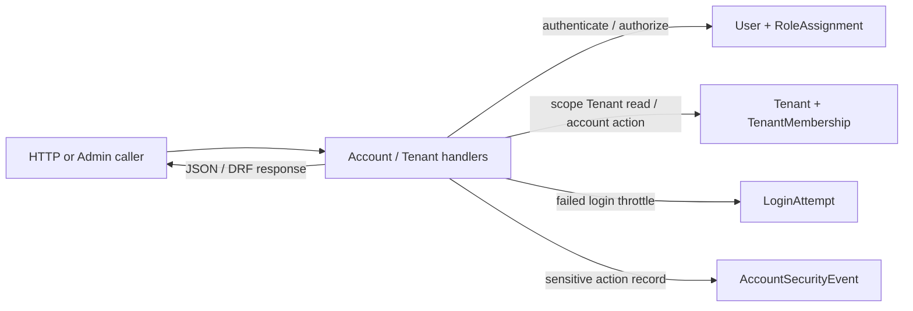

# 01 — Data Flow

## 0. Verification header

- Repository/worktree: `D:/VIRMS`, dirty `staging`; reviewed 2026-10-19. Tracked documentation HEAD: `b4a40772edec567297e96d72bf037df73ea0cae6`. The local Django foundation and these maps are untracked, so HEAD does not attest to their contents.
- **CURRENT APPROVED/TARGET:** `/docs-final-v2/` is the current intended V2 business architecture for these maps, established by the user's explicit 2026-10-19 direction and reinforced by `docs-final-v2/01` calling `/docs-final/` a previous baseline. V2 still labels itself draft and leaves specific business decisions open; this map does not claim every V2 action is ready to implement.
- **CURRENT IMPLEMENTED:** source-inspected Django account/Tenant foundation only. **HISTORICAL / SUPERSEDED:** `/docs-final/` V1 model and non-authoritative `/docs-legacy/`. **PROPOSED:** no additional model is introduced here.
- **UNVERIFIED:** test execution, applied PostgreSQL migrations, live API, runtime, deployment and previous production data. **BUSINESS DECISION REQUIRED:** the V2 items listed below. Repo governance files still point to V1; see [03](03-ARCHITECTURE-CONFLICT-MAP.md).

## 1. Architecture state classification

| State | Meaning here | Evidence boundary |
|---|---|---|
| CURRENT IMPLEMENTED | Local User, role, Tenant membership, login-attempt and account-security source paths | `apps/accounts/`, `apps/tenants/`, `core/`; untracked, source inspected only |
| CURRENT APPROVED/TARGET | Intended V2 Platform → Company/Tenant → Branch architecture and its defined workflows | User direction; `docs-final-v2/01`–`10` and `supporting/`; open decisions remain explicit |
| HISTORICAL / SUPERSEDED | V1 Garage=Tenant, global Investor/Fund, per-deal Owner distribution and formula Loss; older legacy material | `/docs-final/`, `/docs-legacy/`; historical documentation, not current target |
| PROPOSED | Optional future changes outside V2 | None asserted by this map |
| UNVERIFIED | Applied schema, live rows, deployed behavior and historical transactions | No database/runtime/deployment check in this task |
| BUSINESS DECISION REQUIRED | V2 has insufficient meaning for specific payout, Loss, correction, distribution and access actions | V2's explicit open items; see section 9 and [03](03-ARCHITECTURE-CONFLICT-MAP.md) |

## 2. Current implemented data flow — one view

These are local ORM models and migration definitions, not verified applied tables. `Tenant` is a generic implemented entity; code does not establish the V2 Company/Branch model. No Branch, module-state, Investor, Fund, Stock Vehicle, Garage Job, Company Accounting, Owner Distribution or React data flow exists in inspected source. A private S3-compatible storage adapter exists without a Vehicle image workflow.

## 3. Ownership and source-of-truth matrix

| Data | Scope / identity | Authoritative writer and consumers | History / status |
|---|---|---|---|
| User and RoleAssignment | Global UUID User; effective role rows | Current provision/Admin writes; auth and protected handlers read | CURRENT IMPLEMENTED, source inspected; Admin delete denied; deployed state UNVERIFIED |
| Tenant and TenantMembership | UUID Tenant; effective User membership | Current provision/Admin writes; Tenant list/detail scopes reads | CURRENT IMPLEMENTED, source inspected; no Branch assignment or module gate |
| LoginAttempt and AccountSecurityEvent | Login key or actor/subject reference | Current auth/account views; security evidence only | CURRENT IMPLEMENTED, source inspected; not a business ledger |
| Platform, Company/Tenant and Branch | Company is hard isolation/financial owner; Branch is operational attribution inside Company | Platform administration, Company/Branch scoped operations and reports | CURRENT APPROVED/TARGET; Branch and V2 Company membership semantics not implemented |
| Company module state and protected configuration | Versioned Company/module state; Platform-protected rates and recipient splits | Platform Back Office changes; enabled/action checks and effective snapshots consume | CURRENT APPROVED/TARGET; no model/handler; module-OFF minimum settlement actions BDR |
| Investor and principal Fund | Investor relationship and one auditable Fund **within a Company**, shared across its Branches | Investment source movements; Stock Vehicle use/recovery and Investor views | CURRENT APPROVED/TARGET; no current model; never merge Funds across Companies by name |
| Stock Vehicle, movement, funded costs | Stable Company Vehicle UUID; one Investor; current Branch and movement history | Investment/Garage source records; Sale, Finance, Media consume | CURRENT APPROVED/TARGET; no current model |
| External customer Vehicle and Garage Job | Stable Company Vehicle/Job identity; no Investor required | Garage owns work/charge/history; Accounting links receipt/revenue | CURRENT APPROVED/TARGET; no current model; Investment may be OFF |
| Buyer, Stock Sale, receipt/refund | Company-consistent Buyer/Sale and individual actual Buyer events | Sale/collection source; Investor recovery, Company result and settlement consume | CURRENT APPROVED/TARGET; no current model |
| Company Running Capital | Exact actual Company contribution and separate recovery linked to one Vehicle | Company Accounting owns Company money; Investment references source without duplicate economic effect | CURRENT APPROVED/TARGET; no current model |
| Company Accounting, Company Share and Owner Distribution | One Company financial backbone across Branches; period distribution from confirmed distributable Profit | Actual classified Company records; source-linked Investment/Garage events; Owner payments | CURRENT APPROVED/TARGET; no current model; distributable basis BDR |
| Interim Payout, Investor reconciliation, Loss, settlement | Company Investor relationship; actual confirmed events distinct from suggestions | Investment and Accounting source history, linked corrections and current positions | CURRENT APPROVED/TARGET; no current model; interim basis, period mapping and manual Loss BDR |
| Image and publication | Vehicle/Company/Branch context; private original and public-safe projection | Media metadata in PostgreSQL, R2 bytes through adapter when built | CURRENT APPROVED/TARGET; storage adapter only |

Reports, dashboard, UI cache and Owner AI are derived consumers, never independent financial sources. V2's one Company receipt or cost may appear in Investment, Garage and Accounting views but must retain one source identity and one economic effect.

## 4. Relationships, versioning and boundaries

- **Implemented:** User→RoleAssignment and User→TenantMembership are effective rows; local constraints allow only one open row per User/role and User/Tenant. Tenant list/detail filters active Tenant membership. Neither a Tenant UUID nor a global role alone grants access. No current Branch assignment or module enablement model exists.
- **V2 target:** Platform→multiple isolated Companies/Tenants→Branches. A Company has one consolidated Accounting boundary; a Branch is not another Tenant or ledger owner. A Company-scoped Investor may fund many Stock Vehicles within that Company; each funded Stock Vehicle has exactly one Investor. An external customer Garage Vehicle needs no Investor.
- **V2 target:** a Stock Vehicle keeps one identity through Branch moves; prior Job/Expense/financial source Branch attribution remains historical. Stock Sale, Buyer and actual Buyer receipt/refund are Company-consistent and separately linked. Investment and Garage source events feed Company Accounting by reference, not duplicate posting.
- **V2 target:** effective Investor positive-share agreements, monthly rates, module state and Owner recipient configuration have version/history. Completed positive Vehicle and confirmed Company distribution positions retain applicable snapshots. Finalized money facts use linked correction/reversal/adjustment; derived balances are rebuildable.
- **HISTORICAL / SUPERSEDED:** V1's Garage=Tenant, global cross-Garage Investor Fund, per-deal Owner Pool and percentage-derived Owner Loss contribution do not define V2 data ownership.

## 5. Source-to-consumer workflows

| Workflow | Authoritative source and effect | Consumer and gate | State |
|---|---|---|---|
| Account provision / Tenant context | Local atomic User, RoleAssignment, TenantMembership and AccountSecurityEvent; session and LoginAttempt flows | `/auth/me/`, membership-scoped Tenant API; no React consumer | CURRENT IMPLEMENTED, source inspected; live behavior UNVERIFIED |
| Company/Branch and module context | Explicit Company/Branch assignments and versioned module state; no ID grants access | Every protected API, report, export, media and job | CURRENT APPROVED/TARGET; implementation gap |
| Stock Vehicle funding and Garage work | Investor Fund actual use and/or exact Company Running Capital actual contribution; Garage Job work/cost source counted once | Vehicle cost, Company Accounting, Sale and authorized views | CURRENT APPROVED/TARGET; implementation gap |
| External customer Garage Job | Customer charge and separately confirmed receipt with Branch attribution | Company Garage Revenue/receivable; no Investor Fund effect | CURRENT APPROVED/TARGET; implementation gap |
| Sale and positive Vehicle result | Agreed Sale plus bounded actual Buyer receipts/refunds; full collection; Investor principal then actual Company capital recovery; effective Investor positive share and Company Share | Investor Profit, Company Accounting, settlement; Company Share is not direct Owner payout | CURRENT APPROVED/TARGET; implementation gap |
| Company result and Owner distribution | Classified Company sources → confirmed distributable amount → versioned recipient split → separate actual payments | Half-yearly/Annual Company Owner view | CURRENT APPROVED/TARGET; distributable base/close BDR |
| Monthly Investor cycle and reconciliation | Effective monthly rate/day and eligible principal; Due/Suggested separate from actual interim payment | Six-month/annual earned-Profit reconciliation and recoverable/payable | CURRENT APPROVED/TARGET; eligible basis, withdrawal and deal-period mapping BDR |
| Manual Loss and corrections | Negative indicator only until authorized manual decision; actual impacts/events and linked history | Company/Investor positions and settlement | CURRENT APPROVED/TARGET; exact impact and confirmation actor BDR |

V2 automation distinguishes deterministic calculation, editable suggestion, due/reminder, specifically authorized human confirmation, and manual exceptional handling. Only actual confirmed money events change financial truth. No V2 financial transaction/service/table is present locally; exact future persistence and endpoint names are **UNVERIFIED**.

## 6. Data integrity, retention and historical delta

V2 target invariants: hard Company isolation; Branch scope and provenance; one Investor per funded Stock Vehicle but none required for external customer work; no silent Investor Fund overdraft; Company Running Capital separate from Investor principal and Profit; a receipt/cost counted once across module views; fixed-precision INR and two-place `ROUND_HALF_UP`; balanced paise reconciliation for **Company-level positive Owner Distribution**; no automatic negative-result Loss allocation; bounded positive actual payments; immutable confirmed history; no settlement from a calculation, suggestion, reminder or status alone. Locked V1 Loss and per-deal Owner algorithms are historical and must not be run for new V2 activity.

Current Django Admin denies delete of User, RoleAssignment, Tenant and TenantMembership. Other source, database and deployed retention behavior is **UNVERIFIED**. V2 target retains finalized Sale, Fund, Company, Job, distribution, Branch-movement, configuration and correction history. Controlled Company merge preserves Source/Target UUIDs and original Company/Branch financial provenance; it does not repost money. V2 text asserts no production V1 cutover is needed, but actual production history was not inspected, so that factual premise remains **UNVERIFIED**.

## 7. Risks and change entry points

- `DATA-RISK-001` **A before V2 finance work:** importing V1 global Fund, per-deal Owner payout or percentage Loss into V2 would change money ownership and outcomes. See `CONFLICT-003` in [03](03-ARCHITECTURE-CONFLICT-MAP.md).
- `DATA-RISK-002` **A before Company/Branch work:** existing Tenant membership lacks Branch/module scope. Treat it as an implementation gap, not proof that Garage remains the target Tenant. See `CONFLICT-002`.
- `DATA-RISK-003` **B:** migrations and backend source are untracked; applied schema/live historical data are **UNVERIFIED**. No data cutover strategy is inferred. See `CONFLICT-005`.
- Re-review on Company/Branch identity or access changes, Investor Fund and Running Capital movement, Job/Sale/accounting source linkage, module OFF, payment or correction semantics, historical snapshots, public media and settlement.

## 8. Remaining decisions and evidence

**BUSINESS DECISION REQUIRED:** monthly eligible-principal basis and active-cycle withdrawal constraints; which deals belong in a reconciliation period and how ordinary deal Profit coexists with interim/periodic payments; exact manual Loss impact on Investor principal and Company money plus confirmation authority; Company distributable-Profit base, recognition and period close/carryforward; Company-level cross-Branch correction authority; Platform support private-finance read outside explicit Company assignment; minimum settlement actions while a module is OFF. These gaps block only the affected V2 behavior, not the description of V2 as current target.

Evidence: `docs-final-v2/01-business-rules.md`, `02-user-roles-permissions.md`, `03-system-modules.md`, `04-data-model-relationships.md`, `05-vehicle-investor-finance-workflow.md`, `06-technical-architecture-engineering-operations.md`, `07-ui-navigation-structure.md`, `08-image-file-architecture.md`, `09-company-accounting-owner-distribution.md`, `10-garage-jobs-workflow.md`, and V2 `supporting/`; current account/Tenant models, migrations, views, admin, tests and `core/`; historical `/docs-final/`, `/docs-legacy/` and Git documentation commits. `AGENTS.md`, README, `/system-design/00` and old `/architecture/00` still state V1-only authority; this is recorded as stale governance text in [03](03-ARCHITECTURE-CONFLICT-MAP.md) and was not changed. Source inspected; tests/database/runtime/deployment not verified.
