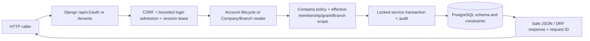

# 02 — API Flow

> Local safety correction 2026-11-19: Vehicle financial-position confirmation returns `INVESTOR_AGREEMENT_SNAPSHOT_MISSING` for Investor-funded expense sources without a matching Purchase Investor snapshot. The position also displays that review status and does not mark an earlier confirmation current. Existing source and Accounting history is retained; this response does not resolve or reverse historical Company Share recognition.

> Phase 8 Loss confirmation: `POST /vehicle-management/vehicles/{vehicle_id}/financial-position/confirm/` requires the current source version, reason and explicit nonnegative `investor_loss_amount` / `company_loss_amount` when the result is negative. The Company-level Accountant may edit the agreement-based suggestion; the two impacts must equal the Vehicle Loss. A positive or break-even result rejects Loss-specific amounts. Source calculation and final signed impacts are retained separately; this confirmation does not debit Fund or move cash.

> Phase 8 Exit notice: Company Accountant `GET /investment/investors/{investor_id}/exit-requests/` lists paginated request notices; `POST /investment/investors/{investor_id}/exit-requests/{exit_id}/notice-extensions/` requires an idempotency key, later deadline and reason. Both are same-Company scoped; the POST requires Investment ON and never posts cash. The bound Investor's existing self response adds the current and initial notice deadline plus extension history. Dates are based on the recorded UTC request instant. Final settlement remains unimplemented.

> Exit cancellation review: the Company Accountant review UI reads the existing paginated request history, displays the Investor's pending reason, and conditionally invokes `POST /investment/investors/{investor_id}/exit-requests/{exit_id}/cancellation-review/` with an idempotency key and explicit approve/reject choice. Backend same-Company authority and Investment/Investor Portal module checks remain authoritative. Successful approval returns `CANCELLED`; rejection returns `REQUESTED`; neither posts cash.

> Phase 1 corrections candidate after `cac26195`: `/auth/me` retains its existing aggregate `roles` fields and adds `company_wide_roles` per Company and `roles` per returned Branch. These describe effective self context; the aggregate is not a Branch permission. Platform `back_office` remains a separate top-level role, not a Company grant. Business Company/Branch reads continue to use their existing authorization policy. See [the execution report](../docs/phase1-execution-progress.md).

> Earlier candidate snapshot — 2026-11-01: identifier admission, scoped account lifecycle and bounded Branch summaries passed 172/172 on disposable PostgreSQL 15.19 before the subsequent B1/B2/B3 corrections. Current correction status and the final 199-test result are in [the execution report](../docs/phase1-execution-progress.md). Live/staging HTTP remains unverified; the legacy migration cutover still requires the documented writer pause.

> Correction audit: current scoped lifecycle, same-row temporal authorization, bounded uniform login admission, safe required lifecycle reasons and audit Branch scope are recorded in [docs/phase1-audit-corrections.md](../docs/phase1-audit-corrections.md). Earlier completion/test-count statements below are historical snapshots.

> HISTORICAL SNAPSHOT — 2026-11-02. This Phase 1/2 integration note describes the state at that time; see the Phase 3 checkpoint below for current branch status.

> Local integration state — 2026-11-02: `codex/audit` now includes the accepted Phase 1 API source and Phase 2 React consumer, including P2-13–P2-22 role-navigation and mock-data boundary corrections. React uses session/CSRF/password endpoints and bounded `/auth/me/` Company/Branch context. A typed Branch-list hook exists but no mock Garage filter calls it. No business API or `/api/mock` caller was added. Phase 1 account/tenant suite passed 210/210 on disposable PostgreSQL; Phase 2 passed 74/74 React tests, configured lint/build, and isolated browser acceptance. Remote branch remains at the earlier `f266803acd5e86caa2286fb8eae41df6cadfcb86` until separately authorized push; staging and production were not changed or verified. Roadmap Phase 3 is Main Operations Foundation (not started); Garage is Phase 6 after Phases 4 and 5. See [roadmap](../planning/V2-DEVELOPMENT-ROADMAP.md) and [Phase 2 report](../docs/phase2-execution-progress.md).

> Phase 3 implementation checkpoint — 2026-11-03: the Company-scoped module-state metadata read, scoped Platform Admin configuration path, and React shared query are implemented. Commit 73797b16aa35db776b5601fe1483c2be8de6c100 is pushed to origin/codex/audit; local and fetched remote heads matched. Django 232/232 and React 89/89 tests plus lint/build/system/migration checks passed locally. GitHub status/run lists were empty. Staging/production HTTP and PostgreSQL runtime-role grants remain UNVERIFIED.

## 2026-10-31 verified Phase 1 state

One normal Company User UUID belongs to one Company. Another Company uses a separate account UUID with independent credentials and authorization. Global `login_id` and email uniqueness are locked; login has no Company selector. Provisioning, reset/status, revoke and scoped Company/Branch reads now use Company membership and the applicable scoped policy; cross-Company targets are hidden or denied. These are source and disposable-PostgreSQL test results, not staging/production runtime evidence.

## Historical 2026-10-31 implementation snapshot

The dated 2026-10-19 route inventory below is a historical baseline. Current routes cover CSRF/login/logout/me/password change, Company-scoped account provisioning/reset/status/revoke, Company list/detail and scoped Branch list/detail, Django Admin adapters, and liveness/readiness. All prior legacy business-role authorization was removed from ordinary account lifecycle paths; explicit Platform technical/bootstrap boundaries remain. The current request inventory and classifications are in `docs/phase1-execution-progress.md`. Final source/tests ran on disposable PostgreSQL; live/staging HTTP behavior remains unverified.

## 0. Historical verification header — 2026-10-19 baseline

- Repository/worktree: `D:/VIRMS`, dirty `staging`; reviewed 2026-10-19. Tracked documentation HEAD `b4a40772edec567297e96d72bf037df73ea0cae6`; current Django code is local and untracked.
- **CURRENT APPROVED/TARGET:** V2 in `/docs-final-v2/` per explicit user direction; its unresolved business decisions remain open. **CURRENT IMPLEMENTED:** account/Tenant routes inspected in source. **HISTORICAL / SUPERSEDED:** V1 `/docs-final/` and `/docs-legacy/`. **PROPOSED:** no new exact endpoint is declared here.
- **UNVERIFIED:** tests run, live HTTP, applied database, frontend, staging/production. **BUSINESS DECISION REQUIRED:** exact affected V2 actions noted below. Governance files now use the V2 authority model; V1-derived System Design remains historicalized and unreconciled. See [03](03-ARCHITECTURE-CONFLICT-MAP.md).

## 1. Architecture state classification and purpose

The current API surface contains the **Phase 1 account/scope foundation, Phase 3 Company module-state metadata read, and Phase 4 Company Accounting resources**; it is not the full V2 product contract. Authentication, provisioning/lifecycle, Company/Branch reads, Django Admin adapters, operational probes, and Phase 4 Accounting flows have local disposable-PostgreSQL/test evidence. Staging/production API behavior and deployment remain unverified. Vehicle/Investment, Garage, Sales, media, and other operational business APIs remain future work. System Design's V1 representative API paths are **HISTORICAL / SUPERSEDED technical target**, not current V2 endpoints.

## 2. Current source-inspected request flow — one view

The Phase 1 schema, migrations and runtime-role checks and the Phase 3 module-state schema/API/Admin tests were exercised on disposable PostgreSQL; no shared database or deployed API was used. Phase 2 called session/authentication and self-context routes. Phase 3 adds a Company module-state metadata read and React query consumer. There is still no Investor/Vehicle/Job/Accounting handler, public catalog or financial command. A private S3-compatible storage class is not an upload API.

## 3. Current route and action registry

| Exact source route | Purpose class | Current source behavior and consumer | State |
|---|---|---|---|
| `GET /api/v1/auth/csrf/` | CONTEXT SETUP | Set CSRF cookie; JSON detail; test/browser prerequisite | CURRENT IMPLEMENTED, source inspected |
| `POST /api/v1/auth/login/` | MUTATION | CSRF, Login ID/password, hashed-key failure throttle; Django session | CURRENT IMPLEMENTED, source inspected |
| `POST /api/v1/auth/logout/` | MUTATION | CSRF and session clear | CURRENT IMPLEMENTED, source inspected |
| `GET /api/v1/auth/me/` | AUTHORITATIVE READ / CONTEXT | Active User UUID, globally unique Login ID, effective Company roles/grants, Company/Branch context and password-change flag | Phase 1 tests passed; live runtime UNVERIFIED |
| `POST /api/v1/auth/password/change/` | MUTATION | Locked User and session lease; current password/new validation; hash/epoch/audit transaction; preserves current session and revokes others | Phase 1 tests passed |
| `POST /api/v1/auth/accounts/provision/` | MUTATION | Company-scoped policy; generates a new User UUID and temporary credential; atomically creates one Company membership and scoped role grant | Phase 1 tests passed |
| `POST /api/v1/auth/accounts/<uuid:user_id>/reset/` | MUTATION | Exact UUID target; Company-scoped lifecycle authorization; temporary credential, epoch/session revocation and audit | Phase 1 tests passed |
| `POST /api/v1/auth/accounts/<uuid:user_id>/status/` | MUTATION | Exact UUID target; Company-scoped activate/deactivate; deactivation does not erase history | Phase 1 tests passed |
| `POST /api/v1/auth/accounts/<uuid:user_id>/revoke/` | MUTATION | Exact UUID target; scoped session revocation and auth-epoch change | Phase 1 tests passed |
| `GET /api/v1/tenants/`, `GET /api/v1/tenants/<uuid:pk>/` | AUTHORITATIVE READ | Active Company membership and effective readable grant; paginated Company summary | Phase 1 tests and query-bound audit passed |
| `GET /api/v1/tenants/<uuid:company_id>/branches/`, detail | AUTHORITATIVE READ | Effective same-Company BranchAssignment intersected with Company read grant; paginated summary | Phase 1 tests, query-bound and EXPLAIN audit passed |
| `GET /api/v1/tenants/<uuid:company_id>/module-state/` | COMPANY-SCOPED METADATA READ | `IsAuthenticated` + `visible_companies`; fixed 14-code projection, latest revision or `unconfigured`; rejects query parameters and is private/no-store | Implemented; backend tests passed on disposable PostgreSQL |
| `/admin/tenants/companymodulestate/configure/` (GET/POST) | ADMINISTRATIVE CONFIGURATION | Managed-Company scoped form; Platform action policy; expected-version command; immutable revision + same-transaction audit | Implemented; Admin tests passed on disposable PostgreSQL |
| `/admin/`, `/admin/password_change/` | ADMINISTRATIVE UI | Scoped Company adapters; generic credential/role/membership mutation blocked; safe one-time temporary credential path | Admin/API parity and bypass tests passed |
| `GET /health/live/`, `GET /health/ready/` | OPERATIONS PROBE | Liveness and migration-aware readiness; safe request correlation | Phase 1 tests passed |

Source: `core/urls.py`, `apps/accounts/urls.py`, `apps/tenants/urls.py`, handlers, policy/service layers, migrations and tests. There is no route for public signup/JWT, Investor/Fund, Stock Vehicle, external Garage Job, Sale, Company Accounting, interim payment, Owner Distribution, media or public catalog. The module-state endpoint returns configuration metadata only and does not authorize any business mutation. No observed production request trace supports calling any current request redundant/duplicate.

## 4. Current execution, authorization and failure

`login_view` applies bounded request and source/identifier admission, canonicalizes the globally unique Login ID, authenticates and issues a locked User epoch plus a key-hashed server-side session lease. `ActiveAccountMiddleware` blocks inactive or stale sessions and restricts first-login Users to auth/password routes. `/auth/me/` returns bounded Company/Branch context. Unsafe browser requests use CSRF enforcement; DRF defaults to `DenyByDefault` and views require authentication. Ordinary lifecycle handlers use the Company-scoped policy and exact target UUID; the legacy global business role by itself grants no reset/status authority.

Provision validates the requested Company/role/Branch and uses the current command/policy service; user UUID, membership and scoped grant are committed atomically. Reset/status/revoke lock the exact account and authorize the actor inside the target Company. A Company account cannot be attached to a second Company; independent accounts cannot be found by matching name/email. Company/Branch list selectors filter before serialization and paginate at 20 rows; 1→25-row fixture growth kept Company reads at 6 queries and Branch reads at 8. Error handling returns safe codes and request IDs while preserving `Retry-After` on throttling. Deployed proxy behavior remains **UNVERIFIED**.

Current successful mutation → transaction-scoped model/security-event write → JSON response; credential-reset responses are no-store and temporary credentials are not logged or audited. React uses in-memory TanStack Query for auth/Company context and the new module-state metadata query; business records remain mock-backed. The backend has no queue/job producer, consumer, dead-letter or async financial event route. Provisioning has a UUID-keyed operation/idempotency guard where supported; password/lifecycle and module-state writes are transaction-locked. Phase 1/2 evidence is in their execution reports; Phase 3 source/test status is recorded in the Phase 3 architecture checkpoint.

## 5. V2 target request/action flow — not current endpoints

The target boundary is: authenticated User → Company membership → relevant Branch assignment → module ON or explicit historical/open-obligation exception → role/action permission → resource/object/field scope → server validation → authoritative operation → source event and linked Accounting/Investment/Garage reference as applicable → committed response → authorized UI refresh. A Company, Branch, Investor, Vehicle or Job ID never grants access. Platform protected-rate mutation and Accountant actual financial confirmation are separate actions. Public Vehicle access uses a dedicated safe response; Media/Investor/Owner views have their V2 field and mutation limits.

| V2 action family | Backend owner and real effect | Consumer/status |
|---|---|---|
| Company, Branch, membership and module administration | Platform control plane; effective access/module history; module OFF denies ordinary new work but retains authorized history and minimum settlement actions | CURRENT APPROVED/TARGET; no handler; minimum OFF actions BDR |
| Investment and funded Stock Vehicle | Company Investor/Fund, one Investor per Stock Vehicle, Branch provenance, actual Investor capital use and distinct Company Running Capital | CURRENT APPROVED/TARGET; no handler |
| Garage Job and external customer work | Garage source Job/charge/receipt with Company/Branch scope; external Vehicle needs no Investor; Accounting references revenue once | CURRENT APPROVED/TARGET; no handler |
| Sale, Buyer payment/refund and positive result | Bounded actual collection, full-collection gate, Investor capital then exact Company capital reconciliation, Investor Share and Company Share; no direct per-deal Owner payout | CURRENT APPROVED/TARGET; no handler |
| Monthly interim, Investor reconciliation and settlement | Configured cycle; Due/Suggested separate from confirmed Paid; six-month/annual reconciliation; normal eligible deal Profit before Exit; final principal then remaining Profit | CURRENT APPROVED/TARGET; no handler; interim basis/period mapping BDR |
| Company Accounting and Owner Distribution | Source-linked Company records; confirmed distributable amount and period; balanced-paise Company-level recipient allocation; actual individual payments | CURRENT APPROVED/TARGET; no handler; distributable basis BDR |
| Manual Loss/correction | Negative indicator has no automatic allocation/posting; specifically authorized manual impact and linked actual events | CURRENT APPROVED/TARGET; no handler; impact/actor/cross-Branch correction BDR |
| Media/public | Vehicle Company/Branch scope, four-active-image limit, private original/R2 and safe publication projection | CURRENT APPROVED/TARGET; storage adapter only |

No exact URL, serializer field, job name, service class or idempotency key is invented for these target actions. V2's five automation levels mean calculation, editable suggestion and due/reminder do **not** return a Paid or Settled fact. Only a specifically authorized human-confirmed event does. Critical money actions must be atomic, bounded, concurrent/retry-safe and source-linked; current code has not implemented those paths.

## 6. Consumer, compatibility and historical API map

| Contract | Current consumer | Target compatibility concern | Status |
|---|---|---|---|
| Session/CSRF and account/Tenant routes | Phase 1 local tests plus Phase 2 candidate browser integration for session, `/auth/me/` and bounded Company/Branch context | V2 Company/Branch/module context must not treat a UI role or Branch selector as authority | CURRENT IMPLEMENTED candidate; deployed consumer UNVERIFIED |
| Financial, Garage, Company and public routes | None in source | Design from V2 target and explicit permission/BDR; do not copy V1 representative routes as authority | CURRENT APPROVED/TARGET, implementation gap |
| V1 System Design API examples | No known deployed caller | Historical/superseded target; may conflict with V2 Company/Branch/Accounting model | HISTORICAL / SUPERSEDED for business shape |

Git history proves a V1 documentation freeze followed by V2 draft commits, not a previous deployed API. `docs-legacy/` is historical text, not deployed behavior. README reports starter removal, but previous app code/released consumers are **UNVERIFIED**. No generated OpenAPI/schema file was found; no frontend request waterfall, duplicate call or N+1 finding was established. A future contract change requires enumeration of actual callers, auth/field assumptions and migration need from evidence.

## 7. Conflicts, decisions, risks and evidence

- `API-RISK-001` **A before V2 scope work:** Phase 3 adds no business-operation endpoints yet. New handlers must enforce approved Company, Branch, module, action and object/field scope; the existing account/tenant and module-state foundations do not prove those business controls; see `CONFLICT-002` in [03](03-ARCHITECTURE-CONFLICT-MAP.md).
- `API-RISK-002` **A before affected finance actions:** monthly eligible basis, manual Loss actor/impact, Company distributable amount and OFF-module settlement action are **BUSINESS DECISION REQUIRED**. No handler should infer them from V1.
- `API-RISK-003` **B:** source is tracked and Phase 3 is pushed at 73797b16; local suites and disposable-PostgreSQL checks are documented. Deployed HTTP/database state and actual staging/production runtime-role grants remain **UNVERIFIED**. Do not claim end-to-end API verification.

Authority model: explicit project direction and V2's cross-document statement establish V2 as **CURRENT APPROVED/TARGET architecture**, while V2's own open items remain unresolved. `AGENTS.md`, README and older governance documents now distinguish target from implementation and history. System Design bodies are V1-derived and historicalized, not reconciled as V2 contracts. Evidence: all 13 V2 documents (especially 01/02/04/05/06/09/10 and supporting authentication); current URL/handler/model/settings/test files; historical V1/System Design and Git documentation commits. **CURRENT IMPLEMENTED** means source is tracked and inspected; relevant local tests and disposable-database checks are documented above. Live API, persistent/deployed database, and deployment remain **UNVERIFIED**. **PROPOSED** extra endpoint families: none.

## Current V2 Business Decision Additions Referenced

- Canonical decisions: [02 — User Roles and Permissions](../docs-final-v2/02-user-roles-permissions.md#approved-business-decision-additions) and [09 — Company Accounting](../docs-final-v2/09-company-accounting-owner-distribution.md#approved-business-decision-additions).
- Technical impact: any future Accounting handler must enforce the Accounting-specific Company/Branch action boundary and keep Income/Expense reads distinct from actual Receipt/Payment movements. No existing API contract is changed or implemented by this reference.

## Current V2 Business Decision Additions Referenced — 2026-11-03

- Current decisions: [01 — Business Rules](../docs-final-v2/01-business-rules.md#approved-business-decision-additions), [02 — User Roles and Permissions](../docs-final-v2/02-user-roles-permissions.md#approved-business-decision-additions), [04 — Data Model Relationships](../docs-final-v2/04-data-model-relationships.md#approved-business-decision-additions), and [09 — Company Accounting](../docs-final-v2/09-company-accounting-owner-distribution.md#approved-business-decision-additions).
- Technical impact: Accounting OFF commands need an explicit pre-existing-obligation check; report filters use Asia/Kolkata period boundaries; opening movements accept either sign; any test-time editable inputs remain Income/Expense records and the result is derived.
- These are future API contract requirements only; they do not implement or change a route, API, schema, or permission in the current repository.

## Current V2 Business Decision Additions Referenced — Phase 4 read and permission contract

- Canonical additions: [02 — User Roles and Permissions](../docs-final-v2/02-user-roles-permissions.md#approved-business-decision-additions), [04 — Data Model Relationships](../docs-final-v2/04-data-model-relationships.md#approved-business-decision-additions), and [09 — Company Accounting](../docs-final-v2/09-company-accounting-owner-distribution.md#approved-business-decision-additions).
- Technical impact: future Accounting Result is a scoped read-only projection over committed Income/Expense records; zero Opening Balance is rejected without posting; Owner mutation is denied. These references implement no route or API.
- Accounting cross-Branch correction is resolved only for Company-level Accountants in the same Company; no other module receives this permission.
- In the older target-status table, the cross-Branch correction part of the Manual Loss/correction BDR row is superseded for Phase 4 Accounting by the canonical Company-level Accountant rule. Manual Loss actor/impact and non-Accounting correction scope remain BDR/default-deny.

## Current V2 Business Decision Additions Referenced — Phase 4 cash event API rules

- Canonical decisions: [01 — Business Rules](../docs-final-v2/01-business-rules.md#approved-business-decision-additions), [04 — Data Model Relationships](../docs-final-v2/04-data-model-relationships.md#approved-business-decision-additions), and [09 — Company Accounting](../docs-final-v2/09-company-accounting-owner-distribution.md#approved-business-decision-additions).
- Technical impact: add separate typed Receipt/Payment correction contracts and application-only reallocation; accept signed nonzero Opening Balance; reject future actual Receipt/Payment/Transfer. These are target contracts only; no current API is implemented.

## Current V2 Business Decision Additions Referenced — Phase 4 correction and archive API rules

- Canonical decisions: [02 — User Roles and Permissions](../docs-final-v2/02-user-roles-permissions.md#approved-business-decision-additions), [04 — Data Model Relationships](../docs-final-v2/04-data-model-relationships.md#approved-business-decision-additions), and [09 — Company Accounting](../docs-final-v2/09-company-accounting-owner-distribution.md#approved-business-decision-additions).
- Technical impact: every supported correction request must declare reversal-only or reversal-and-replacement, enforce same-kind and Branch scope, and fail closed for post-OFF root records. Account archive requires both zero derived balance and no historical event/movement. These are proposed Phase 4 contracts, not current endpoints or behavior.

## Phase 4 API implementation checkpoint — 2026-11-03

**VERIFIED FROM REPOSITORY:** Django mounts Accounting resources under the Company-scoped `tenants/{company_id}/accounting/` prefix. Implemented resource families include branches, accounts/archive, categories/archive, events/detail/correction, Income, Expense, Receipt/correction, Payment/correction, Opening Balance/correction, Transfer/reversal/correction, application reallocation, and Accounting Result. DRF views parse contracts; domain services own validation, permission/module-state gates, transactions, idempotency, and response construction. React consumes these through the shared Accounting client/query layer.

Company/Branch scope and role checks are server-side. The tested local API is not evidence of staging/production deployment or production database grants. This checkpoint supersedes only preceding statements that these Phase 4 endpoint contracts remain proposed or unimplemented; earlier API history remains historical.

## Current V2 Business Decision Additions Referenced — Phase 4 OFF and correction request contracts

- Canonical decisions: [01 — Business Rules](../docs-final-v2/01-business-rules.md#approved-business-decision-additions), [02 — User Roles and Permissions](../docs-final-v2/02-user-roles-permissions.md#approved-business-decision-additions), [04 — Data Model Relationships](../docs-final-v2/04-data-model-relationships.md#approved-business-decision-additions), and [09 — Company Accounting](../docs-final-v2/09-company-accounting-owner-distribution.md#approved-business-decision-additions).
- Technical impact: preserve normal OFF settlement endpoints and create their event/movement/application atomically; apply revision-identity root eligibility only to correction/reallocation. A correction child may be its own target inside that atomic chain. Income/Expense replacement omits `effective_at`; Receipt/Payment and Transfer typed replacement may correct actual date; Opening Balance retains its original instant. No live API is claimed.

## Current V2 Business Decision Additions Referenced — Phase 5 Monthly Interim amount

- Canonical decisions: [02 — User Roles and Permissions](../docs-final-v2/02-user-roles-permissions.md#approved-business-decision-additions), [04 — Data Model Relationships](../docs-final-v2/04-data-model-relationships.md#approved-business-decision-additions), and [05 — Vehicle/Investor Finance Workflow](../docs-final-v2/05-vehicle-investor-finance-workflow.md#approved-business-decision-additions).
- Technical impact: any future API contract for setting the Investor Monthly Interim amount must scope the Investor to the actor's Company and authorize only a Company-level Accountant. No Phase 5 endpoint or API contract is asserted as implemented here.

## Current V2 Business Decision Additions Referenced — Interim advance as Paid

- Canonical decisions: [01 — Business Rules](../docs-final-v2/01-business-rules.md#approved-business-decision-additions), [04 — Data Model Relationships](../docs-final-v2/04-data-model-relationships.md#approved-business-decision-additions), and [05 — Vehicle/Investor Finance Workflow](../docs-final-v2/05-vehicle-investor-finance-workflow.md#approved-business-decision-additions).
- Technical impact: a future reconciliation read contract must return earned Profit separately from actual confirmed Interim payments shown as Paid. This reference defines no endpoint, API implementation, or unresolved period-allocation behavior.

## Current V2 Business Decision Additions Referenced — Phase 5 API contracts

- Canonical contracts and permission decisions: see the Phase 5 additions in [01](../docs-final-v2/01-business-rules.md#phase-5-approved-business-decision-additions--investor-fund-vehicle-periods-and-loss), [02](../docs-final-v2/02-user-roles-permissions.md#phase-5-approved-business-decision-additions--investor-and-vehicle-permissions), [04](../docs-final-v2/04-data-model-relationships.md#phase-5-approved-business-decision-additions--investment-and-vehicle-relationships), [05](../docs-final-v2/05-vehicle-investor-finance-workflow.md#phase-5-approved-business-decision-additions--fund-vehicle-investor-periods-and-exit), and [09](../docs-final-v2/09-company-accounting-owner-distribution.md#phase-5-approved-business-decision-additions--investment-source-linkage).
- Technical impact: implement module-specific resources with server-derived Company/Branch scope, idempotency and atomic typed Accounting links. A user-selected Branch is a requested target only. Purchase routes remain blocked until Q39 is resolved; there is no current Investment/Vehicle API.

## Phase 5 local API implementation checkpoint — 2026-11-07

This checkpoint supersedes only the prior statement above that no Investment/Vehicle API exists. Additive session-authenticated resources now live under `/api/v1/tenants/{company_id}/`:

- Investment: `GET/POST investors/`, `GET/PATCH investors/{investor_id}/`, `GET/POST investors/{investor_id}/interim-configurations/`, `GET/POST fund/credits/`, `GET fund/summary/`, and `GET/POST fund/principal-returns/`.
- Vehicle Management: `GET/POST vehicles/`, `GET/PATCH vehicles/{vehicle_id}/`, and `POST vehicles/{vehicle_id}/branch-movements/`.
- Consequential writes require an `Idempotency-Key`, enforce Company/action/Branch and module-state checks server-side, and commit domain records with typed Accounting capital events, movements, audit, and idempotency response atomically. Company Accountant and Branch Accountant scopes follow canonical V2 decisions; selected Branch is not authorization.

## Current V2 Business Decision Additions Referenced — seller payable scope

- Canonical decision: [05 — Vehicle/Investor Finance Workflow](../docs-final-v2/05-vehicle-investor-finance-workflow.md#approved-business-decision-additions).
- Technical impact: Q39 purchase timing is approved; purchase/installment endpoints remain unexposed until typed source/event/movement, correction, row-lock and migration contracts are reconciled. No lender finance or EMI endpoint is in Phase 5.

## Current V2 Business Decision Additions Referenced — purchase funding allocation timing

- Canonical decision: [05 — Vehicle/Investor Finance Workflow](../docs-final-v2/05-vehicle-investor-finance-workflow.md#approved-business-decision-additions).
- Technical impact: purchase creation must atomically record full Fund/Running Capital allocations at creation; seller installments separately create one Accounting event and movement each. No cash movement is emitted by an allocation.
- This is a target contract reference, not evidence that an endpoint is implemented or deployed.

## Current V2 Business Decision Additions Referenced — purchase correction after seller payment

- Canonical decision: [05 — Vehicle/Investor Finance Workflow](../docs-final-v2/05-vehicle-investor-finance-workflow.md#approved-business-decision-additions).
- API impact: reject a cost correction below cumulative actual installments until the linked actual seller refund is recorded in Accounting; do not accept a seller-credit placeholder.

## Current V2 Business Decision Additions Referenced — purchase correction source allocation

- Canonical decision: [05 — Vehicle/Investor Finance Workflow](../docs-final-v2/05-vehicle-investor-finance-workflow.md#approved-business-decision-additions).
- API impact: append proportional source adjustments and preserve the purchase's Fund FIFO attribution; reject ambiguous paise rounding until its deterministic rule is approved.

## Current V2 Business Decision Additions Referenced — purchase-source paise rounding

- Canonical decision: [05 — Vehicle/Investor Finance Workflow](../docs-final-v2/05-vehicle-investor-finance-workflow.md#approved-business-decision-additions).
- API impact: validate fixed-precision balanced-paise source totals using Fund-first tie-breaking; reject any request that cannot reconcile exactly.

## Current V2 Business Decision Additions Referenced — Company-wide automation approval

- Canonical decision: [01 — Business Rules](../docs-final-v2/01-business-rules.md#approved-business-decision-additions).
- API impact: backend reads/version-checks the Company-wide approval mode and authorizes each consequential action in its owning service; the UI control is not an authorization boundary. Toggle authority and pending-item transition behavior remain open.

## Current V2 Business Decision Additions Referenced — automation setting authority

- Canonical decision: [02 — User Roles and Permissions](../docs-final-v2/02-user-roles-permissions.md#approved-business-decision-additions).
- API impact: only a same-Company Company-level Accountant may change the Company-wide mode; Branch Accountants, Owners and Platform Back Office are denied.

## Current V2 Business Decision Additions Referenced — pending actions across automation mode changes

- Canonical decision: [01 — Business Rules](../docs-final-v2/01-business-rules.md#approved-business-decision-additions).
- API impact: never auto-execute or discard pending work on a mode toggle; approve/cancel remains a separate authorized action in the owning module.

## Current V2 Business Decision Additions Referenced — auto-posting in approval OFF mode

- Canonical decision: [01 — Business Rules](../docs-final-v2/01-business-rules.md#approved-business-decision-additions).
- API impact: bypass per-action confirmation only after the owning workflow's explicit automation policy and all normal permission/source checks pass.

## Current V2 Business Decision Additions Referenced — manual Purchase refund and correction

- Canonical decision: [05 — Vehicle/Investor Finance Workflow](../docs-final-v2/05-vehicle-investor-finance-workflow.md#approved-business-decision-additions).
- API impact: expose separate authorized manual commands for the actual seller refund and Purchase cost correction, with explicit typed links to the same Purchase; accept neither as an implicit side effect of the other.

## Current V2 Business Decision Additions Referenced — Sale form Save confirms Sold

- Canonical decision: [05 — Vehicle/Investor Finance Workflow](../docs-final-v2/05-vehicle-investor-finance-workflow.md#approved-business-decision-additions).
- API impact: successful creation through the existing Sale form's backend contract returns a confirmed Sale; Buyer Receipt creation remains a separate command and does not control Sold status.

## Current V2 Business Decision Additions Referenced — Buyer refund Branch scope

- Canonical decision: [02 — User Roles and Permissions](../docs-final-v2/02-user-roles-permissions.md#approved-business-decision-additions), [05 — Vehicle/Investor Finance Workflow](../docs-final-v2/05-vehicle-investor-finance-workflow.md#approved-business-decision-additions).
- API impact: authorize each refund against the linked Sale's Company and original Branch; Branch Accountants stay within their assigned Branch and Company-level Accountants stay within their Company.

## Current V2 Business Decision Additions Referenced — Sale and Buyer Receipt Branch scope

- Canonical decision: [02 — User Roles and Permissions](../docs-final-v2/02-user-roles-permissions.md#approved-business-decision-additions), [05 — Vehicle/Investor Finance Workflow](../docs-final-v2/05-vehicle-investor-finance-workflow.md#approved-business-decision-additions).
- API impact: Sale writes and Buyer Receipt commands authorize against server-derived Sale Company/Branch; do not trust client-supplied Branch values.

## Current V2 Business Decision Additions Referenced — Buyer Receipt while Vehicle Management is OFF

- Canonical decision: [01 — Business Rules](../docs-final-v2/01-business-rules.md#approved-business-decision-additions), [05 — Vehicle/Investor Finance Workflow](../docs-final-v2/05-vehicle-investor-finance-workflow.md#approved-business-decision-additions).
- API impact: require Vehicle Management and Accounting ON when writing a Buyer Receipt; module-OFF rejection must not emit an Accounting event or movement.

## Current V2 Business Decision Additions Referenced — Seller refund while Vehicle Management is OFF

- Canonical decision: [01 — Business Rules](../docs-final-v2/01-business-rules.md#approved-business-decision-additions), [05 — Vehicle/Investor Finance Workflow](../docs-final-v2/05-vehicle-investor-finance-workflow.md#approved-business-decision-additions).
- API impact: require Vehicle Management and Accounting ON for Seller refund writes; leave the Purchase/refund position untouched when rejected.

## Current V2 Business Decision Additions Referenced — Buyer refund while Vehicle Management is OFF

- Canonical decision: [01 — Business Rules](../docs-final-v2/01-business-rules.md#approved-business-decision-additions), [05 — Vehicle/Investor Finance Workflow](../docs-final-v2/05-vehicle-investor-finance-workflow.md#approved-business-decision-additions).
- API impact: require Vehicle Management and Accounting ON for actual Buyer refunds; reject without creating an Accounting event or movement otherwise.

## Current V2 Business Decision Additions Referenced — Purchase cost correction while Vehicle Management is OFF

- Canonical decision: [01 — Business Rules](../docs-final-v2/01-business-rules.md#approved-business-decision-additions), [05 — Vehicle/Investor Finance Workflow](../docs-final-v2/05-vehicle-investor-finance-workflow.md#approved-business-decision-additions).
- API impact: reject Purchase cost-correction commands while Vehicle Management is OFF without changing Purchase or funding-allocation state.

## Current V2 Business Decision Additions Referenced — Fund Credit correction while Investment is OFF

- Canonical decision: [01 — Business Rules](../docs-final-v2/01-business-rules.md#approved-business-decision-additions), [05 — Vehicle/Investor Finance Workflow](../docs-final-v2/05-vehicle-investor-finance-workflow.md#approved-business-decision-additions).
- API impact: reject Fund Credit attribution corrections while Investment is OFF; preserve the original credit and accounting source link.

## Current V2 Business Decision Additions Referenced — standalone unused-principal return while Investment is OFF

- Canonical decision: [01 — Business Rules](../docs-final-v2/01-business-rules.md#approved-business-decision-additions), [05 — Vehicle/Investor Finance Workflow](../docs-final-v2/05-vehicle-investor-finance-workflow.md#approved-business-decision-additions).
- API impact: reject standalone principal-return commands while Investment is OFF unless they belong to the separately approved pre-OFF Exit settlement path.

## Current V2 Business Decision Additions Referenced — Seller refund cap

- Canonical decision: [05 — Vehicle/Investor Finance Workflow](../docs-final-v2/05-vehicle-investor-finance-workflow.md#approved-business-decision-additions), [04 — Data Model Relationships](../docs-final-v2/04-data-model-relationships.md#approved-business-decision-additions).
- API impact: lock and recalculate net confirmed installments and actual refunds; reject excess atomically without partial Accounting posting.

## Current V2 Business Decision Additions Referenced — Purchase correction while Investment is OFF

- Canonical decision: [05 — Vehicle/Investor Finance Workflow](../docs-final-v2/05-vehicle-investor-finance-workflow.md#approved-business-decision-additions), [04 — Data Model Relationships](../docs-final-v2/04-data-model-relationships.md#approved-business-decision-additions).
- API impact: reject Purchase cost/allocation correction while Investment is OFF, with no partial writes; keep Q89 Vehicle Management and Q87/Q92 Seller refund guards.

## Current V2 Business Decision Additions Referenced — upward Purchase correction source split

- Canonical decision: [05 — Vehicle/Investor Finance Workflow](../docs-final-v2/05-vehicle-investor-finance-workflow.md#approved-business-decision-additions), [04 — Data Model Relationships](../docs-final-v2/04-data-model-relationships.md#approved-business-decision-additions).
- API impact: derive incremental source amounts from the original Purchase allocation, apply the Company shortfall rule, and enforce exact totals atomically.

## Current V2 Business Decision Additions Referenced — Phase 5 Q95–Q100

- Canonical decisions: [01 — Business Rules](../docs-final-v2/01-business-rules.md#approved-business-decision-additions), [02 — User Roles and Permissions](../docs-final-v2/02-user-roles-permissions.md#approved-business-decision-additions), [04 — Data Model Relationships](../docs-final-v2/04-data-model-relationships.md#approved-business-decision-additions), [05 — Vehicle/Investor Finance Workflow](../docs-final-v2/05-vehicle-investor-finance-workflow.md#approved-business-decision-additions), and [09 — Company Accounting](../docs-final-v2/09-company-accounting-owner-distribution.md#approved-business-decision-additions).
- API impact: enforce per-command module revisions and the Q85 Sale Branch permission on Sale corrections. Preserve the distinct Investment-OFF gates for Buyer Receipts versus refunds and create no Fund/Profit posting during source-derived recalculation.

## Current Phase 5 Technical Contract Referenced — Q101 Purchase installments

- Architecture decision: [Phase 5 Architecture](phase-05-investment-vehicle-running-capital/PHASE-05-INVESTMENT-VEHICLE-RUNNING-CAPITAL-ARCHITECTURE.md#approved-technical-contract-q101--purchase-installments-are-separate-linked-records).
- API impact: expose separate Purchase and installment operations; each installment links to one Purchase and one Accounting event, with payable revalidated from current source records.

## Current V2 Business Decision Addition Referenced — Q102 direct Vehicle expenses

- Canonical decisions: [01 — Business Rules](../docs-final-v2/01-business-rules.md#approved-business-decision-additions), [04 — Data Model Relationships](../docs-final-v2/04-data-model-relationships.md#approved-business-decision-additions), and [05 — Vehicle/Investor Finance Workflow](../docs-final-v2/05-vehicle-investor-finance-workflow.md#approved-business-decision-additions).
- API impact: keep Vehicle Expense and actual Accounting Payment as linked resources; support multiple valid partial payments under existing outstanding-balance rules, without duplicating Cash/Bank movements. Garage Job Expense API is deferred.

## Current V2 Business Decision Addition Referenced — Q103 Vehicle cost funding

- Canonical decisions: [01 — Business Rules](../docs-final-v2/01-business-rules.md#approved-business-decision-additions), [04 — Data Model Relationships](../docs-final-v2/04-data-model-relationships.md#approved-business-decision-additions), [05 — Vehicle/Investor Finance Workflow](../docs-final-v2/05-vehicle-investor-finance-workflow.md#approved-business-decision-additions), and [09 — Company Accounting](../docs-final-v2/09-company-accounting-owner-distribution.md#approved-business-decision-additions).
- API impact: allocate Investor Fund then Running Capital shortfall as typed source records; post one actual cash movement through Accounting. Do not route a Stock Vehicle cost through the generic Company Expense endpoint by default. Garage customer billing remains deferred.

## Current V2 Business Decision Addition Referenced — Q104 Vehicle Expense gates

- Canonical decisions: [01 — Business Rules](../docs-final-v2/01-business-rules.md#approved-business-decision-additions), [04 — Data Model Relationships](../docs-final-v2/04-data-model-relationships.md#approved-business-decision-additions), [05 — Vehicle/Investor Finance Workflow](../docs-final-v2/05-vehicle-investor-finance-workflow.md#approved-business-decision-additions), and [09 — Company Accounting](../docs-final-v2/09-company-accounting-owner-distribution.md#approved-business-decision-additions).
- API impact: Expense/allocation mutation checks Vehicle Management + Investment; separate actual payment checks Accounting and creates one Accounting movement.

## Current V2 Business Decision Addition Referenced — Q105 Vehicle Expense payable

- Canonical decisions: [01 — Business Rules](../docs-final-v2/01-business-rules.md#approved-business-decision-additions), [04 — Data Model Relationships](../docs-final-v2/04-data-model-relationships.md#approved-business-decision-additions), [05 — Vehicle/Investor Finance Workflow](../docs-final-v2/05-vehicle-investor-finance-workflow.md#approved-business-decision-additions), and [09 — Company Accounting](../docs-final-v2/09-company-accounting-owner-distribution.md#approved-business-decision-additions).
- API impact: separate full Expense creation from each actual payment command; validate against current outstanding payable and link one Accounting movement per successful installment.

## Current V2 Business Decision Addition Referenced — Q106 payment account preference

- Canonical decisions: [05 — Vehicle/Investor Finance Workflow](../docs-final-v2/05-vehicle-investor-finance-workflow.md#approved-business-decision-additions), [07 — UI Navigation](../docs-final-v2/07-ui-navigation-structure.md#approved-business-decision-additions), and [09 — Company Accounting](../docs-final-v2/09-company-accounting-owner-distribution.md#approved-business-decision-additions).
- API impact: read the Company/Accountant preference for form prefill; persist a changed value only after successful payment commit; independently validate the submitted account on each posting.

## Current V2 Business Decision Addition Referenced — Q107 Vehicle Expense reference

- Canonical decisions: [04 — Data Model Relationships](../docs-final-v2/04-data-model-relationships.md#approved-business-decision-additions), [05 — Vehicle/Investor Finance Workflow](../docs-final-v2/05-vehicle-investor-finance-workflow.md#approved-business-decision-additions), [07 — UI Navigation](../docs-final-v2/07-ui-navigation-structure.md#approved-business-decision-additions), and [09 — Company Accounting](../docs-final-v2/09-company-accounting-owner-distribution.md#approved-business-decision-additions).
- API impact: require a nonblank external reference per payment; store it on the typed source and Accounting event. It is not identity/idempotency, and no uniqueness rule is inferred.

## Current V2 Business Decision Addition Referenced — Q108 Vehicle Expense reference uniqueness

- Canonical decisions: [04 — Data Model Relationships](../docs-final-v2/04-data-model-relationships.md#approved-business-decision-additions), [05 — Vehicle/Investor Finance Workflow](../docs-final-v2/05-vehicle-investor-finance-workflow.md#approved-business-decision-additions), [07 — UI Navigation](../docs-final-v2/07-ui-navigation-structure.md#approved-business-decision-additions), and [09 — Company Accounting](../docs-final-v2/09-company-accounting-owner-distribution.md#approved-business-decision-additions).
- API impact: atomically enforce trimmed, case-insensitive reference uniqueness by Company and Cash/Bank account across Branches at payment post.

## Current V2 Business Decision Addition Referenced — Q109 Vehicle Expense correction

- Canonical decisions: [01 — Business Rules](../docs-final-v2/01-business-rules.md#approved-business-decision-additions), [04 — Data Model Relationships](../docs-final-v2/04-data-model-relationships.md#approved-business-decision-additions), [05 — Vehicle/Investor Finance Workflow](../docs-final-v2/05-vehicle-investor-finance-workflow.md#approved-business-decision-additions), and [09 — Company Accounting](../docs-final-v2/09-company-accounting-owner-distribution.md#approved-business-decision-additions).
- API impact: reject a downward correction while net actual payments exceed corrected cost; accept only after the linked actual refund commits.

## Current V2 Business Decision Addition Referenced — Q110 Vehicle Expense correction allocation

- Canonical decisions: [01 — Business Rules](../docs-final-v2/01-business-rules.md#approved-business-decision-additions), [04 — Data Model Relationships](../docs-final-v2/04-data-model-relationships.md#approved-business-decision-additions), [05 — Vehicle/Investor Finance Workflow](../docs-final-v2/05-vehicle-investor-finance-workflow.md#approved-business-decision-additions), and [09 — Company Accounting](../docs-final-v2/09-company-accounting-owner-distribution.md#approved-business-decision-additions).
- API impact: lock/revalidate Fund availability inside the correction command and atomically append Fund-first/Running Capital adjustment rows.

## Current V2 Business Decision Addition Referenced — Q111 Vehicle Expense correction gate

- Canonical decisions: [01 — Business Rules](../docs-final-v2/01-business-rules.md#approved-business-decision-additions), [04 — Data Model Relationships](../docs-final-v2/04-data-model-relationships.md#approved-business-decision-additions), [05 — Vehicle/Investor Finance Workflow](../docs-final-v2/05-vehicle-investor-finance-workflow.md#approved-business-decision-additions), and [09 — Company Accounting](../docs-final-v2/09-company-accounting-owner-distribution.md#approved-business-decision-additions).
- API impact: correction command must atomically recheck all three module revisions and emit no cash event.

### Current V2 Business Decision Addition Referenced — Q103 no-Investor Vehicle cost
- Canonical rules: `docs-final-v2/01-business-rules.md`, `04-data-model-relationships.md`, `05-vehicle-investor-finance-workflow.md`, and `09-company-accounting-owner-distribution.md`.
- Technical impact: support a Company Running Capital-only cost source without an Investor Fund-use write; exact authorization/module gate remains unresolved.

### Current V2 Business Decision Additions Referenced — Q112–Q122 Vehicle Expense
- Canonical permissions: `docs-final-v2/02-user-roles-permissions.md`; source and correction rules: `docs-final-v2/04-data-model-relationships.md`, `05-vehicle-investor-finance-workflow.md`, `09-company-accounting-owner-distribution.md`.
- Technical impact: enforce persisted Vehicle Branch, action-specific module gates, one Investor Fund source per Vehicle, append-only correction, and derived payable; no API contract is approved by this reference.

### Current V2 Business Decision Additions Referenced — Q118/Q123 Vehicle Expense refund
- Canonical rules: `docs-final-v2/01-business-rules.md`, `04-data-model-relationships.md`, `05-vehicle-investor-finance-workflow.md`, and `09-company-accounting-owner-distribution.md`.
- Technical impact: one actual Cash/Bank movement must reconcile with the Vehicle refund portion and a manually selected excess destination; exact typed source/allocation and idempotency contract remains technical work.

### Approved Q124–Q132 API contract — 2026-11-11
- Purchase, direct Vehicle Expense, Sale, installments, receipts, refunds and corrections use separate typed commands under `/api/v1/tenants/{company_id}/vehicle-management/`; no free-form polymorphic source IDs.
- A Vehicle Expense refund command accepts the Expense allocation and an explicit excess destination. Company Income requires an Accountant-selected category and note and creates a separate Income event plus an application of the same Receipt. One command, one Accounting Receipt event, one AccountMovement, idempotency result, all in one transaction.
- Preserve the existing error envelope `detail`, `code`, `request_id`: 400 validation, 403 permission/module disabled, 404 scoped missing resource, 409 module revision/outstanding/idempotency conflict.
- Purchase/Expense/Sale Branch scope comes from persisted records. Branch Accountant stays in authorized Branch; pooled Fund allocation is Company-level Accountant-only.

## Phase 5 implemented API checkpoint — 2026-11-15

The Q124–Q132 statement above that API contracts were not yet implemented is historical and superseded by the completed local Phase 5 implementation. Typed Investor/Fund and Vehicle commands cover credits/returns/corrections, Purchase and seller settlement, direct Vehicle Expense and settlement/refunds/corrections, Sale and Buyer receipt/refund/correction, and their Accounting source links. Mutations use authenticated Company/action/Branch policy, module revision checks, idempotency, atomic source/accounting writes, and the existing error envelope. See [`docs/phase5-execution-progress.md`](../docs/phase5-execution-progress.md) for test/migration evidence and limits. Offline financial writes are not implemented; deactivation remains unavailable until authoritative Garage/settlement reads exist.

## Phase 5 correction checkpoint — 2026-11-16

- `GET /api/v1/tenants/{company_id}/investment/branches/?page=N` returns paginated Phase 5 Branch choices after Investment read authorization: Company readers see same-Company Branches; Branch Accountants see their assigned authorized Branches. The existing `/branches/` endpoint retains its assigned-Branch behavior.
- Vehicle Expense list responses include `running_capital_total`, calculated across all matching, authorized Expense rows rather than just the current page. The React client rejects responses without a valid total.
- Investor-linked Expense creation calculates Fund-first allocation server-side; supplied source amounts must match the current calculated allocation or receive a conflict. Fund Credit duplicate references in the same Company and account return `FUND_CREDIT_REFERENCE_DUPLICATE`.

## Phase 8 Investor period reconciliation API checkpoint — 2026-11-19

- GET /api/v1/tenants/{company_id}/investment/investors/{investor_id}/profit-periods/ is REQUIRED for the Company Accountant's consolidated review. It returns typed source fingerprint and per-period reconciliation status alongside separate actual deal-paid, Interim-paid and Loss-offset facts.
- POST /api/v1/tenants/{company_id}/investment/investors/{investor_id}/profit-period-reconciliations/ is CONDITIONAL on an explicit Company Accountant action. It requires period start, expected fingerprint, reason and Idempotency-Key; service and PostgreSQL guards enforce same-Company sources, all module revisions ON, unique version/source, immutable history and no stale-source commit.
- Success stores an audited calculation snapshot only. No Accounting event, AccountMovement, Fund debit, payable, recovery or final settlement is created. RESTATEMENT_REQUIRED returns the pending delta; a later explicit POST saves a new snapshot version.
- `GET /api/v1/tenants/{company_id}/investment/portal/self/` is CONDITIONAL on an authenticated Investor with an active same-Company binding and enabled Investor Portal. It includes only that Investor's latest confirmed snapshot fields and current freshness state; it does not return the internal fingerprint, Accountant reason, actor ID, or payable/recoverable status. Historical snapshots with changed sources are marked RESTATEMENT_REQUIRED, and manual attribution review suppresses period amounts. This read has no cash or ledger effect.
- Locally verified by one disposable-PostgreSQL endpoint regression plus 25 focused React/API tests and TypeScript compile. Full Phase 8–10 integrated acceptance remains outstanding.

## Phase 7 implemented API checkpoint — 2026-11-18

The earlier dated API inventory stating there is no Sale route is superseded by current implementation. Existing tenant-scoped Vehicle Management endpoints provide Sale list/create/detail, Buyer receipt, Buyer refund, and Sale correction commands. Sale detail/list now add an ordered `corrections` array with correction id/version, previous and corrected price, reason, effective time, and recorded time; omission remains tolerated by the React parser for backward compatibility. No route, request, permission, financial posting, or database schema changed for this additive response. Receipt/refund writes continue to enforce the Company/Sale Branch, role, module, amount-cap, idempotency, and atomic Accounting-link rules in the service. Focused PostgreSQL and React tests plus local browser persistence verification are recorded in the [Phase 7 architecture record](phase-07-sales-buyers-collection/PHASE-07-SALES-BUYERS-COLLECTION-ARCHITECTURE.md). CI, staging/production, and deployment remain UNVERIFIED.
