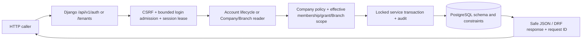

# 02 — API Flow

## 2026-10-31 verified Phase 1 state

One normal Company User UUID belongs to one Company. Another Company uses a separate account UUID with independent credentials and authorization. Global `login_id` and email uniqueness are locked; login has no Company selector. Provisioning, reset/status, revoke and scoped Company/Branch reads now use Company membership and the applicable scoped policy; cross-Company targets are hidden or denied. These are source and disposable-PostgreSQL test results, not staging/production runtime evidence.

## 2026-10-31 implementation delta (worktree only)

The dated 2026-10-19 route inventory below is a historical baseline. Current routes cover CSRF/login/logout/me/password change, Company-scoped account provisioning/reset/status/revoke, Company list/detail and scoped Branch list/detail, Django Admin adapters, and liveness/readiness. All prior legacy business-role authorization was removed from ordinary account lifecycle paths; explicit Platform technical/bootstrap boundaries remain. The current request inventory and classifications are in `docs/phase1-execution-progress.md`. Final source/tests ran on disposable PostgreSQL; live/staging HTTP behavior remains unverified.

## 0. Verification header

- Repository/worktree: `D:/VIRMS`, dirty `staging`; reviewed 2026-10-19. Tracked documentation HEAD `b4a40772edec567297e96d72bf037df73ea0cae6`; current Django code is local and untracked.
- **CURRENT APPROVED/TARGET:** V2 in `/docs-final-v2/` per explicit user direction; its unresolved business decisions remain open. **CURRENT IMPLEMENTED:** account/Tenant routes inspected in source. **HISTORICAL / SUPERSEDED:** V1 `/docs-final/` and `/docs-legacy/`. **PROPOSED:** no new exact endpoint is declared here.
- **UNVERIFIED:** tests run, live HTTP, applied database, frontend, staging/production. **BUSINESS DECISION REQUIRED:** exact affected V2 actions noted below. Governance files now use the V2 authority model; V1-derived System Design remains historicalized and unreconciled. See [03](03-ARCHITECTURE-CONFLICT-MAP.md).

## 1. Architecture state classification and purpose

The current API surface is the completed **Phase 1 account and scope foundation**, not the full V2 product contract. Authentication, provisioning/lifecycle, Company/Branch reads, Django Admin adapters and operational probes are implemented and covered by disposable PostgreSQL regressions. V2 finance, media, vehicle and module workflows are not implemented. System Design's V1 representative API paths are **HISTORICAL / SUPERSEDED technical target**, not current V2 endpoints.

## 2. Current source-inspected request flow — one view

The PostgreSQL schema, migrations and runtime-role checks were exercised on disposable PostgreSQL 15.19; no shared database connection or live API was verified. There is no current React caller, module state, Investor/Vehicle/Job/Accounting handler, public catalog or financial command. A private S3-compatible storage class is not an upload API.

## 3. Current route and action registry

| Exact source route | Purpose class | Current source behavior and consumer | State |
|---|---|---|---|
| `GET /api/v1/auth/csrf/` | CONTEXT SETUP | Set CSRF cookie; JSON detail; test/browser prerequisite | CURRENT IMPLEMENTED, source inspected |
| `POST /api/v1/auth/login/` | MUTATION | CSRF, Login ID/password, hashed-key failure throttle; Django session | CURRENT IMPLEMENTED, source inspected |
| `POST /api/v1/auth/logout/` | MUTATION | CSRF and session clear | CURRENT IMPLEMENTED, source inspected |
| `GET /api/v1/auth/me/` | AUTHORITATIVE READ / CONTEXT | Active User UUID, globally unique Login ID, effective Company roles/grants, Company/Branch context and password-change flag | Phase 1 tests passed; live runtime UNVERIFIED |
| `POST /api/v1/auth/password/change/` | MUTATION | Locked User and session lease; current password/new validation; hash/epoch/audit transaction; preserves current session and revokes others | Phase 1 tests passed |
| `POST /api/v1/auth/accounts/provision/` | MUTATION | Company-scoped policy; generates a new User UUID and temporary credential; atomically creates one Company membership and scoped role grant | Phase 1 tests passed |
| `POST /api/v1/auth/accounts/<uuid:user_id>/reset/` | MUTATION | Exact UUID target; Company-scoped lifecycle authorization; temporary credential, epoch/session revocation and audit | Phase 1 tests passed |
| `POST /api/v1/auth/accounts/<uuid:user_id>/status/` | MUTATION | Exact UUID target; Company-scoped activate/deactivate; deactivation does not erase history | Phase 1 tests passed |
| `POST /api/v1/auth/accounts/<uuid:user_id>/revoke/` | MUTATION | Exact UUID target; scoped session revocation and auth-epoch change | Phase 1 tests passed |
| `GET /api/v1/tenants/`, `GET /api/v1/tenants/<uuid:pk>/` | AUTHORITATIVE READ | Active Company membership and effective readable grant; paginated Company summary | Phase 1 tests and query-bound audit passed |
| `GET /api/v1/tenants/<uuid:company_id>/branches/`, detail | AUTHORITATIVE READ | Effective same-Company BranchAssignment intersected with Company read grant; paginated summary | Phase 1 tests, query-bound and EXPLAIN audit passed |
| `/admin/`, `/admin/password_change/` | ADMINISTRATIVE UI | Scoped Company adapters; generic credential/role/membership mutation blocked; safe one-time temporary credential path | Admin/API parity and bypass tests passed |
| `GET /health/live/`, `GET /health/ready/` | OPERATIONS PROBE | Liveness and migration-aware readiness; safe request correlation | Phase 1 tests passed |

Source: `core/urls.py`, `apps/accounts/urls.py`, `apps/tenants/urls.py`, handlers, policy/service layers, migrations and tests. No source route for public signup/JWT, Investor/Fund, module state, Stock Vehicle, external Garage Job, Sale, Company Accounting, interim payment, Owner Distribution, media or public catalog. No observed production request trace supports calling any current request redundant/duplicate.

## 4. Current execution, authorization and failure

`login_view` applies bounded request and source/identifier admission, canonicalizes the globally unique Login ID, authenticates and issues a locked User epoch plus a key-hashed server-side session lease. `ActiveAccountMiddleware` blocks inactive or stale sessions and restricts first-login Users to auth/password routes. `/auth/me/` returns bounded Company/Branch context. Unsafe browser requests use CSRF enforcement; DRF defaults to `DenyByDefault` and views require authentication. Ordinary lifecycle handlers use the Company-scoped policy and exact target UUID; the legacy global business role by itself grants no reset/status authority.

Provision validates the requested Company/role/Branch and uses the current command/policy service; user UUID, membership and scoped grant are committed atomically. Reset/status/revoke lock the exact account and authorize the actor inside the target Company. A Company account cannot be attached to a second Company; independent accounts cannot be found by matching name/email. Company/Branch list selectors filter before serialization and paginate at 20 rows; 1→25-row fixture growth kept Company reads at 6 queries and Branch reads at 8. Error handling returns safe codes and request IDs while preserving `Retry-After` on throttling. Deployed proxy behavior remains **UNVERIFIED**.

Current successful mutation → transaction-scoped model/security-event write → JSON response; credential-reset responses are no-store and temporary credentials are not logged or audited. There is no React cache, queue/job producer, consumer, dead-letter or async financial event route. Provisioning has a UUID-keyed operation/idempotency guard where supported; password/lifecycle operations are exact-target and transaction-locked. Tests and migration evidence are in `docs/phase1-execution-progress.md`.

## 5. V2 target request/action flow — not current endpoints

The target boundary is: authenticated User → Company membership → relevant Branch assignment → module ON or explicit historical/open-obligation exception → role/action permission → resource/object/field scope → server validation → authoritative operation → source event and linked Accounting/Investment/Garage reference as applicable → committed response → authorized UI refresh. A Company, Branch, Investor, Vehicle or Job ID never grants access. Platform protected-rate mutation and Accountant actual financial confirmation are separate actions. Public Vehicle access uses a dedicated safe response; Media/Investor/Owner views have their V2 field and mutation limits.

| V2 action family | Backend owner and real effect | Consumer/status |
|---|---|---|
| Company, Branch, membership and module administration | Platform control plane; effective access/module history; module OFF denies ordinary new work but retains authorized history and minimum settlement actions | CURRENT APPROVED/TARGET; no handler; minimum OFF actions BDR |
| Investment and funded Stock Vehicle | Company Investor/Fund, one Investor per Stock Vehicle, Branch provenance, actual Investor capital use and distinct Company Running Capital | CURRENT APPROVED/TARGET; no handler |
| Garage Job and external customer work | Garage source Job/charge/receipt with Company/Branch scope; external Vehicle needs no Investor; Accounting references revenue once | CURRENT APPROVED/TARGET; no handler |
| Sale, Buyer payment/refund and positive result | Bounded actual collection, full-collection gate, Investor capital then exact Company capital reconciliation, Investor Share and Company Share; no direct per-deal Owner payout | CURRENT APPROVED/TARGET; no handler |
| Monthly interim, Investor reconciliation and settlement | Configured cycle; Due/Suggested separate from confirmed Paid; six-month/annual reconciliation; normal eligible deal Profit before Exit; final principal then remaining Profit | CURRENT APPROVED/TARGET; no handler; interim basis/period mapping BDR |
| Company Accounting and Owner Distribution | Source-linked Company records; confirmed distributable amount and period; balanced-paise Company-level recipient allocation; actual individual payments | CURRENT APPROVED/TARGET; no handler; distributable basis BDR |
| Manual Loss/correction | Negative indicator has no automatic allocation/posting; specifically authorized manual impact and linked actual events | CURRENT APPROVED/TARGET; no handler; impact/actor/cross-Branch correction BDR |
| Media/public | Vehicle Company/Branch scope, four-active-image limit, private original/R2 and safe publication projection | CURRENT APPROVED/TARGET; storage adapter only |

No exact URL, serializer field, job name, service class or idempotency key is invented for these target actions. V2's five automation levels mean calculation, editable suggestion and due/reminder do **not** return a Paid or Settled fact. Only a specifically authorized human-confirmed event does. Critical money actions must be atomic, bounded, concurrent/retry-safe and source-linked; current code has not implemented those paths.

## 6. Consumer, compatibility and historical API map

| Contract | Current consumer | Target compatibility concern | Status |
|---|---|---|---|
| Session/CSRF and account/Tenant routes | Local test clients; no React client inspected | V2 Company/Branch/module context must be added without treating legacy Tenant membership as complete V2 scope | CURRENT IMPLEMENTED partial; live consumer UNVERIFIED |
| Financial, Garage, Company and public routes | None in source | Design from V2 target and explicit permission/BDR; do not copy V1 representative routes as authority | CURRENT APPROVED/TARGET, implementation gap |
| V1 System Design API examples | No known deployed caller | Historical/superseded target; may conflict with V2 Company/Branch/Accounting model | HISTORICAL / SUPERSEDED for business shape |

Git history proves a V1 documentation freeze followed by V2 draft commits, not a previous deployed API. `docs-legacy/` is historical text, not deployed behavior. README reports starter removal, but previous app code/released consumers are **UNVERIFIED**. No generated OpenAPI/schema file was found; no frontend request waterfall, duplicate call or N+1 finding was established. A future contract change requires enumeration of actual callers, auth/field assumptions and migration need from evidence.

## 7. Conflicts, decisions, risks and evidence

- `API-RISK-001` **A before V2 scope work:** existing Tenant-only routes lack V2 Branch, enabled-module, action and object/field checks. This is an **implementation gap**, not evidence of V1 business authority; see `CONFLICT-002` in [03](03-ARCHITECTURE-CONFLICT-MAP.md).
- `API-RISK-002` **A before affected finance actions:** monthly eligible basis, manual Loss actor/impact, Company distributable amount and OFF-module settlement action are **BUSINESS DECISION REQUIRED**. No handler should infer them from V1.
- `API-RISK-003` **B:** source is untracked; tests, live HTTP, database and deployment are **UNVERIFIED**. Do not claim end-to-end API verification.

Authority model: explicit project direction and V2's cross-document statement establish V2 as **CURRENT APPROVED/TARGET architecture**, while V2's own open items remain unresolved. `AGENTS.md`, README and older governance documents now distinguish target from implementation and history. System Design bodies are V1-derived and historicalized, not reconciled as V2 contracts. Evidence: all 13 V2 documents (especially 01/02/04/05/06/09/10 and supporting authentication); current URL/handler/model/settings/test files; historical V1/System Design and Git documentation commits. **CURRENT IMPLEMENTED** means source inspected only; tests/live API/database/deployment remain **UNVERIFIED**. **PROPOSED** extra endpoint families: none.
