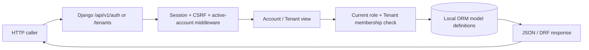

# 02 — API Flow

## 0. Verification header

- Repository/worktree: `D:/VIRMS`, dirty `staging`; reviewed 2026-10-19. Tracked documentation HEAD `b4a40772edec567297e96d72bf037df73ea0cae6`; current Django code is local and untracked.
- **CURRENT APPROVED/TARGET:** V2 in `/docs-final-v2/` per explicit user direction; its unresolved business decisions remain open. **CURRENT IMPLEMENTED:** account/Tenant routes inspected in source. **HISTORICAL / SUPERSEDED:** V1 `/docs-final/` and `/docs-legacy/`. **PROPOSED:** no new exact endpoint is declared here.
- **UNVERIFIED:** tests run, live HTTP, applied database, frontend, staging/production. **BUSINESS DECISION REQUIRED:** exact affected V2 actions noted below. Repository instructions still point to V1; see [03](03-ARCHITECTURE-CONFLICT-MAP.md).

## 1. Architecture state classification and purpose

The current API surface is a **partial implementation of foundations**, not the full V2 contract. V2's required Company, Branch, enabled-module, action, object and field checks are target behavior; existing generic Tenant APIs do not prove them. System Design's V1 representative API paths are **HISTORICAL / SUPERSEDED technical target**, not current V2 endpoints. An absent endpoint is an implementation gap, not evidence that V1 remains authoritative.

## 2. Current source-inspected request flow — one view

The ORM box does not assert a verified live PostgreSQL connection. There is no current React caller, Branch/module check, Investor/Vehicle/Job/Accounting handler, public catalog or financial command. A private S3-compatible storage class is not an upload API.

## 3. Current route and action registry

| Exact source route | Purpose class | Current source behavior and consumer | State |
|---|---|---|---|
| `GET /api/v1/auth/csrf/` | CONTEXT SETUP | Set CSRF cookie; JSON detail; test/browser prerequisite | CURRENT IMPLEMENTED, source inspected |
| `POST /api/v1/auth/login/` | MUTATION | CSRF, Login ID/password, hashed-key failure throttle; Django session | CURRENT IMPLEMENTED, source inspected |
| `POST /api/v1/auth/logout/` | MUTATION | CSRF and session clear | CURRENT IMPLEMENTED, source inspected |
| `GET /api/v1/auth/me/` | AUTHORITATIVE READ / CONTEXT | Active User UUID, Login ID, effective roles and Tenant IDs, password-change flag | CURRENT IMPLEMENTED, source inspected |
| `POST /api/v1/auth/password/change/` | MUTATION | Current password/new validation; User and security event atomically; session hash refresh | CURRENT IMPLEMENTED, source inspected |
| `POST /api/v1/auth/accounts/provision/` | MUTATION | `ProvisionSerializer`, `can_manage` active role/Tenant; atomic User/role/membership/security event; returns UUID and temporary password | CURRENT IMPLEMENTED, source inspected |
| `POST /api/v1/auth/accounts/<uuid:user_id>/reset/` | MUTATION | Locked target; manager must cover every current role × active Tenant; resets temporary credential | CURRENT IMPLEMENTED, source inspected |
| `POST /api/v1/auth/accounts/<uuid:user_id>/status/` | MUTATION | Locked target, boolean state, account-security event; deactivation makes password unusable | CURRENT IMPLEMENTED, source inspected |
| `GET /api/v1/tenants/`, `GET /api/v1/tenants/<uuid:pk>/` | AUTHORITATIVE READ | Allowed role plus active User/Tenant membership; active-Tenant paginated list/detail | CURRENT IMPLEMENTED, source inspected |
| `/admin/` | ADMINISTRATIVE UI | Django Admin path with separate staff controls; not ordinary VIRMS API | CURRENT IMPLEMENTED, source inspected; full audit parity UNVERIFIED |

Source: `core/urls.py`, `apps/accounts/urls.py`, `apps/tenants/urls.py`, handlers, settings and tests. No source route for public signup/JWT, Investor/Fund, Branch, module state, Stock Vehicle, external Garage Job, Sale, Company Accounting, interim payment, Owner Distribution, media or public catalog. No observed production request trace supports calling any current request redundant/duplicate or assigning performance cost.

## 4. Current execution, authorization and failure

`login_view` parses JSON, checks LoginAttempt backoff, calls Django authentication, creates a session on success and removes the attempt row; failures update the hashed-key attempt. `ActiveAccountMiddleware` blocks inactive API accounts and limits a first-login User to auth/password routes. `/auth/me/` derives current roles and Tenant memberships. Unsafe DRF session requests use CSRF enforcement; DRF defaults to `DenyByDefault`, while implemented account/Tenant views explicitly require `IsAuthenticated`.

Account provision first validates shape/role/Tenant UUID, then `can_manage` checks current active actor, required role and active Tenant membership. Back Office may provision Owner/Accountant; Accountant may provision Investor/Media. The provision write is atomic. Reset/status lock target and validate the manager against each active role/Tenant combination. Tenant list/detail filters its queryset to active membership after role filtering; a supplied Tenant UUID is not a grant. Error paths in source distinguish invalid input, missing auth, denied/missing scope, throttle and method rejection. Actual HTTP status/cookie behavior across a deployed proxy remains **UNVERIFIED**.

Current mutation → ORM event/model write → JSON/DRF response. No React cache, refetch, route transition or user-visible state is implemented. Account requests do not expose a general idempotency-key contract; atomicity alone is not proof that an uncertain network retry is safe. No queue/job producer, consumer, dead-letter or async financial event route exists. Current tests assert selected behavior but were not executed in this task.

## 5. V2 target request/action flow — not current endpoints

The target boundary is: authenticated User → Company membership → relevant Branch assignment → module ON or explicit historical/open-obligation exception → role/action permission → resource/object/field scope → server validation → authoritative operation → source event and linked Accounting/Investment/Garage reference as applicable → committed response → authorized UI refresh. A Company, Branch, Investor, Vehicle or Job ID never grants access. Platform protected-rate mutation and Accountant actual financial confirmation are separate actions. Public Vehicle access uses a dedicated safe response; Media/Investor/Owner views have their V2 field and mutation limits.

| V2 action family | Backend owner and real effect | Consumer/status |
|---|---|---|
| Company, Branch, membership and module administration | Platform control plane; effective access/module history; module OFF denies ordinary new work but retains authorized history and minimum settlement actions | CURRENT APPROVED/TARGET; no handler; minimum OFF actions BDR |
| Investment and funded Stock Vehicle | Company Investor/Fund, one Investor per Stock Vehicle, Branch provenance, actual Investor capital use and distinct Company Running Capital | CURRENT APPROVED/TARGET; no handler |
| Garage Job and external customer work | Garage source Job/charge/receipt with Company/Branch scope; external Vehicle needs no Investor; Accounting references revenue once | CURRENT APPROVED/TARGET; no handler |
| Sale, Buyer payment/refund and positive result | Bounded actual collection, full-collection gate, Investor capital then exact Company capital reconciliation, Investor Share and Company Share; no direct per-deal Owner payout | CURRENT APPROVED/TARGET; no handler |
| Monthly interim, Investor reconciliation and settlement | Configured cycle; Due/Suggested separate from confirmed Paid; six-month/annual reconciliation; normal eligible deal Profit before Exit; final principal then remaining Profit | CURRENT APPROVED/TARGET; no handler; interim basis/period mapping BDR |
| Company Accounting and Owner Distribution | Source-linked Company records; confirmed distributable amount and period; balanced-paise Company-level recipient allocation; actual individual payments | CURRENT APPROVED/TARGET; no handler; distributable basis BDR |
| Manual Loss/correction | Negative indicator has no automatic allocation/posting; specifically authorized manual impact and linked actual events | CURRENT APPROVED/TARGET; no handler; impact/actor/cross-Branch correction BDR |
| Media/public | Vehicle Company/Branch scope, four-active-image limit, private original/R2 and safe publication projection | CURRENT APPROVED/TARGET; storage adapter only |

No exact URL, serializer field, job name, service class or idempotency key is invented for these target actions. V2's five automation levels mean calculation, editable suggestion and due/reminder do **not** return a Paid or Settled fact. Only a specifically authorized human-confirmed event does. Critical money actions must be atomic, bounded, concurrent/retry-safe and source-linked; current code has not implemented those paths.

## 6. Consumer, compatibility and historical API map

| Contract | Current consumer | Target compatibility concern | Status |
|---|---|---|---|
| Session/CSRF and account/Tenant routes | Local test clients; no React client inspected | V2 Company/Branch/module context must be added without treating legacy Tenant membership as complete V2 scope | CURRENT IMPLEMENTED partial; live consumer UNVERIFIED |
| Financial, Garage, Company and public routes | None in source | Design from V2 target and explicit permission/BDR; do not copy V1 representative routes as authority | CURRENT APPROVED/TARGET, implementation gap |
| V1 System Design API examples | No known deployed caller | Historical/superseded target; may conflict with V2 Company/Branch/Accounting model | HISTORICAL / SUPERSEDED for business shape |

Git history proves a V1 documentation freeze followed by V2 draft commits, not a previous deployed API. `docs-legacy/` is historical text, not deployed behavior. README reports starter removal, but previous app code/released consumers are **UNVERIFIED**. No generated OpenAPI/schema file was found; no frontend request waterfall, duplicate call or N+1 finding was established. A future contract change requires enumeration of actual callers, auth/field assumptions and migration need from evidence.

## 7. Conflicts, decisions, risks and evidence

- `API-RISK-001` **A before V2 scope work:** existing Tenant-only routes lack V2 Branch, enabled-module, action and object/field checks. This is an **implementation gap**, not evidence of V1 business authority; see `CONFLICT-002` in [03](03-ARCHITECTURE-CONFLICT-MAP.md).
- `API-RISK-002` **A before affected finance actions:** monthly eligible basis, manual Loss actor/impact, Company distributable amount and OFF-module settlement action are **BUSINESS DECISION REQUIRED**. No handler should infer them from V1.
- `API-RISK-003` **B:** source is untracked; tests, live HTTP, database and deployment are **UNVERIFIED**. Do not claim end-to-end API verification.

Authority model: latest direct user instruction plus V2's cross-document statement establishes V2 as **CURRENT APPROVED/TARGET architecture**, while the V2 file header still signals incomplete formal approval. `AGENTS.md`, README, System Design and earlier architecture text still name V1; they were not edited here and are recorded as `DOC_STALE` in [03](03-ARCHITECTURE-CONFLICT-MAP.md). Evidence: all 13 V2 documents (especially 01/02/04/05/06/09/10 and supporting authentication); current URL/handler/model/settings/test files; historical V1/System Design and Git documentation commits. **CURRENT IMPLEMENTED** means source inspected only; tests/live API/database/deployment remain **UNVERIFIED**. **PROPOSED** extra endpoint families: none.
