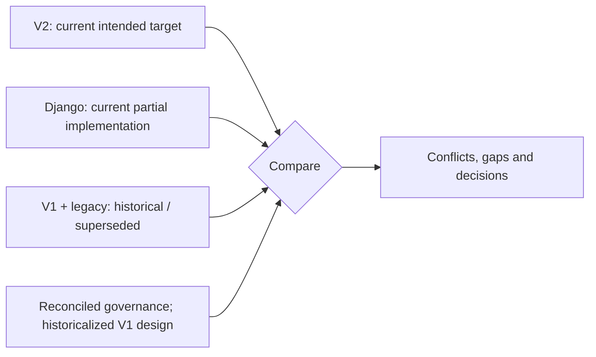

# 03 — Architecture Conflict Map

> Correction audit: current scoped lifecycle, same-row temporal authorization, bounded uniform login admission, safe required lifecycle reasons and audit Branch scope are recorded in [docs/phase1-audit-corrections.md](../docs/phase1-audit-corrections.md). Earlier completion/test-count statements below are historical snapshots.

> HISTORICAL SNAPSHOT — 2026-11-02. Its Phase 1/2 and Phase 3-not-started statements record the state then and are superseded by the current checkpoint below.

> Local integration and roadmap reconciliation — 2026-11-02: the current `codex/audit` integration line contains accepted Phase 1 and Phase 2 source, tests, and the final role/mock-boundary corrections. Phase 1 passed 210/210 account/tenant tests on disposable PostgreSQL; Phase 2 passed 74/74 React tests, configured lint/build, and isolated browser acceptance. No business-domain models or APIs exist in the inspected application. The verified roadmap assigns Phase 3 to Main Operations Foundation (not started); Garage Jobs is Phase 6 and depends on Phase 4 Accounting plus Phase 5 Vehicle/Investment ownership contracts. A separate Garage architecture candidate that placed Garage in Phase 3 remains outside this integration because its model ownership depended on future Phase 4/5 contracts. Its confirmed Garage business rules are recorded in `docs-final-v2/`; implementation design must be revisited at the Phase 6 gate. See [roadmap](../planning/V2-DEVELOPMENT-ROADMAP.md).

> Current branch status — 2026-11-03: codex/audit and origin/codex/audit were fetched and verified at 73797b16aa35db776b5601fe1483c2be8de6c100. Phase 3 Company module-state foundation is committed and pushed. Django passed 232/232 and React passed 89/89; lint/build/migration checks passed locally. GitHub CI status/runs were empty at inspection. Staging/production database access, deployed behavior, and the actual runtime database role/grants are UNVERIFIED.

## 2026-10-31 verified Phase 1 implementation

The one-Company-per-normal-business-account rule is implemented with the PostgreSQL membership guard, service policy and Admin restrictions. Separate Company accounts retain independent UUIDs, credentials, sessions, grants, lifecycle and audit. Existing database contents remain unverified; the migration fails closed on multi-Company accounts and no rows are auto-split. Global `login_id` and email uniqueness remain in force; there is no Company login selector.

P1-11 through P1-19 implementation and final local validation are recorded in `docs/phase1-execution-progress.md`. This changes the current implementation classification below; dated 2026-10-19 verification headers and tables remain historical snapshots. No financial or Phase 2 behavior was implemented.

## 0. Historical verification header — 2026-10-19 baseline

- Repository/worktree: `D:/VIRMS`, dirty `staging`; reviewed 2026-10-19. Tracked documentation HEAD `b4a40772edec567297e96d72bf037df73ea0cae6`. Backend and architecture files inspected locally are untracked.
- **CURRENT APPROVED/TARGET:** the intended V2 architecture in `/docs-final-v2/`, per explicit current user direction and `docs-final-v2/01`'s statement that `/docs-final/` is a previous baseline. This does **not** fill V2's open business decisions or claim formal final-lock status.
- **CURRENT IMPLEMENTED:** source-inspected account/Tenant Django foundation only. **HISTORICAL / SUPERSEDED:** V1 `/docs-final/`, `/docs-legacy/` and V1-derived technical assumptions. **PROPOSED:** no alternative business architecture is added here.
- **UNVERIFIED:** tests, database/migration ledger, deployed API, production history. **BUSINESS DECISION REQUIRED:** V2's explicitly open money/access meanings. Governance documents now state the V2 authority model; unreconciled V1-derived System Design remains historical, not a V2 contract.

## 1. Three-truth comparison

Folder names, DRAFT/FINAL labels and commit recency alone do not determine the current target. Here the **latest explicit user direction** selects V2 for architecture mapping, and V2 itself calls V1 historical. The V2 header still says business approval is required before becoming authoritative; therefore **target selection is settled for these maps**, while formal document-governance reconciliation and unresolved V2 behavior remain outstanding. If a future instruction removes that explicit target or makes it genuinely ambiguous, mark `AUTHORITY CONFLICT — USER / BUSINESS CONFIRMATION REQUIRED` rather than guessing.

## 2. Canonical truth matrix

| Topic | CURRENT APPROVED/TARGET V2 | CURRENT IMPLEMENTED / tests | HISTORICAL / SUPERSEDED or stale text | Classification/action |
|---|---|---|---|---|
| Authority | V2 intended target; 01 says previous `/docs-final/` is historical baseline; 02/04/05/09/10 own V2 meanings | Code cannot choose product authority | `AGENTS.md`, README and older governance docs now distinguish V2 target, implementation and historical V1; System Design body remains historical/unreconciled | `CONFLICT-001` resolved by documentation; V2 BDRs remain open |
| Isolation | Platform→Company/Tenant→Branch; Company hard boundary, Branch within Company; module/action/object/field scope | Phase 1 implements Company membership/grants and Branch assignment/read scope. Phase 3 implements versioned Company module state and a Company-scoped metadata read; no business-operation endpoint exists yet to enforce module gates | V1 Garage=Tenant, Tenant-scoped Garage operations | Company/Branch and module-state foundations are implemented; business-module controls remain future-phase work |
| Company account identity | Each ordinary business User UUID belongs to one Company; the same human in another Company has a separate account. Platform technical identities are distinct | `accounts.0007` PostgreSQL guard, provisioning policy and Admin protections enforce one Company for Company accounts. Disposable raw-SQL and upgrade tests pass; real rows remain unverified | Earlier shared Company account plan assumptions | `CONFLICT-006` implementation complete; migration fails closed on existing multi-Company rows; no automatic split; global login ID/email uniqueness retained |
| Investor/Vehicle | Fund relationship at Company level across Branches; one Investor per funded Stock Vehicle; external customer Vehicle requires none | No Investor, Fund, Vehicle or Garage model/API | V1 global cross-Garage Investor/Fund, one Investor for every Vehicle | `RULE_SUPERSEDED` for target; `CONFLICT-003` compatibility review |
| Money and Owner | Actual Company Running Capital separate; positive Investor/Company Share; Company-level period Owner Distribution; manual Loss | No finance tables/routes/tests | V1 per-deal Owner Pool, formula Loss/Owner contribution, no Company Accounting/Running Capital | `RULE_SUPERSEDED`; V2 `BUSINESS DECISION REQUIRED` in affected areas |
| Protected rates | Platform Back Office changes Investor agreements, monthly rate, Owner split and sensitive defaults; Accountant confirms authorized transactions | No protected financial configuration | V1 Accountant could change Investor-specific percentage | `RULE_SUPERSEDED`; actor boundary implementation gap |
| API and frontend | V2 Company/Branch/module-scoped backend, Garage independent of Investment, source-linked Accounting; React target | Phase 1/2 account and React foundations passed their documented tests; Phase 3 Company module-state model, Admin path, metadata read, and shared React query passed 232 backend and 89 React tests locally; no business API | V1-derived System Design routes/diagrams and roadmap | Phase 1–3 foundations are locally verified; Phase 3 commit 73797b16aa35db776b5601fe1483c2be8de6c100 is pushed; Garage remains Phase 6 |
| Existing production history | V2 text says no production V1 cutover needed | Current app source is tracked; no live database or deployed history was inspected | README describes replaced starter migrations | `UNVERIFIED`, `CONFLICT-005`; cannot infer live data state |

No `SYSTEM_DEFECT` or `TEST_STALE` is declared without code/runtime/test evidence proving one. The present business-target mismatch is primarily **missing implementation**, not proof the V2 target is wrong.

## 3. Conflict register — resolved and open

### CONFLICT-001 — Governance authority reconciliation

- **Classification/area:** authority and documentation. Previously stale V1 authority wording in `AGENTS.md`, README, System Design 00 and older Architecture 00/roadmap material has been reconciled to the V2 target and implementation/historical distinctions.
- **Current implemented behavior:** code remains a partial implementation and does not select product authority.
- **Why it mattered:** stale pointers could have led future work to apply V1 money, Tenant or permission rules.
- **Resolution:** V2 is **CURRENT APPROVED/TARGET**; V1 is **HISTORICAL / SUPERSEDED**. All 20 System Design files are explicitly historicalized, but their bodies are not V2-reconciled and still require section-level review before reuse.
- **Status:** RESOLVED as a documentation-authority conflict. V2 business decisions and implementation gaps remain tracked separately under `CONFLICT-002` through `CONFLICT-005`.

### CONFLICT-002 — Company/Branch/module target versus Tenant-backed Phase 1 foundation

- **Classification/area:** Phase 1 implements Company membership, CompanyRoleGrant, Branch assignment, account lifecycle/provisioning scope, Company/Branch reads and Django Admin adapters. Phase 3 adds versioned Company module state, scoped configuration/audit, and Company-scoped metadata read. Business-operation module gates and product resource/object/field rules remain for the owning future module.
- **Historical influence:** V1 Garage=Tenant design may have shaped the foundation, but generic `Tenant` code alone does not prove a V1 business implementation.
- **Why it matters:** a future financial/Job route built on Tenant membership alone could cross Branch/module boundaries or misassign Company money.
- **Resolution:** P1-11 through P1-19 and the approved Phase 3 module-state foundation were verified locally on disposable PostgreSQL. Module-specific enforcement belongs at future business-operation call sites. **Status:** Platform/account, Branch-scope, and Phase 3 module-state foundations are implemented; finance and other business modules remain unimplemented.

### CONFLICT-003 — V1-derived finance/design assumptions versus V2 economics

- **Classification/area:** `RULE_SUPERSEDED` for current target plus `BREAKING_CHANGE_RISK` if real V1 data/consumers exist. V1 treats Garage as Tenant, Investor/Fund as global, Owner payout as per-deal and Loss as percentage allocated. V2 makes Company the Tenant, Fund Company-level, Company Share a source of Company Accounting, Owner distribution a Company period action and Loss manual. V2 also adds Running Capital, Garage Jobs, interim payout/reconciliation and module state.
- **Current implementation:** no financial model/API to refactor was found. `/system-design/01`–`/19`, earlier `/architecture/` foundation/roadmap and diagram are V1-derived; their V1 business shapes are historical, though stack/technical practices may still be usable after revalidation.
- **Why it matters:** copying V1 formulas or permission actors would produce wrong V2 money and isolation behavior. A deployed V1 cutover remains **UNVERIFIED**.
- **Resolution:** use V2 as target, block affected actions on V2 BDRs, and reconcile technical design before those implementations. No migration or dual engine is prescribed by this documentation task. **Status:** OPEN design drift and future compatibility risk.

### CONFLICT-004 — V2 has explicit unresolved business meaning

- **Classification/area:** `BUSINESS_DECISION_REQUIRED`, not an architecture implementation choice. V2 marks eligible principal/withdrawal limits; interim versus deal/period reconciliation; manual Loss effects and actor; Company distributable-Profit definition; cross-Branch correction authority; Platform support private-finance read; and minimum settlement actions while module OFF as unresolved.
- **Current implementation:** none of these financial or module-control actions exists locally.
- **Why it matters:** a calculation, suggestion or historical V1 formula cannot supply an approved V2 economic/permission outcome.
- **Resolution:** keep affected implementation blocked or manual only where V2 explicitly permits it until business decisions are recorded. Other defined V2 target boundaries remain describable. **Status:** OPEN.

### CONFLICT-006 — Company business account identity cardinality

- **CURRENT TARGET:** one ordinary Company business account UUID belongs to exactly one Company. The same human in another Company uses a separate UUID account with independent credentials, sessions, roles, Branch scope and audit history. Technical platform identity remains separate.
- **CURRENT IMPLEMENTED (2026-10-31 local worktree):** successor migration `accounts.0007` adds an immutable Company/platform account kind and a PostgreSQL trigger rejecting a second Company membership for Company accounts, including a new raw SQL insert. Provisioning, lifecycle and Admin policy use the same one-Company boundary. Fresh replay, direct-bypass tests and representative supported upgrade pass. Existing real rows remain unverified.
- **Compatibility gate:** inspect existing multi-Company User counts and history before a successor constraint or reader cutover. Never auto-split or infer identity from name, email or phone. Global login ID/email uniqueness is the current rule; no Company login selector is required.

### CONFLICT-005 — Application history and deployed runtime evidence absent

- **Classification/area:** `UNVERIFIED`; schema/release/history. Current source and migrations are locally tested; no live staging/production PostgreSQL ledger, API, deployment or production transaction history was checked.
- **Competing claims:** modified README says starter migrations were replaced; V2/01 and V2/06 say no production V1 cutover or dual calculation engine is required. These are documentation claims, not observed environment state.
- **Resolution:** verify environment and actual history before any migration, compatibility or release decision. Do not invent existing customers/data, and do not assume zero records. **Status:** OPEN evidence gap.

## 4. Superseded rule and current/previous delta register

| HISTORICAL / SUPERSEDED V1 rule or reference | CURRENT APPROVED/TARGET V2 replacement | Previous implemented behavior | Search/compatibility guard |
|---|---|---|---|
| Garage = Tenant | Company = Tenant; Branch/Garage is within Company | V1 deployed behavior UNVERIFIED | Search `Garage = Tenant`, Tenant resolver and transfer paths; no automatic data migration assumption. |
| Global Investor/Fund across Garages | Company-level Investor/Fund across that Company's Branches | V1 financial data UNVERIFIED | Search global Fund assumptions; prevent cross-Company balances. |
| Every Vehicle has one Investor | Funded Stock Vehicle one Investor; external customer Garage Vehicle need not have one | Vehicle implementation absent | Search unconditional Investor FK/permission assumptions. |
| Accountant changes Investor-specific percentage | Platform Back Office protects Investor positive-share agreement/rates; Accountant uses effective value | No agreement endpoint | Search Accountant config mutation assumptions. |
| Deal-level Owner Pool and percentage Loss | Company-level period Owner Distribution; new V2 Loss manual | No finance implementation | Search Owner pool/loss-share/contribution formulas; do not import them into V2. |
| No Company Accounting, Running Capital or Garage Jobs in V1 core | V2 Company Accounting, separate Running Capital and independent Garage Job workflow | No local implementation | V1 module list/roadmap is not a complete V2 module list. |

`docs-legacy/` remains non-authoritative historical material. Git commits show V1 freeze `24b7300` and V2 documentation additions `d8edb38`/`b4a4077`. Chronology alone did not choose V2; explicit project intent and V2's own authority statement did. No prior deployed business flow or data shape was verified.

## 5. Diagram, test and duplicate-source drift

| Evidence | Current status / drift | Required guard |
|---|---|---|
| `architecture/diagrams/virms-foundation-and-delivery-flow.mmd`, V1 roadmaps | Phase sequence may be useful, but labels/source basis point to V1 | Treat business/module conclusions as HISTORICAL / SUPERSEDED until reconciled. |
| `system-design/01` context, `/03` tenancy, `/05` finance, `/07` API | Technical design derived from V1, not a V2 contract | Do not copy global Fund, Garage Tenant or per-deal Owner/Loss semantics into V2. |
| Account/Tenant/Branch/module test coverage | Selected account, Tenant, Branch, and module-state tests exist; finance tests are not applicable because financial modules are not implemented | PARTIAL_IMPLEMENTATION for later business modules |
| Current Account/Tenant model plus future Company/Branch sources | Risk of treating generic Tenant membership as complete Company/Branch permission | One authoritative Company/Branch scope path; no duplicate grants from caller IDs. |
| Investment, Garage and Accounting views of the same money | V2 defines separate module ownership with source links | One actual economic event; Company ledger references source without double posting. |
| Monthly interim, ordinary deal Profit and period reconciliation | V2 distinct streams; precise reconciliation still BDR | Do not relabel an interim advance as earned deal Profit or count a payment twice. |

No test execution or runtime defect was performed/proven here. `CONFLICT-001` was resolved by documentation changes only, not by a code commit. Historicalized System Design references remain unreconciled and must not be treated as approved V2 technical detail.

## 6. Security and ownership conflict guard

V2 hard boundary is Company. Phase 1 implements Company/Branch scope, and Phase 3 implements versioned Company module-state metadata. Future business operations still need their module-specific authorization checks and approved history/open-obligation rules. A Platform administrator cross-Company capability does not automatically include private Company finance. Protected configuration permission does not confer Accountant posting permission. Media cannot read internal finance; Investor self-view cannot read another Investor; Owner is read-only. The current foundation APIs do not constitute the full V2 business contract. CONFLICT-002/004 govern affected future routes. Public views must use safe publication fields and never serialize internal Vehicle/Investor records.

## 7. Business decisions required and verification status

1. Monthly Interim Payout: eligible-principal basis and active-cycle principal withdrawal limit (`docs-final-v2/01`, `/04`, `/05`).
2. Investor reconciliation: deal inclusion and ordinary eligible deal Profit versus monthly interim versus six-month/annual settlement; prevent double payment (`/01`, `/05`).
3. Manual Loss: exact Investor principal/Company Running Capital and Company accounting impact, confirmation actor and closure consequences (`/01`, `/02`, `/04`, `/05`).
4. Company distributable Profit: recognition basis for Company Share, Garage Revenue/common Expenses, period close/carryforward and actual distributable amount (`/01`, `/04`, `/09`).
5. Company-level correction across Branches: exact action authority and scope (`/02`, `/10`).
6. Platform Back Office support: conditions for private Company finance read beyond explicit Company assignment (`/02`).
7. Module OFF: minimum permitted settlement actions for already-open obligations (`/02`, `/06`).

These are **BUSINESS DECISION REQUIRED** for the affected behavior, not evidence V2 ceases to be current target. Governance authority wording is reconciled; V1-derived System Design body content remains historical and unreconciled. **UNVERIFIED:** actual tests, database, deployment, production V1 data/cutover. **CURRENT IMPLEMENTED:** only local source-inspected foundation. **PROPOSED** additional architecture: none. Evidence includes all V2 documents, old V1/legacy documents, governance/design files, current code/tests and the Git commits above.

## Current V2 Business Decision Additions Referenced

- Canonical decisions: [02 — User Roles and Permissions](../docs-final-v2/02-user-roles-permissions.md#approved-business-decision-additions) and [09 — Company Accounting](../docs-final-v2/09-company-accounting-owner-distribution.md#approved-business-decision-additions).
- Technical impact: the resolved cross-Branch permission is Accounting-specific. It does not resolve or widen Garage, Vehicle, Investment, Sales, or other-module correction authority. Unrelated BDRs remain in force.

## Current V2 Business Decision Additions Referenced — 2026-11-03

- Current decisions: [01 — Business Rules](../docs-final-v2/01-business-rules.md#approved-business-decision-additions), [02 — User Roles and Permissions](../docs-final-v2/02-user-roles-permissions.md#approved-business-decision-additions), [04 — Data Model Relationships](../docs-final-v2/04-data-model-relationships.md#approved-business-decision-additions), and [09 — Company Accounting](../docs-final-v2/09-company-accounting-owner-distribution.md#approved-business-decision-additions).
- Technical impact: the Accounting-specific OFF obligation actions are resolved; minimum OFF actions for other modules remain BDRs. Profit period timezone and negative opening movement are now specified. No module ownership or other-module permission changes follow from these decisions.

## Current V2 Business Decision Additions Referenced — Phase 4 locked topics

- Canonical additions: [01 — Business Rules](../docs-final-v2/01-business-rules.md#approved-business-decision-additions), [02 — User Roles and Permissions](../docs-final-v2/02-user-roles-permissions.md#approved-business-decision-additions), [04 — Data Model Relationships](../docs-final-v2/04-data-model-relationships.md#approved-business-decision-additions), and [09 — Company Accounting](../docs-final-v2/09-company-accounting-owner-distribution.md#approved-business-decision-additions).
- Superseded only for Phase 4: the bounded Accounting Result is defined, Owner ordinary Accounting posting is denied, and Company-level Accountant cross-Branch Accounting correction is resolved. The broad correction BDR, other-module cross-Branch boundaries, full Company Profit source recognition, distributable Profit, period close, and Investor reconciliation remain unchanged.
- The cross-Branch correction item in `CONFLICT-004` is no longer a BDR for same-Company Accounting actions by Company-level Accountants; its manual Loss and non-Accounting portions remain open or default-deny.

## Current V2 Business Decision Additions Referenced — Phase 4 cash correction distinction

- Canonical decisions: [01 — Business Rules](../docs-final-v2/01-business-rules.md#approved-business-decision-additions), [04 — Data Model Relationships](../docs-final-v2/04-data-model-relationships.md#approved-business-decision-additions), and [09 — Company Accounting](../docs-final-v2/09-company-accounting-owner-distribution.md#approved-business-decision-additions).
- The earlier blanket exclusion of Receipt/Payment correction is superseded only for wrong cash facts; wrong-target-only reallocation preserves cash. Real refund/recovery remains a separate future/BDR workflow. No unrelated business conflict is resolved.

## Current V2 Business Decision Additions Referenced — Phase 4 correction and archive safety

- Canonical decisions: [02 — User Roles and Permissions](../docs-final-v2/02-user-roles-permissions.md#approved-business-decision-additions), [04 — Data Model Relationships](../docs-final-v2/04-data-model-relationships.md#approved-business-decision-additions), and [09 — Company Accounting](../docs-final-v2/09-company-accounting-owner-distribution.md#approved-business-decision-additions).
- The prior archive-by-zero-balance contract is superseded: any account movement/event history blocks archive. Correction choices and OFF eligibility are narrowed as specified in those canonical additions. No non-Accounting Branch authority or unrelated BDR changes.

## Current V2 Business Decision Additions Referenced — Phase 4 settlement and correction reconciliation

- Canonical decisions: [01 — Business Rules](../docs-final-v2/01-business-rules.md#approved-business-decision-additions), [02 — User Roles and Permissions](../docs-final-v2/02-user-roles-permissions.md#approved-business-decision-additions), [04 — Data Model Relationships](../docs-final-v2/04-data-model-relationships.md#approved-business-decision-additions), and [09 — Company Accounting](../docs-final-v2/09-company-accounting-owner-distribution.md#approved-business-decision-additions).
- Phase 4 Accounting's same-Company Company-level correction permission and its pre-OFF settlement/correction distinctions are resolved. This does not resolve cross-Branch authority for manual Loss or other modules, nor other modules' OFF rules. Full Company Profit and Investor/Owner settlement BDRs remain.

## Phase 4 implementation status and remaining boundaries — 2026-11-03

The bounded Company Accounting Foundation is implemented in the current local worktree and verified against a disposable PostgreSQL database and the existing React application. It adds Accounting-owned persistence and APIs; it does not create a second source of truth in React. See [Phase 4 execution evidence](../docs/phase4-execution-progress.md).

This supersedes only older map statements that Phase 4 Accounting models/endpoints/data flow are unimplemented. Vehicle, Investment, Garage, Sales, and other future modules do not yet originate Accounting source events; their integration remains future vertical work. Final Company Share/Garage Revenue/common Expense recognition, distributable Profit, period close/carryforward, Investor Profit, Owner Distribution, and unrelated-module permission rules remain outside this slice. No staging/production state or deployment is asserted.

## Current V2 Business Decision Additions Referenced — Phase 5 Monthly Interim amount

- Canonical decisions: [01 — Business Rules](../docs-final-v2/01-business-rules.md#approved-business-decision-additions), [02 — User Roles and Permissions](../docs-final-v2/02-user-roles-permissions.md#approved-business-decision-additions), [04 — Data Model Relationships](../docs-final-v2/04-data-model-relationships.md#approved-business-decision-additions), and [05 — Vehicle/Investor Finance Workflow](../docs-final-v2/05-vehicle-investor-finance-workflow.md#approved-business-decision-additions).
- The fixed per-Investor amount supersedes only the rate/eligible-principal calculation BDR and the former PBO-only authority for that field. Principal-withdrawal limits and period-reconciliation deal/payout behavior remain unresolved; no other module ownership or permission boundary changes.

## Current V2 Business Decision Additions Referenced — Interim advance as Paid

- Canonical decisions: [01 — Business Rules](../docs-final-v2/01-business-rules.md#approved-business-decision-additions), [04 — Data Model Relationships](../docs-final-v2/04-data-model-relationships.md#approved-business-decision-additions), and [05 — Vehicle/Investor Finance Workflow](../docs-final-v2/05-vehicle-investor-finance-workflow.md#approved-business-decision-additions).
- The question of whether a confirmed Interim advance is Paid against Investor Profit is resolved. The remaining BDR concerns which deals belong to a period and how ordinary deal-level payouts interact; the data-flow target must not duplicate an economic event.

## Current V2 Business Decision Additions Referenced — Phase 5 ownership and blockers

- Canonical owner/permission additions: [01 Business Rules](../docs-final-v2/01-business-rules.md#phase-5-approved-business-decision-additions--investor-fund-vehicle-periods-and-loss), [02 Roles](../docs-final-v2/02-user-roles-permissions.md#phase-5-approved-business-decision-additions--investor-and-vehicle-permissions), [04 Relationships](../docs-final-v2/04-data-model-relationships.md#phase-5-approved-business-decision-additions--investment-and-vehicle-relationships), [05 Workflow](../docs-final-v2/05-vehicle-investor-finance-workflow.md#phase-5-approved-business-decision-additions--fund-vehicle-investor-periods-and-exit), and [09 Accounting](../docs-final-v2/09-company-accounting-owner-distribution.md#phase-5-approved-business-decision-additions--investment-source-linkage).
- Technical impact: current Accounting owns actual cash movements, but does not yet have typed Investment/Vehicle source links. Current repository has no Investment or Vehicle models/API. Older Phase 5 drafts are not authoritative where they conflict with current Phase 4 code.
- Readiness: PHASE_5_CODE_ARCHITECTURE_BLOCKED by Q39 purchase-payment semantics and by missing authoritative Garage/Sales/finance sources needed to enforce deactivation prerequisites. These are implementation blockers, not permission to infer new rules.

## Phase 5 implementation status and remaining blockers — 2026-11-07

Current local source resolves the earlier missing-backend-foundation conflict for Investor/interim records, Fund credit/principal return, Vehicle identity/Branch movement, and typed capital links into Phase 4 Accounting. The full phase and code-architecture readiness remain **BLOCKED**:

- **Q39 BUSINESS DECISION REQUIRED:** seller payment timing blocks Vehicle Purchase, purchase cash outflow, Fund-use allocation, and Vehicle-linked Running Capital purchase allocation.
- **DEPENDENCY BLOCKER:** deactivation/registration reuse still cannot prove Sold state or no open Job, finance or settlement without authoritative Garage/Sales/financial modules.
- **INTEGRATION BLOCKER:** approved React forms contain unrelated combined fields and lack required Branch/cash-account identities. No current form is silently remapped or stripped; the current mock-backed UI remains unchanged.
- Investor Profit, loss offsets, Exit settlement and automatic mock import remain unimplemented.

The implementation is local/uncommitted on a separate worktree. Disposable PostgreSQL checks do not verify the persistent 8002 database or any hosted environment. See [the Phase 5 execution evidence](../docs/phase5-execution-progress.md). These facts do not supersede Phase 1–4 boundaries or any unrelated BDR.

## Current V2 Business Decision Additions Referenced — seller payable scope

- Canonical decision: [05 — Vehicle/Investor Finance Workflow](../docs-final-v2/05-vehicle-investor-finance-workflow.md#approved-business-decision-additions).
- Conflict-map impact: the earlier Q39 `BUSINESS DECISION REQUIRED` label is historical and superseded. Seller payable/partial payment is approved; its code architecture remains technically blocked. Third-party lender finance, EMI, interest and finance tags are excluded from Phase 5.

## Current V2 Business Decision Additions Referenced — purchase funding allocation timing

- Canonical decision: [05 — Vehicle/Investor Finance Workflow](../docs-final-v2/05-vehicle-investor-finance-workflow.md#approved-business-decision-additions).
- Conflict-map impact: full purchase-source allocations are committed at purchase creation; seller payable records the separate amount still owed, and actual cash moves only on payment. This resolves allocation timing without resolving the technical installment contract.

## Current V2 Business Decision Additions Referenced — purchase correction after seller payment

- Canonical decision: [05 — Vehicle/Investor Finance Workflow](../docs-final-v2/05-vehicle-investor-finance-workflow.md#approved-business-decision-additions).
- Conflict-map impact: an actual Accounting refund is a prerequisite to reducing corrected purchase cost below cumulative installments; correction/source reallocation remains an append-only technical contract to complete.

## Current V2 Business Decision Additions Referenced — purchase correction source allocation

- Canonical decision: [05 — Vehicle/Investor Finance Workflow](../docs-final-v2/05-vehicle-investor-finance-workflow.md#approved-business-decision-additions).
- Conflict-map impact: cost reduction preserves the recorded Fund/Running Capital ratio; paise rounding is still a narrow implementation blocker.

## Current V2 Business Decision Additions Referenced — purchase-source paise rounding

- Canonical decision: [05 — Vehicle/Investor Finance Workflow](../docs-final-v2/05-vehicle-investor-finance-workflow.md#approved-business-decision-additions).
- Conflict-map impact: proportional source corrections now have a deterministic exact-paise rule; no rounding decision remains open.

## Current V2 Business Decision Additions Referenced — Company-wide automation approval

- Canonical decision: [01 — Business Rules](../docs-final-v2/01-business-rules.md#approved-business-decision-additions).
- Conflict-map impact: the setting gates execution of consequential automation; it does not override module, role, Company or Branch authorization. Pure calculations remain automatic.

## Current V2 Business Decision Additions Referenced — automation setting authority

- Canonical decision: [02 — User Roles and Permissions](../docs-final-v2/02-user-roles-permissions.md#approved-business-decision-additions).
- Conflict-map impact: setting writes are Company-level Accountant-only; this does not change the permission boundary for any underlying automated action.

## Current V2 Business Decision Additions Referenced — pending actions across automation mode changes

- Canonical decision: [01 — Business Rules](../docs-final-v2/01-business-rules.md#approved-business-decision-additions).
- Conflict-map impact: an OFF transition must not convert the existing pending queue into automatic postings or remove its history.

## Current V2 Business Decision Additions Referenced — auto-posting in approval OFF mode

- Canonical decision: [01 — Business Rules](../docs-final-v2/01-business-rules.md#approved-business-decision-additions).
- Conflict-map impact: OFF overrides per-action confirmation only for a separately approved automation; it does not override the action's role, tenant, module or data-integrity constraints.

## Current V2 Business Decision Additions Referenced — manual Purchase refund and correction

- Canonical decision: [05 — Vehicle/Investor Finance Workflow](../docs-final-v2/05-vehicle-investor-finance-workflow.md#approved-business-decision-additions).
- Conflict-map impact: actual seller refund and Purchase cost correction are two manually initiated, separately audited records linked to one Purchase; technical typed-link, payable-derivation, and atomic correction rules remain to be locked.

## Current V2 Business Decision Additions Referenced — Sale form Save confirms Sold

- Canonical decision: [05 — Vehicle/Investor Finance Workflow](../docs-final-v2/05-vehicle-investor-finance-workflow.md#approved-business-decision-additions).
- Conflict-map impact: the authoritative Sale record owns the confirmed Sold state; do not add a duplicate mutable Sold flag to Vehicle, and do not infer it from Buyer collection.

## Current V2 Business Decision Additions Referenced — Buyer refund Branch scope

- Canonical decision: [02 — User Roles and Permissions](../docs-final-v2/02-user-roles-permissions.md#approved-business-decision-additions), [05 — Vehicle/Investor Finance Workflow](../docs-final-v2/05-vehicle-investor-finance-workflow.md#approved-business-decision-additions).
- Conflict-map impact: keep Buyer refunds within the Sale's original Branch for Branch Accountants; the Company-level exception applies only within that same Company.

## Current V2 Business Decision Additions Referenced — Sale and Buyer Receipt Branch scope

- Canonical decision: [02 — User Roles and Permissions](../docs-final-v2/02-user-roles-permissions.md#approved-business-decision-additions), [05 — Vehicle/Investor Finance Workflow](../docs-final-v2/05-vehicle-investor-finance-workflow.md#approved-business-decision-additions).
- Conflict-map impact: keep Sale creation/confirmation and Buyer Receipt authorization within the Sale's Branch for Branch Accountants; Company-level scope remains within one Company.

## Current V2 Business Decision Additions Referenced — Buyer Receipt while Vehicle Management is OFF

- Canonical decision: [01 — Business Rules](../docs-final-v2/01-business-rules.md#approved-business-decision-additions), [05 — Vehicle/Investor Finance Workflow](../docs-final-v2/05-vehicle-investor-finance-workflow.md#approved-business-decision-additions).
- Conflict-map impact: do not apply the pre-OFF Seller payable exception to Buyer Receipts; Vehicle Management OFF blocks the Buyer Receipt even if Accounting remains ON.

## Current V2 Business Decision Additions Referenced — Seller refund while Vehicle Management is OFF

- Canonical decision: [01 — Business Rules](../docs-final-v2/01-business-rules.md#approved-business-decision-additions), [05 — Vehicle/Investor Finance Workflow](../docs-final-v2/05-vehicle-investor-finance-workflow.md#approved-business-decision-additions).
- Conflict-map impact: keep the Seller payable installment exception narrow; it does not imply that seller refunds are allowed while Vehicle Management is OFF.

## Current V2 Business Decision Additions Referenced — Buyer refund while Vehicle Management is OFF

- Canonical decision: [01 — Business Rules](../docs-final-v2/01-business-rules.md#approved-business-decision-additions), [05 — Vehicle/Investor Finance Workflow](../docs-final-v2/05-vehicle-investor-finance-workflow.md#approved-business-decision-additions).
- Conflict-map impact: apply the same Vehicle Management OFF gate to actual Buyer refunds, without generalizing the Seller payable installment exception.

## Current V2 Business Decision Additions Referenced — Purchase cost correction while Vehicle Management is OFF

- Canonical decision: [01 — Business Rules](../docs-final-v2/01-business-rules.md#approved-business-decision-additions), [05 — Vehicle/Investor Finance Workflow](../docs-final-v2/05-vehicle-investor-finance-workflow.md#approved-business-decision-additions).
- Conflict-map impact: do not infer a general correction exception from the narrow pre-OFF Seller payable installment rule.

## Current V2 Business Decision Additions Referenced — Fund Credit correction while Investment is OFF

- Canonical decision: [01 — Business Rules](../docs-final-v2/01-business-rules.md#approved-business-decision-additions), [05 — Vehicle/Investor Finance Workflow](../docs-final-v2/05-vehicle-investor-finance-workflow.md#approved-business-decision-additions).
- Conflict-map impact: do not infer an Investment correction exception from Accounting being ON; the source module must also be ON.

## Current V2 Business Decision Additions Referenced — standalone unused-principal return while Investment is OFF

- Canonical decision: [01 — Business Rules](../docs-final-v2/01-business-rules.md#approved-business-decision-additions), [05 — Vehicle/Investor Finance Workflow](../docs-final-v2/05-vehicle-investor-finance-workflow.md#approved-business-decision-additions).
- Conflict-map impact: keep the pre-OFF Exit settlement exception narrow; it does not authorize a new standalone unused-principal return while Investment is OFF.

## Current V2 Business Decision Additions Referenced — Seller refund cap

- Canonical decision: [05 — Vehicle/Investor Finance Workflow](../docs-final-v2/05-vehicle-investor-finance-workflow.md#approved-business-decision-additions), [04 — Data Model Relationships](../docs-final-v2/04-data-model-relationships.md#approved-business-decision-additions).
- Conflict-map impact: a Purchase cost correction cannot imply a Seller refund or increase the refundable amount beyond net actual Purchase payments.

## Current V2 Business Decision Additions Referenced — Purchase correction while Investment is OFF

- Canonical decision: [05 — Vehicle/Investor Finance Workflow](../docs-final-v2/05-vehicle-investor-finance-workflow.md#approved-business-decision-additions), [04 — Data Model Relationships](../docs-final-v2/04-data-model-relationships.md#approved-business-decision-additions).
- Conflict-map impact: Accounting ON alone does not permit a Purchase correction that changes Investor Fund use while Investment is OFF.

## Current V2 Business Decision Additions Referenced — upward Purchase correction source split

- Canonical decision: [05 — Vehicle/Investor Finance Workflow](../docs-final-v2/05-vehicle-investor-finance-workflow.md#approved-business-decision-additions), [04 — Data Model Relationships](../docs-final-v2/04-data-model-relationships.md#approved-business-decision-additions).
- Conflict-map impact: Purchase-funding proportions are distinct from Investor Profit-share percentages and vary by Purchase.

## Current V2 Business Decision Additions Referenced — Phase 5 Q95–Q100

- Canonical decisions: [01 — Business Rules](../docs-final-v2/01-business-rules.md#approved-business-decision-additions), [02 — User Roles and Permissions](../docs-final-v2/02-user-roles-permissions.md#approved-business-decision-additions), [04 — Data Model Relationships](../docs-final-v2/04-data-model-relationships.md#approved-business-decision-additions), [05 — Vehicle/Investor Finance Workflow](../docs-final-v2/05-vehicle-investor-finance-workflow.md#approved-business-decision-additions), and [09 — Company Accounting](../docs-final-v2/09-company-accounting-owner-distribution.md#approved-business-decision-additions).
- Conflict impact: later Q97 supersedes the old Phase 5 deferral of Sale price correction and Buyer refunds. The later Q98 answer replaces the earlier answer in this conversation. Do not conflate Buyer Receipt and Buyer refund module gates.

## Current Phase 5 Technical Contract Referenced — Q101 Purchase installments

- Architecture decision: [Phase 5 Architecture](phase-05-investment-vehicle-running-capital/PHASE-05-INVESTMENT-VEHICLE-RUNNING-CAPITAL-ARCHITECTURE.md#approved-technical-contract-q101--purchase-installments-are-separate-linked-records).
- Conflict impact: do not represent the Seller payable as a mutable paid-total; preserve separate Purchase, installment, and Accounting event identities.

## Current V2 Business Decision Addition Referenced — Q102 direct Vehicle expenses

- Canonical decisions: [01 — Business Rules](../docs-final-v2/01-business-rules.md#approved-business-decision-additions), [04 — Data Model Relationships](../docs-final-v2/04-data-model-relationships.md#approved-business-decision-additions), and [05 — Vehicle/Investor Finance Workflow](../docs-final-v2/05-vehicle-investor-finance-workflow.md#approved-business-decision-additions).
- Conflict impact: shared Accounting movement ownership does not make a Vehicle Expense a Sale, Purchase, Company Income, or duplicate cash event; Garage Job-linked costs remain later-phase scope.

## Current V2 Business Decision Addition Referenced — Q103 Vehicle cost funding

- Canonical decisions: [01 — Business Rules](../docs-final-v2/01-business-rules.md#approved-business-decision-additions), [04 — Data Model Relationships](../docs-final-v2/04-data-model-relationships.md#approved-business-decision-additions), [05 — Vehicle/Investor Finance Workflow](../docs-final-v2/05-vehicle-investor-finance-workflow.md#approved-business-decision-additions), and [09 — Company Accounting](../docs-final-v2/09-company-accounting-owner-distribution.md#approved-business-decision-additions).
- Conflict impact: a Company Running Capital source is not a Company Accounting Expense; customer Job billing belongs to Garage. Accounting's once-only movement role does not collapse these source records.

## Current V2 Business Decision Addition Referenced — Q104 Vehicle Expense gates

- Canonical decisions: [01 — Business Rules](../docs-final-v2/01-business-rules.md#approved-business-decision-additions), [04 — Data Model Relationships](../docs-final-v2/04-data-model-relationships.md#approved-business-decision-additions), [05 — Vehicle/Investor Finance Workflow](../docs-final-v2/05-vehicle-investor-finance-workflow.md#approved-business-decision-additions), and [09 — Company Accounting](../docs-final-v2/09-company-accounting-owner-distribution.md#approved-business-decision-additions).
- Conflict impact: Q104 is specific to direct Vehicle Expense/source-allocation save; Purchase and Purchase correction still use their own module gates.

## Current V2 Business Decision Addition Referenced — Q105 Vehicle Expense payable

- Canonical decisions: [01 — Business Rules](../docs-final-v2/01-business-rules.md#approved-business-decision-additions), [04 — Data Model Relationships](../docs-final-v2/04-data-model-relationships.md#approved-business-decision-additions), [05 — Vehicle/Investor Finance Workflow](../docs-final-v2/05-vehicle-investor-finance-workflow.md#approved-business-decision-additions), and [09 — Company Accounting](../docs-final-v2/09-company-accounting-owner-distribution.md#approved-business-decision-additions).
- Conflict impact: do not treat a Vehicle Expense payment as a new cost or as a generic Company Accounting Expense; the source payable and actual cash movement remain separate.

## Current V2 Business Decision Addition Referenced — Q106 payment account preference

- Canonical decisions: [05 — Vehicle/Investor Finance Workflow](../docs-final-v2/05-vehicle-investor-finance-workflow.md#approved-business-decision-additions), [07 — UI Navigation](../docs-final-v2/07-ui-navigation-structure.md#approved-business-decision-additions), and [09 — Company Accounting](../docs-final-v2/09-company-accounting-owner-distribution.md#approved-business-decision-additions).
- Conflict impact: a stored preference is only a default; it is not an account permission and cannot alter the account on an existing payment.

## Current V2 Business Decision Addition Referenced — Q107 Vehicle Expense reference

- Canonical decisions: [04 — Data Model Relationships](../docs-final-v2/04-data-model-relationships.md#approved-business-decision-additions), [05 — Vehicle/Investor Finance Workflow](../docs-final-v2/05-vehicle-investor-finance-workflow.md#approved-business-decision-additions), [07 — UI Navigation](../docs-final-v2/07-ui-navigation-structure.md#approved-business-decision-additions), and [09 — Company Accounting](../docs-final-v2/09-company-accounting-owner-distribution.md#approved-business-decision-additions).
- Conflict impact: a required external payment reference does not imply uniqueness or replace typed UUID source relationships; receipt/fund-credit reference rules stay separate.

## Current V2 Business Decision Addition Referenced — Q108 Vehicle Expense reference uniqueness

- Canonical decisions: [04 — Data Model Relationships](../docs-final-v2/04-data-model-relationships.md#approved-business-decision-additions), [05 — Vehicle/Investor Finance Workflow](../docs-final-v2/05-vehicle-investor-finance-workflow.md#approved-business-decision-additions), [07 — UI Navigation](../docs-final-v2/07-ui-navigation-structure.md#approved-business-decision-additions), and [09 — Company Accounting](../docs-final-v2/09-company-accounting-owner-distribution.md#approved-business-decision-additions).
- Conflict impact: Q108 supersedes Q107's no-uniqueness wording for Vehicle Expense payments only; other payment source reference rules are unchanged.

## Current V2 Business Decision Addition Referenced — Q109 Vehicle Expense correction

- Canonical decisions: [01 — Business Rules](../docs-final-v2/01-business-rules.md#approved-business-decision-additions), [04 — Data Model Relationships](../docs-final-v2/04-data-model-relationships.md#approved-business-decision-additions), [05 — Vehicle/Investor Finance Workflow](../docs-final-v2/05-vehicle-investor-finance-workflow.md#approved-business-decision-additions), and [09 — Company Accounting](../docs-final-v2/09-company-accounting-owner-distribution.md#approved-business-decision-additions).
- Conflict impact: the corrected expense cannot lead the actual money return; refund and correction remain separate linked actions with preserved history.

## Current V2 Business Decision Addition Referenced — Q110 Vehicle Expense correction allocation

- Canonical decisions: [01 — Business Rules](../docs-final-v2/01-business-rules.md#approved-business-decision-additions), [04 — Data Model Relationships](../docs-final-v2/04-data-model-relationships.md#approved-business-decision-additions), [05 — Vehicle/Investor Finance Workflow](../docs-final-v2/05-vehicle-investor-finance-workflow.md#approved-business-decision-additions), and [09 — Company Accounting](../docs-final-v2/09-company-accounting-owner-distribution.md#approved-business-decision-additions).
- Conflict impact: Q110's Fund-first Vehicle Expense correction is distinct from Q94's Purchase-only source-proportion correction.

## Current V2 Business Decision Addition Referenced — Q111 Vehicle Expense correction gate

- Canonical decisions: [01 — Business Rules](../docs-final-v2/01-business-rules.md#approved-business-decision-additions), [04 — Data Model Relationships](../docs-final-v2/04-data-model-relationships.md#approved-business-decision-additions), [05 — Vehicle/Investor Finance Workflow](../docs-final-v2/05-vehicle-investor-finance-workflow.md#approved-business-decision-additions), and [09 — Company Accounting](../docs-final-v2/09-company-accounting-owner-distribution.md#approved-business-decision-additions).
- Conflict impact: Q111 applies to cost correction after refund, not Q104 new Expense creation or Q94 Purchase correction.

### Current V2 Business Decision Addition Referenced — Q103 no-Investor Vehicle cost
- Canonical rules: `docs-final-v2/01-business-rules.md`, `04-data-model-relationships.md`, `05-vehicle-investor-finance-workflow.md`, and `09-company-accounting-owner-distribution.md`.
- Conflict boundary: this applies when the Stock Vehicle cost has no Investor Fund source; Q103 Investor Fund-first/shortfall behavior remains for Investor-funded Vehicles. Module gating remains unresolved.

### Current V2 Business Decision Additions Referenced — Q112–Q122 Vehicle Expense
- Canonical decisions: `docs-final-v2/01-business-rules.md`, `02-user-roles-permissions.md`, `04-data-model-relationships.md`, `05-vehicle-investor-finance-workflow.md`, and `09-company-accounting-owner-distribution.md`.
- Conflict boundary: Company-funded expenses do not require Investment, but actual Vendor refunds do; all three modules are required for correction. Refunds have no prior-payment cap, while excess-refund accounting remains unresolved.

### Current V2 Business Decision Additions Referenced — Q118/Q123 Vehicle Expense refund
- Canonical rules: `docs-final-v2/01-business-rules.md`, `04-data-model-relationships.md`, `05-vehicle-investor-finance-workflow.md`, and `09-company-accounting-owner-distribution.md`.
- Conflict boundary: Q118 removes reference/uniqueness checks for Vendor refunds only; Q107/Q108 still apply to Expense installments. Q123 routes any excess manually and bars automatic Income classification.

### Approved Q124–Q132 conflict resolution — 2026-11-11
- Q130/Q132 permits Company Income classification only as an explicit new Income event with an Accountant-selected category and note, linked to the same actual Receipt. It does not authorize editing a past Income event or double-counting cash.
- Q125/Q127/Q131 keeps Investor-linked Expense creation and pooled Fund allocation Company-level Accountant-only. Company-only source costs retain Branch-local authority and do not require Investment.
- Additional automation is deferred; it is not a prerequisite for the Vehicle/Fund workflows. Vehicle deactivation remains dependent on authoritative Garage/financial records.

## Phase 5 local implementation status — 2026-11-15

The current local code resolves the Phase 5 implementation gaps recorded in the historical snapshots above: typed source models/links, Company/Branch and module gates, payable/refund/correction contracts, and API-backed React workspaces are implemented and verified on disposable PostgreSQL. Refund excess destination requires an explicit Accountant choice; Q130/Q132 only create a separate Company Income event when the Accountant selects it. Q133–Q134 prior use/return history remains intact and triggers manual review, not automatic historical Profit/settlement recalculation. Garage-dependent deactivation and Phase 8 Profit/Exit remain deferred. See [`docs/phase5-execution-progress.md`](../docs/phase5-execution-progress.md); hosted runtime/deployment remain UNVERIFIED.
