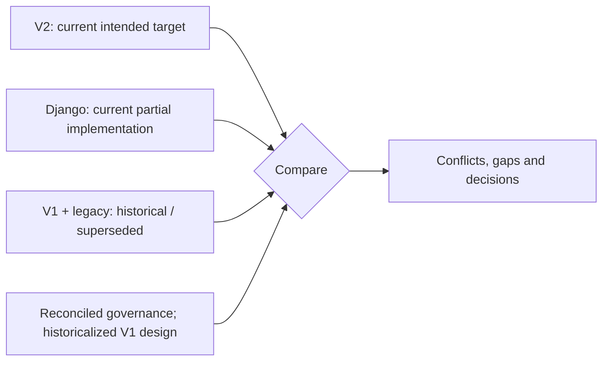

# 03 — Architecture Conflict Map

## 2026-10-31 verified Phase 1 implementation

The one-Company-per-normal-business-account rule is implemented with the PostgreSQL membership guard, service policy and Admin restrictions. Separate Company accounts retain independent UUIDs, credentials, sessions, grants, lifecycle and audit. Existing database contents remain unverified; the migration fails closed on multi-Company accounts and no rows are auto-split. Global `login_id` and email uniqueness remain in force; there is no Company login selector.

P1-11 through P1-19 implementation and final local validation are recorded in `docs/phase1-execution-progress.md`. This changes the current implementation classification below; dated 2026-10-19 verification headers and tables remain historical snapshots. No financial or Phase 2 behavior was implemented.

## 0. Verification header

- Repository/worktree: `D:/VIRMS`, dirty `staging`; reviewed 2026-10-19. Tracked documentation HEAD `b4a40772edec567297e96d72bf037df73ea0cae6`. Backend and architecture files inspected locally are untracked.
- **CURRENT APPROVED/TARGET:** the intended V2 architecture in `/docs-final-v2/`, per explicit current user direction and `docs-final-v2/01`'s statement that `/docs-final/` is a previous baseline. This does **not** fill V2's open business decisions or claim formal final-lock status.
- **CURRENT IMPLEMENTED:** source-inspected account/Tenant Django foundation only. **HISTORICAL / SUPERSEDED:** V1 `/docs-final/`, `/docs-legacy/` and V1-derived technical assumptions. **PROPOSED:** no alternative business architecture is added here.
- **UNVERIFIED:** tests, database/migration ledger, deployed API, production history. **BUSINESS DECISION REQUIRED:** V2's explicitly open money/access meanings. Governance documents now state the V2 authority model; unreconciled V1-derived System Design remains historical, not a V2 contract.

## 1. Three-truth comparison

Folder names, DRAFT/FINAL labels and commit recency alone do not determine the current target. Here the **latest explicit user direction** selects V2 for architecture mapping, and V2 itself calls V1 historical. The V2 header still says business approval is required before becoming authoritative; therefore **target selection is settled for these maps**, while formal document-governance reconciliation and unresolved V2 behavior remain outstanding. If a future instruction removes that explicit target or makes it genuinely ambiguous, mark `AUTHORITY CONFLICT — USER / BUSINESS CONFIRMATION REQUIRED` rather than guessing.

## 2. Canonical truth matrix

| Topic | CURRENT APPROVED/TARGET V2 | CURRENT IMPLEMENTED / tests | HISTORICAL / SUPERSEDED or stale text | Classification/action |
|---|---|---|---|---|
| Authority | V2 intended target; 01 says previous `/docs-final/` is historical baseline; 02/04/05/09/10 own V2 meanings | Code cannot choose product authority | `AGENTS.md`, README and older governance docs now distinguish V2 target, implementation and historical V1; System Design body remains historical/unreconciled | `CONFLICT-001` resolved by documentation; V2 BDRs remain open |
| Isolation | Platform→Company/Tenant→Branch; Company hard boundary, Branch within Company; module/action/object/field scope | Phase 1 implements Company membership/grants, Branch assignment, account and read scopes; finance/module handlers remain absent | V1 Garage=Tenant, Tenant-scoped Garage operations | Phase 1 foundation scope implemented; `CONFLICT-002` remains for unbuilt modules |
| Company account identity | Each ordinary business User UUID belongs to one Company; the same human in another Company has a separate account. Platform technical identities are distinct | `accounts.0007` PostgreSQL guard, provisioning policy and Admin protections enforce one Company for Company accounts. Disposable raw-SQL and upgrade tests pass; real rows remain unverified | Earlier shared Company account plan assumptions | `CONFLICT-006` implementation complete; migration fails closed on existing multi-Company rows; no automatic split; global login ID/email uniqueness retained |
| Investor/Vehicle | Fund relationship at Company level across Branches; one Investor per funded Stock Vehicle; external customer Vehicle requires none | No Investor, Fund, Vehicle or Garage model/API | V1 global cross-Garage Investor/Fund, one Investor for every Vehicle | `RULE_SUPERSEDED` for target; `CONFLICT-003` compatibility review |
| Money and Owner | Actual Company Running Capital separate; positive Investor/Company Share; Company-level period Owner Distribution; manual Loss | No finance tables/routes/tests | V1 per-deal Owner Pool, formula Loss/Owner contribution, no Company Accounting/Running Capital | `RULE_SUPERSEDED`; V2 `BUSINESS DECISION REQUIRED` in affected areas |
| Protected rates | Platform Back Office changes Investor agreements, monthly rate, Owner split and sensitive defaults; Accountant confirms authorized transactions | No protected financial configuration | V1 Accountant could change Investor-specific percentage | `RULE_SUPERSEDED`; actor boundary implementation gap |
| API and frontend | V2 Company/Branch/module-scoped backend, Garage independent of Investment, source-linked Accounting; React target | Phase 1 auth/lifecycle/provisioning/read APIs and Django Admin are covered by 129 disposable-PostgreSQL tests; no React or finance API | V1-derived System Design routes/diagrams and roadmap | Phase 1 auth foundation implemented; broader V2 product remains partial |
| Existing production history | V2 text says no production V1 cutover needed | No tracked app code or live DB inspected | README describes replaced starter migrations | `UNVERIFIED`, `CONFLICT-005`; cannot infer live data state |

No `SYSTEM_DEFECT` or `TEST_STALE` is declared without code/runtime/test evidence proving one. The present business-target mismatch is primarily **missing implementation**, not proof the V2 target is wrong.

## 3. Conflict register — resolved and open

### CONFLICT-001 — Governance authority reconciliation

- **Classification/area:** authority and documentation. Previously stale V1 authority wording in `AGENTS.md`, README, System Design 00 and older Architecture 00/roadmap material has been reconciled to the V2 target and implementation/historical distinctions.
- **Current implemented behavior:** code remains a partial implementation and does not select product authority.
- **Why it mattered:** stale pointers could have led future work to apply V1 money, Tenant or permission rules.
- **Resolution:** V2 is **CURRENT APPROVED/TARGET**; V1 is **HISTORICAL / SUPERSEDED**. All 20 System Design files are explicitly historicalized, but their bodies are not V2-reconciled and still require section-level review before reuse.
- **Status:** RESOLVED as a documentation-authority conflict. V2 business decisions and implementation gaps remain tracked separately under `CONFLICT-002` through `CONFLICT-005`.

### CONFLICT-002 — Company/Branch/module target versus Tenant-backed Phase 1 foundation

- **Classification/area:** Phase 1 implements Company membership, CompanyRoleGrant, Branch assignment, account lifecycle/provisioning scope, Company/Branch reads and Django Admin adapters. The V2 enabled-module gate and product resource/object/field rules have no modules to govern yet.
- **Historical influence:** V1 Garage=Tenant design may have shaped the foundation, but generic `Tenant` code alone does not prove a V1 business implementation.
- **Why it matters:** a future financial/Job route built on Tenant membership alone could cross Branch/module boundaries or misassign Company money.
- **Resolution:** P1-11 through P1-19 verified the account/scope foundation on disposable PostgreSQL. Add module-specific gates with their owning V2 module in a later authorized phase; no financial behavior was introduced here. **Status:** Phase 1 foundation resolved; product-module implementation remains outside Phase 1.

### CONFLICT-003 — V1-derived finance/design assumptions versus V2 economics

- **Classification/area:** `RULE_SUPERSEDED` for current target plus `BREAKING_CHANGE_RISK` if real V1 data/consumers exist. V1 treats Garage as Tenant, Investor/Fund as global, Owner payout as per-deal and Loss as percentage allocated. V2 makes Company the Tenant, Fund Company-level, Company Share a source of Company Accounting, Owner distribution a Company period action and Loss manual. V2 also adds Running Capital, Garage Jobs, interim payout/reconciliation and module state.
- **Current implementation:** no financial model/API to refactor was found. `/system-design/01`–`/19`, earlier `/architecture/` foundation/roadmap and diagram are V1-derived; their V1 business shapes are historical, though stack/technical practices may still be usable after revalidation.
- **Why it matters:** copying V1 formulas or permission actors would produce wrong V2 money and isolation behavior. A deployed V1 cutover remains **UNVERIFIED**.
- **Resolution:** use V2 as target, block affected actions on V2 BDRs, and reconcile technical design before those implementations. No migration or dual engine is prescribed by this documentation task. **Status:** OPEN design drift and future compatibility risk.

### CONFLICT-004 — V2 has explicit unresolved business meaning

- **Classification/area:** `BUSINESS_DECISION_REQUIRED`, not an architecture implementation choice. V2 marks eligible principal/withdrawal limits; interim versus deal/period reconciliation; manual Loss effects and actor; Company distributable-Profit definition; cross-Branch correction authority; Platform support private-finance read; and minimum settlement actions while module OFF as unresolved.
- **Current implementation:** none of these financial or module-control actions exists locally.
- **Why it matters:** a calculation, suggestion or historical V1 formula cannot supply an approved V2 economic/permission outcome.
- **Resolution:** keep affected implementation blocked or manual only where V2 explicitly permits it until business decisions are recorded. Other defined V2 target boundaries remain describable. **Status:** OPEN.

### CONFLICT-006 — Company business account identity cardinality

- **CURRENT TARGET:** one ordinary Company business account UUID belongs to exactly one Company. The same human in another Company uses a separate UUID account with independent credentials, sessions, roles, Branch scope and audit history. Technical platform identity remains separate.
- **CURRENT IMPLEMENTED (2026-10-31 local worktree):** successor migration `accounts.0007` adds an immutable Company/platform account kind and a PostgreSQL trigger rejecting a second Company membership for Company accounts, including a new raw SQL insert. Provisioning, lifecycle and Admin policy use the same one-Company boundary. Fresh replay, direct-bypass tests and representative supported upgrade pass. Existing real rows remain unverified.
- **Compatibility gate:** inspect existing multi-Company User counts and history before a successor constraint or reader cutover. Never auto-split or infer identity from name, email or phone. Global login ID/email uniqueness is the current rule; no Company login selector is required.

### CONFLICT-005 — Application history and deployed runtime evidence absent

- **Classification/area:** `UNVERIFIED`; schema/release/history. Current source and migrations are locally tested; no live staging/production PostgreSQL ledger, API, deployment or production transaction history was checked.
- **Competing claims:** modified README says starter migrations were replaced; V2/01 and V2/06 say no production V1 cutover or dual calculation engine is required. These are documentation claims, not observed environment state.
- **Resolution:** verify environment and actual history before any migration, compatibility or release decision. Do not invent existing customers/data, and do not assume zero records. **Status:** OPEN evidence gap.

## 4. Superseded rule and current/previous delta register

| HISTORICAL / SUPERSEDED V1 rule or reference | CURRENT APPROVED/TARGET V2 replacement | Previous implemented behavior | Search/compatibility guard |
|---|---|---|---|
| Garage = Tenant | Company = Tenant; Branch/Garage is within Company | V1 deployed behavior UNVERIFIED | Search `Garage = Tenant`, Tenant resolver and transfer paths; no automatic data migration assumption. |
| Global Investor/Fund across Garages | Company-level Investor/Fund across that Company's Branches | V1 financial data UNVERIFIED | Search global Fund assumptions; prevent cross-Company balances. |
| Every Vehicle has one Investor | Funded Stock Vehicle one Investor; external customer Garage Vehicle need not have one | Vehicle implementation absent | Search unconditional Investor FK/permission assumptions. |
| Accountant changes Investor-specific percentage | Platform Back Office protects Investor positive-share agreement/rates; Accountant uses effective value | No agreement endpoint | Search Accountant config mutation assumptions. |
| Deal-level Owner Pool and percentage Loss | Company-level period Owner Distribution; new V2 Loss manual | No finance implementation | Search Owner pool/loss-share/contribution formulas; do not import them into V2. |
| No Company Accounting, Running Capital or Garage Jobs in V1 core | V2 Company Accounting, separate Running Capital and independent Garage Job workflow | No local implementation | V1 module list/roadmap is not a complete V2 module list. |

`docs-legacy/` remains non-authoritative historical material. Git commits show V1 freeze `24b7300` and V2 documentation additions `d8edb38`/`b4a4077`. Chronology alone did not choose V2; explicit project intent and V2's own authority statement did. No prior deployed business flow or data shape was verified.

## 5. Diagram, test and duplicate-source drift

| Evidence | Current status / drift | Required guard |
|---|---|---|
| `architecture/diagrams/virms-foundation-and-delivery-flow.mmd`, V1 roadmaps | Phase sequence may be useful, but labels/source basis point to V1 | Treat business/module conclusions as HISTORICAL / SUPERSEDED until reconciled. |
| `system-design/01` context, `/03` tenancy, `/05` finance, `/07` API | Technical design derived from V1, not a V2 contract | Do not copy global Fund, Garage Tenant or per-deal Owner/Loss semantics into V2. |
| `apps/accounts/tests/test_users.py`, `apps/tenants/tests/test_tenants.py` | Selected account/Tenant assertions present; execution UNVERIFIED; no V2 Branch/module/finance tests | `PARTIAL_IMPLEMENTATION`, not automatic `TEST_STALE` or V2 coverage. |
| Current Account/Tenant model plus future Company/Branch sources | Risk of treating generic Tenant membership as complete Company/Branch permission | One authoritative Company/Branch scope path; no duplicate grants from caller IDs. |
| Investment, Garage and Accounting views of the same money | V2 defines separate module ownership with source links | One actual economic event; Company ledger references source without double posting. |
| Monthly interim, ordinary deal Profit and period reconciliation | V2 distinct streams; precise reconciliation still BDR | Do not relabel an interim advance as earned deal Profit or count a payment twice. |

No test execution or runtime defect was performed/proven here. `CONFLICT-001` was resolved by documentation changes only, not by a code commit. Historicalized System Design references remain unreconciled and must not be treated as approved V2 technical detail.

## 6. Security and ownership conflict guard

V2 hard boundary is Company. Branch is within-Company scope/attribution and module state gates ordinary actions. A Platform administrator's cross-Company platform capability does not automatically include private Company finance. Protected configuration permission does not confer Accountant posting permission. Media cannot read internal finance; Investor self-view cannot read another Investor; Owner is read-only. Current Tenant-only API coverage is narrower than those target controls. `CONFLICT-002/004` govern any affected route. Public views must use safe publication fields and never serialize internal Vehicle/Investor records.

## 7. Business decisions required and verification status

1. Monthly Interim Payout: eligible-principal basis and active-cycle principal withdrawal limit (`docs-final-v2/01`, `/04`, `/05`).
2. Investor reconciliation: deal inclusion and ordinary eligible deal Profit versus monthly interim versus six-month/annual settlement; prevent double payment (`/01`, `/05`).
3. Manual Loss: exact Investor principal/Company Running Capital and Company accounting impact, confirmation actor and closure consequences (`/01`, `/02`, `/04`, `/05`).
4. Company distributable Profit: recognition basis for Company Share, Garage Revenue/common Expenses, period close/carryforward and actual distributable amount (`/01`, `/04`, `/09`).
5. Company-level correction across Branches: exact action authority and scope (`/02`, `/10`).
6. Platform Back Office support: conditions for private Company finance read beyond explicit Company assignment (`/02`).
7. Module OFF: minimum permitted settlement actions for already-open obligations (`/02`, `/06`).

These are **BUSINESS DECISION REQUIRED** for the affected behavior, not evidence V2 ceases to be current target. Governance authority wording is reconciled; V1-derived System Design body content remains historical and unreconciled. **UNVERIFIED:** actual tests, database, deployment, production V1 data/cutover. **CURRENT IMPLEMENTED:** only local source-inspected foundation. **PROPOSED** additional architecture: none. Evidence includes all V2 documents, old V1/legacy documents, governance/design files, current code/tests and the Git commits above.
