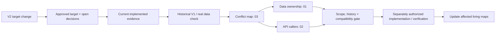

# 04 — Change Impact & Compatibility

> Local safety correction 2026-11-19: confirmation now fails closed for expense-only Investor funding without a matching Purchase agreement snapshot, preventing Company-only recognition. Existing expense entry and historical records remain unchanged; a complete Investor agreement/recovery path remains outstanding.

> Phase 8 Loss confirmation now requires explicit Investor and Company Loss amounts from new clients when confirming a negative result; positive and break-even confirmation payloads remain unchanged. Investment migrations 0025–0028 enforce signed result consistency, preserve a nullable suggestion snapshot for existing historical rows, and require matching suggestion/impact audit for new Loss confirmations. Existing immutable results and payout records are not rewritten. Deploying clients and migrations together requires a compatibility plan; staging/production remain unverified.

> Phase 8 Exit notice: investment migrations 0022–0023 add append-only extension records and PostgreSQL source, ordering and audit guards. Existing Exit requests retain their recorded identity and derive the initial deadline from their UTC request instant. The additive Company Accountant list/extension API and Investor self fields do not create Fund, Accounting or settlement events. Full Exit settlement and deployment verification remain outstanding.

> HISTORICAL SNAPSHOT — 2026-11-02. This Phase 1/2 candidate note is retained as dated history; current Phase 3 status follows.

> Local integration state — 2026-11-02: `codex/audit` contains the accepted Phase 1/2 integration, including P2-13–P2-22 role-navigation and Investor mock-data boundary corrections. Phase 1 passed 210/210 account/tenant tests on disposable PostgreSQL; Phase 2 passed 74/74 React tests, configured lint/build, and isolated browser acceptance. Role/menu/data-boundary corrections added no business API or schema. The narrow-screen dashboard tab overflow and TopBar decorative-avatar accessibility finding were corrected without redesigning desktop hierarchy; the Vite bundle advisory is deferred. Remote remains at `f266803acd5e86caa2286fb8eae41df6cadfcb86` pending separately authorized push; staging is untouched, production proxy/cookie behavior remains unverified. Roadmap Phase 3 is Main Operations Foundation (not started); Garage is Phase 6 after Phases 4 and 5. See [roadmap](../planning/V2-DEVELOPMENT-ROADMAP.md) and [Phase 2 report](../docs/phase2-execution-progress.md).

> Phase 3 checkpoint — 2026-11-03: Company module-state model/migration, scoped Admin command, read-only metadata API, and React shared query are implemented. Commit 73797b16aa35db776b5601fe1483c2be8de6c100 is pushed to origin/codex/audit; local and fetched remote heads matched. Django 232/232 and React 89/89 checks passed with lint/build/migration validation. No CI run/status was present. Staging/production deployment and actual PostgreSQL runtime-role permissions remain UNVERIFIED; UI pages, routes, and business workflows did not change.

> Phase 1 corrections candidate after `cac26195`: `/auth/me` adds scoped role fields while preserving existing routes and fields. Migration 0012 adds end-time guards to four authorization history tables; it also forbids extending or removing a still-active finite end, so a new interval must use a new row. Supported Phase 1 administrative writes use parent locks for overlap prevention; no database-wide exclusion constraint is claimed. The existing legacy 0007 cutover writer-pause requirement remains. See [the execution report](../docs/phase1-execution-progress.md).

> Earlier candidate snapshot — 2026-11-01: the Phase 1 backend passed 172/172 accounts/tenants tests on disposable PostgreSQL 15.19 and preserved released migration 0007 before the subsequent B1/B2/B3 corrections. Current correction status and the final 199-test result are in [the execution report](../docs/phase1-execution-progress.md). The legacy preflight/write race requires the accepted writer pause and recovery procedure; no shared database or deployment was used.

> Correction audit: current scoped lifecycle, same-row temporal authorization, bounded uniform login admission, safe required lifecycle reasons and audit Branch scope are recorded in [docs/phase1-audit-corrections.md](../docs/phase1-audit-corrections.md). Earlier completion/test-count statements below are historical snapshots.

## 2026-10-31 verified compatibility state

Phase 1 account, Company/Branch authorization and migration safeguards are implemented through P1-19. One normal Company business User UUID is protected to exactly one Company; another Company uses an independent UUID account. Existing database rows are unverified and the migration refuses ambiguous multi-Company accounts; no auto-split is performed. Global `login_id` and email uniqueness are locked, with no Company selector. Platform technical identity remains separate. Finance/product modules and deployment remain outside this Phase 1 result.

## Historical 2026-10-31 implementation snapshot

The 2026-10-19 snapshot below is historical. The current local Phase 1 candidate has passed fresh PostgreSQL migration replay, the accounts/tenants regression, a supported legacy upgrade, explicit role/login mapping tests, restore rehearsal, audit privilege and Admin bypass tests, and bounded Company/Branch read query checks. The Phase 2 candidate separately adds React session/authentication and bounded Company/Branch context integration; it does not implement V2 finance or business modules. Evidence is in `docs/phase1-execution-progress.md` and `docs/phase2-execution-progress.md`. Initial migrations were not rewritten. Existing production history, role configuration, cleanup scheduling, staging/production runtime and deployment remain unverified.

## 0. Historical verification header — 2026-10-19 baseline

- Repository/worktree: `D:/VIRMS`, dirty `staging`; reviewed 2026-10-19. Tracked documentation HEAD `b4a40772edec567297e96d72bf037df73ea0cae6`; inspected backend and architecture files are untracked.
- **CURRENT APPROVED/TARGET:** V2 business architecture in `/docs-final-v2/`, selected by explicit current user direction and V2/01's historical-baseline statement. V2's marked open decisions are not supplied by this map.
- **CURRENT IMPLEMENTED at this 2026-10-19 snapshot:** source-inspected Phase 1 account/Tenant/Branch foundation only. Phase 3 had not started at that historical date; see the current checkpoint above for Phase 3 status. **HISTORICAL / SUPERSEDED:** V1 `/docs-final/`, `/docs-legacy/` and V1-derived design assumptions. **PROPOSED:** no extra business behavior or compatibility mechanism is chosen here.
- **UNVERIFIED:** staging/production runtime and prior released data. **BUSINESS DECISION REQUIRED:** specific V2 financial/access meanings below. Governance files now use the V2 authority model; System Design bodies remain historicalized and unreconciled. See [03](03-ARCHITECTURE-CONFLICT-MAP.md).

## 1. Purpose and state classification

This map asks what a V2-target change affects and which **valid current implemented** paths must survive. Missing V2 modules are implementation gaps, not valid V1 financial flows to preserve. A documented V2 target does not mean a transaction can be implemented where V2 itself leaves its economic basis or actor undecided. No migration, adapter, dual-read/write strategy or deployment action is inferred from uninspected runtime data.

## 2. One-view change gate

The right lane is a future review sequence, not authorization to implement anything in this task.

## 3. Domain dependency and change-impact matrix

| Change area | Data/API/consumer impact | Security, history and compatibility check | State/classification |
|---|---|---|---|
| Session, role and Tenant foundation | Current auth, provision/reset/status and Tenant list/detail; future V2 client | Preserve CSRF/session, first-login gate, current role/membership denial; add Company/Branch/module/object scope without caller-ID grants | CURRENT IMPLEMENTED partial; `SECURITY_SCOPE_REVALIDATION_REQUIRED` |
| Platform→Company/Tenant→Branch | Company membership, Branch assignment/movement, enabled module, every protected route/report/cache | Company isolation, prior-Branch records, cross-Branch correction authority, module OFF obligations; inspect actual DB before migration | CURRENT APPROVED/TARGET; `PARTIAL_IMPLEMENTATION`; `CONFLICT-002/004` |
| Investor and Fund | Company-scoped Investor relationship and one Fund across that Company's Branches | Never join Funds across Companies; source-linked actual use/recovery; assess real V1 data if present | CURRENT APPROVED/TARGET; `HISTORY_PRESERVATION_REQUIRED` if data exists |
| Funded Stock Vehicle versus external Garage Vehicle | One Investor only for funded Stock; Garage Job can exist without Investment | Stable Company Vehicle identity, Branch movement, Job cost once, Investor-less external customer path | CURRENT APPROVED/TARGET; `DATA/API/UI MIGRATION` need UNVERIFIED |
| Investor capital and Company Running Capital | Exact actual source contributions/recoveries, Stock Vehicle cost, Sale | No Investor/Company money netting, no cost/recovery duplicate; full collection gate for final positive settlement | CURRENT APPROVED/TARGET; finance high risk |
| Buyer Sale/payment/refund | Company Buyer, agreed price, actual bounded receipt, refund payable and actual refund | Original events immutable; no overcollection/double Fund or Company credit, atomic cap checks | CURRENT APPROVED/TARGET; finance high risk |
| Investor positive Share and Company Share | Effective protected agreement/snapshot, Company Accounting link | Platform changes rate; Accountant confirms money; Company Share not per-deal Owner payout; avoid hard-coded 33% | CURRENT APPROVED/TARGET; actor/snapshot check |
| Company Accounting, Garage Revenue and Owner Distribution | One classified Company source/ledger, Branch attribution, period result, recipients/payments | No duplicate economic event; positive Company-level allocation exact; distributable base/recognition/period close BDR | CURRENT APPROVED/TARGET; `BUSINESS_DECISION_REQUIRED` |
| Monthly interim, reconciliation and Exit | Due/Suggested versus Paid, ordinary deal Profit history, recoverable/payable, principal-first final closure | Eligible-principal/withdrawal and period/deal inclusion BDR; never pay retained amount twice | CURRENT APPROVED/TARGET; `BUSINESS_DECISION_REQUIRED` |
| Manual Loss and correction | Negative indicator, approved impact, reason and actual linked events | No V1 formula Loss/Owner contribution; impact/confirmation/cross-Branch authority BDR | CURRENT APPROVED/TARGET; `BUSINESS_DECISION_REQUIRED` |
| Media/public and module availability | Vehicle Company/Branch scope, private R2 original, public-safe response, module state | Do not expose private finance or lose history when module OFF; minimum open-obligation actions BDR | CURRENT APPROVED/TARGET; privacy/access high risk |

Use `NO_COMPATIBILITY_IMPACT` or `LOCAL_INTERNAL_CHANGE` only after tracing actual consumers. Other possible classifications are `BACKWARD_COMPATIBLE_CHANGE`, `COMPATIBILITY_ADAPTER_REQUIRED`, `DATA_MIGRATION_REQUIRED`, `API_MIGRATION_REQUIRED`, `UI_ROUTE_MIGRATION_REQUIRED`, `HISTORY_PRESERVATION_REQUIRED`, `SECURITY_SCOPE_REVALIDATION_REQUIRED`, `BREAKING_CHANGE_APPROVAL_REQUIRED`, and `BUSINESS_DECISION_REQUIRED`. None automatically mandates a mechanism without evidence of deployed data/callers.

## 4. Valid current workflow protection

| CURRENT IMPLEMENTED path | Current entry/data/permission | Protection and evidence limit |
|---|---|---|
| CSRF → Login ID/password → Django session → `/auth/me/` | LoginAttempt throttle, active User, effective role/Tenant IDs and first-login flag | Preserve session, generic failure, password replacement and reset safety while extending V2 context. Account/tenant tests passed on disposable PostgreSQL. |
| Account provisioning | `/accounts/provision/`; atomic User/RoleAssignment/TenantMembership/AccountSecurityEvent; Back Office Owner/Accountant or Accountant Investor/Media within active Tenant membership | Preserve UUID/history and authorized temporary-credential path; reassess Platform/Company/Branch permissions for V2. Live behavior UNVERIFIED. |
| Password reset, deactivation/reactivation | Target lock, manager authority across current target roles/Tenants, history/event | Preserve out-of-scope denial and old-session safety; no assumption that Admin and API audit are identical. |
| Tenant list/detail | Allowed role and active membership-filtered active Tenant queryset; read-only API | Preserve no unauthorized Tenant disclosure; a current Tenant-only response is insufficient as complete V2 Company/Branch context. |
| Company module-state configuration/read | Platform Admin managed-Company form → locked command + `module.configure` audit; `GET /api/v1/tenants/{company_id}/module-state/` uses `visible_companies` | Immutable version history, expected-version conflicts, no Branch query authorization, fixed metadata-only response; passed PostgreSQL tests on a disposable database. |

No Investor, Stock Vehicle, Garage Job, Company Accounting, financial, public catalog or media flow is currently implemented as an end-to-end valid workflow. Business records remain demo data; the module-state React query is metadata only. Their V2 boundaries are target obligations, not legacy behavior. Record confirmed defects as `SYSTEM_DEFECT`; the module-state backend regression suite passed on disposable PostgreSQL, while deployed runtime remains unverified.

## 5. Historical V1 versus V2 target change gate

**HISTORICAL / SUPERSEDED V1:** Garage=Tenant; global cross-Garage Fund; Accountant Investor-specific rate changes; Owner Profit allocated directly per Vehicle deal; Loss allocated through Profit percentages and Owner contribution. **CURRENT APPROVED/TARGET V2:** Company=Tenant with Branches, Company-scoped Fund, Platform Back Office protected rates, exact Company Running Capital, Company Accounting, Company-level periodic Owner Distribution and manual Loss. External customer Garage work can exist without Investment. These are different ownership, permission and economic contracts, not a safe terminology swap.

`AGENTS.md`, README and older governance/roadmap documents now distinguish V2 target from current implementation and historical V1. The System Design set is explicitly historicalized, but its body has not been V2-reconciled; do not rely on it without section-level review. `CONFLICT-001` is resolved as a documentation-authority conflict; `CONFLICT-003` continues to track historical business/design differences and compatibility risk. V2 document headers still say draft/approval required, so these maps **do not claim formal final lock** or fill its BDRs. Actual V1 deployment/data/cutover need is **UNVERIFIED**. The draft statement that no production V1 transaction cutover is needed must be checked against real history before migration decisions. No dual engine, backfill, adapter or rollback method is specified here.

## 6. Frontend↔backend, schema and history compatibility

**Current frontend:** authenticated React context uses `/auth/me/`; Phase 3 adds a role-gated `module-state` API service/query keyed by user+Company and a zero-render workspace bootstrap. Business pages still read their existing demo data. **V2 target:** each future route/API client sends authenticated context; backend validates Company membership, Branch assignment, module state, role/action, object and field scope; authoritative Django transaction records one source event; response drives authorized scoped TanStack Query refresh. A UI route or hidden control is not permission. Before an API shape change, enumerate real current callers, fields, error handling and cache keys; do not copy V1 representative routes without V2 revalidation.

**Current schema:** local account/Tenant/Branch migration history plus `tenants.0003_company_module_state`; fresh apply, empty-state reverse/reapply and populated-history reverse protection were verified on disposable PostgreSQL. Persistent, staging and production migration ledgers remain unverified. Before altering Tenant identity, adding business models or moving Fund ownership, inspect actual migration state, existing rows, writers/readers, external consumers, historical data and release order. Never rewrite a released migration merely for neatness. Preserve V2 immutable financial, Job, movement, configuration and distribution source history once implemented.

**Current permission:** account/Tenant/Branch paths use existing scoped policies. The module-state read uses `visible_companies`; configuration uses the Platform-only `module.configure` action and managed-Company Admin scope. This metadata foundation does not yet enforce module state on business operations; each V2 business endpoint must add its own Company/Branch/module/action/object checks. Platform configuration authority does not confer ordinary Company finance posting; Platform private-finance support beyond explicit Company assignment is a BDR. Module OFF must retain authorized history and required open-position settlement without inventing which actions are permitted.

## 7. Regression and evidence map

| Area | Direct focused check when implemented | Transitive / current gap |
|---|---|---|
| Auth/Company/Branch/module | Existing session/CSRF, provisioning/reset, Company isolation and Branch access regressions; new module-state command/API/Admin/concurrency tests | Combined React and PostgreSQL backend regressions passed locally; no business module OFF/ON enforcement exists yet |
| Stock/Garage/Accounting | Funded Stock one Investor, external Vehicle none, Job cost/charge source, one Company receipt/economic effect | Running Capital, Company Share, Garage Revenue and reports; no current code/tests |
| Buyer/Investor finance | Positive bounded Buyer receipt/refund, actual principal/Company capital reconciliation, protected agreement snapshot | Deal Profit, interim, reconciliation, settlement and correction; BDRs for some positions |
| Owner/manual Loss | Company period approved amount and balanced-paise Owner allocation; specifically authorized actual payments; manual Loss no auto-allocation | Historical snapshots, correction and actual recovery; distributable/impact authority BDR |
| Media/public | Four active images, private original, Company/Branch field scope and safe public schema | Branch movement, module state and publication cache; no current code/tests |
| Migration/release | Fresh migration replay, actual upgrade path, backup/restore, health/readiness | Database and deployment UNVERIFIED; no cutover claim |

Future high-risk work follows current target and current implementation → previous verified behavior where relevant → `CONFLICT-` check → Data/API/consumer/security/history impact → business decision and approval gate → separately authorized implementation → focused and transitive verification → only affected map/current-state updates. No test or deployment action is performed by this documentation change.

## 8. Remaining conflicts, decisions and verification

- `CHANGE-RISK-001` **A:** unreconciled V1-derived System Design body content can reintroduce wrong V2 ownership/finance rules (`CONFLICT-003`). It is historicalized; require section-level V2 and implementation review before relying on it for a phase.
- `CHANGE-RISK-002` **A for business routes:** Company/Branch foundations and Company module-state metadata are now source-implemented, but no business endpoint consumes module state yet (`CONFLICT-002`); building financial routes on Tenant-only checks would be unsafe.
- `CHANGE-RISK-003` **A for affected actions:** monthly eligible-principal and withdrawal, period/deal reconciliation, manual Loss impact/actor, Company distributable amount/period close, cross-Branch correction, Platform support private read and module-OFF minimum settlement actions are **BUSINESS DECISION REQUIRED** (`CONFLICT-004`).
- `CHANGE-RISK-004` **B:** Phase 1–3 source is tracked and Phase 3 is pushed; disposable-PostgreSQL schema/migration tests passed. Deployed runtime and production data/history remain **UNVERIFIED** (`CONFLICT-005`); do not assume empty production or an existing V1 cutover.

Evidence: all 13 V2 documents, particularly 01/02/04/05/06/09/10 and supporting standards; historical V1 and legacy documents; current `core/`, `apps/accounts/`, `apps/tenants/`, migrations and tests; repository governance and V1-derived design; Git documentation history. **CURRENT IMPLEMENTED:** tracked source inspected; Phase 1–3 local tests and disposable-database validation are recorded in the current checkpoints. **CURRENT APPROVED/TARGET:** V2 intent, with BDRs. **HISTORICAL / SUPERSEDED:** V1 business shape. **PROPOSED:** no new business rules. **UNVERIFIED:** tests, DB, API runtime, frontend integration, deployment and prior production data.

## Current V2 Business Decision Additions Referenced — Phase 4 bounded Accounting

- Canonical additions: [01 — Business Rules](../docs-final-v2/01-business-rules.md#approved-business-decision-additions), [02 — User Roles and Permissions](../docs-final-v2/02-user-roles-permissions.md#approved-business-decision-additions), [04 — Data Model Relationships](../docs-final-v2/04-data-model-relationships.md#approved-business-decision-additions), and [09 — Company Accounting](../docs-final-v2/09-company-accounting-owner-distribution.md#approved-business-decision-additions).
- Technical impact: Accounting Result includes committed Accounting Income/Expense only; signed opening movement affects account balance only; Owner is read-only; cross-Branch correction is Accounting-specific. No current code, API, migration, or UI behavior is changed by this reference.
- Full Company Profit recognition and remaining Investor/Loss/Platform questions stay BDRs; the resolved Accounting permission must not be applied to Garage or other modules.
- `CHANGE-RISK-003` no longer treats Company-level Accounting cross-Branch correction as a BDR; its other listed BDRs remain unchanged.

## Current V2 Business Decision Additions Referenced — Phase 4 cash event history

- Canonical decisions: [01 — Business Rules](../docs-final-v2/01-business-rules.md#approved-business-decision-additions), [04 — Data Model Relationships](../docs-final-v2/04-data-model-relationships.md#approved-business-decision-additions), and [09 — Company Accounting](../docs-final-v2/09-company-accounting-owner-distribution.md#approved-business-decision-additions).
- Compatibility impact: typed cash corrections append linked events/movements; wrong-target changes append applications only. All actual cash writes reject future timestamps. Routes/UI and Phase 1–3 behavior remain unchanged by this reference.

## Current V2 Business Decision Additions Referenced

- Canonical decisions: [01 — Business Rules](../docs-final-v2/01-business-rules.md#approved-business-decision-additions), [02 — User Roles and Permissions](../docs-final-v2/02-user-roles-permissions.md#approved-business-decision-additions), [04 — Data Model Relationships](../docs-final-v2/04-data-model-relationships.md#approved-business-decision-additions), and [09 — Company Accounting](../docs-final-v2/09-company-accounting-owner-distribution.md#approved-business-decision-additions).
- Technical impact: later Accounting work must preserve immutable source events and calculate Company reporting periods from the canonical records. These references change no current code, schema, API, migration, permission, or route.
- Cross-Branch impact is limited to the Company-level Accountant Accounting correction rule referenced in 02/09; existing Garage and other-module BDR/default-deny rules remain.

## Current V2 Business Decision Additions Referenced — 2026-11-03

- Current decisions: [01 — Business Rules](../docs-final-v2/01-business-rules.md#approved-business-decision-additions), [02 — User Roles and Permissions](../docs-final-v2/02-user-roles-permissions.md#approved-business-decision-additions), [04 — Data Model Relationships](../docs-final-v2/04-data-model-relationships.md#approved-business-decision-additions), and [09 — Company Accounting](../docs-final-v2/09-company-accounting-owner-distribution.md#approved-business-decision-additions).
- Technical impact: future Accounting integration must preserve pre-existing obligations across module OFF, use Asia/Kolkata report boundaries with UTC event storage, permit signed opening movements, and keep Profit as a derived projection from the Accounting source records.
- This reference changes no current implementation or route. It does not resolve distributable-Profit, period-close, Investor reconciliation, or other-module OFF BDRs.

## Current V2 Business Decision Additions Referenced — Phase 4 correction and archive safety

- Canonical decisions: [02 — User Roles and Permissions](../docs-final-v2/02-user-roles-permissions.md#approved-business-decision-additions), [04 — Data Model Relationships](../docs-final-v2/04-data-model-relationships.md#approved-business-decision-additions), and [09 — Company Accounting](../docs-final-v2/09-company-accounting-owner-distribution.md#approved-business-decision-additions).
- Compatibility impact: add no behavior to existing Phase 1–3 paths. Phase 4 corrections append linked same-kind events; Company-level Branch reattribution stays within one Company; an account with transaction history remains non-archivable. These are target constraints only until implementation is separately approved.

## Current V2 Business Decision Additions Referenced — Phase 4 OFF chronology and status overlay

- Canonical decisions: [01 — Business Rules](../docs-final-v2/01-business-rules.md#approved-business-decision-additions), [02 — User Roles and Permissions](../docs-final-v2/02-user-roles-permissions.md#approved-business-decision-additions), [04 — Data Model Relationships](../docs-final-v2/04-data-model-relationships.md#approved-business-decision-additions), and [09 — Company Accounting](../docs-final-v2/09-company-accounting-owner-distribution.md#approved-business-decision-additions).
- Use immutable Company module-state revision references for event ordering; ordinary OFF settlement and correction/reallocation are distinct. Phase 4 Accounting's cross-Branch correction and pre-existing-obligation settlement are resolved, not BDRs. `CHANGE-RISK-003` remains for Investor principal/withdrawal/reconciliation, manual Loss, Company Profit/distribution, Platform private support access, and non-Accounting correction/OFF authority.
- This overlay supersedes only the matching BDR fragments in the earlier risk table; no other compatibility or deployment state changes.

## Phase 4 implementation and compatibility checkpoint — 2026-11-03

Phase 4 Company Accounting persistence, scoped API actions, and the React Accounting data boundary are implemented and locally verified. Existing Phase 1–3 behavior and frontend route identities were covered by regression checks; no unrelated module flow was migrated. Corrections retain append-only event/application/movement history; account archive is denied when any financial history exists, including a net-zero balance. See [Phase 4 execution evidence](../docs/phase4-execution-progress.md).

This supersedes only prior compatibility references that described these Accounting contracts as proposed-only. Later module-to-Accounting source integrations and staging/production validation remain outstanding; no claim is made for those flows.

## Phase 4 migration rollback safety audit — 2026-11-04

Accounting migrations `0001`–`0003` now guard reverse operations when Accounting catalogue or history/idempotency rows exist, preserving the data and integrity triggers. Empty rollback/reapply is supported and tested. The forward schema is unchanged by this guard. Fresh apply and no-pending-plan checks passed on a separate disposable PostgreSQL database; persistent, staging, and production migration history remains unverified. See [the Phase 4 execution evidence](../docs/phase4-execution-progress.md).

## Current V2 Business Decision Additions Referenced — Phase 5 Monthly Interim amount

- Canonical decisions: [01 — Business Rules](../docs-final-v2/01-business-rules.md#approved-business-decision-additions), [02 — User Roles and Permissions](../docs-final-v2/02-user-roles-permissions.md#approved-business-decision-additions), [04 — Data Model Relationships](../docs-final-v2/04-data-model-relationships.md#approved-business-decision-additions), and [05 — Vehicle/Investor Finance Workflow](../docs-final-v2/05-vehicle-investor-finance-workflow.md#approved-business-decision-additions).
- Compatibility impact: no Phase 1–4 code, API, schema, route, or UI behavior is changed by this documentation decision. Phase 5 remains NOT STARTED; the fixed amount and permission apply only to a future Investment implementation. Principal withdrawal limits and reconciliation-period deal/payout behavior remain open.

## Current V2 Business Decision Additions Referenced — Interim advance as Paid

- Canonical decisions: [01 — Business Rules](../docs-final-v2/01-business-rules.md#approved-business-decision-additions), [04 — Data Model Relationships](../docs-final-v2/04-data-model-relationships.md#approved-business-decision-additions), and [05 — Vehicle/Investor Finance Workflow](../docs-final-v2/05-vehicle-investor-finance-workflow.md#approved-business-decision-additions).
- Compatibility impact: a future Investor Profit view shows earned Profit and confirmed Interim payments separately and derives the remaining position without duplicating payment history. No existing Phase 1–4 flow changes; Phase 5 remains NOT STARTED. Period deal inclusion and ordinary payout interaction remain open.

## Current V2 Business Decision Additions Referenced — Phase 5 compatibility

- Canonical Phase 5 additions: [01 Business Rules](../docs-final-v2/01-business-rules.md#phase-5-approved-business-decision-additions--investor-fund-vehicle-periods-and-loss), [02 Permissions](../docs-final-v2/02-user-roles-permissions.md#phase-5-approved-business-decision-additions--investor-and-vehicle-permissions), [04 Relationships](../docs-final-v2/04-data-model-relationships.md#phase-5-approved-business-decision-additions--investment-and-vehicle-relationships), [05 Workflow](../docs-final-v2/05-vehicle-investor-finance-workflow.md#phase-5-approved-business-decision-additions--fund-vehicle-investor-periods-and-exit), and [09 Accounting](../docs-final-v2/09-company-accounting-owner-distribution.md#phase-5-approved-business-decision-additions--investment-source-linkage).
- Compatibility impact: future Phase 5 adds isolated Investment/Vehicle APIs and typed capital-event source links while retaining existing Phase 4 event/movement semantics, Company/Branch boundaries, module-state lock ordering, routes and UI compositions. Existing mock UUID-like labels must not be treated as database IDs.

## Phase 5 local compatibility checkpoint — 2026-11-07

This checkpoint supersedes only the future-tense claim above that Phase 5 APIs/source links are not yet implemented. The local branch adds Investment and Vehicle APIs/models and typed Accounting capital links without editing React pages, routes, navigation identities or visual composition. The `apps` Django suite has been rerun on disposable PostgreSQL after the Phase 5 backend changes; focused concurrency tests prove a pooled source-credit return cannot overdraw its Branch-attributed credit and produces one return/cash effect. Fresh migrations and empty-schema reverse/reapply passed. Exact test results and the outstanding React test failure are in [Phase 5 execution evidence](../docs/phase5-execution-progress.md).

Compatibility is incomplete: React still uses mutable mock state for these modules, Vehicle purchase is Q39-blocked, and deactivation is dependency-blocked. No persistent 8002, staging or production database was used or migrated; no commit, push or deployment occurred.
- Q39 gates purchase posting; deactivation waits for authoritative Garage/Sales/financial state. No Phase 1–4 compatibility contract is superseded.

## Current V2 Business Decision Additions Referenced — seller payable scope

- Canonical decision: [05 — Vehicle/Investor Finance Workflow](../docs-final-v2/05-vehicle-investor-finance-workflow.md#approved-business-decision-additions).
- Compatibility impact: the earlier Q39 business gate above is superseded, but purchase API/UI integration remains blocked by technical source-link, correction, concurrency, migration and form-contract work. Seller payable is in scope; lender finance and EMI are not. Existing React UI/routes remain protected.

## Current V2 Business Decision Additions Referenced — purchase funding allocation timing

- Canonical decision: [05 — Vehicle/Investor Finance Workflow](../docs-final-v2/05-vehicle-investor-finance-workflow.md#approved-business-decision-additions).
- Compatibility impact: Fund/Running Capital allocations are recorded at purchase creation, even before seller payment. Existing UI still needs a safe mapping to the purchase allocation and seller-payment sequence; no routes or layouts are changed by this reference.

## Current V2 Business Decision Additions Referenced — purchase correction after seller payment

- Canonical decision: [05 — Vehicle/Investor Finance Workflow](../docs-final-v2/05-vehicle-investor-finance-workflow.md#approved-business-decision-additions).
- Compatibility impact: preserve original seller payments and cash movements; a reduced cost needs a real, recorded refund. Existing UI/routes remain unchanged; purchase correction API and form contract remain unimplemented.

## Current V2 Business Decision Additions Referenced — purchase correction source allocation

- Canonical decision: [05 — Vehicle/Investor Finance Workflow](../docs-final-v2/05-vehicle-investor-finance-workflow.md#approved-business-decision-additions).
- Compatibility impact: source allocations remain history-backed and proportional; no existing route or UI changes. Specify paise rounding before exposing correction.

## Current V2 Business Decision Additions Referenced — purchase-source paise rounding

- Canonical decision: [05 — Vehicle/Investor Finance Workflow](../docs-final-v2/05-vehicle-investor-finance-workflow.md#approved-business-decision-additions).
- Compatibility impact: use the exact balanced-paise rule and stable source order; existing routes and UI remain unchanged.

## Current V2 Business Decision Additions Referenced — Company-wide automation approval

- Canonical decision: [01 — Business Rules](../docs-final-v2/01-business-rules.md#approved-business-decision-additions).
- Compatibility impact: add a compact in-context Approve/Details interaction and responsive popup without changing route identity or page composition. The current Settings action is prototype/local-only, so backend persistence is required.

## Current V2 Business Decision Additions Referenced — pending actions across automation mode changes

- Canonical decision: [01 — Business Rules](../docs-final-v2/01-business-rules.md#approved-business-decision-additions).
- Compatibility impact: preserve existing pending cards/actions after OFF; only newly generated actions switch to auto-run. Existing UI routes remain unchanged.

## Current V2 Business Decision Additions Referenced — auto-posting in approval OFF mode

- Canonical decision: [01 — Business Rules](../docs-final-v2/01-business-rules.md#approved-business-decision-additions).
- Compatibility impact: only explicitly configured workflows can skip per-action confirmation while OFF; route, UI, and actual-event ownership boundaries remain.

## Current V2 Business Decision Additions Referenced — manual Purchase refund and correction

- Canonical decision: [05 — Vehicle/Investor Finance Workflow](../docs-final-v2/05-vehicle-investor-finance-workflow.md#approved-business-decision-additions).
- Compatibility impact: preserve prior installments, Cash/Bank history, and source-allocation history; corrections add linked audit records without changing existing route identity or initiating a refund automatically.

## Current V2 Business Decision Additions Referenced — Sale form Save confirms Sold

- Canonical decision: [05 — Vehicle/Investor Finance Workflow](../docs-final-v2/05-vehicle-investor-finance-workflow.md#approved-business-decision-additions).
- Compatibility impact: keep the existing Sale form and route; successful save confirms the recorded Sale without adding a separate Confirm control. Buyer collection remains separate.

## Current V2 Business Decision Additions Referenced — Buyer refund Branch scope

- Canonical decision: [02 — User Roles and Permissions](../docs-final-v2/02-user-roles-permissions.md#approved-business-decision-additions), [05 — Vehicle/Investor Finance Workflow](../docs-final-v2/05-vehicle-investor-finance-workflow.md#approved-business-decision-additions).
- Compatibility impact: preserve the existing form/route; any refund action uses the linked Sale's Branch for authorization and adds no generic cross-Branch control.

## Current V2 Business Decision Additions Referenced — Sale and Buyer Receipt Branch scope

- Canonical decision: [02 — User Roles and Permissions](../docs-final-v2/02-user-roles-permissions.md#approved-business-decision-additions), [05 — Vehicle/Investor Finance Workflow](../docs-final-v2/05-vehicle-investor-finance-workflow.md#approved-business-decision-additions).
- Compatibility impact: keep the existing Sale and Collection routes; enforce the same Sale-Branch boundary in their backend commands without adding generic cross-Branch controls.

## Current V2 Business Decision Additions Referenced — Buyer Receipt while Vehicle Management is OFF

- Canonical decision: [01 — Business Rules](../docs-final-v2/01-business-rules.md#approved-business-decision-additions), [05 — Vehicle/Investor Finance Workflow](../docs-final-v2/05-vehicle-investor-finance-workflow.md#approved-business-decision-additions).
- Compatibility impact: retain the existing Collection UI but reject its submit when Vehicle Management is OFF; do not show false success or alter the outstanding Sale balance.

## Current V2 Business Decision Additions Referenced — Seller refund while Vehicle Management is OFF

- Canonical decision: [01 — Business Rules](../docs-final-v2/01-business-rules.md#approved-business-decision-additions), [05 — Vehicle/Investor Finance Workflow](../docs-final-v2/05-vehicle-investor-finance-workflow.md#approved-business-decision-additions).
- Compatibility impact: preserve existing Purchase/payment forms; block refund submission while Vehicle Management is OFF and leave all displayed balances unchanged.

## Current V2 Business Decision Additions Referenced — Buyer refund while Vehicle Management is OFF

- Canonical decision: [01 — Business Rules](../docs-final-v2/01-business-rules.md#approved-business-decision-additions), [05 — Vehicle/Investor Finance Workflow](../docs-final-v2/05-vehicle-investor-finance-workflow.md#approved-business-decision-additions).
- Compatibility impact: reject Buyer refund submission while Vehicle Management is OFF, preserve the displayed Sale/refund balance, and show no success state or movement.

## Current V2 Business Decision Additions Referenced — Purchase cost correction while Vehicle Management is OFF

- Canonical decision: [01 — Business Rules](../docs-final-v2/01-business-rules.md#approved-business-decision-additions), [05 — Vehicle/Investor Finance Workflow](../docs-final-v2/05-vehicle-investor-finance-workflow.md#approved-business-decision-additions).
- Compatibility impact: keep the Purchase record read-only while Vehicle Management is OFF; do not present a successful correction or change its funding allocation display.

## Current V2 Business Decision Additions Referenced — Fund Credit correction while Investment is OFF

- Canonical decision: [01 — Business Rules](../docs-final-v2/01-business-rules.md#approved-business-decision-additions), [05 — Vehicle/Investor Finance Workflow](../docs-final-v2/05-vehicle-investor-finance-workflow.md#approved-business-decision-additions).
- Compatibility impact: disable the correction action while Investment is OFF and keep the existing Fund attribution visible without a false success state.

## Current V2 Business Decision Additions Referenced — standalone unused-principal return while Investment is OFF

- Canonical decision: [01 — Business Rules](../docs-final-v2/01-business-rules.md#approved-business-decision-additions), [05 — Vehicle/Investor Finance Workflow](../docs-final-v2/05-vehicle-investor-finance-workflow.md#approved-business-decision-additions).
- Compatibility impact: disable standalone principal-return submission while Investment is OFF, but preserve visibility of existing Fund balances and eligible pre-OFF Exit workflow.

## Current V2 Business Decision Additions Referenced — Seller refund cap

- Canonical decision: [05 — Vehicle/Investor Finance Workflow](../docs-final-v2/05-vehicle-investor-finance-workflow.md#approved-business-decision-additions), [04 — Data Model Relationships](../docs-final-v2/04-data-model-relationships.md#approved-business-decision-additions).
- Compatibility impact: reject an over-cap refund without changing the Purchase, installments, or Accounting movement history.

## Current V2 Business Decision Additions Referenced — Purchase correction while Investment is OFF

- Canonical decision: [05 — Vehicle/Investor Finance Workflow](../docs-final-v2/05-vehicle-investor-finance-workflow.md#approved-business-decision-additions), [04 — Data Model Relationships](../docs-final-v2/04-data-model-relationships.md#approved-business-decision-additions).
- Compatibility impact: preserve the current Purchase and Fund values while blocked; do not show a success state until Investment is ON and the correction commits.

## Current V2 Business Decision Additions Referenced — upward Purchase correction source split

- Canonical decision: [05 — Vehicle/Investor Finance Workflow](../docs-final-v2/05-vehicle-investor-finance-workflow.md#approved-business-decision-additions), [04 — Data Model Relationships](../docs-final-v2/04-data-model-relationships.md#approved-business-decision-additions).
- Compatibility impact: retain each Purchase's original source split; do not substitute fixed 70:30 values or the Investor Profit-share percentage.

## Current V2 Business Decision Additions Referenced — Phase 5 Q95–Q100

- Canonical decisions: [01 — Business Rules](../docs-final-v2/01-business-rules.md#approved-business-decision-additions), [02 — User Roles and Permissions](../docs-final-v2/02-user-roles-permissions.md#approved-business-decision-additions), [04 — Data Model Relationships](../docs-final-v2/04-data-model-relationships.md#approved-business-decision-additions), [05 — Vehicle/Investor Finance Workflow](../docs-final-v2/05-vehicle-investor-finance-workflow.md#approved-business-decision-additions), and [09 — Company Accounting](../docs-final-v2/09-company-accounting-owner-distribution.md#approved-business-decision-additions).
- Compatibility impact: preserve prior Sale and cash-event history while applying price corrections; enforce the approved role/module gates, refresh derived Investor calculations from sources, and never show a Fund/Profit payment without its own authorized posting.

## Current Phase 5 Technical Contract Referenced — Q101 Purchase installments

- Architecture decision: [Phase 5 Architecture](phase-05-investment-vehicle-running-capital/PHASE-05-INVESTMENT-VEHICLE-RUNNING-CAPITAL-ARCHITECTURE.md#approved-technical-contract-q101--purchase-installments-are-separate-linked-records).
- Compatibility impact: existing Purchase total remains distinct from each actual payment; valid partial payments remain visible as an outstanding payable, without rewriting prior payments.

## Current V2 Business Decision Addition Referenced — Q102 direct Vehicle expenses

- Canonical decisions: [01 — Business Rules](../docs-final-v2/01-business-rules.md#approved-business-decision-additions), [04 — Data Model Relationships](../docs-final-v2/04-data-model-relationships.md#approved-business-decision-additions), and [05 — Vehicle/Investor Finance Workflow](../docs-final-v2/05-vehicle-investor-finance-workflow.md#approved-business-decision-additions).
- Compatibility impact: preserve Sale/Purchase/Vehicle Expense source identity and Accounting movement ownership; no duplicate cash posting, and no Garage Job cost flow is introduced in Phase 5.

## Current V2 Business Decision Addition Referenced — Q103 Vehicle cost funding

- Canonical decisions: [01 — Business Rules](../docs-final-v2/01-business-rules.md#approved-business-decision-additions), [04 — Data Model Relationships](../docs-final-v2/04-data-model-relationships.md#approved-business-decision-additions), [05 — Vehicle/Investor Finance Workflow](../docs-final-v2/05-vehicle-investor-finance-workflow.md#approved-business-decision-additions), and [09 — Company Accounting](../docs-final-v2/09-company-accounting-owner-distribution.md#approved-business-decision-additions).
- Compatibility impact: keep Phase 5 Stock Vehicle costs separate from Company Accounting Expenses and Garage Job customer bills; actual cash movement remains one Accounting-owned event.

## Current V2 Business Decision Addition Referenced — Q104 Vehicle Expense gates

- Canonical decisions: [01 — Business Rules](../docs-final-v2/01-business-rules.md#approved-business-decision-additions), [04 — Data Model Relationships](../docs-final-v2/04-data-model-relationships.md#approved-business-decision-additions), [05 — Vehicle/Investor Finance Workflow](../docs-final-v2/05-vehicle-investor-finance-workflow.md#approved-business-decision-additions), and [09 — Company Accounting](../docs-final-v2/09-company-accounting-owner-distribution.md#approved-business-decision-additions).
- Compatibility impact: when Accounting is OFF, preserve the saved Vehicle cost and source allocation without fabricating a payment; actual payment still requires Accounting ON.

## Current V2 Business Decision Addition Referenced — Q105 Vehicle Expense payable

- Canonical decisions: [01 — Business Rules](../docs-final-v2/01-business-rules.md#approved-business-decision-additions), [04 — Data Model Relationships](../docs-final-v2/04-data-model-relationships.md#approved-business-decision-additions), [05 — Vehicle/Investor Finance Workflow](../docs-final-v2/05-vehicle-investor-finance-workflow.md#approved-business-decision-additions), and [09 — Company Accounting](../docs-final-v2/09-company-accounting-owner-distribution.md#approved-business-decision-additions).
- Compatibility impact: partial payments preserve the full Vehicle cost and prior payment history; only the derived payable decreases, with no second cost or cash event.

## Current V2 Business Decision Addition Referenced — Q106 payment account preference

- Canonical decisions: [05 — Vehicle/Investor Finance Workflow](../docs-final-v2/05-vehicle-investor-finance-workflow.md#approved-business-decision-additions), [07 — UI Navigation](../docs-final-v2/07-ui-navigation-structure.md#approved-business-decision-additions), and [09 — Company Accounting](../docs-final-v2/09-company-accounting-owner-distribution.md#approved-business-decision-additions).
- Compatibility impact: preserve per-payment account identity and history; reuse only the successful last-used selection across the two approved forms.

## Current V2 Business Decision Addition Referenced — Q107 Vehicle Expense reference

- Canonical decisions: [04 — Data Model Relationships](../docs-final-v2/04-data-model-relationships.md#approved-business-decision-additions), [05 — Vehicle/Investor Finance Workflow](../docs-final-v2/05-vehicle-investor-finance-workflow.md#approved-business-decision-additions), [07 — UI Navigation](../docs-final-v2/07-ui-navigation-structure.md#approved-business-decision-additions), and [09 — Company Accounting](../docs-final-v2/09-company-accounting-owner-distribution.md#approved-business-decision-additions).
- Compatibility impact: retain existing Buyer Receipt/Fund Credit reference contracts; add a required per-installment external reference only for direct Vehicle Expense payments.

## Current V2 Business Decision Addition Referenced — Q108 Vehicle Expense reference uniqueness

- Canonical decisions: [04 — Data Model Relationships](../docs-final-v2/04-data-model-relationships.md#approved-business-decision-additions), [05 — Vehicle/Investor Finance Workflow](../docs-final-v2/05-vehicle-investor-finance-workflow.md#approved-business-decision-additions), [07 — UI Navigation](../docs-final-v2/07-ui-navigation-structure.md#approved-business-decision-additions), and [09 — Company Accounting](../docs-final-v2/09-company-accounting-owner-distribution.md#approved-business-decision-additions).
- Compatibility impact: keep reference uniqueness specific to direct Vehicle Expense installments; do not alter other existing reference contracts.

## Current V2 Business Decision Addition Referenced — Q109 Vehicle Expense correction

- Canonical decisions: [01 — Business Rules](../docs-final-v2/01-business-rules.md#approved-business-decision-additions), [04 — Data Model Relationships](../docs-final-v2/04-data-model-relationships.md#approved-business-decision-additions), [05 — Vehicle/Investor Finance Workflow](../docs-final-v2/05-vehicle-investor-finance-workflow.md#approved-business-decision-additions), and [09 — Company Accounting](../docs-final-v2/09-company-accounting-owner-distribution.md#approved-business-decision-additions).
- Compatibility impact: retain original expense/payment history; actual returned cash and the later cost correction are distinct records.

## Current V2 Business Decision Addition Referenced — Q110 Vehicle Expense correction allocation

- Canonical decisions: [01 — Business Rules](../docs-final-v2/01-business-rules.md#approved-business-decision-additions), [04 — Data Model Relationships](../docs-final-v2/04-data-model-relationships.md#approved-business-decision-additions), [05 — Vehicle/Investor Finance Workflow](../docs-final-v2/05-vehicle-investor-finance-workflow.md#approved-business-decision-additions), and [09 — Company Accounting](../docs-final-v2/09-company-accounting-owner-distribution.md#approved-business-decision-additions).
- Compatibility impact: keep Q94 Purchase proportions intact; only corrected Vehicle Expenses use Q110's fresh available-Fund-first allocation.

## Current V2 Business Decision Addition Referenced — Q111 Vehicle Expense correction gate

- Canonical decisions: [01 — Business Rules](../docs-final-v2/01-business-rules.md#approved-business-decision-additions), [04 — Data Model Relationships](../docs-final-v2/04-data-model-relationships.md#approved-business-decision-additions), [05 — Vehicle/Investor Finance Workflow](../docs-final-v2/05-vehicle-investor-finance-workflow.md#approved-business-decision-additions), and [09 — Company Accounting](../docs-final-v2/09-company-accounting-owner-distribution.md#approved-business-decision-additions).
- Compatibility impact: keep Q104 expense creation/payment gates distinct; require all three modules only for the approved correction/reallocation.

### Current V2 Business Decision Addition Referenced — Q103 no-Investor Vehicle cost
- Canonical rules: `docs-final-v2/01-business-rules.md`, `04-data-model-relationships.md`, `05-vehicle-investor-finance-workflow.md`, and `09-company-accounting-owner-distribution.md`.
- Compatibility impact: source allocation may be entirely Company Running Capital without a Fund-use record; no change to actual Accounting cash-movement ownership.

### Current V2 Business Decision Additions Referenced — Q112–Q122 Vehicle Expense
- Canonical decisions: `docs-final-v2/01-business-rules.md`, `02-user-roles-permissions.md`, `04-data-model-relationships.md`, `05-vehicle-investor-finance-workflow.md`, and `09-company-accounting-owner-distribution.md`.
- Compatibility impact: keep source, payment, refund, and correction records distinct; retain correction audit history and original effective-period reporting. Refund reference/duplicate behavior and excess-refund classification remain unresolved.

### Current V2 Business Decision Additions Referenced — Q118/Q123 Vehicle Expense refund
- Canonical rules: `docs-final-v2/01-business-rules.md`, `04-data-model-relationships.md`, `05-vehicle-investor-finance-workflow.md`, and `09-company-accounting-owner-distribution.md`.
- Compatibility impact: retain existing Expense installment reference rules; record each refund movement once and support user-selected excess allocation without automatic Income.

### Approved Q124–Q132 compatibility contract — 2026-11-11
- Preserve Accounting's append-only Income/Receipt distinction. Explicit Company Income classification uses a separate new Income event and an application of the refund's same actual Receipt; existing Income history stays unchanged.
- Extend typed source links and constraints without weakening the existing Fund Credit/Principal Return exact-one-link, one-event, one-movement guarantees.
- Purchase/Expense source funding, actual settlement, Sale/Buyer receipts, and refunds remain distinct records. New writes must commit allocations, Accounting event, one movement, and idempotency response atomically.
- Preserve routes and UI composition; do not import demo data. Add only approved fields needed for real source identity and settlement.
- Defer added automation/approval/posting workflows until core workflows are stable. Keep Vehicle deactivation unavailable until Garage and open-finance/settlement records are authoritative.

## Phase 8 period reconciliation compatibility checkpoint — 2026-11-19

The period reconciliation endpoint and Accountant review UI are additive. Existing Investor-period and portal read contracts retain separate gross, actual paid and Loss-offset facts. The snapshot route is Company Accountant-only, uses the existing tenant/module revision and idempotency boundaries, and stores an immutable source version. Confirmation creates no Cash/Bank event and does not label the signed position as payable. A stale source returns a conflict for refresh/review; later confirmation appends a new version and preserves the old snapshot/payment records. The private Investor self projection now exposes only the bound Investor's saved calculation and freshness warning; it excludes private Accountant metadata and creates no financial event. No Investor payable/recoverable, Exit settlement, Company close or Owner Distribution behavior is added by this slice.

## Phase 5 current compatibility checkpoint — 2026-11-15

Earlier Phase 1–3 descriptions of Investor/Vehicle business records as mock-only are historical snapshots; approved Phase 5 routes now use backend records while preserving route identities and workspace composition. No automatic mock import was added. Fresh/replay PostgreSQL migrations and local backend/frontend checks passed; the local browser reload confirmed Fund Credit attribution correction from persisted backend state. Existing Phase 1–4 flows remain covered by the 330-test Django suite and 132-test React suite. Vehicle deactivation/registration reuse remains intentionally disabled until Garage and Investor settlement sources are authoritative. No populated-history rollback, hosted database, staging, production or deployment was verified. See [`docs/phase5-execution-progress.md`](../docs/phase5-execution-progress.md).
