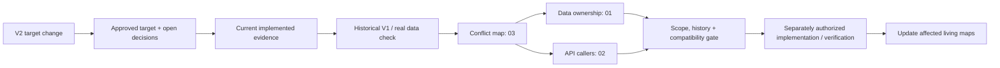

# 04 — Change Impact & Compatibility

## 0. Verification header

- Repository/worktree: `D:/VIRMS`, dirty `staging`; reviewed 2026-10-19. Tracked documentation HEAD `b4a40772edec567297e96d72bf037df73ea0cae6`; inspected backend and architecture files are untracked.
- **CURRENT APPROVED/TARGET:** V2 business architecture in `/docs-final-v2/`, selected by explicit current user direction and V2/01's historical-baseline statement. V2's marked open decisions are not supplied by this map.
- **CURRENT IMPLEMENTED:** source-inspected account/Tenant foundation only. **HISTORICAL / SUPERSEDED:** V1 `/docs-final/`, `/docs-legacy/` and V1-derived design assumptions. **PROPOSED:** no extra business behavior or compatibility mechanism is chosen here.
- **UNVERIFIED:** tests, live database/migrations, API, frontend, staging/production and prior released data. **BUSINESS DECISION REQUIRED:** specific V2 financial/access meanings below. Governance files now use the V2 authority model; System Design bodies remain historicalized and unreconciled. See [03](03-ARCHITECTURE-CONFLICT-MAP.md).

## 1. Purpose and state classification

This map asks what a V2-target change affects and which **valid current implemented** paths must survive. Missing V2 modules are implementation gaps, not valid V1 financial flows to preserve. A documented V2 target does not mean a transaction can be implemented where V2 itself leaves its economic basis or actor undecided. No migration, adapter, dual-read/write strategy or deployment action is inferred from uninspected runtime data.

## 2. One-view change gate

The right lane is a future review sequence, not authorization to implement anything in this task.

## 3. Domain dependency and change-impact matrix

| Change area | Data/API/consumer impact | Security, history and compatibility check | State/classification |
|---|---|---|---|
| Session, role and Tenant foundation | Current auth, provision/reset/status and Tenant list/detail; future V2 client | Preserve CSRF/session, first-login gate, current role/membership denial; add Company/Branch/module/object scope without caller-ID grants | CURRENT IMPLEMENTED partial; `SECURITY_SCOPE_REVALIDATION_REQUIRED` |
| Platform→Company/Tenant→Branch | Company membership, Branch assignment/movement, enabled module, every protected route/report/cache | Company isolation, prior-Branch records, cross-Branch correction authority, module OFF obligations; inspect actual DB before migration | CURRENT APPROVED/TARGET; `PARTIAL_IMPLEMENTATION`; `CONFLICT-002/004` |
| Investor and Fund | Company-scoped Investor relationship and one Fund across that Company's Branches | Never join Funds across Companies; source-linked actual use/recovery; assess real V1 data if present | CURRENT APPROVED/TARGET; `HISTORY_PRESERVATION_REQUIRED` if data exists |
| Funded Stock Vehicle versus external Garage Vehicle | One Investor only for funded Stock; Garage Job can exist without Investment | Stable Company Vehicle identity, Branch movement, Job cost once, Investor-less external customer path | CURRENT APPROVED/TARGET; `DATA/API/UI MIGRATION` need UNVERIFIED |
| Investor capital and Company Running Capital | Exact actual source contributions/recoveries, Stock Vehicle cost, Sale | No Investor/Company money netting, no cost/recovery duplicate; full collection gate for final positive settlement | CURRENT APPROVED/TARGET; finance high risk |
| Buyer Sale/payment/refund | Company Buyer, agreed price, actual bounded receipt, refund payable and actual refund | Original events immutable; no overcollection/double Fund or Company credit, atomic cap checks | CURRENT APPROVED/TARGET; finance high risk |
| Investor positive Share and Company Share | Effective protected agreement/snapshot, Company Accounting link | Platform changes rate; Accountant confirms money; Company Share not per-deal Owner payout; avoid hard-coded 33% | CURRENT APPROVED/TARGET; actor/snapshot check |
| Company Accounting, Garage Revenue and Owner Distribution | One classified Company source/ledger, Branch attribution, period result, recipients/payments | No duplicate economic event; positive Company-level allocation exact; distributable base/recognition/period close BDR | CURRENT APPROVED/TARGET; `BUSINESS_DECISION_REQUIRED` |
| Monthly interim, reconciliation and Exit | Due/Suggested versus Paid, ordinary deal Profit history, recoverable/payable, principal-first final closure | Eligible-principal/withdrawal and period/deal inclusion BDR; never pay retained amount twice | CURRENT APPROVED/TARGET; `BUSINESS_DECISION_REQUIRED` |
| Manual Loss and correction | Negative indicator, approved impact, reason and actual linked events | No V1 formula Loss/Owner contribution; impact/confirmation/cross-Branch authority BDR | CURRENT APPROVED/TARGET; `BUSINESS_DECISION_REQUIRED` |
| Media/public and module availability | Vehicle Company/Branch scope, private R2 original, public-safe response, module state | Do not expose private finance or lose history when module OFF; minimum open-obligation actions BDR | CURRENT APPROVED/TARGET; privacy/access high risk |

Use `NO_COMPATIBILITY_IMPACT` or `LOCAL_INTERNAL_CHANGE` only after tracing actual consumers. Other possible classifications are `BACKWARD_COMPATIBLE_CHANGE`, `COMPATIBILITY_ADAPTER_REQUIRED`, `DATA_MIGRATION_REQUIRED`, `API_MIGRATION_REQUIRED`, `UI_ROUTE_MIGRATION_REQUIRED`, `HISTORY_PRESERVATION_REQUIRED`, `SECURITY_SCOPE_REVALIDATION_REQUIRED`, `BREAKING_CHANGE_APPROVAL_REQUIRED`, and `BUSINESS_DECISION_REQUIRED`. None automatically mandates a mechanism without evidence of deployed data/callers.

## 4. Valid current workflow protection

| CURRENT IMPLEMENTED path | Current entry/data/permission | Protection and evidence limit |
|---|---|---|
| CSRF → Login ID/password → Django session → `/auth/me/` | LoginAttempt throttle, active User, effective role/Tenant IDs and first-login flag | Preserve session, generic failure, password replacement and reset safety while extending V2 context. Tests inspected, not run. |
| Account provisioning | `/accounts/provision/`; atomic User/RoleAssignment/TenantMembership/AccountSecurityEvent; Back Office Owner/Accountant or Accountant Investor/Media within active Tenant membership | Preserve UUID/history and authorized temporary-credential path; reassess Platform/Company/Branch permissions for V2. Live behavior UNVERIFIED. |
| Password reset, deactivation/reactivation | Target lock, manager authority across current target roles/Tenants, history/event | Preserve out-of-scope denial and old-session safety; no assumption that Admin and API audit are identical. |
| Tenant list/detail | Allowed role and active membership-filtered active Tenant queryset; read-only API | Preserve no unauthorized Tenant disclosure; a current Tenant-only response is insufficient as complete V2 Company/Branch context. |

No Investor, Stock Vehicle, Garage Job, Company Accounting, finance, React, public catalog or media flow is currently implemented as an end-to-end valid workflow. Their V2 boundaries are target obligations, not legacy behavior. A known code defect should be recorded as `SYSTEM_DEFECT`, not protected for compatibility; no such defect was reproduced in this task.

## 5. Historical V1 versus V2 target change gate

**HISTORICAL / SUPERSEDED V1:** Garage=Tenant; global cross-Garage Fund; Accountant Investor-specific rate changes; Owner Profit allocated directly per Vehicle deal; Loss allocated through Profit percentages and Owner contribution. **CURRENT APPROVED/TARGET V2:** Company=Tenant with Branches, Company-scoped Fund, Platform Back Office protected rates, exact Company Running Capital, Company Accounting, Company-level periodic Owner Distribution and manual Loss. External customer Garage work can exist without Investment. These are different ownership, permission and economic contracts, not a safe terminology swap.

`AGENTS.md`, README and older governance/roadmap documents now distinguish V2 target from current implementation and historical V1. The System Design set is explicitly historicalized, but its body has not been V2-reconciled; do not rely on it without section-level review. `CONFLICT-001` is resolved as a documentation-authority conflict; `CONFLICT-003` continues to track historical business/design differences and compatibility risk. V2 document headers still say draft/approval required, so these maps **do not claim formal final lock** or fill its BDRs. Actual V1 deployment/data/cutover need is **UNVERIFIED**. The draft statement that no production V1 transaction cutover is needed must be checked against real history before migration decisions. No dual engine, backfill, adapter or rollback method is specified here.

## 6. Frontend↔backend, schema and history compatibility

**Current frontend:** none inspected. **V2 target:** React route/API client sends authenticated context; backend validates Company membership, Branch assignment, module state, role/action, object and field scope; authoritative Django transaction records one source event; response drives authorized scoped TanStack Query refresh. A UI route or hidden control is not permission. Before an API shape change, enumerate real current callers, fields, error handling and cache keys; do not copy V1 representative routes without V2 revalidation.

**Current schema:** local untracked account/Tenant `0001_initial` migrations and model constraints; applied database ledger unknown. Before altering Tenant identity, adding Branch or moving Fund ownership, inspect actual migration state, existing rows, writers/readers, external consumers, historical data and release order. Never rewrite a released migration merely for neatness. Preserve V2 immutable financial, Job, movement, configuration and distribution source history once implemented.

**Current permission:** Tenant membership and global role suffice only for the source-inspected account/Tenant paths. V2's Company/Branch/module and action/field checks must be added for affected features. Platform configuration authority does not confer ordinary Company finance posting; Platform private-finance support beyond explicit Company assignment is a BDR. Module OFF must retain authorized history and required open-position settlement without inventing which actions are permitted.

## 7. Regression and evidence map

| Area | Direct focused check when implemented | Transitive / current gap |
|---|---|---|
| Auth/Company/Branch/module | Session/CSRF, provisioning/reset, Company isolation, Branch access/movement, module OFF/ON | Existing auth/Tenant tests are source-inspected but unrun; no Branch/module tests |
| Stock/Garage/Accounting | Funded Stock one Investor, external Vehicle none, Job cost/charge source, one Company receipt/economic effect | Running Capital, Company Share, Garage Revenue and reports; no current code/tests |
| Buyer/Investor finance | Positive bounded Buyer receipt/refund, actual principal/Company capital reconciliation, protected agreement snapshot | Deal Profit, interim, reconciliation, settlement and correction; BDRs for some positions |
| Owner/manual Loss | Company period approved amount and balanced-paise Owner allocation; specifically authorized actual payments; manual Loss no auto-allocation | Historical snapshots, correction and actual recovery; distributable/impact authority BDR |
| Media/public | Four active images, private original, Company/Branch field scope and safe public schema | Branch movement, module state and publication cache; no current code/tests |
| Migration/release | Fresh migration replay, actual upgrade path, backup/restore, health/readiness | Database and deployment UNVERIFIED; no cutover claim |

Future high-risk work follows current target and current implementation → previous verified behavior where relevant → `CONFLICT-` check → Data/API/consumer/security/history impact → business decision and approval gate → separately authorized implementation → focused and transitive verification → only affected map/current-state updates. No test or deployment action is performed by this documentation change.

## 8. Remaining conflicts, decisions and verification

- `CHANGE-RISK-001` **A:** unreconciled V1-derived System Design body content can reintroduce wrong V2 ownership/finance rules (`CONFLICT-003`). It is historicalized; require section-level V2 and implementation review before relying on it for a phase.
- `CHANGE-RISK-002` **A:** Branch/module scope is absent from current Tenant/account code (`CONFLICT-002`); building financial routes on Tenant-only checks would be unsafe.
- `CHANGE-RISK-003` **A for affected actions:** monthly eligible-principal and withdrawal, period/deal reconciliation, manual Loss impact/actor, Company distributable amount/period close, cross-Branch correction, Platform support private read and module-OFF minimum settlement actions are **BUSINESS DECISION REQUIRED** (`CONFLICT-004`).
- `CHANGE-RISK-004` **B:** source untracked and runtime/data history **UNVERIFIED** (`CONFLICT-005`); do not assume empty production or an existing V1 cutover.

Evidence: all 13 V2 documents, particularly 01/02/04/05/06/09/10 and supporting standards; historical V1 and legacy documents; current `core/`, `apps/accounts/`, `apps/tenants/`, migrations and tests; repository governance and V1-derived design; Git documentation history. **CURRENT IMPLEMENTED:** source inspected only. **CURRENT APPROVED/TARGET:** V2 intent, with BDRs. **HISTORICAL / SUPERSEDED:** V1 business shape. **PROPOSED:** no new business rules. **UNVERIFIED:** tests, DB, API runtime, frontend integration, deployment and prior production data.
