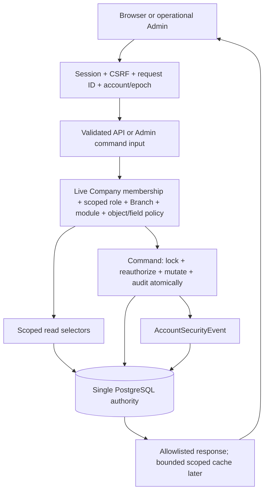

# VIRMS Architecture Phase 1 — Platform Core + Authentication Foundation

> PLAN ONLY: target designs are proposals, not implemented/runtime claims.

## Version

1.0

## Observed At

2026-10-30 Asia/Calcutta

## Mode

PLAN_ONLY

## Risk

HIGH-RISK

## Status

PROPOSED FOR REVIEW; explicit implementation approval and affected decision gates remain required

## Objective

Extend the existing Django modular monolith into a secure PostgreSQL-backed Company/Branch account and authorization foundation. Reuse existing identity and Tenant models; implement no business modules in Phase 1.

## Authorization

- This operation writes only these two requested plan artifacts. No application code, dependency, database, credential, frontend, canonical document or handoff change is authorized.

- No commit, push, merge, pull, branch switch, deployment or production/staging mutation. Preserve all pre-existing dirty work.

- Implementation is a separate approval. A plan approval cannot resolve a BUSINESS DECISION REQUIRED by implication. No Phase 2 planning.

## Verified Repository

**Root:** D:/VIRMS

**Repository:** muhammedshibiliraihsoft-art/VIRMS

**Branch:** staging

**Head:** ed114b2667a707034b01bc58211d58aa70013314

**Worktrees:** D:/VIRMS [staging] only

**Cached Refs:** origin/staging ed114b2; origin/main d89974f. Both trees inspected locally; no fetch and no claim of live GitHub equality.

**Dirty State:** README modified; 50 tracked historical documentation/diagram deletions; no staged diff. Extensive pre-existing untracked backend/configuration/demo/planning/handoff work. Ownership unknown; preserve all.

**Preservation:** Initial inventory hashed 962 Git-visible files in a temporary sandbox snapshot; that temporary snapshot is unavailable across tool calls. Final status comparison and a same-process hash comparison around final artifact edits are used instead; no claim of full initial-to-final hash verification.

### Backend

- core is the existing Django project. Installed local apps: accounts, tenants, common; Django admin/auth/sessions and DRF configured. Do not create another project.

- accounts.User extends AbstractBaseUser/PermissionsMixin, UUID PK, unique login_id/email, active/staff/first-password flags and creator/updater references. AUTH_USER_MODEL=accounts.User, USERNAME_FIELD=login_id, REQUIRED_FIELDS=[email]. UserManager accepts manually supplied login_id.

- Tenant has UUID, name, unique slug, is_active. TenantMembership has User/Tenant/assigned_by, effective interval, PROTECT FKs, valid-interval check and one-open-row partial uniqueness. Reuse Tenant as Company; labels/slug are attributes, not identity.

- RoleAssignment is global User/role/effective interval with no Company FK. can_manage combines global role with membership. This is incomplete V2 Company-specific authority.

- Current active_roles/active_tenant_ids/can_manage accept only effective_until=NULL. Finite future expiry currently denies access, not ordinary half-open interval semantics. This difference must not be silently migrated.

- Session/CSRF login, logout, me, current-password change, temporary provisioning/reset and account status exist. Selected commands use atomic transactions and locks; password change validates a stale User before acquiring any User lock.

- AccountSecurityEvent covers successful account actions, required actor/subject, action, tenant_ids, outcome. It is not yet a general append-only administrative audit. LoginAttempt stores HMAC Login-ID failure state and progressive cooldown.

- Admin registers User, RoleAssignment, Tenant and TenantMembership. Admin deletes denied, but raw save/password/privilege and queryset/widget paths require audit and scope review. First-password middleware currently applies only to /api/.

- No Branch, BranchAssignment, Company-scoped grant, module-state model, revoke-all command or health/readiness endpoints in inspected backend. No business-module backend implemented.

- accounts and tenants each have local 0001_initial migration. README warns starter migrations were replaced. Applied database ledger/schema/rows unknown; never rewrite or assume these migrations are unapplied.

- Requirements pin Django 5.1.4, DRF 3.15.2, psycopg 3.2.3. Installed .venv: Python 3.12.10 with those versions; pytest 8.3.4, pytest-django 4.9.0. Direct pins exist; full reproducible transitive/runtime lock not established.

- Docker/devcontainer already present: Python 3.12, postgres:15, private environment values, persistent volume, no automatic migration. Tags float. Docker build collectstatic uses local settings; non-local manifest compatibility needs a packaging smoke test.

- 17 test methods found statically in accounts/tenants tests. No test execution/discovery pass count claimed. Demo frontends exist under demo/; production React-to-Django integration not established.

### Evidence

- README.md

- core/settings.py

- core/urls.py

- core/authentication.py

- core/permissions.py

- apps/accounts/models/users.py

- apps/accounts/models/user_manager.py

- apps/accounts/access.py

- apps/accounts/auth_views.py

- apps/accounts/middleware.py

- apps/accounts/views/__init__.py

- apps/accounts/serializers/__init__.py

- apps/accounts/admin.py

- apps/accounts/urls.py

- apps/tenants/models/tenant.py

- apps/tenants/views/__init__.py

- apps/tenants/admin.py

- apps/tenants/urls.py

- apps/accounts/migrations/0001_initial.py

- apps/tenants/migrations/0001_initial.py

- apps/accounts/tests/test_users.py

- apps/tenants/tests/test_tenants.py

- requirements.txt

- requirements-dev.txt

- pyproject.toml

- setup.cfg

- Dockerfile

- Dockerfile.dev

- .devcontainer/docker-compose.yml

- .devcontainer/devcontainer.json

- .env.example

- Makefile

**Runtime Database:** UNVERIFIED: live PostgreSQL connection/schema/ledger/rows, application tests, browser/API runtime, Docker execution, staging/production and released consumer history. No real .env/credential contents read.

## Source Authority

### Order

- User task and applicable AGENTS.md govern authorization.

- docs-final-v2 is current target, including explicitly unresolved items. Code/migrations prove implemented definitions; DB/runtime evidence proves applied behavior.

- architecture/01–04 maps provide contextual claims, not current runtime proof. Headers refer to 2026-10-19 and older HEAD b4a4077; revalidated against current source.

- docs-final, docs-legacy, system-design and older architecture plans are historical; many are currently deleted. Do not restore or import their V1 business rules.

### Read

- AGENTS.md

- README.md

- docs-final-v2/01-business-rules.md

- docs-final-v2/02-user-roles-permissions.md

- docs-final-v2/03-system-modules.md

- docs-final-v2/04-data-model-relationships.md

- docs-final-v2/06-technical-architecture-engineering-operations.md

- docs-final-v2/supporting/authentication-account-security.md

- docs-final-v2/supporting/production-engineering-standards.md

- docs-final-v2/supporting/tenant-merge-consolidation.md

- architecture/01-DATA-FLOW.md

- architecture/02-API-FLOW.md

- architecture/03-ARCHITECTURE-CONFLICT-MAP.md

- architecture/04-CHANGE-IMPACT-COMPATIBILITY.md

- planning/V2-DEVELOPMENT-ROADMAP.md

### Verified Canonical Target

- Platform → Company/Tenant → Branch. Company hard isolation, Branch operational scope, immutable backend UUIDs.

- Login ID/password, temporary first-login replacement, private current-password change, assisted recovery, session revocation, history-preserving lifecycle. No public signup/OTP/email recovery or secondary business password.

- Backend validates identity, membership, module, role/action, Branch, object and fields. Owner read-only; Accountant ordinary business writer; Investor self-only; Media limited; Platform administration distinct from finance.

- Platform Back Office manages Company/Branch/accounts/membership/modules. Accountant may provision Investor/Media in authorized scope; global shared-account reset authority is not fully specified.

- Module OFF preserves records and authorized history/open-obligation actions; exact financial settlement exceptions remain unresolved.

- Django/DRF/PostgreSQL provider-neutral modular monolith, supported reproducible versions, bounded APIs, safe logs/errors and focused/batch/final-phase verification.

### Documentation Claims

- V2 headers still say DRAFT/source after approval; project instructions establish target authority without resolving BDRs.

- V2 says no production V1 financial cutover. Operational migration/data history remains unverified; this cannot justify replacing initial migrations.

- Roadmap marks Platform Core NOT STARTED while partial local source exists. Treat this as incomplete foundation, not completed Phase 1.

## Official Sources

### S1

**Id:** S1

**Url:** https://www.djangoproject.com/download/

**Finding:** 5.1 absent from supported series; propose supported Django 5.2 LTS secure patch, reverified and exactly pinned at implementation.

### S2

**Id:** S2

**Url:** https://docs.djangoproject.com/en/5.2/topics/auth/customizing/

**Finding:** Keep existing custom User/AUTH_USER_MODEL; adapt custom admin forms and authorization boundary.

### S3

**Id:** S3

**Url:** https://docs.djangoproject.com/en/5.2/topics/auth/default/#session-invalidation-on-password-change

**Finding:** Password hash changes invalidate other sessions; update_session_auth_hash preserves current self-change session. Epoch is a proposed project extension, not a built-in feature.

### S4

**Id:** S4

**Url:** https://www.django-rest-framework.org/api-guide/authentication/#sessionauthentication

**Finding:** Unsafe cookie requests require CSRF. Anonymous login needs separate unconditional CSRF protection.

### S5

**Id:** S5

**Url:** https://www.django-rest-framework.org/api-guide/throttling/#a-note-on-concurrency

**Finding:** Built-in cache throttles permit concurrent races; strict shared admission needs its own atomic implementation.

### S6

**Id:** S6

**Url:** https://docs.djangoproject.com/en/5.2/topics/db/transactions/

**Finding:** Use explicit command atomic boundaries; account for rollback and failure audit outside aborted transaction.

### S7

**Id:** S7

**Url:** https://www.postgresql.org/docs/15/ddl-constraints.html

**Finding:** FK/check/unique constraints enforce row integrity; cross-table Company equality cannot be implemented as ordinary CHECK. Use narrowly scoped consistency triggers where needed.

## Scope

- P1_01 safe Admin/bootstrap

- P1_02 full identity/auth lifecycle

- P1_03 Company boundary

- P1_04 Branch foundation

- P1_05 membership/roles/permission skeleton

- P1_06 audit

- P1_07 DRF API foundation

- P1_08 PostgreSQL/migrations

- P1_09 future local-cache compatibility

- P1_10 security/environments

- P1_11 tests and one final audit

- P1_12 verified documentation

## Non Scope

- Vehicle, Job, Investor Fund, Sales, collections, accounting/calculation engines, Reports/Dashboard backend or protected financial configuration implementation

- Investor Portal, custom Back Office frontend, React accounting integration or demo changes

- Phase 2 planning

- SQLite/Electron/Tauri, offline writes/queue/sync/conflict engine or second financial authority

- Production deployment, cloud provisioning, microservices, Redis, Celery, Kafka, Kubernetes or speculative scaling

- Company consolidation implementation, private-finance support exceptions and module-OFF financial settlement policies

## Inferences Proposals

- Reuse apps.accounts/apps.tenants/apps.common/core. Retain internal Tenant naming and /tenants URLs; Company is its business meaning, not another table.

- CompanyRoleGrant belongs to membership, with optional Branch. NULL Branch represents an explicit Company-wide grant, never inferred from no assignments. Existing global back_office remains platform role source; legacy global business roles cease to authorize after reviewed cutover.

- Extend AccountSecurityEvent as the single administrative/security audit source, not a competing audit ledger.

- No persisted business module configuration in Phase 1: typed module hook, unsupported/unknown module default deny, core operations separately registered. No financial permissions or OFF exceptions invented.

- Proposed technical security defaults for approval: minimum password length 12, accept long passphrases, no composition regex; session absolute lifetime 12 hours, idle timeout 30 minutes, configurable shorter Admin sessions. Exact retention/source/global rate budgets require measured operator security configuration before release. These are proposals, not canonical business rules.

## Impact Report

**Frontend:** No change. Inventory actual demo/external consumers before incompatible API changes; later session/CSRF cache integration only.

**Backend:** Extend accounts/tenants, thin existing handlers around command services/selectors, core middleware/settings and small common HTTP primitives. No new project or generic framework.

**Api:** Preserve current routes and success fields; additive scoped me context, Branch reads, revoke command and probes. Protected Admin commands suffice for Company/Branch/grant writes; no generic CRUD.

**Schema:** Add epoch, Branch/assignments/scoped grants; extend audit/limiter. Preserve UUIDs, original events and membership/role history; exact migration graph requires ledger inventory.

**Compatibility:** Intentional security narrowing of global-role authority requires approved mapping and caller inventory. Unsafe access is not a valid compatibility guarantee. No automatic role × membership backfill.

**Security:** All protected requests/Admin/commands affected. No staff/superuser/group/model-permission/client-ID bypass to Company business data.

### Regressions

- Session/CSRF status and cookie behavior

- First-password gate across Admin/API

- Provision/reset/status and lost temporary delivery

- Grant changes during active sessions

- Company/Tenant list/detail privacy/pagination

- Shared User with different Company/Branch roles

- Future/finite/ended intervals

- Raw Admin, bulk actions, search, autocomplete and FK widgets

**Gate:** Review this plan and resolve relevant decisions before structural/auth implementation. No implementation occurs in this run.

## Architecture Diagram

## App Boundaries

### core/

**Area:** core/

**Owns:** Environment/settings, root routing, session/epoch enforcement, default-deny DRF wiring, request/probe wiring. Client-selected Company is only an untrusted selector.

### apps/accounts/

**Area:** apps/accounts/

**Owns:** Existing User, global platform-role source, scoped CompanyRoleGrant, credential/session lifecycle, limiter, authorization policy, AccountSecurityEvent and account commands. Add services/selectors/policy modules only when needed.

### apps/tenants/

**Area:** apps/tenants/

**Owns:** Existing Company/Tenant, membership, Branch/BranchAssignment, scoped selectors and administrative commands. Retain package exports and model layout.

### apps/common/

**Area:** apps/common/

**Owns:** Existing UUID base plus small safe request-ID/error/metadata helpers. No business modules, generic repositories, event bus or permission DSL.

### core/storage.py

**Area:** core/storage.py

**Owns:** Existing private S3-compatible adapter retained; no upload/media endpoint or provider change.

## Identity Authentication

**Identity:** Keep UUID User, unique login_id/email and existing manager. Do not change login normalization, case uniqueness or email requirement without a decision. No generated human Login ID.

**Bootstrap:** After approved isolated migrations/rehearsal: python manage.py createsuperuser --email mullas313@gmail.com; operator supplies login_id and password interactively. No execution now, no password fixture/migration/source/shell argument. Existing create_superuser sets must_change_password=False for private interactive bootstrap. Validate password through supported command/admin validators. Superuser is break-glass system identity, not an automatic Company business grant.

### Flows

- CSRF GET → login POST → rotated backend session → minimal me. First-login session only csrf/me/logout/password change; same gate for Admin deep links and password paths.

- Own change: lock fresh User, validate current password/status/epoch, new confirmation/validators/new!=current; commit hash/flag/epoch/audit atomically, preserve only current session with refreshed hash/epoch.

- Provision: authorize approved Company/Branch/role, atomically create User/grants/audit, generate temporary credential in memory, persist hash only and deliver once to authorized initiator in no-store response over secure transport. No credential retrieval API or response-body logging.

- Reset: verify business identity by controlled operator procedure, require safe reason, lock target and reauthorize global lifecycle permission; rotate credential/epoch, require private replacement, invalidate old sessions.

- Deactivate: global authority under BDR-03, inactive/unusable credential/epoch bump, preserve grants/history. Reactivation alone cannot restore old sessions/credential; fresh reset required.

- Compromise revoke: explicit authorized reasoned command increments epoch without mandatory password mutation; next protected request rejects prior sessions.

**Hashing:** Use supported Django PBKDF2 and current cost defaults after framework upgrade, retain old-hash upgrade compatibility. Common/similarity/minimum validators; no predictable composition rules. set_password alone does not validate: services/Admin/API must validate. Never reveal permanent plaintext/hash.

**Session Login Race:** Login and self-change must not stamp a fresh epoch onto a stale authenticated User. Verify credentials/activity/epoch against locked fresh User; concurrent reset/revoke/deactivate serialized before session issuance. A session from old credentials cannot inherit new epoch.

**Security Policy Gate:** Accept proposed expiry/minimum length and operator temporary-delivery/retention policy during plan review. No new email/phone verification or public recovery flow.

## Company Branch Authorization

**Company:** Reuse Tenant UUID/name/slug/is_active; inactive means operational suspension, no delete/merge. Normal activity denies; specifically authorized Platform recovery/activation uses separate audited control-plane policy, never private-finance wildcard access.

**Membership:** Effective interval proposed [from, until), null means open. Active User/Company additionally required. Close/append rows, immutable user/company/start. Existing finite-future rows require BDR-01 explicit mapping because current code denies them. Phase1 writes do not create scheduled/future-ending rows; existing finite history retained without granting it implicitly.

**Roles:** CompanyRoleGrant membership + role(owner/accountant/investor/media) + nullable Branch + interval + assigned_by. Company-wide grant explicit. Branch-local action needs both effective grant and effective BranchAssignment in same membership/Company. Global back_office only platform capability; Company access separately scoped. Legacy global non-platform rows preserved for trace, never fallback authorization after cutover.

**Branches:** UUID, immutable Tenant PROTECT FK, name and timestamps. No Branch-name identity/uniqueness/coded limit/default Branch. Inactive lifecycle only after BDR-04; identity and assignment foundation can proceed without inactive actions.

**Assignments:** BranchAssignment membership/Branch PROTECT FKs, actor and interval. Same-Company enforced for assignment AND scoped role grant in services and PostgreSQL triggers. Cannot reparent Branch/membership or grant foreign Company access.

**Temporal Integrity:** Effective access is intersection of current User/Company, membership interval, role-grant interval and (for Branch-local action) BranchAssignment interval. Persisted child intervals may outlive a closed parent; they are ineffective and cannot attach to a replacement membership UUID. Ending parent does not rewrite or auto-reopen child history. New grants/assignments must start no earlier than membership and are created now/open; future starts/ends and unsupported overlaps rejected in Phase1 administrative writes under stable parent locks. Legacy finite/overlap rows require approved mapping before any reinterpretation. Do not claim full stored interval containment or an exclusion constraint that has not been implemented.

**Policy:** authorize(actor, action, company, branch=None, resource=None, fields=None): live account/epoch/password gate → current Company membership → explicit action/role grant → Branch assignment/scope → module hook → object ownership/Company/Branch → field allowlist. Scope queryset before object lookup. Client Company/Branch IDs are not authority. No first-membership selection.

### Phase1 Matrix

- Self me/logout/password: authenticated self and first-login allowlist.

- Provision: scoped Back Office to Owner/Accountant; scoped Accountant to Investor/Media, matching current baseline. No back_office self-escalation inferred. Other delegation/reset/lifecycle entries require BDR matrix.

- Company/Branch/membership/role administration: specifically authorized Platform Back Office operation; no Company-private-finance read/post implied.

- Company summary: preserve current allowed role cases only with explicit scoped grants; do not add Investor Company-directory visibility. Branch summary limited to granted operational metadata.

- No financial/Investor/Media business operation registered; unknown module/action denies.

**Platform Admin:** Django groups/user_permissions/is_superuser/is_staff do not confer business action authority. Bootstrap break-glass can establish approved initial platform grants by reviewed operator procedure; normal APIs still require scoped policy. No self-service privilege elevation.

**Module Hook:** Typed core operation registry plus optional module identifier/operation class. No persistent business-module-state implementation. Unsupported module denies; future provider distinguishes ordinary writes, authorized history and separately approved open-obligation actions, never wildcard OFF bypass.

**History:** No consolidation, reparent or historical financial rewrite. Same-Company previous-Branch business-history rules remain a future resource-selector obligation, not permission to read every Branch today.

**Platform Scope Representation:** No new platform grant entity: active global RoleAssignment(role=back_office) represents platform identity; explicit current TenantMembership represents authorized Company control-plane scope, combined with the approved core action matrix. CompanyRoleGrant covers only business roles and cannot confer platform powers. This global platform-role plus explicit membership rule is intentional for control-plane administration, not the forbidden legacy global BUSINESS-role Cartesian mapping. Company-specific provisioning/Branch/membership actions require both. company.create and bootstrap establishment are explicitly Company-less platform actions under approved platform action policy; creation never silently grants membership. Initial membership/platform role comes from explicit approved operator bootstrap manifest. Suspension recovery requires current effective explicit Company membership and current platform role plus approved recovery action, ignoring only Company.is_active; historical/ended membership alone never authorizes recovery. No private-data wildcard access. BDR-02 gates matrix/delegation entries.

## Concurrency Transaction Idempotency

**Linearization:** Sensitive write acquires current actor/target User and scope parent locks, then rechecks credentials/session epoch/current membership/grant/Company state inside transaction. Revocation/suspension/grant end uses the same locks. If revoke wins first, write denies; if an authorized write commits first, revoke applies afterward. Middleware checks alone do not cancel in-flight writes.

**Lock Order:** Proposed global order: User UUIDs sorted, Company UUIDs sorted, TenantMembership UUIDs sorted, Branch UUIDs sorted, grant/assignment UUIDs sorted. All account/Admin/Company/grant mutations must follow this order, including new insert paths. Lock stable parents, not only existing child rows; short transactions, no external delivery under lock.

**Atomicity:** Command state and success audit commit together; integrity failure handled after rollback. Denial/failure event written separately, sanitized, without accidentally committing partial mutation.

**Retry:** Status desired-state and end operations are idempotent no-ops after reauthorization, no duplicate state-change success event. Provision/reset/password change are unsafe to automatically retry. On unknown response inspect authorized state, then deliberately issue a new audited reset if temporary delivery was lost. No plaintext replay storage or generic idempotency platform in Phase1.

## Schema Proposal

### User existing

**Entity:** User existing

**Change:** auth_epoch PositiveBigInteger default 1 with valid nonnegative constraint; session stores epoch/issued/last-activity. No identity replacement.

**Indexes:** Keep PK/login/email, no speculative indexes.

### Tenant existing

**Entity:** Tenant existing

**Change:** Preserve table/UUID/slug/is_active; audited lifecycle service only, no duplicate Company.

**Indexes:** Existing PK/slug.

### TenantMembership existing

**Entity:** TenantMembership existing

**Change:** Keep history/IDs; immutable User/Tenant/start; close and append; existing valid-interval and open uniqueness retained.

**Indexes:** Existing FKs/partial uniqueness; measure before extra interval indexes.

### Branch new tenants model

**Entity:** Branch new tenants model

**Change:** UUID, Tenant PROTECT, name, timestamps; lifecycle field only after decision. Immutable parent; no name uniqueness or default Branch.

**Indexes:** Tenant FK; evaluate tenant/name/id ordered read plan.

### BranchAssignment new tenants model

**Entity:** BranchAssignment new tenants model

**Change:** UUID, membership/Branch/assigned_by PROTECT, interval, end>start CHECK, unique open membership+Branch. Same-Company/immutable ownership triggers.

**Indexes:** FKs and open partial unique.

### CompanyRoleGrant new accounts model

**Entity:** CompanyRoleGrant new accounts model

**Change:** UUID, membership PROTECT, role enum excluding platform, optional Branch PROTECT, actor, interval CHECK. Separate partial uniques for open membership+role NULL Branch and open membership+role+Branch non-NULL. Same-Company trigger; service locks/interval rules plus access-time parent intersection protect effective authority and supported transitions.

**Indexes:** FKs and two justified partial uniques.

### RoleAssignment existing

**Entity:** RoleAssignment existing

**Change:** Preserve legacy UUID/history. back_office platform source only after cutover; no automatic business role×membership mapping.

**Indexes:** Existing partial uniqueness.

### AccountSecurityEvent existing

**Entity:** AccountSecurityEvent existing

**Change:** Nullable actor/subject for anonymous/system/non-account target; explicit actor kind, immutable resource type/UUID and scope snapshot, optional Company/Branch refs, occurred_at, request_id, reason, allowlisted before/after. Preserve existing IDs/values; historical tenant_ids legacy only, never authorization.

**Indexes:** Company+occurred_at+id and subject+occurred_at+id for bounded operational review; verify query plans.

### LoginAttempt existing

**Entity:** LoginAttempt existing

**Change:** Bucket kind/key/window/admission count/expiry for shared atomic limiter; HMAC identifiers and trusted source buckets, no raw credential/IP retention.

**Indexes:** Unique bucket key and bounded cleanup expiry index.

## Audit Architecture

### Coverage

- Account create/activate/deactivate

- Password reset initiation/outcome and self-change

- Session revoke/compromise

- Company/Branch administrative changes

- Membership/grant/Branch assignment add/end

- Protected Admin actions and denied/failed outcomes

**Write:** Success state/audit atomic; failure/denial audit after rollback in bounded separate transaction. Audit failure makes sensitive mutation fail closed. Denial audit failure never authorizes the action. No dummy User for Company events.

**Append Only:** Application/Admin no update/delete; runtime DB role SELECT/INSERT only on event table, no UPDATE/DELETE/TRUNCATE. Separate migration-owner role, guard triggers for accidental ORM/bulk changes. DB owner can still tamper; do not claim WORM/tamper-proof.

**Visibility:** Control-plane global account events are operator-only by default. Company reviewers see only explicitly Company-scoped event projections; mixed-Company tenant_ids/before-after data never serialized wholesale. No authorization from JSON tenant_ids. Branch audit reads also scope filtered.

**Privacy:** Allowlist actor/resource UUID, UTC time, action/outcome/reason, request ID and minimum safe old/new. Never password/hash/temp credential/session/CSRF token/secret or raw body/object dump. Review Admin LogEntry repr/change message and APM capture. Retention and support access require accepted operator policy, not invented business visibility.

## Api Foundation

### Existing Calls

#### GET /api/v1/auth/csrf/

**Route:** GET /api/v1/auth/csrf/

**Class:** CONDITIONAL

**Contract:** Before first unsafe browser request or after rotation, not before every GET; preserve cookie/detail.

#### POST /api/v1/auth/login/

**Route:** POST /api/v1/auth/login/

**Class:** REQUIRED

**Contract:** On login intent; login_id/password → must_change_password and session, no bearer token.

#### POST /api/v1/auth/logout/

**Route:** POST /api/v1/auth/logout/

**Class:** REQUIRED

**Contract:** On signout intent; CSRF, current-session flush, detail.

#### GET /api/v1/auth/me/

**Route:** GET /api/v1/auth/me/

**Class:** REQUIRED

**Contract:** Session bootstrap/revalidation; keep id/login_id/must_change_password/roles/tenant_ids, add scoped membership/grants/context revision. roles informational only.

#### POST /api/v1/auth/password/change/

**Route:** POST /api/v1/auth/password/change/

**Class:** CONDITIONAL

**Contract:** First/private own change; retain current_password/new_password/confirm_password and detail.

#### POST /api/v1/auth/accounts/provision/

**Route:** POST /api/v1/auth/accounts/provision/

**Class:** CONDITIONAL

**Contract:** Explicit authorized create; retain login_id/email/role/tenant_id/profile, add approved explicit Branch scope. id/temporary_password delivered once, no-store.

#### POST /api/v1/auth/accounts/<uuid:user_id>/reset/

**Route:** POST /api/v1/auth/accounts/<uuid:user_id>/reset/

**Class:** CONDITIONAL

**Contract:** Explicit recovery; required safe reason, BDR global authority; one-time temporary_password/no-store.

#### POST /api/v1/auth/accounts/<uuid:user_id>/status/

**Route:** POST /api/v1/auth/accounts/<uuid:user_id>/status/

**Class:** CONDITIONAL

**Contract:** Explicit lifecycle; is_active boolean/reason, BDR global authority; retain is_active response.

#### GET /api/v1/tenants/

**Route:** GET /api/v1/tenants/

**Class:** CONDITIONAL

**Contract:** Authorized Company picker; keep count/next/previous/results and stable name,id ordering.

#### GET /api/v1/tenants/<uuid:pk>/

**Route:** GET /api/v1/tenants/<uuid:pk>/

**Class:** CONDITIONAL

**Contract:** Company metadata if required; scoped hidden 404.

#### /admin/

**Route:** /admin/

**Class:** CONDITIONAL

**Contract:** Operational commands only, separate entry controls; not a financial business API.

**Request Analysis:** No observed request trace proves REDUNDANT/DUPLICATE; no removal/merge justified. Inventory actual demos/other callers before compatibility change.

### New Calls

#### GET /api/v1/tenants/<uuid:tenant_id>/branches/

**Route:** GET /api/v1/tenants/<uuid:tenant_id>/branches/

**Class:** CONDITIONAL

**Contract:** Scoped paginated id/tenant_id/name summaries; allowlisted name search/order, stable UUID tie-breaker.

#### GET /api/v1/tenants/<uuid:tenant_id>/branches/<uuid:pk>/

**Route:** GET /api/v1/tenants/<uuid:tenant_id>/branches/<uuid:pk>/

**Class:** CONDITIONAL

**Contract:** Authorized same-Company Branch summary or hidden 404.

#### POST /api/v1/auth/accounts/<uuid:user_id>/sessions/revoke/

**Route:** POST /api/v1/auth/accounts/<uuid:user_id>/sessions/revoke/

**Class:** CONDITIONAL

**Contract:** Explicit authorized reasoned compromise revoke; detail response, BDR global authority.

#### GET /health/live/

**Route:** GET /health/live/

**Class:** CONDITIONAL

**Contract:** Process existence only; no DB/secret disclosure.

#### GET /health/ready/

**Route:** GET /health/ready/

**Class:** CONDITIONAL

**Contract:** 200 only when bounded DB check and required migration graph applied; otherwise generic 503. Never migrate in probe.

**Errors:** Add error.code/message/fields/request_id retaining existing detail/errors fields for compatibility. Normalize Django JSON, DRF, middleware, CSRF, API 404/405 and unexpected failures. 400 invalid input, 401 invalid session, 403 CSRF/first-password/known forbidden, 404 hidden object, 409 duplicate/version conflict, 429 bounded Retry-After, 503 unavailable dependency, 500 generic failure. No traceback/DB/credential/identifier existence leak.

**Reads:** Default 20 retained; proposed maximum 100 on new lists, no unbounded list-all. Scope first, allowlist search/filter/sort, stable id tie-break. Explicit serializers, no all-fields/public internal schema.

**Commands:** Thin input adapters → current policy → atomic service → state/audit → committed response. No GET/startup mutation; no generic Company/account CRUD. API/Admin use same command authority. Unknown outcome is not safe automatic retry.

**Context:** Company/Branch path/body is selector; conflicting parent/object IDs deny. Selected Company in session is UX hint only. context revision derived from live grants, not client permission token.

## Security Environment

### Threats

- Session/login spoofing and CSRF

- Company/Branch IDOR and global-role bleed

- Raw Admin/staff/group/superuser escalation

- Stale permissions and in-flight revocation

- Concurrent password/reset/lifecycle

- Login hash-work exhaustion and temporary-response leakage

- Unaudited mutations/log/error/probe leakage

### Controls

- CSRF required for anonymous login and all unsafe cookie requests/Admin. HttpOnly session; Secure outside loopback local HTTP; SameSite Lax with same-origin/same-site topology. No localStorage token authority.

- No wildcard credentialed CORS or CSRF disabling. Prefer same-origin future API routing; cross-site hosting topology requires separate review.

- Shared PostgreSQL limiter reserves admission before password hashing; identifier plus trusted source/global budgets, bounded body, progressive cooldown, no worker sleeping or permanent lockout. Apply to Admin login too.

- Keep current 3-failure backoff up to 300 seconds as initial compatibility baseline; source/global limits selected from measured hashing cost and expected usage before release. HMAC source identifiers, bounded expiry cleanup command, no Redis/Celery needed.

- Request IDs generated/validated with bounded characters/length, returned as X-Request-ID. Structured logs safe actor/scope/error code only; disable body/token/credential capture in logs/APM/Admin messages.

- Transactions reauthorize under stable parent locks; handle integrity errors after rollback and return safe conflicts, never false success.

**Configuration:** Retain DJANGO_ENV local/staging/production, explicit allowed hosts, DEBUG local only, loopback development HTTP, private local .env and controlled injected secrets elsewhere. DATABASE_URL precedence documented; PostgreSQL only. Tests explicitly isolated DB/role, never shared data.

**Tls Proxy:** Non-local secure cookies/redirect/HSTS require verified trusted HTTPS proxy that sanitizes forwarding headers; source IP cannot be trusted from arbitrary X-Forwarded-For. Explicit CSRF origins; hosting provider/domain remain configurable.

**Versions:** Upgrade proposed to supported Django 5.2 LTS secure patch and compatible supported DRF; resolve exact pins at implementation with official release notes/compatibility checks. Exact runtime/container patch/digest and transitive lock. No unrelated bulk upgrade.

**Packaging:** Reuse current PostgreSQL devcontainer/volume, no second DB technology or down -v. Verify collectstatic hashed manifest for actual non-local storage and non-root startup, without real secrets or DB connection at build. No automatic migration.

**Future Ops:** Production separately requires accepted RPO/RTO, backups/tested restore, limited runtime versus migration DB roles, TLS/secret injection, Admin exposure and incident revoke procedures. No deployment here. Session expiry, retention and rate technical settings require accepted operator policy.

## Local First Compatibility

**Authority:** Django + PostgreSQL alone commit authoritative truth. Same Django APIs for later web/local clients. No client financial posting authority.

**Reads:** Bounded authorized recent cache can filter/search/sort locally; growing datasets use server pagination/filter/search/sort. Manual/controlled refresh and future TanStack Query, no full growing database fetch or polling added now.

**Cache Scope:** Future keys include User UUID, Company UUID, Branch scope, operation/filter/page and context revision. Clear on logout/account/Company switch/session 401/scope change; revalidate before protected activity. Server rejects stale authority independently.

**Versions:** Opaque live context revision supports invalidation; entity updated_at/revision supports later conditional reads. This is not a sync protocol and cannot remotely delete offline copies.

**Privacy Gate:** Persistent private-data caching/offline retention/encryption needs later approval. No SQLite, packaging, queue, drafts/sync/conflict engine implemented in Phase1.

## Migration Sequence

- M0: identify approved local/test DB/roles/version and inspect ledger/schema/row counts/starter history read-only. Stop on ambiguity. No fake-initial/reset/drop/flush/replacement initial migrations.

- M1: additive successor User epoch/audit/limiter fields, nullable historical scope. Preserve old event values/IDs; unknown stays unknown, never guessed.

- M2: tenants Branch then BranchAssignment; accounts CompanyRoleGrant depends on TenantMembership/Branch. Successor cross-app dependencies avoid circular initial migrations. Exact filenames assigned from actual graph, not fabricated here.

- M3: checks/partial uniques and named PostgreSQL same-Company/ownership/audit guard triggers plus separate runtime privileges. Validate existing intervals/data before stricter enforcement. No unreviewed extensions.

- M4: approved mapping manifest for actual User/membership/role/Branch rows; no Cartesian role×membership or default Branch. Legacy finite-future and overlap rows require explicit treatment. Empty verified database needs no historical backfill. Bounded repeat-safe historical-model backfill only for explicit mappings.

- M5: reader cutover after reviewed mapping; scoped API/Admin policy replaces global business-role helpers, legacy records retained. Revoke pre-cutover sessions. Expansion → mapping → readers → enforcement; no partially mixed authorization rollout.

- M6: disposable PostgreSQL fresh replay and representative old-foundation upgrade, UUID/history/count/constraint/trigger/privilege checks, measured timings and restore/forward-fix evidence. Reverse additive schema only before dependent new data exists.

## Business Decisions Required

### BDR-01

**Id:** BDR-01

**Decision:** Map each existing global business role to explicit Company/Branch grants; decide treatment of legacy finite-future/overlapping intervals without auto-activating denied access.

**Source:** RoleAssignment and current null-ended helpers versus V2/02,04 explicit historical scope.

**Blocks:** Backfill/cutover and authority for existing ambiguous rows; no automatic cross-product.

### BDR-02

**Id:** BDR-02

**Decision:** Confirm Phase1 Company-wide versus Branch-specific read/admin grant matrix, delegation authority and per-Branch role combinations. Proposed nullable-Branch grant can represent both, but grants no default.

**Source:** V2/02 authorized Company-wide views/relevant Branch scope, no exhaustive Phase1 matrix.

**Blocks:** Initial production operational grants and unlisted delegation/read behavior.

### BDR-03

**Id:** BDR-03

**Decision:** Who can reset/deactivate/reactivate/revoke a global User shared across Companies? Does Accountant provisioning authority include these global lifecycle actions, and which other memberships/privileges must the actor control?

**Source:** Global User impact versus Company isolation; current all-role×all-Tenant code is implementation, not business approval.

**Blocks:** Shared/global account lifecycle authorization. Fail closed for unspecified matrix entries.

### BDR-04

**Id:** BDR-04

**Decision:** Whether Branch may become inactive, permitted actor and effect on assignments/history/open work. Do not infer Branch state semantics from Labour status.

**Source:** Prompt says lifecycle only if canonical support; V2 lacks exact Branch inactive semantics.

**Blocks:** Inactive lifecycle only; identity/assignment foundation can proceed without it.

### BDR-05

**Id:** BDR-05

**Decision:** Existing financial bases/reconciliation/manual Loss/cross-Branch correction, private-finance Platform support beyond assignment and minimum module-OFF settlement actions remain unresolved.

**Source:** V2/01,02,04 and architecture/03.

**Blocks:** Affected future business actions, outside Phase1; no wildcard exception implemented.

## Rollback Recovery

- Plan-only artifacts require no application rollback. Preserve all other dirty files.

- Implementation slices additive and reviewed; do not restore global-role authorization as a rollback after scoped narrowing. Fail closed and forward fix.

- Verified isolated backup/restore rehearsal before mutation. Never restore over newly committed activity without an accepted reconciliation/data-loss plan.

- Reverse unused additive schema only after data/dependency checks and permission; once audit/grants exist retain evidence and forward fix. No reverse migration silently deleting history.

- Lost temporary response: inspect authorized state and deliberately reset again; no stored plaintext replay. Audit/credential failures roll back mutation, never false success.

- Company/Branch re-enable is authorized transition, not deletion/recreation or consolidation.

## Tasks

### P1-00

**Task Id:** P1-00

**Title:** Decision/target baseline

**Goal:** Resolve approval, grant matrix and isolated DB identity

**Why:** Avoid unsafe guesses and mid-phase redesign

#### Current State Evidence

- AGENTS.md

- README

- BDR-01/02/03/04

#### Dependencies

#### Files Or Areas Expected

- Plan register

- operator inventory

- existing tests

**Data Or Schema Impact:** Read-only target/schema/ledger/row inventory

**Api Impact:** Inventory actual demo/other callers

**Security Tenant Impact:** Approved Company/Branch/global lifecycle matrix; technical policy accepted

**Migration Requirement:** No mutation until history verified

#### Implementation Steps

- Review plan

- resolve BDR-01/02/03

- decide Branch inactive deferral

- inspect starter ledger

- approve mapping manifest

- run baseline only on verified isolated DB

#### Focused Tests

- Existing accounts/tenants suite: actual discovery/results recorded

**Rollback Or Recovery Notes:** Stop on history/target contradiction

#### Done When

- Explicit implementation authorization and required decisions exist

### P1-01

**Task Id:** P1-01

**Title:** Supported reproducible runtime

**Goal:** Replace unsupported dependency baseline safely

**Why:** Security needs supported framework

#### Current State Evidence

- requirements.txt

- installed .venv

- S1

#### Dependencies

- P1-00

#### Files Or Areas Expected

- requirements*.txt

- constraints/lock

- runtime/container pins

**Data Or Schema Impact:** No intended business schema change; check drift

**Api Impact:** Preserve session/route semantics

**Security Tenant Impact:** Supported secure Django5.2 patch/compatible DRF; no unrelated bulk upgrade

**Migration Requirement:** Review drift; never rewrite initial migrations

#### Implementation Steps

- Review release notes/compatibility

- exact supported pins

- related upgrades one at time

- lock transitives/runtime/images

- verify custom forms/hash compatibility

#### Focused Tests

- Baseline versus upgraded suite; check; dry-run drift; dependency security review

**Rollback Or Recovery Notes:** Unsupported old pins only isolated diagnosis, not shipping rollback

#### Done When

- Supported reproducible versions and foundation regressions pass

### P1-02

**Task Id:** P1-02

**Title:** Append-oriented audit foundation

**Goal:** Extend one administrative/security event source

**Why:** Every transition needs safe atomic evidence

#### Current State Evidence

- AccountSecurityEvent

- accounts/admin.py

#### Dependencies

- P1-01

#### Files Or Areas Expected

- accounts model/audit service/tests

- migrations

**Data Or Schema Impact:** Nullable actor/subject, resource/scope snapshots, reason/request metadata

**Api Impact:** No audit API; later scoped Admin reads

**Security Tenant Impact:** Runtime append-only; mixed-Company projection privacy

**Migration Requirement:** M1 fields; M3 runtime privileges/guard triggers

#### Implementation Steps

- Define actor-kind/action/outcome/legacy unknown contract

- atomic success and separate post-rollback denial writer

- sanitize metadata

- review LogEntry

#### Focused Tests

- Secret sentinel; rollback/denial; direct SQL append-only; mixed-Company event visibility

**Rollback Or Recovery Notes:** Forward fix, never delete evidence

#### Done When

- State/success event atomic; denied actions remain denied if audit fails

### P1-03

**Task Id:** P1-03

**Title:** Epoch and whole-surface session gate

**Goal:** Support revoke-all and private-password restriction

**Why:** Current first-password middleware API-only

#### Current State Evidence

- User

- ActiveAccountMiddleware

- S3

#### Dependencies

- P1-02

#### Files Or Areas Expected

- accounts model/middleware/authentication/tests

- core settings

**Data Or Schema Impact:** auth_epoch and issued/idle session metadata

**Api Impact:** Existing routes retained; stale API401, Admin safe redirect

**Security Tenant Impact:** Admin deep paths and login issuance race protected

**Migration Requirement:** M1 epoch; old sessions expire at cutover

#### Implementation Steps

- Add epoch/expiry

- apply first-password allowlist across Admin/API

- login rechecks locked fresh credentials/activity/epoch before issuing session

#### Focused Tests

- Two sessions; expiry/revoke; Admin first-password bypass; login versus reset/deactivate/revoke

**Rollback Or Recovery Notes:** Fail closed; re-login after cutover

#### Done When

- Stale credentials cannot inherit current epoch; all protected surfaces covered

### P1-04

**Task Id:** P1-04

**Title:** Company lifecycle commands

**Goal:** Build Company lifecycle persistence primitives without exposing new authority.

**Why:** Avoid duplicate identity and unsafe suspension

#### Current State Evidence

- Tenant

- TenantAdmin

- V2/01,04

#### Dependencies

- P1-02

- P1-03

#### Files Or Areas Expected

- tenants services/model/Admin tests

**Data Or Schema Impact:** Retain UUID/table/slug/state; audit transitions

**Api Impact:** Keep existing Tenant reads/metadata

**Security Tenant Impact:** Control-plane recovery distinct from ordinary Company activity

**Migration Requirement:** Ownership guards only, no duplicate Company table

#### Implementation Steps

- Keep existing Tenant identity/state; private create/rename/suspend/reactivate persistence primitives and audit transaction tests.

- No new route/Admin activation or replacement reader before P1-09 policy and P1-17 coordinated cutover.

- Compose authorized commands in P1-09/P1-15; no merge/reparent or automatic membership on Company creation.

#### Focused Tests

- Private state/UUID/history/audit/no-op and stable lock tests; policy/recovery-scope tests execute in P1-09/P1-15.

**Rollback Or Recovery Notes:** Audited re-enable, never deletion/recreation

#### Done When

- Persistence primitives preserve Company identity/history, remain unexposed, and declare required later policy integration.

### P1-05

**Task Id:** P1-05

**Title:** Membership history and live validity

**Goal:** Centralize effective Company membership

**Why:** Null-ended helpers mishandle finite-future rows

#### Current State Evidence

- TenantMembership

- active_tenant_ids

- can_manage

#### Dependencies

- P1-04

#### Files Or Areas Expected

- tenants services/selectors

- accounts access/policy

- tests

**Data Or Schema Impact:** Immutable User/Company/start; close/append history

**Api Impact:** me derives current scoped context

**Security Tenant Impact:** No stale membership grants; finite legacy treatment decision gated

**Migration Requirement:** Preflight legacy intervals; retain constraints; ownership guards

#### Implementation Steps

- Implement approved interval selector/private add/end primitives using stable parent locks.

- Explicit legacy finite-row mapping required; no existing reader semantics switched here.

- Children become ineffective by access-time intersection with closed membership; no child history rewrite or scheduling/overlap writes.

#### Focused Tests

- Future/ended/finite validity; end versus mutation; concurrent inserts; duplicate open membership

**Rollback Or Recovery Notes:** New row to regrant; no reopening history

#### Done When

- Private membership primitives/history semantics tested; reader activation deferred to P1-17.

### P1-06

**Task Id:** P1-06

**Title:** Company-scoped role foundation

**Goal:** Remove global business role authority

**Why:** Role in Company A cannot authorize B

#### Current State Evidence

- RoleAssignment

- can_manage

- BDR-01/02

#### Dependencies

- P1-05

#### Files Or Areas Expected

- accounts scoped grant model/policy/tests

- migrations

**Data Or Schema Impact:** CompanyRoleGrant membership/role/interval; Branch FK completed P1-08

**Api Impact:** Additive me context, old roles informational

**Security Tenant Impact:** Explicit Company-wide grant; unknown deny; no Django privilege bypass

**Migration Requirement:** M2 Company-only grant; Branch addition after P1-07

#### Implementation Steps

- Approved Phase1 action matrix

- scoped role model

- retain old global history

- separate platform role from business authority

- Build business-grant schema only here; global back_office plus explicit Company membership/control-plane matrix is separate platform scope, not another CompanyRoleGrant role.

#### Focused Tests

- Multi-Company roles; roleless/nonmember; Owner write deny; group/superuser no implicit authority

**Rollback Or Recovery Notes:** Never fallback to Cartesian global role union

#### Done When

- Scoped grant model/policy inputs tested with fixtures, no live reader replacement before P1-17.

### P1-07

**Task Id:** P1-07

**Title:** Branch identity inside Company

**Goal:** Create minimal operational scope

**Why:** Branch is not another Tenant

#### Current State Evidence

- No existing Branch

- V2/01,04

- BDR-04

#### Dependencies

- P1-04

#### Files Or Areas Expected

- tenants/models/branch.py

- exports/services/tests

- migrations

**Data Or Schema Impact:** UUID/Tenant/name/timestamps; lifecycle only if approved

**Api Impact:** No business endpoints

**Security Tenant Impact:** Immutable Company; no name identity/default Branch

**Migration Requirement:** M2 Branch before Branch-scoped FK

#### Implementation Steps

- Create minimal model

- protected ownership and audit

- omit inactive field/actions until BDR-04 resolved

#### Focused Tests

- Reparent/delete denied; names attributes; no Branch cap

**Rollback Or Recovery Notes:** Keep used UUIDs; reverse unused additive schema only with checks

#### Done When

- Branch remains in original Company; no lifecycle rule invented

### P1-08

**Task Id:** P1-08

**Title:** Branch assignment and grant integrity

**Goal:** Intersect operational and role scope

**Why:** Branch UUID alone grants nothing

#### Current State Evidence

- TenantMembership

- new Branch

- BDR-02

#### Dependencies

- P1-05

- P1-06

- P1-07

#### Files Or Areas Expected

- tenants BranchAssignment/services

- accounts scoped policy

- migrations/tests

**Data Or Schema Impact:** Assignment; grant Branch FK; partial uniques and Company triggers

**Api Impact:** No generic assignment CRUD

**Security Tenant Impact:** Same Company for assignment AND grant; effective membership/assignment required

**Migration Requirement:** M2/M3 successors and explicit dependencies

#### Implementation Steps

- Create/end with history

- service and DB same-Company/immutable-parent guards

- access-time parent intersection and explicit Company-wide/Branch roles

- Keep schema/primitives unexposed; ended parent suppresses open child grants without rewriting their stored intervals.

#### Focused Tests

- Cross-Company grant/assignment SQL denied; overlaps/ended rows; no all-Branch access from empty assignment

**Rollback Or Recovery Notes:** Close/regrant, no delete/reparent

#### Done When

- Company equality and membership/role/assignment intersection verified

### P1-09

**Task Id:** P1-09

**Title:** Default-deny action and module hooks

**Goal:** Prepare extensible authorization boundary

**Why:** Future modules cannot inherit access

#### Current State Evidence

- DenyByDefault

- V2/02,03,06

#### Dependencies

- P1-08

#### Files Or Areas Expected

- accounts policy

- core permissions

- contract tests

**Data Or Schema Impact:** No persistent business module state

**Api Impact:** Phase1 registry only

**Security Tenant Impact:** Unknown module/action/object/field denied

**Migration Requirement:** None

#### Implementation Steps

- Implement authorize contract

- typed core registry

- unsupported module provider denies

- no wildcard OFF exception

- Compose Company/Branch/membership/grant primitives into protected commands; implement explicit platform role+Company membership control-plane rule and Company-less create/bootstrap matrix. Keep unused/unapproved entries denied.

#### Focused Tests

- Unknown module/action; scope/field mismatch; core auth remains independent of unsupported modules

- Company create does not auto-grant membership; suspended Company activation uses explicit control-plane authority; global platform role alone cannot read Company-private data.

**Rollback Or Recovery Notes:** Small registry, fail closed on policy error

#### Done When

- Every handler declares action/scope, no business permission fabricated

### P1-10

**Task Id:** P1-10

**Title:** Private password lifecycle

**Goal:** Make first-login/self-change race safe

**Why:** Current view validates stale User before locking

#### Current State Evidence

- change_password_view

- validators

- S3

#### Dependencies

- P1-03

- P1-09

#### Files Or Areas Expected

- accounts auth service/views

- Admin password adapter

- tests

**Data Or Schema Impact:** Atomic password/flag/epoch/audit

**Api Impact:** Keep current/new/confirmation payload

**Security Tenant Impact:** Fresh locked current-password/status/session proof; reject same password

**Migration Requirement:** Use prior epoch/audit schema

#### Implementation Steps

- Serialize against reset/deactivate

- validators consistently

- commit hash/epoch/audit

- refresh only current session

- handle CSRF rotation

#### Focused Tests

- Wrong/mismatch/weak/same/long password; reset race; other-session revoke; Admin/API parity

**Rollback Or Recovery Notes:** Rollback on failure; no false success

#### Done When

- Private replacement mandatory; stale change cannot overwrite concurrent reset

### P1-11

**Task Id:** P1-11

**Title:** Scoped temporary provisioning

**Goal:** Create only approved account/grants

**Why:** Current global role creation and precheck race unsafe

#### Current State Evidence

- provision_account

- ProvisionSerializer

#### Dependencies

- P1-09

- P1-10

#### Files Or Areas Expected

- accounts provisioning service/serializer/views

- tests

**Data Or Schema Impact:** Atomic User/membership/grant/Branch/audit

**Api Impact:** Keep provision/id/temporary_password; approved scope additions

**Security Tenant Impact:** No staff/superuser mass assignment; target roles bounded

**Migration Requirement:** No identity seed; explicit approved mappings

#### Implementation Steps

- Whitelist input

- lock/reauthorize

- generate secret in memory

- catch uniqueness race after rollback

- no-store one-time delivery

- disable body capture

#### Focused Tests

- Allowed baseline roles; cross-Company/Branch deny; concurrent duplicate; escalation input; audit failure; no-store

**Rollback Or Recovery Notes:** No auto retry; deliberate reset for lost delivery

#### Done When

- One identity per unique Login ID; no secret persistence/unapproved grant

### P1-12

**Task Id:** P1-12

**Title:** Reset/lifecycle/compromise commands

**Goal:** Unify approved global account management

**Why:** Global User affects all memberships

#### Current State Evidence

- reset_account_password

- set_account_active

- BDR-03

#### Dependencies

- P1-11

#### Files Or Areas Expected

- accounts lifecycle services/views

- revoke URL

- tests

**Data Or Schema Impact:** Atomic password/active/epoch/audit; retain grants

**Api Impact:** Existing reset/status plus explicit revoke

**Security Tenant Impact:** Shared-account BDR matrix; safe required reason; scoped target hidden

**Migration Requirement:** Uses prior schema

#### Implementation Steps

- Lock/recheck actor/target grants

- reset/deactivate/reactivate/revoke

- reactivation needs fresh reset

- Admin/API same service

- unknown authority denies

#### Focused Tests

- Two-Company shared User; each transition session denial; concurrent writes; status no-op; audit failure

**Rollback Or Recovery Notes:** No old session resurrection; fresh audited reset recovers

#### Done When

- Same authority/effect across Admin/API; no single-Company takeover

### P1-13

**Task Id:** P1-13

**Title:** Shared bounded login admission

**Goal:** Resist concurrent abuse without speculative infrastructure

**Why:** Check-then-note limiter admits concurrent work

#### Current State Evidence

- LoginAttempt

- login_view

- S5

#### Dependencies

- P1-10

- P1-12

#### Files Or Areas Expected

- accounts limiter/login/Admin adapter

- migrations/tests

**Data Or Schema Impact:** Bucket/window/admission/expiry fields

**Api Impact:** Generic401; 429 Retry-After

**Security Tenant Impact:** Trusted source/global budgets, no permanent lockout/sleep

**Migration Requirement:** M1/M3 fields/expiry index

#### Implementation Steps

- Atomic admission before hashing

- identifier/source/global budgets

- existing backoff baseline

- body bound

- bounded cleanup

- success does not clear unrelated source budget

#### Focused Tests

- Concurrent admission; known/missing/inactive generic; spoofed proxy; window reset; cleanup; multiprocess shared state

**Rollback Or Recovery Notes:** No in-memory-only fallback; fail safely

#### Done When

- PostgreSQL admission/cooldown deterministic; Admin not bypass

### P1-14

**Task Id:** P1-14

**Title:** Scoped Company/Branch reads

**Goal:** Expose bounded authorization context

**Why:** Current Tenant views use global roles

#### Current State Evidence

- TenantScopeMixin

- serializers/urls

#### Dependencies

- P1-08

- P1-09

- P1-12

#### Files Or Areas Expected

- tenants selectors/serializers/views/urls

- accounts me

- tests

**Data Or Schema Impact:** Read-only live context/revision

**Api Impact:** Keep /tenants; nested Branch GETs; additive me

**Security Tenant Impact:** Scope before lookup; explicit fields; no extra Investor directory authority

**Migration Requirement:** Prior grants/Branch schema only

#### Implementation Steps

- Replace global helper

- stable bounded paging/search/order

- Branch summaries

- live context revision

- Prepare selectors/adapters with explicit grant fixtures; coordinate actual legacy-reader replacement at P1-17, no partial fallback.

#### Focused Tests

- Two Companies/mixed roles/Branches; hidden404; finite grants; suspended Company; query counts/private fields

**Rollback Or Recovery Notes:** Fix scope fail-closed, not global-role rollback

#### Done When

- No unauthorized Company/Branch in list/detail/me; bounded payloads

### P1-15

**Task Id:** P1-15

**Title:** Safe Django Admin command adapters

**Goal:** Make Admin operational, not raw bypass

**Why:** Existing registrations broad raw mutation paths

#### Current State Evidence

- accounts/admin.py

- tenants/admin.py

- AdminFoundationTests

#### Dependencies

- P1-12

- P1-13

- P1-14

#### Files Or Areas Expected

- accounts/tenants admin/forms/tests

**Data Or Schema Impact:** No raw audit/identity/grant/privilege mutation

**Api Impact:** No custom frontend or financial registrations

**Security Tenant Impact:** Scope lists/search/autocomplete/FK/actions as well as save; no staff bypass

**Migration Requirement:** Audit DB privileges already installed

#### Implementation Steps

- Protected save/password/bulk paths use commands

- histories read-only

- restrict staff/superuser/groups/user_permissions to reviewed bootstrap

- direct POST policy

- Integrate and test approved Company/Branch lifecycle, membership/grant/assignment administration commands after P1-09; expose no speculative financial/raw mutation paths.

#### Focused Tests

- Staff/nonstaff/BackOffice/superuser matrix; deep URL/bulk/FK/search attacks; reset parity; no delete; audit scope

**Rollback Or Recovery Notes:** Disable unsafe action fail-closed; documented recovery

#### Done When

- Raw Admin cannot bypass policy/audit or elevate privileges

### P1-16

**Task Id:** P1-16

**Title:** Errors, request IDs and probes

**Goal:** Create observable stable HTTP boundary

**Why:** Current Django/DRF/CSRF errors differ; probes absent

#### Current State Evidence

- core URLs/settings

- auth_views

#### Dependencies

- P1-13

- P1-14

- P1-15

#### Files Or Areas Expected

- common HTTP helpers

- core middleware/settings/urls

- health tests

**Data Or Schema Impact:** No business data; bounded dependency/migration readiness

**Api Impact:** Compatible additive errors; request ID; live/ready

**Security Tenant Impact:** No body/secret/reflected-ID/traceback/DB leak

**Migration Requirement:** None

#### Implementation Steps

- Normalize API errors retaining compatibility

- safe structured logs

- validate/generate ID

- live separate from bounded DB/migration ready

- no probe mutation

#### Focused Tests

- 400/401/403/404/405/409/429/500/503; malformed input; credential sentinel; DBdown/missing migration; live independent

**Rollback Or Recovery Notes:** 503 not false ready; formatter failure safe

#### Done When

- All failure paths consistent; critical dependency cannot claim ready

### P1-17

**Task Id:** P1-17

**Title:** Rehearse schema and grant cutover

**Goal:** Prove PostgreSQL migration/history integrity

**Why:** Applied ledger and replaced starter history unknown

#### Current State Evidence

- Current 0001 migrations

- README

- M0-M6

#### Dependencies

- P1-16

#### Files Or Areas Expected

- successor migrations

- MigrationExecutor fixtures/tests

- operator evidence

**Data Or Schema Impact:** Approved mappings/constraints/triggers/privileges/session cutover

**Api Impact:** No route removal; consumer mapping checked

**Security Tenant Impact:** No global-role union or finite-row autoactivation

**Migration Requirement:** M0-M6 only authorized isolated targets

#### Implementation Steps

- Inspect migrate plan

- fresh/old-foundation upgrade

- check UUID/count/history

- invalid SQL app-role

- mapping rerun safety

- restore/forward-fix rehearsal

- Activate all prepared scoped readers/Admin adapters together after approved manifest mapping; revoke old sessions and verify no remaining legacy business-role reader.

#### Focused Tests

- Fresh/upgrade executor; ambiguous manifest stops; intervals/Company guards; session cutover; restore results

**Rollback Or Recovery Notes:** Keep manifest/backup; forward fix after new events

#### Done When

- Fresh/supported upgrade proven without ignored ledger/history loss

### P1-18

**Task Id:** P1-18

**Title:** Verified setup/bootstrap documentation

**Goal:** Make implementation reproducible

**Why:** Plan is not runtime proof

#### Current State Evidence

- README

- Makefile

- V2 standards

#### Dependencies

- P1-17

#### Files Or Areas Expected

- README/setup

- affected architecture01-04 only

- packaging if needed

**Data Or Schema Impact:** Document actual schema/flow only

**Api Impact:** Document implemented fields/errors/call classes

**Security Tenant Impact:** No secret examples; explicit identity/target

**Migration Requirement:** Document verified migration/test commands

#### Implementation Steps

- Follow fresh isolated setup

- interactive bootstrap fields

- incident reset/revoke

- exact checks

- static manifest/nonroot smoke

- update verified living maps only

#### Focused Tests

- Operator walkthrough; packaging smoke when used; docs credential scan

**Rollback Or Recovery Notes:** Correct task docs only; preserve prior work

#### Done When

- Another operator reproduces safe foundation; claims distinguish tested/unverified

### P1-19

**Task Id:** P1-19

**Title:** One final Phase1 audit

**Goal:** Assess integrated exit gate

**Why:** Focused tests alone insufficient cross-system evidence

#### Current State Evidence

- single_final_phase_audit

- prior tasks

#### Dependencies

- P1-18

#### Files Or Areas Expected

- Audit evidence and focused fixes within approved scope

**Data Or Schema Impact:** Isolated test effects only; no shared DB mutation

**Api Impact:** Inventory all routes and rejected actions

**Security Tenant Impact:** Auth/Company/Branch/Admin/privacy/concurrency matrix

**Migration Requirement:** Validate migration/restore evidence

#### Implementation Steps

- Execute audit

- independently verify findings

- fix A/materialB with focused and batch checks

- record final state/decisions

- stop

#### Focused Tests

- Full PostgreSQL foundation/concurrency/integrity/migration; config/lint/health/Admin smoke

**Rollback Or Recovery Notes:** Do not mark complete on missing evidence or budget pressure

#### Done When

- No open A; required tests discovered/passed; no Phase2 started

## Test Matrix

### Auth/CSRF

**Area:** Auth/CSRF

**Fixtures:** Strict-CSRF anonymous/active/inactive/first-login clients

**Assert:** Login and unsafe endpoints reject missing CSRF; generic failures; cookie flags; no signup/JWT

#### Tasks

- P1-03

- P1-10

- P1-13

### Passwords/sessions

**Area:** Passwords/sessions

**Fixtures:** Two sessions, long/weak/same/wrong passwords, separate-connection races

**Assert:** Private gate, locked current-password proof, old sessions denied, stale password/login cannot inherit epoch

#### Tasks

- P1-03

- P1-10

- P1-12

### Global lifecycle

**Area:** Global lifecycle

**Fixtures:** Shared User Company A/B different managers

**Assert:** BDR-approved global authority only; reactivation never revives credentials/session

#### Tasks

- P1-00

- P1-12

### Company isolation

**Area:** Company isolation

**Fixtures:** Two Companies, different roles, unrelated User/operator

**Assert:** List/detail/command/Admin/audit foreign Company denied; platform/superuser not business wildcard

#### Tasks

- P1-04

- P1-06

- P1-14

- P1-15

### Branch and intervals

**Area:** Branch and intervals

**Fixtures:** Explicit Company-wide, Branch grant, no assignment, ended/future/finite/overlap rows

**Assert:** Grant/assignment/membership intersection; approved finite-row migration; no empty-assignment wildcard; direct SQL Company mismatch denied

#### Tasks

- P1-05

- P1-08

- P1-09

### Audit/secret safety

**Area:** Audit/secret safety

**Fixtures:** Rollback/denial, sentinel credentials, legacy/global events, runtime DB role

**Assert:** Atomic success; denied outcome safe; immutable app-role event; mixed scope redacted; no passwords/hashes/tokens/body

#### Tasks

- P1-02

- P1-11

- P1-12

- P1-15

### API/probes

**Area:** API/probes

**Fixtures:** Malformed/stale/foreign UUID/unexpected errors, DBdown/missing migration

**Assert:** Safe consistent error/status/requestID, compatibility fields, hidden404, readiness503/live independent

#### Tasks

- P1-14

- P1-16

### PostgreSQL races

**Area:** PostgreSQL races

**Fixtures:** TransactionTestCase/separate connections and deterministic barriers

**Assert:** Reset/change/login/revoke and end/mutation linearize; insertion locks; uniqueness/limiter bounds; final rows/audit verified

#### Tasks

- P1-05

- P1-10

- P1-11

- P1-12

- P1-13

- P1-17

### Migrations/recovery

**Area:** Migrations/recovery

**Fixtures:** Fresh and representative old-foundation disposable DBs

**Assert:** UUID/history/count preserved, explicit manifest mapping, invalid SQL denied, restore/forward-fix rehearsed

#### Tasks

- P1-17

### Performance/cache

**Area:** Performance/cache

**Fixtures:** Bounded realistic Company/Branch pages with several memberships

**Assert:** No N+1 growth; scoped stable pagination/search/order; measured budget; revision changes with authority; no client truth

#### Tasks

- P1-13

- P1-14

- P1-16

### Admin/config/bootstrap

**Area:** Admin/config/bootstrap

**Fixtures:** User/staff/scoped BackOffice/breakglass; local/nonlocal test settings

**Assert:** Deep POST/bulk/search/FK escalation deny; interactive identity fields correct; secure proxy/cookies/secrets/static manifest

#### Tasks

- P1-01

- P1-03

- P1-15

- P1-18

## Single Final Phase Audit

**Timing:** One broad final audit after implementation tasks, with focused task tests and related batch regressions. Plan review now is not execution of this audit.

### Procedure

- Record exact worktree/revision/environment/DB/version and actual test discovery/results.

- Use two Companies, multiple Branches, shared User/different roles, platform versus business identity, inactive/future/finite/ended grants; trace every API/Admin path through session/CSRF/policy/validation/transaction/audit/response.

- Attempt raw Admin POST/bulk/search/autocomplete/FK/privilege bypass; object/field scope and mixed-Company audit leakage.

- Exercise PostgreSQL separate-connection reset/change/login/revoke and membership-end/mutation races, duplicate provision, limiter admission and uncertain retry; assert final rows/audit counts.

- Inspect actual FKs/checks/partial uniques/Company triggers/immutable ownership and runtime audit privileges; direct invalid SQL must fail as app role.

- Capture credential sentinels through logs/errors/audit/Admin/APM/probes; verify no secret/hash/token/body and one-time no-store response.

- Measure scoped page query counts/payloads, EXPLAIN meaningful queries, limiter/cleanup bounds and hashing cost; establish evidence-based performance budgets.

- Run full foundation tests, migration fresh/upgrade/restore rehearsals, check/check --deploy, dry-run migration drift, configured lint and non-root/static manifest startup smoke when applicable. No frontend build applies.

- Verify setup/bootstrap/recovery docs against observed behavior; reconcile independent findings with actual source/runtime, record open decisions and severity disposition.

### Severity

**A:** Must Fix Before Phase1 Completion: isolation/auth/Admin bypass, secret exposure, evidence/data loss, unsafe migration

**B:** Should Fix Before Phase1 Completion; resolve or explicitly accept with owner/reason/target without weakening safety exit gate

**C:** Defer with explicit owner/reason/target and no current exit-gate violation

**D:** Informational

**Exit:** No open A; material B resolved or explicitly accepted; required tests actually discovered/passed on PostgreSQL, final DB state and denial behavior verified. Never substitute static test count or command success for behavior evidence.

## Documentation Status

Only these plan files change now. After verified implementation update affected README/setup and architecture/01–04 current-state sections only. Do not rewrite frozen V2 business docs, create a handoff or claim roadmap completion without evidence.

## Plan Exit Gate

- All twelve scope items mapped to architecture/tasks/tests; no Phase2 or code implementation.

- Admin bootstrap fields and current User/Tenant reuse known; schema, security, migration/history and API compatibility explicit.

- Implementation approval and BDR-01/02/03 remain prerequisites; BDR-04 only if inactive Branch included. Plan is decision-gated, not unconditionally ready.

- No financial/support/OFF meaning guessed; local cache never authoritative.

- JSON valid, dependencies acyclic, required task fields complete, Markdown/JSON equivalent and only two requested files added.

## Implementation Exit Gate

- Safe operational Admin/bootstrap and full account/session/password lifecycle verified.

- Company/Branch scope, membership/scoped grants/module default deny, audit and API contracts proven on isolated PostgreSQL.

- Fresh/upgrade schema, explicit mapping, constraints/runtime privileges and recovery preserve IDs/history.

- Focused/batch tests pass, one final audit meets severity gate, approved decisions in contracts/tests.

- Reproducible setup/bootstrap/test/migration/recovery and cache compatibility documented from observed behavior.

- No frontend/business/offline implementation or deployment claimed. Phase1 completion is not whole-system production release.

## Risks Limitations

- A: Global-role mapping and shared-account authority are unresolved prerequisites.

- A: Existing password-change race and API-only first-password/Admin gaps must be closed before phase completion; no runtime exploit reproduced in planning.

- A: Django 5.1.4 is outside supported table; supported-version migration planned, not performed.

- B: DB ledger/data/history unknown and earlier initial-migration replacement warning requires preflight.

- B: Backend/config is local untracked and will not exist in another checkout without separately authorized transfer/version-control work.

- B: No live remote refresh, application tests, DB/browser/Docker/deployment verification.

- D: Existing architecture headers are stale observation metadata, not current runtime evidence.

## Skills Used

- using-agent-skills

- context-engineering

- source-driven-development

- planning-and-task-breakdown

- doubt-driven-development

- security-and-hardening

- api-and-interface-design

- documentation-and-adrs

- test-driven-development (future test strategy only)

- code-review-and-quality (plan review)

- incremental-implementation (future slices only)

## Review

Independent same-model review completed in three bounded cycles; substantive findings reconciled, final narrow suspension wording corrected. User chose manual external review after delivery; no cross-model CLI run. This is plan review, not executed Phase1 implementation audit.

## Checks Actually Run

- Read-only Git identity/status/diffs/cached branch trees and source/config/doc inspection.

- Installed Python/package version query: Python3.12.10/Django5.1.4/DRF3.15.2/psycopg3.2.3/pytest8.3.4/pytest-django4.9.0.

- Configuration-only .venv/Scripts/python.exe -B manage.py check, isolated in-memory local settings and nonexistent loopback DB port9: exit0, no issues/0 silenced. No real .env or DB access.

- Application tests/migrations/makemigrations/browser/Docker/deployment NOT RUN. 17 source test methods is not a pass count.

## Validation Commands For Implementation

**Precondition:** Separate implementation approval and verified isolated PostgreSQL test DB/role; not executed during planning except recorded configuration-only check.

**Focused:** python manage.py test apps.accounts.tests.<actual_class> or apps.tenants.tests.<actual_class>; actual discovered labels recorded as tests added.

**Full:** python manage.py test apps.accounts apps.tenants --verbosity 2

### Schema

- python manage.py check

- python manage.py makemigrations --check --dry-run

- python manage.py migrate --plan

- python manage.py migrate (approved local/disposable target only)

### Quality

- black --check apps core

- isort --check-only apps core

- flake8 apps core

- python manage.py check --deploy under non-local private test configuration

**Limits:** No frontend build/typecheck applies; do not invent a configured Python typecheck gate. PostgreSQL separate connections/TransactionTestCase required for meaningful locking tests.

## Batch Regressions

### 1

**After:** P1-03

**Checks:** Existing auth/account/Tenant plus audit/epoch/first-password tests

### 2

**After:** P1-09

**Checks:** Membership/scoped grant/Branch integrity and two-Company denial matrix

### 3

**After:** P1-13

**Checks:** Credential lifecycle/Admin gates/concurrent limiter/password/reset/login

### 4

**After:** P1-17

**Checks:** Full foundation, migrations/direct SQL privileges, API/probes/query sanity

## Scope Task Mapping

### P1 01

- P1-03

- P1-15

- P1-18

### P1 02

- P1-03

- P1-10

- P1-11

- P1-12

- P1-13

### P1 03

- P1-04

- P1-05

- P1-14

### P1 04

- P1-07

- P1-08

- P1-14

### P1 05

- P1-05

- P1-06

- P1-08

- P1-09

### P1 06

- P1-02

- P1-15

### P1 07

- P1-09

- P1-14

- P1-16

### P1 08

- P1-00

- P1-01

- P1-17

### P1 09

- P1-14

- P1-18

### P1 10

- P1-01

- P1-03

- P1-13

- P1-16

### P1 11

- P1-00

- P1-17

- P1-19

### P1 12

- P1-18

## Activation Order

- P1-04 through P1-08 build schema, private persistence/selector primitives and isolated fixture tests only. They expose no new route/Admin mutation, change no live permission reader and supply no temporary permissive authorization implementation.

- P1-09 defines the authoritative policy and authorizes composition of internal primitives into commands; P1-10 through P1-16 integrate/test API/Admin adapters against explicit fixture grants.

- Prepare actual mapping manifest at P1-00. P1-17 rehearses and performs the separately authorized LOCAL cutover M4/M5 only after all policy/adapters are ready: map explicit grants, replace legacy readers consistently and revoke prior sessions. No mixed legacy/new authorization fallback.

- No incomplete slice is deployed. New selectors/commands remain private or fail closed until policy and approved mappings are present; existing protected readers are replaced only at coordinated cutover, not opportunistically in schema tasks.

## Review Reconciliation

### 1

**Cycle:** Initial architecture review

**Classification:** VALID + ACTIONABLE

**Result:** Added fresh locked login/password proof, in-flight authorization linearization/stable parents, same-Company DB checks for both grant and assignment, explicit legacy finite-interval mapping, nullable audit actor/target and mixed-Company visibility, scoped Admin selectors/privilege controls.

### 2

**Cycle:** Final artifact review

**Classification:** VALID + ACTIONABLE

**Finding:** Scoped Back Office representation missing

**Resolution:** Explicit existing global platform RoleAssignment plus current Company membership and core operation matrix; distinct business grants, no new entity or automatic create membership.

### 3

**Cycle:** Final artifact review

**Classification:** VALID + ACTIONABLE

**Finding:** Semantic dependency inversion and early reader activation

**Resolution:** P1-04–08 private schema/primitives only; policy composition P1-09, adapters P1-10–16, coordinated approved local mapping/reader cutover P1-17.

### 4

**Cycle:** Final artifact review

**Classification:** VALID + ACTIONABLE

**Finding:** Persisted interval containment conflicts with parent closure

**Resolution:** Access-time interval intersection explicit; open child rows may outlive ended parent but remain ineffective and cannot move to replacement membership.

### 5

**Cycle:** Targeted final check

**Classification:** VALID + ACTIONABLE

**Finding:** Suspension recovery wording could imply historical membership authority

**Resolution:** Requires current effective explicit membership/platform role/action; ignores only Company.is_active. Historical/ended membership never authorizes recovery.

## Plan Validation

- JSON parse, 20 unique tasks, all 15 required fields, ordered acyclic dependencies and 12 scope mappings validated.

- All JSON scalar values checked in rendered Markdown; test-matrix task references valid.

- Final Git tracked diff/stat unchanged from initial inspection; only two requested untracked paths added at top-level status. Same-process hash checks around artifact edits preserved 962 other Git-visible files.

- No application test/migration/runtime/deployment result implied by plan validation.
