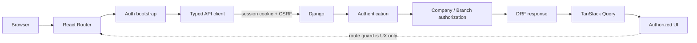

# VIRMS Architecture Phase 2 — Frontend Foundation + Real Backend Integration

> Version 1.0 — task specification with a 2026-11-02 local integration status overlay. The accepted Phase 2 source and P2-13–P2-22 corrections are integrated on local `codex/audit`; no push, staging integration or release is claimed. Current evidence and limits are in [the execution report](../../docs/phase2-execution-progress.md) and [V2 roadmap](../../planning/V2-DEVELOPMENT-ROADMAP.md). Candidate-specific plan details below are historical where they differ.

## Version and status

| Item | Value |
|---|---|
| Observed | 2026-11-02, Asia/Calcutta |
| Mode | IMPLEMENTED_LOCAL_INTEGRATION |
| Risk | HIGH-RISK: authentication, authorization, Company/Branch isolation and session handling |
| Status | `PHASE_2_FULLY_COMPLETE_AND_ACCEPTED` on local `codex/audit`; remote baseline remains `f266803acd5e86caa2286fb8eae41df6cadfcb86` pending separately authorized push |
| Published commit | `f266803acd5e86caa2286fb8eae41df6cadfcb86` on `origin/codex/audit`; parent `6ee3202f0432f19577f88a24b1d3c97ff2d36eef` |
| Git state | Local integration is not pushed; `staging` remains untouched. No production readiness is claimed. |

The planning snapshot below was created on 2026-11-01 against `D:/VIRMS` staging. Its staging-specific observations are historical and are superseded by the execution result and report below. The implementation uses the separately verified Phase 1 candidate in the worktree named above.

## Execution result — 2026-11-02

- **P2-00:** PASS for the Phase 1 correction baseline at parent commit `6ee3202f0432f19577f88a24b1d3c97ff2d36eef`. The accounts/tenants PostgreSQL suite passed 199/199; fresh migration replay reached `accounts.0012_scope_end_monotonic`; Django and schema-drift checks passed. This does not imply that staging contains those changes.
- **P2-01–P2-11:** DONE for the existing `demo/react` Vite/React UI: auth/session, typed CSRF API client, route guard, `/auth/me/` context, Company/role/Branch summaries, logout and in-memory query-cache controls.
- **P2-12:** `P2-12_COMPLETE_AND_VERIFIED` for the authorized Branch-context boundary. `/auth/me/` summaries remain context-only; the paginated Branch API parser matches the exact serializer (`id`, `tenant_id`, `name`); the scoped query hook is conditional and role-gated; tests prove Investor-only and truncated Company context do not trigger Branch reads. Business-page filters remain deferred until an approved business API accepts Branch scope. Synthetic Garage IDs remain separate.
- **P2-13:** `VERIFIED_DONE` after adding the tested role-navigation mapping, preventing Investor access to shared mock dashboard/Fund/Vehicle data, guarding direct dashboard/detail routes, aligning navigation shortcuts and adding Owner Distribution visibility for Owner/Accountant.
- **P2-14–P2-17:** `VERIFIED_DONE`; scoped TanStack Query lifecycle, error handling, bounded Company/Branch context and demo-only business data boundaries were re-audited. No business API or persistence was introduced.
- **P2-18:** `VERIFIED_DONE` for regression scope. Candidate Owner and Investor browser checks covered 320/390/768/1024/1440 px with no document overflow. The Owner dashboard tab strip now scrolls within its available mobile width; desktop layout is unchanged. The previous TopBar label-content finding was traced to decorative `OP` avatar initials, which are now hidden from the accessibility tree. Live accessibility-tree, login label/alert, keyboard and focus checks passed; no page errors were observed.
- **P2-19:** `VERIFIED_DONE`; 74/74 frontend tests across 13 files, TypeScript/build, configured lint, dependency audit and `git diff --check` passed. Role/navigation regression passed 31/31 across 6 files. The current-candidate accounts/tenants PostgreSQL regression passed 199/199 and fresh migrations replayed through `accounts.0012_scope_end_monotonic`. The Vite main chunk remains above the 500 kB advisory and is deferred.
- **P2-20:** DONE as a dependency/deferral map; dashboard and future business-module data remain synthetic.
- **P2-21:** DONE for the README, living architecture maps, execution report, this plan and the supporting authentication security document. That supporting document records the approved six-character password minimum; canonical business permissions were not changed.
- **P2-20–P2-21:** `VERIFIED_DONE`; future business modules are mapped to their approved backend/data dependencies, and living documentation now matches the local accepted candidate.
- **P2-22:** `VERIFIED_DONE`; final adversarial acceptance found no unresolved A-level or material B-level issue. Production host/proxy configuration, future business APIs and the bundle advisory remain documented deferrals.
- Commit `f266803acd5e86caa2286fb8eae41df6cadfcb86` remains the remote `origin/codex/audit` baseline until a separately authorized push. The accepted corrections are included in the current local `codex/audit` integration; staging integration and deployment did not occur. Phase 3 Main Operations remains not started, and Garage belongs to Phase 6 per the verified roadmap.

All statements in sections below labeled current/verified describe the original 2026-11-01 planning snapshot unless they are explicitly updated by this execution result. The report is the current evidence source.

## Authority and skills

`AGENTS.md` and this request govern scope. `docs-final-v2/` supplies target business and permission meaning; explicitly unresolved business decisions remain unresolved. Repository source, migrations, tests and runtime evidence define what is implemented. Historical `/docs-final/`, `/docs-legacy/` and unreconciled V1-derived design documents do not supply new V2 behavior.

Installed skills used:

- `planning-and-task-breakdown` — dependency order, small acceptance-oriented tasks and gates.
- `api-and-interface-design` — contract-first API inventory, compatibility and error/retry boundaries.
- `security-and-hardening` — session, CSRF, tenant isolation and cache-leak controls.
- `frontend-ui-engineering` — design preservation, responsive and accessible UI validation.

No remote skill package was fetched.

## Verified repository state

### Git and worktrees

- Active worktree: `D:/VIRMS`, branch `staging`, HEAD `ed114b2667a707034b01bc58211d58aa70013314`.
- The worktree has a pre-existing modified README, deleted historical architecture/docs files, and many untracked backend, demo, planning and documentation files. No staged files were observed. Preserve all of them.
- `origin/staging` is one commit ahead of the local branch by its existing tracking reference. No network fetch was performed, so no claim is made about live remote state.
- Separate Phase 1 candidate: `D:/VIRMS/tmp/reviewed-backend-baseline`, branch `codex/audit`, HEAD `948df94b8e2cee0fe12075181d9fe602cd708ed9`. It contains uncommitted Phase 1 changes and fixes. It is not merged into this `staging` worktree.

### Backend

**VERIFIED FROM WORKTREE:** `core/` is the Django/DRF application. The current `staging` source contains session/CSRF auth, login/logout/me/password-change and account lifecycle routes, Django Admin, and read-only Tenant list/detail. Its migrations in this worktree are only `accounts.0001` and `tenants.0001`; Branch and the Phase 1 Company-scoped model/API set are absent here.

**VERIFIED FROM SEPARATE CANDIDATE WORKTREE:** the `codex/audit` candidate includes Branch/BranchAssignment, Company-scoped selectors and lifecycle code, candidate Branch read endpoints, health probes, and migrations through `accounts.0011` and `tenants.0002`. Its `docs/phase1-final-defect-fixes.md` and saved run record report the final 158/158 account/tenant tests passing on disposable PostgreSQL 15.19, a fresh migration replay, Django check and migration drift check. The record shows exit code 0 and `Ran 158 tests … OK`. This run belongs to that candidate worktree; it was not rerun for this plan and does not make current `staging` accepted.

**API contract warning:** the current staging and Phase 1 candidate versions of `/api/v1/auth/me/` differ. The frontend must wait for P2-00 and use the exact accepted response; this plan does not freeze an unmerged candidate response as a live contract.

### Frontend and mock surfaces

- `demo/react/` is a local React 19, TypeScript, Vite, Tailwind 4 prototype. It has an `AppShell`, existing sidebar/dock/flyout patterns, UI components and a 45-entry view blueprint. `App.tsx` uses in-memory `activeRoute`; Dashboard view is also represented in a URL query parameter. No React Router, Django API client, login UI or auth state was found.
- The React app imports local `initial*` data. Refresh reloads local arrays; page actions mutate React state. Several dashboard values are locally derived and its performance series is static. `demo/react/package.json` has no test script.
- `demo/accountant-ui-demo/` is a separate Next.js demonstration. It uses local `GET/PUT /api/mock` with `.demo-data/store.json`, revision conflict handling and mock/demo services. This is not a Django API or production data contract. Its Node tests do not prove Django authentication or authorization.
- `localStorage` use observed in the React app is for theme preference/dashboard prototype behavior, not an auth token. No browser/runtime/build/accessibility checks were run during this planning task.
- **Primary UI choice:** `demo/react` is the primary candidate because it is the Vite React shell with the VIRMS UI blueprint. Confirm this source selection at P2-01 before code. Keep the Next.js accountant demo separate as reference unless separately authorized.

### Missing and unverified

Missing from the current React prototype: Login, first-password route/form, server logout, auth bootstrap, protected URL routing, typed Django client, Company/Branch context, role presentation, TanStack Query and auth-scoped cache cleanup.

Business modules, migrations already applied to a live database, production/staging data, deployed UI, external consumers, browser behavior, selected origin/proxy topology and real user acceptance remain **UNVERIFIED**. There are no Phase 1 business APIs for Investor/Fund, Vehicle, Garage Job, Sales/Collections, Running Capital, Company Accounting, reports or dashboard calculations.

## Phase 2 decision and boundary

### Phase 2 — Frontend Foundation + Real Backend Integration

**Purpose:** Complete a reusable VIRMS frontend foundation and connect it securely to the accepted Phase 1 Django backend while preserving the existing VIRMS UI. Replace mock integration with real authenticated Company/Branch-scoped data only where an accepted backend contract exists. Do not implement future business-domain backend modules.

**Starts:** only after Phase 1 acceptance passes on the exact target branch/worktree: Phase 1 A-level defects fixed; required B-level blockers addressed; disposable PostgreSQL regression and migration rehearsal pass; auth/session/Company/Branch API contract is stable and documented.

**Original planning entry state:** NOT PASSED on `D:/VIRMS` `staging` at the 2026-11-01 snapshot. **Current execution:** P2-00 passed on `D:/VIRMS/tmp/phase1-consolidated-20261101` with the exact local Phase 1 correction source; neither candidate is integrated into staging.

**Ends:** real cookie-session authentication and first-password flow work; Company/Branch context comes from accepted APIs; route guards and cache state remain UX/client controls; existing UI is preserved; backend integration tests pass; unsupported business mock data and dashboards remain explicitly deferred.

**Phase 3 boundary:** Phase 3 and later are planned separately from the repository state after Phase 2. This plan does not pre-plan or implement a business vertical slice.

## Scope and preservation contract

In scope: auth UI; CSRF/session client; `/auth/me/`; Company/Branch context; safe route protection; UX-only role presentation; TanStack Query lifecycle; shared loading/error/empty states; real data only for an accepted Phase 1 contract; responsive/accessibility/security regression; documentation of verified changes.

Out of scope:

- Investor Fund, Vehicle finance, Garage Job backend, Sales, Buyer Collections, Running Capital, Accounting ledger, Company Share, Profit/Loss, Owner Distribution, Investor reconciliation/settlement, media workflow, report calculations, AI, and all business APIs/tables.
- Real dashboard metrics or dashboard aggregation. Preserve the existing dashboard UI; dashboard real-data conversion is last in later phases, after authoritative source modules exist.
- Redesign or deletion of existing business pages, new Back Office UI, changes to V2 business rules, production/staging migrations, shared DB writes, deploy, commit, push, merge or Phase 3 implementation.

Preserve the existing sidebar, navigation, top bar, page layouts, cards, tables, typography, colors, responsive patterns and interactions. The only new visual surface is a simple functional auth page: one centered card, existing VIRMS styling, no split-screen marketing design, hero art or new branding system. Preserve existing route keys and aliases; today they are client-state keys, not established public URL routes. Mock UUIDs are never server identity. Do not show local business values or local success messages as persisted truth after authentication.

## Current state → Phase 2 target comparison

| Area | Current state | Phase 2 target | Gap | Action / classification |
|---|---|---|---|---|
| React application shell | Vite shell and shared components exist under `demo/react`; runtime unverified. | Reuse current shell and visual language. | No auth/API integration. | **REUSE** |
| Authentication UI | No login page or auth state. | Login, first-password and expired-session states. | New auth surface. | **NEW FOUNDATION REQUIRED** |
| Login | Backend endpoint exists; no React caller. | Login ID/password with Django session cookie. | Client and UI missing. | **INTEGRATION REQUIRED** |
| First-password change | Candidate backend has password lifecycle/gate; React has no flow. | Block app access until backend confirms replacement. | UI/route missing. | **INTEGRATION REQUIRED** |
| Logout | AppShell callback only. | CSRF-protected server logout plus local state purge. | Callback is local-only. | **INTEGRATION REQUIRED** |
| Session expiry/revocation | Candidate backend checks session/auth epoch; no client handler. | Clear user state on 401 and return safely to login. | No lifecycle handling. | **INTEGRATION REQUIRED** |
| CSRF | Django CSRF endpoint exists; no browser client. | Bootstrap cookie and send token on unsafe requests. | No token handling. | **INTEGRATION REQUIRED** |
| API client | No fetch/axios client in React. | Typed client with credentials, CSRF, errors/request IDs and safe retries. | No client boundary. | **NEW FOUNDATION REQUIRED** |
| `/auth/me/` | Exists in both worktrees, response differs. | Accepted response is auth/context source of truth. | Contract gate and runtime parser needed. | **INTEGRATION REQUIRED** |
| Company context | Local Garage filter only. | One Company for ordinary business account; no normal Company switcher; Platform identity separate. | No server context. | **INTEGRATION REQUIRED** |
| Branch context | Garage filter uses mock IDs and local data. | Authorized Branch list; Company-wide context only when API supports it. | Mock filter is not a permission or real mapping. | **MOCK TO REAL** |
| Protected routing | In-memory `activeRoute`; no router/auth guard. | Public, protected and first-password URL boundaries; safe redirects. | URL-level protection missing. | **NEW FOUNDATION REQUIRED** |
| Role-aware presentation | Static prototype navigation. | Use accepted role state only for UX; backend authorizes. | No user-role presentation mapping. | **INTEGRATION REQUIRED** |
| TanStack Query | Not installed; local state/cache service. | One remote-data layer with identity-scoped keys. | No server-state layer. | **NEW FOUNDATION REQUIRED** |
| Cache/session cleanup | Local prototype dashboard cache; no identity boundary. | Memory-only sensitive cache, cleared on logout/401/revocation. | Cross-user leakage risk if integrated naively. | **NEW FOUNDATION REQUIRED** |
| Errors | Status messages and simulated local outcomes. | Safe 400/401/403/404/409/429/network/5xx states. | No API error mapping. | **NEW FOUNDATION REQUIRED** |
| Loading/empty states | Some skeleton/empty states exist. | Preserve them and add auth/API states, no blank screen. | No remote loading/error lifecycle. | **REUSE** |
| Responsive behavior | Responsive styles exist; browser behavior unverified. | Validate narrow phone through desktop and preserve layout. | No runtime evidence. | **REUSE** |
| Accessibility | No completed accessibility audit found. | Keyboard/focus/labels/contrast/status announcements. | Coverage unverified. | **NEW FOUNDATION REQUIRED** |
| Mock data | React initial arrays; separate Next demo has local JSON mock API. | Field map; never confuse either mock with Django truth. | All business data remains mock-only. | **MOCK TO REAL** |
| Real backend integration | No Django caller found. | Use accepted auth/Company/Branch APIs only. | No integrated caller/tests. | **INTEGRATION REQUIRED** |
| Existing business pages | UI blueprint has 45 view records; many are pending/reference/local data. | Preserve pages, wire only real context; business APIs deferred. | No Phase 1 business APIs. | **OUT OF PHASE 2** |
| Dashboards | Four local dashboard views, derived values and static chart. | Preserve UI; defer metrics until module sources exist. | No authoritative source APIs. | **OUT OF PHASE 2** |
| Tests | Vite has no test script; Next demo has mock-only Node tests. | Unit, component, real Django integration, security and viewport checks. | No Phase 2 test suite. | **NEW FOUNDATION REQUIRED** |
| Documentation | Maps say no React prototype and roadmap labels Phase 2 as Back Office foundation. | Correct local prototype status and phase sequence; never call plan implemented. | Existing claims/sequence stale. | **INTEGRATION REQUIRED** |

Classification definitions: `ALREADY IMPLEMENTED` means verified current code behavior; `REUSE` means preserve and validate; `INTEGRATION REQUIRED` means connect an existing backend contract; `MOCK TO REAL` means map before replacing; `NEW FOUNDATION REQUIRED` means client/auth/query/test capability is absent; `OUT OF PHASE 2` means preserve/defer; `BUSINESS DECISION REQUIRED` only for unresolved business meaning; `UNVERIFIED` means source/runtime proof is absent.

## Expected data flows

- **Login:** `GET /api/v1/auth/csrf/` → CSRF cookie → `POST /api/v1/auth/login/` with Login ID/password and CSRF header → Django sets HttpOnly session → `GET /api/v1/auth/me/` → first-password gate or safe app route.
- **First password:** temporary session → restricted password route → CSRF-protected `POST /api/v1/auth/password/change/` → backend validates/audits → refresh `/auth/me/` → app opens only when `must_change_password` is false.
- **Logout:** CSRF-protected `POST /api/v1/auth/logout/` → server invalidates session → clear auth state, query cache, Company/Branch and page-local sensitive state. If the network outcome is unknown, clear local sensitive state but do not claim server logout; verify `/auth/me/` on the next load.
- **Session expiry:** protected API returns 401 or `/auth/me/` returns 401 → cancel/purge identity-scoped requests → session-expired/login surface. A 403 remains forbidden and must not start an auth loop.
- **Branch filter:** fetch accepted Company-scoped Branch list → choose authorized Branch UUID → use as filter only on endpoints that explicitly accept it → backend reauthorizes Company, Branch, action and object. Selection never grants access.
- **Forbidden direct UUID:** arbitrary Company/Branch UUID reaches a protected endpoint → backend scoped query denies/hides it → safe forbidden/not-found state. The frontend does not resolve access by matching names or UUIDs.
- **Mock to real:** route field → P2-02 mapping → accepted serializer/source → runtime validation → scoped query → existing UI projection. If a source is absent, keep the UI as a separate reference or show unavailable; never infer from labels/local arithmetic.

## API inventory

Classification applies to frontend use. `REQUIRED` means needed for the Phase2 flow; `CONDITIONAL` means use only when the current screen/workflow needs it; no endpoint is invented. Current staging and the separate Phase1 candidate are distinguished because they are not the same contract.

| Endpoint | Class | Caller/auth/CSRF | Request → observed response/errors | Bounds and scope | Frontend consumer |
|---|---|---|---|---|---|
| `GET /api/v1/auth/csrf/` | REQUIRED | Browser; public; safe GET. | No body → detail plus CSRF cookie. Failures need contract test. | No tenant data. | Before unsafe auth requests. |
| `POST /api/v1/auth/login/` | REQUIRED | Login form; anonymous; CSRF required. | `login_id`, `password` → `must_change_password` and session cookie. 400/401/429; candidate includes Retry-After and bounded body. | No Company/Branch authority. | Login. |
| `POST /api/v1/auth/logout/` | REQUIRED | Authenticated session; CSRF required. | No body → detail; server invalidates session. Network outcome may be unknown. | Current session only. | Logout. |
| `GET /api/v1/auth/me/` | REQUIRED | Authenticated session; safe GET. | Current staging returns account flags/roles/tenant_ids; candidate adds `companies` and `company_context_truncated`. 401 when unauthenticated/stale. | Candidate response bounded; exact contract must pass P2-00. | Bootstrap, identity and Company summary. |
| `POST /api/v1/auth/password/change/` | REQUIRED | Allowed authenticated session; CSRF required. | Current/new/confirm password → detail. 400 validation, 401 unauthenticated. | Self only. | First-password/private password flow. |
| `GET /api/v1/tenants/` | CONDITIONAL | Authenticated; safe GET. | Optional accepted page query → paginated Tenant summaries. | Candidate backend scopes Company set; default page size 20. | Only where a real Company list is needed; no normal account switcher. |
| `GET /api/v1/tenants/{company_uuid}/` | CONDITIONAL | Authenticated; safe GET. | Company UUID → `id`, `name`, `slug`, `is_active`; 401/403/404. | Backend queryset must hide unauthorized Company. | No current page requires it. |
| `GET /api/v1/tenants/{company_uuid}/branches/` | REQUIRED for Branch context | Candidate only; authenticated; safe GET. | Company UUID → paginated `{id, tenant_id, name}` Branch summaries. | Candidate default page size 20; Company UUID is not authority. | Branch context after P1 acceptance. |
| `GET /api/v1/tenants/{company_uuid}/branches/{branch_uuid}/` | CONDITIONAL | Candidate only; authenticated; safe GET. | Two UUIDs → Branch summary; 401/403/404. | Backend scopes both Company and Branch. | Only if a real detail surface needs it. |
| `POST /api/v1/auth/accounts/provision/` | CONDITIONAL | Privileged lifecycle policy; CSRF required. | Backend-defined provisioning payload/result; sensitive. | Company-scoped policy in candidate. | No React caller; Django Admin/back-office only. |
| `POST /api/v1/auth/accounts/{user_uuid}/reset/` | CONDITIONAL | Privileged lifecycle policy; CSRF required. | Exact target UUID and lifecycle input; sensitive temporary credential result. | One target account and authorized Company. | No React caller. |
| `POST /api/v1/auth/accounts/{user_uuid}/status/` | CONDITIONAL | Privileged lifecycle policy; CSRF required. | Target UUID/status input → lifecycle result. | One account; Company-scoped candidate policy. | No React caller. |
| `POST /api/v1/auth/accounts/{user_uuid}/revoke/` | CONDITIONAL | Candidate only; privileged lifecycle policy; CSRF required. | Target UUID → revocation result. | One account and authorized Company. | No React caller. |
| `GET /health/live/`, `GET /health/ready/` | CONDITIONAL | Candidate only; operational probe. | `live`/`ready` or 503. | No user data. | Monitoring only. |
| `/admin/`, `/admin/password_change/` | CONDITIONAL | Separate Django Admin HTML session with Django CSRF. | HTML forms/redirects, not JSON API. | Admin adapters remain backend-scoped. | Not a React API. |

Future business endpoints are **NOT IMPLEMENTED — FUTURE MODULE**. No React request should be created for them in Phase 2. Use the accepted Phase1 contract only after P2-00; do not let an unmerged candidate endpoint become an implicit contract.

## Mock and page inventory

### Field-by-field mapping

Field status uses `DIRECT REAL FIELD`, `DERIVED REAL FIELD`, `FUTURE MODULE DATA`, `REDUNDANT`, `UNSUPPORTED MOCK`, or `BUSINESS DECISION REQUIRED`. `FUTURE MODULE DATA` means a V2 concept exists but its business source/API is not implemented. `UNSUPPORTED MOCK` means no current V2 source/approved field exists. In Phase2, only Company/Branch context fields have a Phase1 API candidate.

| Mock type/source | Every field → classification and actual/future source |
|---|---|
| `Garage` | `id` — **UNSUPPORTED MOCK** value; replace with server Branch UUID, do not reuse. `name` — **DIRECT REAL FIELD** from accepted `Branch.name`. `location` — **UNSUPPORTED MOCK**, absent from candidate serializer. `active` — **UNSUPPORTED MOCK**, absent from candidate Branch serializer. |
| `Investor` | `id`, `name` — **FUTURE MODULE DATA**; `principal` — **FUTURE MODULE DATA**, confirmed Fund events; `used`, `available` — **FUTURE MODULE DATA**, derived from future authoritative ledger. |
| `FundCredit` | `id`, `investorId`, `amount`, `date`, `note` — **FUTURE MODULE DATA**; event/Company identity must come from future backend. |
| `PrincipalRecovery` | `id`, `vehicleId`, `saleId`, `amount`, `date` — **FUTURE MODULE DATA**, actual linked recovery only. |
| `Vehicle` | `id`, `number`, `model`, `type`, `investorId`, `status`, `purchase`, `totalCost`, `imageUrl` — **FUTURE MODULE DATA** from Vehicle/Investment/Media sources; `garageId` — **UNSUPPORTED MOCK relation** until a business API provides Branch attribution; `person` — **UNSUPPORTED MOCK** ambiguous display source until the Investor/customer relation exists. |
| `WorkEntry` | `id`, `date`, `category`, `description` — **FUTURE MODULE DATA** from Garage Job work history. |
| `JobCost` | `id`, `date`, `category`, `description`, `amount` — **FUTURE MODULE DATA**, authoritative Garage/Expense source. |
| `JobCharge` | `id`, `date`, `category`, `description`, `amount` — **FUTURE MODULE DATA**, authoritative Garage charge source. |
| `StatusHistoryEntry` | `id`, `timestamp`, `from`, `to`, `actor`, `note` — **FUTURE MODULE DATA**; actual actor/history must be server-recorded. |
| `Job` | `id`, `vehicleId`, `number`, `description`, `status`, `date`, `charge`, `received`, `workEntries`, `costs`, `charges`, `statusHistory` — **FUTURE MODULE DATA**; `garageId` — **UNSUPPORTED MOCK relation** until a real Branch attribution contract exists. |
| `Item` | `id`, `name`, `category`, `active` — **UNSUPPORTED MOCK**; V2 does not include full Parts Inventory in the current baseline. |
| `Batch` | `id`, `itemId`, `garageId`, `date`, `quantity`, `cost` — **UNSUPPORTED MOCK** under current V2 scope. |
| `Issue` | `id`, `batchId`, `vehicleId`, `jobId`, `expenseId`, `jobCostId`, `quantity`, `price`, `date`, `investor`, `capital` — **UNSUPPORTED MOCK** under current V2 scope; do not implement a new inventory or cost allocation rule. |
| `ExpenseCorrection` | `id`, `date`, `reason`, `oldAmount`, `oldInvestor`, `oldCapital`, `amount`, `investor`, `capital` — **FUTURE MODULE DATA**; future linked corrections require backend history and audit. |
| `Expense` | `id`, `vehicleId`, `description`, `amount`, `investor`, `capital`, `date`, `category`, `jobId`, `costType`, `corrections` — **FUTURE MODULE DATA**; `garageId` — **UNSUPPORTED MOCK relation** until a real Branch attribution contract exists. |
| `SaleCorrection` | `id`, `date`, `actor`, `reason`, `oldPrice`, `price` — **FUTURE MODULE DATA**, linked backend correction. |
| `Sale` | `id`, `vehicleId`, `buyer`, `price`, `received`, `corrections` — **FUTURE MODULE DATA**; received amount must derive from actual payment events. |
| `BuyerRefund` | `id`, `saleId`, `amount`, `date`, `method`, `reason` — **FUTURE MODULE DATA**; `principalBacked` — **UNSUPPORTED MOCK field** until a later domain contract defines it. |
| `AuditRecord` | `id`, `date`, `action`, `detail` — **UNSUPPORTED MOCK**; not a backend audit event and no audit list API exists. |
| `Payment` | `id`, `targetId`, `amount`, `date`, `method` — **FUTURE MODULE DATA** with actual event IDs; `kind` — **UNSUPPORTED MOCK union** until Buyer/customer/capital payment contracts are separate and explicit. |
| `OtherIncomeReceipt` | `id`, `description`, `source`, `amount`, `method`, `timestamp`, `actor` — **FUTURE MODULE DATA**; `garageId` — **UNSUPPORTED MOCK relation** until API supplies Branch attribution. |
| `ActivityItem` | `id`, `code`, `title`, `subtitle`, `amount`, `status`, `statusVariant`, `date`, `type` — **UNSUPPORTED MOCK derived feed**; no activity API/source event feed exists. |
| Dashboard data/cache | `monthlyPerformanceData` — **UNSUPPORTED MOCK** static chart; dashboard values/cache — **UNSUPPORTED MOCK** prototype values, later derived only from authoritative modules; `theme preference` — **REUSE**, non-sensitive presentation preference, not auth/session state. |
| Company/Branch response projection | `Company.id`, `Company.name`, `Branch.id`, `Branch.name`, `Branch.tenant_id` — **DIRECT REAL FIELD** only from accepted backend serializer. UUID is identity; name is a label; neither selector nor label grants access. |

The separate Next demo uses the same broad mock types plus `Snapshot.revision`, which is **UNSUPPORTED MOCK** for the real API. Its `GET/PUT /api/mock` is **CONDITIONAL** for that isolated demo only, not the Django API. Preserve its local demo contract separately; do not route authenticated React calls through it.

### Every current page/view record

All rows are prototype/reference pages. `API exists` means an accepted Phase1 domain API for the page, not merely the auth/context APIs. All business pages below have no Phase1 business API. The `Garages / Branches` read list has a candidate Branch API only and is gated by P2-00.

| Route/view | Current mock source | Target API exists? | Conversion / blocked module | Action |
|---|---|---|---|---|
| Dashboard | React initial data, local metrics/static chart | No | Later, after authoritative modules; dashboard last | Keep UI; defer real metrics. |
| All Vehicles | `initialVehicles` | No | Later Vehicle phase | Preserve reference UI. |
| Stock / Investor | Vehicles, Investors, Expenses | No | Later Vehicle/Investment | Preserve; no mock writes as live. |
| Customer Vehicles | Vehicles/jobs | No | Later Garage/Vehicle | Preserve reference UI. |
| Garage Jobs | Jobs/work/cost/charge arrays | No | Later Garage | Preserve reference UI. |
| Investor Fund | Investor/fund/recovery arrays | No | Later Investment | Preserve reference UI. |
| Vehicle Sales | Sales/Vehicle arrays | No | Later Sales | Preserve reference UI. |
| Collections | Payments, Sales, Jobs | No | Later Buyer/Garage receipts | Preserve; no fake confirmation. |
| Sale Corrections & Refunds | Sale corrections/refunds/payments | No | Later Sales/corrections | Preserve reference UI. |
| Investor Profit & Interim | Notice plus mock Investor values | No | Later Investment; V2 decisions remain open | Keep read-only notice. |
| Reconciliation & Settlement | Notice plus mock positions | No | Later Investor settlement | Keep read-only notice. |
| Items & Purchases | Items/Batches/Issues | No | Full Parts Inventory is outside current V2 baseline | Keep isolated reference only. |
| Stock Issues | Issues/Batches/Expenses | No | Full Parts Inventory outside baseline | Keep reference only. |
| Stock Reports | Batch/issue arithmetic | No | Full Parts Inventory outside baseline | Keep reference; no live valuation. |
| Garage Revenue | Jobs/charges/payments | No | Later Garage/Accounting | Preserve reference UI. |
| Company Income | `otherIncomeReceipts` | No | Later Accounting | Preserve reference UI. |
| Company Expenses | Expenses/corrections | No | Later Expense/Accounting | Preserve reference UI. |
| Running Capital | Expense capital/recovery values | No | Later Running Capital | Preserve reference UI. |
| Company Result | Local aggregate calculations | No | After authoritative Accounting sources | Preserve; no mock result as live. |
| Transactions | Payments/receipts/activity arrays | No | Later source modules | Preserve reference UI. |
| All Reports | ReportShell/local arrays | No | After source modules; reports last | Preserve layout, defer data. |
| Audit & Corrections | Mock audit/correction arrays | No | Later audit/correction module | Preserve; mock log is not audit evidence. |
| Garages / Branches | `initialGarages`, local Settings CRUD | Candidate read-only Branch list only | Phase2 can connect read-only context; no mutation API | Convert list only if contract/UI fit; keep mock CRUD out of live state. |
| Demo Data | Local reset/import; Next `/api/mock` file store | No | Demo tooling | Keep isolated; not authenticated production surface. |
| Vehicle Detail | `selectedVehicleId` plus mock linked costs | No | Later Vehicle/Investment | Preserve contextual detail UI. |
| Garage Job Detail | `selectedJobId` plus mock work/cost | No | Later Garage | Preserve contextual detail UI. |
| Company Consolidated | ReportShell mock aggregate | No | After source modules | Preserve; defer aggregate. |
| Garage-wise | ReportShell filters mock Garage IDs | No | Later Branch/Garage reports | Keep distinct from authorized Branch selector. |
| Vehicle Cost | Vehicle expenses/jobs/issues | No | Later Vehicle/Accounting | Preserve reference UI. |
| Investor | Investor/Vehicle/payment arrays | No | Later Investor views | Preserve reference UI. |
| Investor Fund Report | Principal/credit/recovery values | No | Later Investment | Preserve; no mock balance as live. |
| Expense | Expenses/corrections | No | Later Accounting | Preserve reference UI. |
| Garage Jobs Report | Jobs/costs/charges/receipts | No | Later Garage | Preserve; report last. |
| Inventory Current Stock | Items/Batches/Issues | No | Full Parts Inventory outside baseline | Reference only. |
| Inventory Purchases | Items/Batches | No | Full Parts Inventory outside baseline | Reference only. |
| Inventory Issues | Issues/Batches | No | Full Parts Inventory outside baseline | Reference only. |
| Product Margin | Batch purchase/issue calculation | No | Full Parts Inventory outside baseline | Reference only; no live margin. |
| Sales | Sales/Payments arrays | No | Later Sales | Preserve reference UI. |
| Buyer Receivables | Sale price minus mock received | No | Later Sales/Collections | Preserve; no mock arithmetic as actual balance. |
| Customer Garage Receivables | Job charges minus mock receipts | No | Later Garage/Accounting | Preserve reference UI. |
| Running Capital Report | Mock capital/recovery values | No | Later Running Capital/Accounting | Preserve; no mock position as live. |
| Owner Distribution | Notice/local Company result | No | Later Company Accounting | Preserve read-only notice. |
| Inventory | `activeRoute`/`activeTab` navigation key | No | Full Parts Inventory outside baseline | Preserve key, no backend implementation. |
| Accounting | Navigation alias to Garage Revenue prototype | No | Later Company Accounting | Preserve alias; no ledger API. |
| Reports | `activeRoute`/`activeTab` navigation key | No | After modules; dashboard/report last | Preserve navigation compatibility. |

Aliases and contextual routes: `Overview` is a redundant Dashboard alias; `Vehicles` is a redundant All Vehicles alias; Vehicle/Job detail are contextual views using local selected IDs, not stable API identities. Do not trigger duplicate queries for aliases.

## Security and data boundary

- Django session remains HttpOnly and server controlled. No long-lived token in localStorage/sessionStorage.
- Fetch CSRF bootstrap and send the token for every unsafe cookie request. Use a same-origin proxy if the accepted environment supports it; otherwise require explicit allowlisted CORS and CSRF origins. Never use wildcard credentialed CORS.
- Backend authorizes each protected request. Route guards, role-aware menus, Company/Branch selectors and hidden buttons are UX only.
- Ordinary business accounts have exactly one Company and no Company switcher. Platform identities remain separate. A Company/Branch UUID or label is not authority.
- Branch lists are backend-filtered. Direct UUID, cross-Company, stale membership and Branch assignment attempts are rejected server-side.
- Query keys include authenticated identity and relevant Company/Branch. Do not persist sensitive data. Cancel and purge user-scoped queries on logout, 401, revocation or account change.
- First-password restriction is enforced by Django and the UI. Safe local redirects only; no open redirect.
- Distinguish 401 from 403/404. Render server text through React escaping; no unsafe HTML, stack traces, credentials or sensitive body logs.
- Carry request IDs for support when available; never log passwords or session/CSRF values.

## Task sequence

All tasks are planning units. Every task after P2-00 depends on the entry gate passing. If P2-00 fails, no app code, package change or backend contract integration starts. Read-only investigation and plan maintenance are not a substitute for the gate.

### P2-00 — Phase 1 acceptance and reproducible baseline gate

- **Purpose:** Verify accepted Phase1 auth/session/Company/Branch behavior on the exact target branch before Phase2 implementation.
- **Current evidence:** Staging source has no Branch model/migrations; Phase1 fixes and the saved 158/158 test result are in a separate dirty `codex/audit` worktree.
- **Dependencies:** None.
- **Expected areas:** Git/worktree, Phase1 source/migrations/tests, API contract docs.
- **Backend / API / frontend:** Phase1 A-level and required B-level fixed; auth/CSRF/me/Company/Branch/errors/pagination contracts locked; no frontend code until pass.
- **Security / Company / Branch / session:** Verify one Company/account, cross-Company and direct Branch UUID denial, CSRF, first-password, throttling, auth epoch and Admin parity.
- **Mock impact / compatibility:** None; never accept mock tests as backend evidence; use exact target source and preserve worktree state.
- **Steps:** Inspect branch and dirty files; review all A/B findings; run full account/tenant/Admin/session regression and fresh migrations on disposable PostgreSQL; record exact results and contract.
- **Tests:** Full Phase1 tests, migration replay/drift, API contract tests on isolated PostgreSQL.
- **Failure cases:** Any A defect, required B blocker, migration error, ambiguous API contract or non-disposable database blocks Phase2.
- **Regression scope:** Accounts, sessions, CSRF, password, tenant, Branch, Admin, migration and concurrency.
- **Done when:** Exact Phase2 base includes reviewed Phase1 fixes; disposable regressions pass; stable API contract is documented.
- **Docs:** Update Phase1 gate evidence only from actual logs.
- **Risk:** HIGH.

### P2-01 — Frontend inventory and preservation baseline

- **Purpose:** Verify Vite shell, page keys, aliases, states and UI baseline; keep Next accountant demo distinct.
- **Evidence:** `demo/react` contains the Vite shell and 45 blueprint records; `demo/accountant-ui-demo` is a local JSON mock demo.
- **Dependencies:** P2-00.
- **Expected areas:** `App.tsx`, `AppShell`, navigation registry, UI blueprint, accountant demo.
- **Backend / API / frontend:** No new backend/API. Confirm `demo/react` as primary before code, map shell and screens.
- **Security / Company / Branch / session:** Keep mock/reference data out of authenticated views; distinguish Company identity from Branch/Garage filter; auth UI is absent.
- **Mock impact / compatibility:** Inventory every route/source; preserve all route keys, aliases and shell behavior.
- **Steps:** Map AppShell/navigation/45 views; capture read-only baseline at target widths; classify Next demo as reference.
- **Tests:** Static key/component parity and read-only browser baseline at 320, 390, 768, 1024, 1440 px.
- **Failure cases:** Unclear primary UI source or unaccepted visual baseline blocks markup change.
- **Regression scope:** Sidebar/dock/flyout, topbar, routes, cards, tables, forms and responsive patterns.
- **Done when:** Primary source and UI preservation baseline are explicit and repeatable.
- **Docs:** Keep route/preservation inventory in this plan.
- **Risk:** STANDARD.

### P2-02 — Mock data and API dependency field inventory

- **Purpose:** Map every route and typed mock field to a V2/backend source or explicit defer before conversion.
- **Evidence:** Mock types cover Company-like Garage labels, Investor/Vehicle/Job, inventory, expenses, sales, payments, audit and dashboard values; no business API exists.
- **Dependencies:** P2-00, P2-01.
- **Expected areas:** React `types/index.ts`, `mockData.ts`, components, Next mock types, V2 models.
- **Backend / API / frontend:** Read-only; enumerate actual endpoints only; future business endpoints remain NOT IMPLEMENTED.
- **Security / Company / Branch / session:** No mock UUID or role can cross boundary; assign future Company owner; do not infer Branch link from label.
- **Mock impact / compatibility:** Classify every field as DIRECT, DERIVED, FUTURE MODULE, REDUNDANT, UNSUPPORTED or BUSINESS DECISION REQUIRED; preserve demo schema.
- **Steps:** Enumerate routes/fields/actions; compare V2 source semantics and API serializers; document conversion and defer behavior.
- **Tests:** Mapping completeness and route coverage for 45 records, aliases and detail views.
- **Failure cases:** Similar name/ID/arithmetic is not a mapping; ambiguous field remains unsupported or requires a real decision.
- **Regression scope:** All columns, filters, actions, IDs, statuses, money labels and empty states.
- **Done when:** Every field/route has a source and no-false-success disposition.
- **Docs:** Maintain mock inventory.
- **Risk:** HIGH.

### P2-03 — Frontend runtime and safe environment configuration

- **Purpose:** Configure Vite to reach accepted Django without client secrets or broad origins.
- **Evidence:** Vite/React/TypeScript/Tailwind and package lock exist; no Django proxy/API config.
- **Dependencies:** P2-00, P2-01.
- **Expected areas:** `package.json`, lockfile, `vite.config.ts`, runtime docs.
- **Backend / API / frontend:** Accepted Django origin; accepted endpoint base path; use existing npm lock and add only necessary dependencies.
- **Security / Company / Branch / session:** No secret in `VITE_*`; explicit CORS/CSRF allowlist if cross-origin; cookie SameSite behavior must work.
- **Mock impact / compatibility:** Mock URLs stay out of production configuration; preserve local Vite commands/port unless evidence requires change.
- **Steps:** Choose same-origin proxy or explicit origins; validate public env config; document startup/teardown without auto-migrations.
- **Tests:** Invalid/missing origin config and browser cookie/CSRF smoke against isolated Django.
- **Failure cases:** Wildcard credential CORS, secret bundle, cookie mismatch or unknown origin blocks release.
- **Regression scope:** Vite dev/preview, build inputs, lockfile and deployment base path.
- **Done when:** Reproducible frontend config points only at approved backend and holds no secrets.
- **Docs:** Record origin/proxy setup.
- **Risk:** HIGH.

### P2-04 — Typed API client, CSRF, request IDs and retry boundary

- **Purpose:** Build one typed browser client for accepted Django session APIs.
- **Evidence:** React has no client; Django uses session/CSRF; candidate error responses can contain request ID metadata.
- **Dependencies:** P2-00, P2-03.
- **Expected areas:** API/services layer, types, client unit tests.
- **Backend / API / frontend:** No backend change; credentials include; CSRF bootstrap/header; preserve status, error and Retry-After; parse unknown bodies at boundary.
- **Security / Company / Branch / session:** Never store tokens or log credentials; no client authorization; logout/401 follows session policy.
- **Mock impact / compatibility:** Do not send production calls to `/api/mock`; do not alter Django routes/response contracts.
- **Steps:** Define types from accepted contracts; implement cookie and CSRF behavior; carry request ID; retry bounded safe reads only.
- **Tests:** Cookies, CSRF, malformed body, status mapping, network failures and no POST replay.
- **Failure cases:** CSRF/content-type/network/unknown status becomes safe failure, not success.
- **Regression scope:** Request body limits, error privacy and existing cookie/session contract.
- **Done when:** All Django browser requests use one client and no duplicate helper/token persistence exists.
- **Docs:** Record API/error/retry contract.
- **Risk:** HIGH.

### P2-05 — Authentication state model and bootstrap boundary

- **Purpose:** Define loading, authenticated, unauthenticated, first-password, stale-session and network-error states.
- **Evidence:** React has no auth provider; AppShell logout is a callback; candidate backend has `must_change_password`.
- **Dependencies:** P2-00, P2-03, P2-04.
- **Expected areas:** auth state/provider, root App, auth unit tests.
- **Backend / API / frontend:** No backend change; define gateway on P2-04; `/auth/me` runtime integration is P2-10.
- **Security / Company / Branch / session:** Unknown defaults to deny; never infer auth/company from cache; Branch selection never grants rights.
- **Mock impact / compatibility:** Fixtures only in unit tests; preserve shell once identity resolves.
- **Steps:** Define state transitions; bootstrap server truth; separate API outage from anonymous/forbidden.
- **Tests:** Initial/authenticated/unauthenticated/first-password/network transitions.
- **Failure cases:** Stale/out-of-order response cannot reopen protected views.
- **Regression scope:** App mount, shell, existing keys and refresh behavior.
- **Done when:** Auth transition is deterministic, default-deny and testable.
- **Docs:** State diagram/startup behavior.
- **Risk:** HIGH.

### P2-06 — Login UI and real login integration

- **Purpose:** Add Login ID/password form using CSRF and real Django session.
- **Evidence:** No login UI/caller; candidate login sets session cookie and returns first-password flag.
- **Dependencies:** P2-04, P2-05.
- **Expected areas:** New auth view, auth adapter, component tests.
- **Backend / API / frontend:** Accepted `POST /api/v1/auth/login/`; centered card using existing tokens.
- **Security / Company / Branch / session:** Generic credential errors, no existence leak, 429 handling; no Company/Branch selection at login.
- **Mock impact / compatibility:** No demo credentials/fake login; preserve business shell.
- **Steps:** Accessible labeled form; fetch CSRF; submit once; refresh `/me`; route by first-password flag.
- **Tests:** Success, invalid credentials, 429, CSRF and network timeout.
- **Failure cases:** Unknown outcome does not resubmit; password remains in component memory only and clears after success/unmount.
- **Regression scope:** Global styles, shell and keyboard form.
- **Done when:** A valid login creates backend session only; errors remain generic and accessible.
- **Docs:** Request/response/CSRF states.
- **Risk:** HIGH.

### P2-07 — First-login temporary-password replacement

- **Purpose:** Connect mandatory password replacement and prevent app entry until backend confirmation.
- **Evidence:** Candidate backend has first-password gate and lifecycle; React flow absent.
- **Dependencies:** P2-06, P2-09, P2-10.
- **Expected areas:** Password view, API adapter, route state and tests.
- **Backend / API / frontend:** Accepted password policy and `POST /api/v1/auth/password/change/`; one focused auth form.
- **Security / Company / Branch / session:** Never put password in URL/log/storage; no Company/Branch access before gate clears.
- **Mock impact / compatibility:** No mock replacement; preserve current business keys and safe local return path.
- **Steps:** Render gate from `/me`; validate confirmation for UX; submit and refresh server state.
- **Tests:** Valid/weak/mismatched/wrong current password, reload and direct-route bypass.
- **Failure cases:** 400/401/403/network keeps user restricted, without success state.
- **Regression scope:** Temporary login, session continuity and server middleware.
- **Done when:** Protected views remain unavailable until Django reports gate cleared.
- **Docs:** First-password flow and errors.
- **Risk:** HIGH.

### P2-08 — Logout, session expiry and revocation handling

- **Purpose:** Server logout and purge all authenticated UI/cache state on expiry, revocation or inactive user.
- **Evidence:** AppShell callback only; candidate backend auth epoch invalidates stale session.
- **Dependencies:** P2-04, P2-05, P2-06, P2-14.
- **Expected areas:** AppShell callback, API error boundary, auth/query state.
- **Backend / API / frontend:** Accepted CSRF logout; protected 401 is stale-session signal; 403 is not expiry.
- **Security / Company / Branch / session:** Purge before another user signs in; unknown network outcome is not server success; clear selected contexts.
- **Mock impact / compatibility:** No sensitive dashboard/local cache; keep theme preference as UI-only; preserve callback interaction.
- **Steps:** POST logout, clear state; on timeout purge locally but report unknown; handle 401 without loops.
- **Tests:** Logout, timeout, 401, stale epoch, inactive account, other-user cache isolation.
- **Failure cases:** 403 does not log user out; local cache still purges on network failure.
- **Regression scope:** Context, routes, theme and revocation behavior.
- **Done when:** No prior user data remains; server outcome is accurately represented.
- **Docs:** Logout/stale-session rules.
- **Risk:** HIGH.

### P2-09 — Protected routing and safe redirects

- **Purpose:** Add URL route boundaries while retaining all existing client view keys/aliases.
- **Evidence:** Single root path and in-memory `activeRoute`; dashboard has view query; no router.
- **Dependencies:** P2-05, P2-06, P2-07.
- **Expected areas:** `main.tsx`, `App.tsx`, nav registry, router tests/lockfile.
- **Backend / API / frontend:** No backend endpoint change; guard is UX only; use minimum routing change.
- **Security / Company / Branch / session:** Validate local redirect only; route or Branch UUID never grants access; gate first-password.
- **Mock impact / compatibility:** No fake business route authorization; keep `/`, route keys, aliases, detail back flow and `?view`.
- **Steps:** Map login/first-password/app routes; add pending/error/not-found states; adapt existing navigation.
- **Tests:** Direct URL, refresh, back/forward, open redirect, anonymous and first-password.
- **Failure cases:** External/malformed return path defaults safely; unknown route reveals no data.
- **Regression scope:** All 45 blueprint records and contextual detail interactions.
- **Done when:** Server auth resolves before protected render; current navigation remains functional.
- **Docs:** Route map/redirect contract.
- **Risk:** HIGH.

### P2-10 — `/auth/me/` identity and session bootstrap integration

- **Purpose:** Use accepted server response for identity, role presentation, password gate and Company summary.
- **Evidence:** Staging/candidate response differs; candidate adds Company summaries/truncation.
- **Dependencies:** P2-04, P2-05, P2-06, P2-09.
- **Expected areas:** Auth types/bootstrap, account summary, contract tests.
- **Backend / API / frontend:** Exact accepted `GET /api/v1/auth/me/`; validate at runtime; no alternate endpoint.
- **Security / Company / Branch / session:** Never trust cached role/Company; Company comes from server; no Branch authority from role string.
- **Mock impact / compatibility:** Replace hardcoded account label only with safe API field; tolerate additive fields without assuming missing fields.
- **Steps:** Validate accepted fields; use on load/login/password change; handle 401, malformed, 5xx and truncation without polling.
- **Tests:** Contract fixtures, 401, malformed response, revoked epoch and truncation.
- **Failure cases:** No/multiple Company for ordinary account does not silently select or disclose another scope.
- **Regression scope:** Login, password, refresh, logout, navigation/account display.
- **Done when:** Auth/identity reflects current accepted backend response.
- **Docs:** `/me` fields/bounds.
- **Risk:** HIGH.

### P2-11 — Company context integration

- **Purpose:** Show exact authorized Company without a normal Company switcher.
- **Evidence:** V2 says one Company per business account; mock Garage filter is not Company identity.
- **Dependencies:** P2-10.
- **Expected areas:** AppShell context area, Company selector/types, tests.
- **Backend / API / frontend:** Accepted account-kind/membership rules; `/me`, optional Tenant list only when needed.
- **Security / Company / Branch / session:** One Company/no switcher for ordinary accounts; Platform remains separate; UUID not authority; Branch selection is separate; clear context on user/session change.
- **Mock impact / compatibility:** Never map Garage mock ID to Company; preserve shell position.
- **Steps:** Render accepted Company summary; no ordinary selector; handle no/multiple/truncated cases safely.
- **Tests:** One-company, no membership, platform identity, truncation, logout/login switch.
- **Failure cases:** Missing/ambiguous scope blocks Company data; no slug/name fallback.
- **Regression scope:** TopBar, role UI and query keys.
- **Done when:** Rendered Company is server-derived and one-company rule holds.
- **Docs:** Context/no-switcher contract.
- **Risk:** HIGH.

### P2-12 — Authorized Branch context and filters

- **Purpose:** Load permitted Branch choices and apply them only as filters, never as authority.
- **Evidence:** Local Garage filter uses mock IDs; candidate Branch read API absent from staging.
- **Dependencies:** P2-10, P2-11, P2-14, P2-15.
- **Expected areas:** AppShell Branch context, API adapter, scope tests.
- **Backend / API / frontend:** Accepted BranchAssignment policy; candidate paginated `GET /api/v1/tenants/{company_uuid}/branches/`; lock serializer/page contract first.
- **Security / Company / Branch / session:** Server rechecks all direct UUIDs; Company UUID not authority; stale selection cleared; selection alone grants nothing.
- **Mock impact / compatibility:** Do not map `garageId` to Branch before a real domain API establishes relation; keep mock filter in reference mode.
- **Steps:** Fetch scoped list/page; bind selected server Branch UUID; send it only to APIs that accept a filter.
- **Tests:** Unauthorized/cross-Company UUID, stale assignment, pagination and supported Company-wide context.
- **Failure cases:** 403/404/empty list never falls back to all Branches or mock IDs.
- **Regression scope:** Garage selector, all consumer views and Company-wide semantics.
- **Done when:** Only authorized Branches are selectable and backend denial is proven.
- **Docs:** Branch API/bounds/selector boundary.
- **Risk:** HIGH.

### P2-13 — Role-aware navigation and action presentation

- **Purpose:** Use role state to simplify UX without making frontend authorization decisions.
- **Evidence:** Nav registry is static; candidate backend uses scoped roles/grants.
- **Dependencies:** P2-10, P2-11.
- **Expected areas:** Navigation registry, AppShell, role matrix tests.
- **Backend / API / frontend:** No new permission rule/endpoint; accepted role data only; preserve visual hierarchy.
- **Security / Company / Branch / session:** Backend remains authoritative; no global role as cross-Company power; a selected Branch is not a grant; clear nav state on identity change.
- **Mock impact / compatibility:** No fake-role fallback; keep existing valid keys.
- **Steps:** Map confirmed role presentation; avoid fetching hidden private content; leave API policy unchanged.
- **Tests:** Role/navigation matrix plus direct protected API negative tests.
- **Failure cases:** Unknown role gives least-privilege UI, never a grant.
- **Regression scope:** Owner, Accountant, Investor, Media, Platform Back Office surfaces only as exposed.
- **Done when:** UI mapping is UX-only and server tests prove permissions.
- **Docs:** Role presentation matrix.
- **Risk:** HIGH.

### P2-14 — TanStack Query server-state and cache policy

- **Purpose:** Add bounded server state with identity-scoped keys and secure invalidation; avoid speculative optimization.
- **Evidence:** TanStack Query is absent; local dashboard cache is prototype behavior.
- **Dependencies:** P2-04, P2-05, P2-10.
- **Expected areas:** QueryClient, key factories, auth lifecycle, lockfile.
- **Backend / API / frontend:** Accepted response identity and page bounds; safe read retries only; local UI remains local state/context.
- **Security / Company / Branch / session:** No persisted sensitive query cache; keys include user/Company/Branch; purge/cancel on logout/401/change.
- **Mock impact / compatibility:** Do not persist business mock data into production QueryClient; avoid duplicate cache systems.
- **Steps:** Conservative defaults; typed key factories; invalidation policy; no persistence plugin.
- **Tests:** Cross-user/Company/Branch keys, purge, stale request completion and retry.
- **Failure cases:** Old identity cache cannot be read or repopulated after logout.
- **Regression scope:** dashboard cache/refresh and local preference storage.
- **Done when:** One server-state source has verified cache boundaries.
- **Docs:** Query/cache policy.
- **Risk:** HIGH.

### P2-15 — Shared loading, error, empty and conflict states

- **Purpose:** Make API/auth failure states consistent, accessible and truthful.
- **Evidence:** Some local skeleton/empty/status UI exists; no Django error mapper.
- **Dependencies:** P2-04, P2-05, P2-14.
- **Expected areas:** Shared status components, error mapper, auth forms/shell.
- **Backend / API / frontend:** Preserve backend statuses; cover 400/401/403/404/409/429/network/timeout/5xx/503; preserve existing visual hierarchy.
- **Security / Company / Branch / session:** Safe errors/request IDs only; no Company existence leak; no Branch-wide fallback; 401 differs from 403.
- **Mock impact / compatibility:** Local success is never API success; preserve current empty/skeleton patterns.
- **Steps:** Map status to action; add loading/empty/forbidden/missing/conflict/offline states; support forms and request IDs.
- **Tests:** Components for statuses, retry behavior and accessible announcements.
- **Failure cases:** Unknown payload/status or timeout cannot duplicate a mutation or claim success.
- **Regression scope:** Login, password, context, toasts, tables/forms.
- **Done when:** All shared states are consistent without false success.
- **Docs:** Status-to-UX mapping.
- **Risk:** STANDARD.

### P2-16 — API-backed identity and context surfaces only

- **Purpose:** Convert existing shell/context fields only where accepted Phase1 API is the source.
- **Evidence:** Candidate has `/me`, Tenant/Company and Branch reads; no business-domain APIs.
- **Dependencies:** P2-02, P2-10, P2-11, P2-12, P2-14, P2-15.
- **Expected areas:** TopBar/AppShell and `Garages / Branches` read list only if compatible.
- **Backend / API / frontend:** No business backend change; `/me`, optional Tenant list and scoped Branch list only; no account CRUD UI.
- **Security / Company / Branch / session:** Backend scopes; UUID does not grant; identity/context cleared/refetched; only Branch list is real.
- **Mock impact / compatibility:** Convert only DIRECT/DERIVED fields with serializer proof; otherwise preserve layout but isolate/unavailable; no fake write success.
- **Steps:** Wire account/context; convert real fields; keep account management in Django Admin unless a current API exists.
- **Tests:** Real backend me/company/branch and assertion that no absent business endpoint is called.
- **Failure cases:** Missing field/API stays reference-only or unavailable.
- **Regression scope:** TopBar, context, Branch read and untouched business pages.
- **Done when:** Every converted field has server provenance; no mock business action reports saved.
- **Docs:** Per-page conversion map.
- **Risk:** HIGH.

### P2-17 — Unsupported mock-field reconciliation and safe defer behavior

- **Purpose:** Apply the field map; keep unsupported business domains clearly non-live.
- **Evidence:** Mock domains include future V2 modules and full Parts Inventory, which is outside current V2 baseline.
- **Dependencies:** P2-02, P2-16.
- **Expected areas:** Mock selectors, page data boundaries, reference mode.
- **Backend / API / frontend:** No API/table/model; preserve page layout and separate reference data from authenticated server state.
- **Security / Company / Branch / session:** No mock IDs attached to real Company/Branch; auth does not convert sample into user data.
- **Mock impact / compatibility:** No new local persistence in live flow; no deletion of existing demos; future APIs stay unimplemented.
- **Steps:** Apply field classifications; keep Inventory reference only; remove/relabel false live-success affordances only as required for safe integration.
- **Tests:** No unsupported API calls, no local fake success in live state, reference workflow preserved.
- **Failure cases:** Ambiguous or decision-dependent fields remain deferred.
- **Regression scope:** Forms, toasts, selectors, reports and mock persistence.
- **Done when:** Every field is mapped or explicitly not-live/deferred.
- **Docs:** Field mapping/defer list.
- **Risk:** HIGH.

### P2-18 — Responsive and accessibility regression

- **Purpose:** Validate preserved UI and new auth/context at narrow phone through desktop, keyboard and screen reader states.
- **Evidence:** Responsive styles exist; no browser or accessibility evidence.
- **Dependencies:** P2-01, P2-06, P2-07, P2-09, P2-11, P2-12, P2-15, P2-17.
- **Expected areas:** Touched React pages and browser/a11y harness.
- **Backend / API / frontend:** Isolated backend for auth screens; no production access; preserve visual layout.
- **Security / Company / Branch / session:** Error/password focus safe; long Company/Branch labels do not confuse scope; session-expired view usable.
- **Mock impact / compatibility:** Synthetic non-sensitive fixture data; compare touched screens to baseline.
- **Steps:** Check 320/390/768/1024/1440 px; keyboard order, focus, labels, live regions, contrast, overflow and safe areas.
- **Tests:** Browser snapshots/checks, automated accessibility scan, keyboard-only flow.
- **Failure cases:** Clipping, keyboard trap, unlabeled field, inaccessible state or overlapping mobile surface blocks exit.
- **Regression scope:** Auth, topbar, sidebar/dock, context, tables, forms and modals.
- **Done when:** No blocking responsive/a11y regression; accepted UI composition remains.
- **Docs:** Record tested browsers/viewports and residual issues.
- **Risk:** STANDARD.

### P2-19 — Frontend unit, component, integration and security suite

- **Purpose:** Prove browser-to-Django session/scope behavior using real backend, not mocks alone.
- **Evidence:** Vite has no test script; separate Next tests are demo-only.
- **Dependencies:** P2-04 through P2-17.
- **Expected areas:** Vite test harness, auth/client tests, isolated Django/PostgreSQL runner, browser tests.
- **Backend / API / frontend:** Use accepted Phase1 backend and disposable PostgreSQL only; choose minimal Vite-compatible tools and pin lockfile.
- **Security / Company / Branch / session:** Invalid CSRF, expiry, revoked epoch, inactive account, unauthorized Branch/cross-Company UUID, direct API, cache leak and first-password bypass.
- **Mock impact / compatibility:** Mock tests alone cannot prove authorization; existing Phase1 regressions remain green.
- **Steps:** Unit and component suite; real session integration; isolated runner with exact DB/source evidence.
- **Tests:** Helpers/state/query/error; Login/password/routes/states/Branch; login→session→me→Company/Branch→protected route→logout.
- **Failure cases:** Persistent DB, only mocked auth, undiscovered tests or unsupported browser blocks gate.
- **Regression scope:** Full Phase1 account/tenant/Admin/session/migration plus touched frontend flows.
- **Done when:** Required tests run and pass in the correct isolated environment.
- **Docs:** Exact commands, discovery and proof limits.
- **Risk:** HIGH.

### P2-20 — Dashboard and future-module dependency map

- **Purpose:** Keep dashboards intact and defer real metrics until authoritative sources exist.
- **Evidence:** Four local views, derived values, static chart, local cache; no business API.
- **Dependencies:** P2-02, P2-16.
- **Expected areas:** Dashboard cards/charts, field inventory, Phase2 boundary.
- **Backend / API / frontend:** No dashboard backend or invented metric endpoint; keep current UI/reference separated from live data.
- **Security / Company / Branch / session:** No cross-Company mock aggregate; future Branch metric needs real attribution.
- **Mock impact / compatibility:** Document source of every metric and defer; preserve composition.
- **Steps:** Map cards/charts; list source modules; no fake live metrics.
- **Tests:** Inventory coverage and no absent business API calls.
- **Failure cases:** Any request to invent aggregation is deferred.
- **Regression scope:** Overview/operations/analytics/financial dashboards and current cache.
- **Done when:** Dashboards remain last; prerequisites are explicit.
- **Docs:** Dashboard source/defer map.
- **Risk:** HIGH.

### P2-21 — Verified architecture and living-map updates

- **Purpose:** Record actual integration truth without turning proposal into implementation or changing V2 business rules.
- **Evidence:** Maps said no React prototype; roadmap used Phase2 as Platform/Back Office. Source shows local demos and this plan assigns new Phase2 scope.
- **Dependencies:** P2-01, P2-02, P2-19, P2-20.
- **Expected areas:** Phase2 MD/JSON, maps 01–05 and V2 development roadmap.
- **Backend / API / frontend:** Document only accepted backend/API/frontend evidence.
- **Security / Company / Branch / session:** Preserve one-company, Branch-filter-not-permission and cookie/CSRF boundaries.
- **Mock impact / compatibility:** Keep field/dashboard deferrals current; change only stale claims; do not rewrite frozen V2 docs.
- **Steps:** Compare evidence to plan; update only verified truth; mark unknowns.
- **Tests:** Markdown links, JSON/Markdown task parity and diff review.
- **Failure cases:** Unverified claims remain unverified and block completion claim.
- **Regression scope:** Data/API/conflict/compatibility maps and phase sequence.
- **Done when:** Docs match verified code/test state and distinguish proposed/future work.
- **Docs:** This task is the documentation update.
- **Risk:** STANDARD.

### P2-22 — Final Phase 2 integration and exit audit

- **Purpose:** Audit auth/context integration, preserved UI, security, tests, migrations and deferrals.
- **Planning snapshot evidence:** Phase2 was plan-only and had no implementation/browser proof when this task was drafted. **Current result:** the implementation and browser proof are recorded in `docs/phase2-execution-progress.md`.
- **Dependencies:** P2-00 through P2-21.
- **Expected areas:** Full React/Django integration, disposable DB evidence, maps and plan.
- **Backend / API / frontend:** Phase1 accepted; no unauthorized business endpoint/schema changes; all callers match accepted contract.
- **Security / Company / Branch / session:** No A-level auth/CSRF/cache/Company/Branch defect; direct UUID denial and session lifecycle pass.
- **Mock impact / compatibility:** Every page/field mapped; preserve shell/routes; no business success/dashboard data invented.
- **Steps:** Review diff and acceptance; full frontend/backend regression; responsive/a11y and migration checks; confirm Phase3 not started.
- **Tests:** Complete unit/component/integration/security suite, Phase1 PostgreSQL regression, fresh migration replay, viewport/a11y and docs checks.
- **Failure cases:** Any test/API/migration/UX/scope failure blocks exit.
- **Regression scope:** All preserved routes/components and backend session/auth/Company/Branch/Admin behavior.
- **Done when:** Every exit item has evidence; Phase2 is reported complete without starting Phase3.
- **Docs:** Final verified status and explicit deferred surfaces.
- **Risk:** HIGH.

## Test architecture

- **Unit:** API helpers and runtime validators; auth state transitions; query-key identity; error mapping and retry rules.
- **Component:** Login; password replacement; route guard; Branch context; loading, empty, validation, forbidden, missing, conflict, rate-limit and offline states.
- **Integration:** Real Login → session cookie → `/auth/me/` → Company/Branch context → protected route → logout.
- **Security regression:** Invalid CSRF; expired session; revoked auth epoch; inactive user; unauthorized Branch UUID; cross-Company UUID; direct protected API; stale cache after logout; first-password bypass; open redirect.
- **Browser quality:** Vite build/typecheck; 320, 390, 768, 1024 and 1440 px; keyboard/focus/labels/live regions/contrast; no overflow or modal overlap.
- **Proof rule:** Frontend mocks do not prove backend authorization. Record exact commands, discovery counts, source SHA and disposable database identity. Never run these checks against a shared/staging/production database.

## Business decisions and risks

No new Phase 2 business decision is required. Existing V2 decisions about interim principal/withdrawals, manual Loss, Company distributable Profit, cross-Branch corrections and module-OFF settlement remain open for their later phases; Phase2 must not guess them.

Planning confirmations: `demo/react` was selected and preserved in the candidate. The local development proxy permits loopback HTTP only; production cookie/proxy topology remains unverified until a hosting target is selected.

| ID | Original severity | Risk | Current disposition |
|---|---|---|---|
| R2-01 | A | Phase1 candidate/API is not integrated into staging. | **CLOSED FOR THIS CANDIDATE GATE:** exact local source was tested; status explicitly excludes staging integration. |
| R2-02 | A | Stale Company/Branch query data could leak across sessions. | **CLOSED:** scoped cache keys, cancellation/purge and regression/browser checks passed. |
| R2-03 | A | Route/role state could be mistaken for permission. | **CLOSED:** backend remains authoritative; scoped negative API checks passed. |
| R2-04 | B | Next `/api/mock` or local JSON could be mistaken for production. | **CLOSED:** no Next.js code/API was used; API client targets only `/api/v1/`. |
| R2-05 | B | Mock money or local success could be presented as actual. | **CLOSED:** prototype data is retained and local actions disclose that no backend save occurred. |
| R2-06 | B | Older roadmap phase naming conflicted with this task. | **RESOLVED FOR SEQUENCING:** the verified `planning/V2-DEVELOPMENT-ROADMAP.md` assigns Phase 3 to Main Operations Foundation and Garage to Phase 6 after Phases 4 and 5. The preserved Garage design candidate is not imported as Phase 3 implementation work. |
| R2-07 | B | Cookie/CSRF origin topology is unknown for deployment. | **C — DEFERRED:** same-origin local proxy was verified; production topology is not configured or claimed. |
| R2-08 | C | Demo includes Parts Inventory outside V2 baseline. | **DEFERRED:** kept as synthetic reference only; no API or backend scope was added. |

## Phase 2 exit gate

1. Phase1 gate passes on the exact target branch with A-level defects fixed, required B-level findings addressed, and stable tested APIs.
2. CSRF/session login, `/me`, first-password, logout, expiry/revocation and no-token-storage flows pass against disposable Django/PostgreSQL.
3. One Company per business account; Platform remains separate; authorized Branch context works and never grants permission.
4. Direct UUID/cross-Company/Branch, first-password bypass and stale-cache tests pass against backend authorization.
5. Typed API client, TanStack Query, shared errors and cache lifecycle are integrated with safe retry behavior.
6. Existing approved UI and route keys are preserved; auth uses existing styling; responsive/accessibility gates pass.
7. Every page and mock field has a source or explicit defer; no business module/dashboard backend or false live result is added.
8. Full required frontend/backend checks and migration verification pass on isolated targets; evidence/docs match verified state.
9. Report Phase2 status and defer Phase3; do not automatically begin another phase.

## Living-document updates made during planning and execution

- `README.md`, `architecture/01-DATA-FLOW.md`, `architecture/02-API-FLOW.md`, `architecture/03-ARCHITECTURE-CONFLICT-MAP.md`, `architecture/04-CHANGE-IMPACT-COMPATIBILITY.md`, `docs/phase1-execution-progress.md`, and `docs/phase2-execution-progress.md` — describe the verified candidate integration and its boundaries.
- `architecture/05-SYSTEM-STRUCTURE-MAP.md` and `planning/V2-DEVELOPMENT-ROADMAP.md` were referenced by the original plan but are absent from this worktree; they were not created from stale references.

`docs-final-v2/*` was not changed by the Phase 2 application implementation. During a later, separately approved roadmap/business-rule reconciliation, seven canonical Garage decision documents were updated; that documentation work added no Phase 2 application behavior. The execution report records tested Phase 2 truth and runtime evidence.

## Current roadmap boundary

At Phase 2 completion, the reusable authenticated frontend and real Company/Branch context are available for later business-domain work. The current roadmap's Phase 3 is Main Operations Foundation and is not started. Garage, Jobs and Labour are Phase 6 after Phase 4 Accounting and Phase 5 Vehicle/Investment contracts. No business-domain API/model implementation was added by Phase 2.
