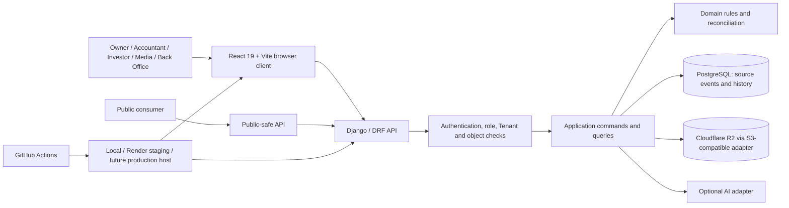

# 01 — System context and boundaries

> **Reconciliation status: HISTORICAL / SUPERSEDED V1-DERIVED TECHNICAL DESIGN.** **CURRENT TARGET:** `/docs-final-v2/`. **CURRENT IMPLEMENTED:** repository source, as distinguished in the four living maps. The former `/docs-final/` and `/docs-legacy/` are historical. This document was derived from V1 rules and is not an approved V2 schema, API, permission, financial workflow, or implementation contract. Reuse a statement only where its business meaning is explicit in V2 and its technical claim is independently verified. Missing V2 code is an **IMPLEMENTATION GAP**, not evidence for V1. Unresolved meaning is **BUSINESS DECISION REQUIRED**. The remaining unreconciled content below is **HISTORICAL / SUPERSEDED**. See `/architecture/03-ARCHITECTURE-CONFLICT-MAP.md`.

Canonical sources: docs-final/01, 02, 03, 04, 06, 07, 08 and supporting authentication and production standards. See 00 for authority.

## Actors and boundaries

| Actor | Scope and system interaction |
|---|---|
| Owner | Read/monitor/analyse explicitly authorized Tenants, including approved combined views; no ordinary writes. |
| Accountant / Operations Admin | Daily operational commands in authorized Tenant, Investor and object scope. |
| Investor | Self-scoped global Fund, own Vehicles and normal exit request; other Vehicles only through the public projection. |
| Media User | Authorized Vehicle images and approved public information; no finance or core lifecycle change. |
| Back Office Admin | Tenant/account/configuration administration, authorized financial read and controlled consolidation; no ordinary daily finance confirmation. |
| Labour | Managed Tenant record, with no account or navigation. |
| Public consumer | Only explicitly published, eligible Vehicle data through the public-safe API. |
| Owner AI | Explanatory reader of minimum necessary authorized data; no command authority or dependency for core financial workflows. |

## System of record and source of truth

- PostgreSQL is the system of record for identity, memberships, Tenant context, operational records, immutable financial source events, correction links, configuration snapshots, audit, publication state and current-position metadata.
- The Investor Fund Ledger and linked confirmed transaction events are the monetary source of truth; calculated balances and reports are derived. Cloudflare R2 stores image bytes and variants, while PostgreSQL stores immutable image identity, scope, metadata and access/publication state.
- /docs-final/ is the requirement source of truth. /system-design/ is its subordinate technical design. A UI view, AI answer, report, cache or object-storage key is never an independent financial or identity authority.
- External dependencies are the GitHub delivery path, application host, PostgreSQL host, R2, optional email/notification transport and optional AI provider. Core financial commands depend on the database, not on successful AI, publication or notification delivery.

## Trust boundaries

1. Browser/public input to API: treat IDs, roles, Tenant context, amount, computed totals, filenames and MIME claims as untrusted.
2. Authenticated API to private data: evaluate role, membership, object and field scope for every request; Owner union and global Investor identity are explicit scopes.
3. Application to PostgreSQL: only transactionally validated commands create authoritative events; read projections cannot post money.
4. Application to R2: backend-controlled upload/access, least-privilege credentials, publication-aware delivery and no permanent privileged browser credential.
5. Application to AI: backend selects and minimizes permitted data; AI result remains explanatory and cannot call financial writes.
6. Staging/production boundary: isolated configuration and data, same business behavior; production host is not selected.

The public boundary uses a separate projection and serializer. Internal Vehicle or Investor schemas never flow to a public endpoint. Tenant IDs on events provide provenance, not automatic access.
