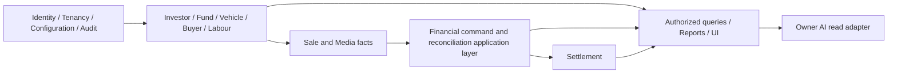

# 02 — Domain and module architecture

> **Reconciliation status: HISTORICAL / SUPERSEDED V1-DERIVED TECHNICAL DESIGN.** **CURRENT TARGET:** `/docs-final-v2/`. **CURRENT IMPLEMENTED:** repository source, as distinguished in the four living maps. The former `/docs-final/` and `/docs-legacy/` are historical. This document was derived from V1 rules and is not an approved V2 schema, API, permission, financial workflow, or implementation contract. Reuse a statement only where its business meaning is explicit in V2 and its technical claim is independently verified. Missing V2 code is an **IMPLEMENTATION GAP**, not evidence for V1. Unresolved meaning is **BUSINESS DECISION REQUIRED**. The remaining unreconciled content below is **HISTORICAL / SUPERSEDED**. See `/architecture/03-ARCHITECTURE-CONFLICT-MAP.md`.

Canonical sources: docs-final/01–06, especially 03 for official modules and 02 for permissions. Modules are boundaries inside one Django modular monolith, not network services.

## Dependency direction

This graph describes application-level composition, not direct package imports in every direction. A single command service coordinates multiple repositories inside one PostgreSQL transaction. Fund Ledger records may reference a Vehicle UUID without importing Vehicle behavior. Sale/Vehicle modules do not calculate Fund balances or recipient entitlements. Finance rules do not call UI, AI, reporting or transport code. Audit is invoked through an application boundary rather than becoming a second financial ledger.

All entries below use backend-generated UUIDs. Unless marked public, data and endpoints are private. A command boundary means validation, source event, linked Fund effect, projection update and audit commit together; a query has no mutation boundary. Section 05 owns financial semantics, 07 owns API shape and 03 owns authorization evaluation.

## Foundation and operational modules

| Module; owned root/data | Input → output | Dependencies; prohibited dependency | Boundary | Actor and scope |
|---|---|---|---|---|
| Accounts/Auth; User, credential/session state | Login, reset, password change → authenticated session and security audit | Identity store; never depend on finance or expose password material | Atomic account/session changes; query for session validation | Global User; administrative reset per 02/supporting auth; private |
| Users/Roles/Permissions; Role, assignment, historical Membership | Provision/assign/deactivate → effective access and audit | Tenant and account identity; never infer rights from frontend role display | Atomic assignment change | Back Office for Owner/Accountant; Accountant for Investor/Media within scope; private |
| Tenants/Garages; Tenant, Vehicle Tenant History | Create/administer/transfer → current context plus preserved origin | Membership and Vehicle UUID; no history rewrite | Atomic transfer and history record | Back Office administration; operational transfer only if canonically authorized; private |
| Investors; Investor, agreement history | Create/change agreement/request exit → global identity, version and lifecycle | Identity, Configuration; no Tenant-owned Investor duplicate | Atomic agreement/lifecycle event | Accountant operational write, Investor self request, other reads per 02; global with scoped access |
| Investor Fund; Fund Ledger | Capital/use/recovery/return/settlement event → principal history and derived position | Investor UUID and linked source IDs; never derive balance from reports or Profit | Atomic with the initiating financial command | Global Investor Fund, source Tenant provenance; Accountant writes per 02 |
| Vehicles; Vehicle, purchase, lifecycle and transfer history | Purchase/status/transfer → current Vehicle and history | Investor and Tenant; never support multiple funding Investors | Atomic with Fund use for purchase | Tenant Vehicle, one global Investor; Accountant lifecycle write |
| Expenses; Expense Category, Vehicle Expense | Approved cost → Vehicle cost and linked Fund debit | Vehicle and Fund command; no General Garage Expense or worker allocation | Atomic Expense/Fund posting | Tenant via Vehicle; Accountant write |
| Buyers; Buyer identity | Contact create/update → reusable Tenant Buyer | Tenant; no phone/name identity merge or global Buyer | Atomic record change | Tenant-scoped; Accountant write |
| Sales; Sale, confirmed Buyer Payment and refund source events | Sale/receipt/refund/correction command → source facts and collection state | Buyer, Vehicle, finance coordinator; no direct entitlement authority | Atomic with allocation/Fund/audit where relevant | Tenant via Vehicle/Sale; Accountant financial confirmation |
| Labour; Labour and manual Labour Payment | Manage/status/pay → manual history | Tenant; never auto-create Vehicle Expense or payroll | Atomic manual payment history | Tenant-scoped; Accountant write, Owner read |
| GST/Tax/Invoice capability; optional linked fields | Relevant transaction information → optional record | Parent transaction; no full tax engine | Atomic with parent when written | Accountant within applicable Tenant; private |

## Finance, read and controlled modules

| Module; owned root/data | Input → output | Dependencies; prohibited dependency | Boundary | Actor and scope |
|---|---|---|---|---|
| Principal Recovery; linked allocation and Fund movements | Actual Buyer receipt/correction → net principal allocation | Sale, Vehicle, Fund Ledger; never create a second receipt | Same transaction as receipt/reclassification | Accountant command; Tenant source, global Investor Fund |
| Profit Distribution; Distribution Snapshot, entitlement and payout events | Sale/config snapshot/payment → calculated, eligible, paid and outstanding positions | Finance engine and configuration history; no early payout mode or editable balance | Sale snapshot and each actual payout atomic | Accountant confirms; scoped Owner/Investor reads |
| Loss Allocation; recognition event and Owner allocation rows | Negative deal/correction → loss shares and claim adjustment | Historical snapshot and finance engine; no manual bearer selector | Atomic recognition/correction | Accountant command; Vehicle/Tenant context |
| Owner Contributions; contribution source event | Actual receipt → obligation reduction and Fund credit | Loss requirement and Fund; no calculated-cash credit | One atomic receipt/Fund/audit posting | Accountant confirms; Owner is read-only |
| Owner Returns; return payable and actual return event | Corrected excess/actual payment → reserved position, Fund debit | Correction and Fund; no automatic Profit netting | Atomic actual return/Fund/audit | Accountant confirms; same Investor Fund |
| Buyer Refunds; payable/reserve and actual refund event | Corrected excess/actual refund → payable, reserve and Fund adjustment | Sale Payment chain and finance engine; no accepted overpayment | Atomic correction or actual refund as appropriate | Accountant confirms; Tenant Sale context |
| Investor Settlement; Exit Request, Settlement and payments | Exit/exception/actual payment → global resolution and closure | Global Fund, Vehicle, Sale, Profit, correction positions; no liquidity invention | Payment atomic; closure rechecks all blockers | Investor normal request; Accountant manages; Owner reads |
| Audit/Correction History; audit and linked correction events | Every sensitive command → actor, source, before/after, reason, time | Application commands; never replace source event or serve as balance | Same DB transaction as source command | Read per 02, append through authorized commands |
| Configuration; Investor agreement and Owner split versions | Authorized version change → effective configuration and history | Tenant/Investor identity; never mutate deal snapshot | Atomic version/audit change | Back Office defaults; Accountant Investor percentage per 02 |
| Media/Publication; Image, variants, publication state | Upload/replace/publish → authorized media and public projection | Vehicle and storage adapter; no internal finance or core lifecycle mutation | DB finalization atomic; object writes reconciled | Tenant Vehicle; Accountant/Media field-specific write |
| Public Vehicle Access; safe published projection | Public query → approved safe fields/images | Publication and Vehicle read model; never serialize internal entity | Read-only | Public; explicitly published eligible resources |
| Dashboard/Reports; rebuildable read projections | Authorized filter/query → bounded summaries | Source records and finance read model; never own money | Read-only; projection refresh separate | Owner authorized union, Accountant scope, Investor self where granted |
| Back Office; administration and Financial Review | Tenant/user/default command or financial query → controlled administration | Identity/Tenant/config and authorized finance read models; no ordinary finance confirmation | Admin mutations atomic; financial review read-only | Back Office authorized system/Tenant scope |
| Owner AI; minimized query/result | Owner question → explanatory answer | Deterministic authorized read model; never write source facts | Read-only; provider failure degrades locally | Owner, authorized Tenant scope |
| Tenant Merge; manifest, operation and transfer audit | Reviewed preflight → controlled cutover | Tenant/Membership/Vehicle and validation queries; no financial reposting | Checkpointed controlled operation, not ordinary UI | Back Office/controlled administration only |

## Shared kernel and transaction ownership

Share only small stable primitives: UUID, timezone-aware instant, decimal INR amount, percentage, Tenant-context reference, actor reference, event identity, idempotency identity and typed authorization outcome. Do not create a generic mutable Account, Balance or DomainModel superclass that mixes all modules.

The application command is the unit of orchestration. A purchase touches Vehicle and Fund; a receipt touches Sale, allocation and Fund; a correction touches source chain and affected current positions. The coordinating command owns lock order and transaction completion. Modules expose explicit domain operations/read contracts, not each other's private tables as open mutation APIs. Queries may compose read models after a centralized scope decision. Reporting, AI and UI never become transaction participants for financial authority.
