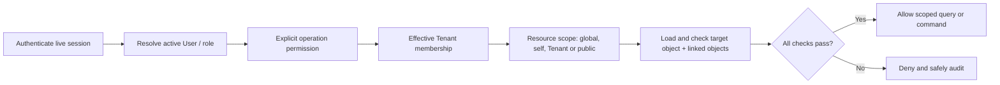

# 03 — Identity, tenancy and authorization

> **Reconciliation status: HISTORICAL / SUPERSEDED V1-DERIVED TECHNICAL DESIGN.** **CURRENT TARGET:** `/docs-final-v2/`. **CURRENT IMPLEMENTED:** repository source, as distinguished in the four living maps. The former `/docs-final/` and `/docs-legacy/` are historical. This document was derived from V1 rules and is not an approved V2 schema, API, permission, financial workflow, or implementation contract. Reuse a statement only where its business meaning is explicit in V2 and its technical claim is independently verified. Missing V2 code is an **IMPLEMENTATION GAP**, not evidence for V1. Unresolved meaning is **BUSINESS DECISION REQUIRED**. The remaining unreconciled content below is **HISTORICAL / SUPERSEDED**. See `/architecture/03-ARCHITECTURE-CONFLICT-MAP.md`.

Canonical sources: docs-final/01 Business and identity; 02 in full; 04 Identity/scope; 06 Tenant architecture; supporting authentication and Tenant Merge.

## Identity and scope

- User, Investor, Business Owner/Profit Recipient and Investor Fund are global identities with immutable UUIDs. Roles and historical Tenant Membership attach to a global User. A User can have multiple explicit memberships; current Tenant selection is context, not permission.
- Garage is Tenant. Vehicle, Buyer, Labour and Expense Category carry a current or parent-derived Tenant scope. Vehicle Tenant History preserves prior context. A Vehicle has exactly one funding Investor.
- Investor self-service is bound to an explicitly linked Investor identity and its global Fund/portfolio, not to a supplied Investor UUID. Tenant labels on Fund movements describe provenance, not Fund ownership.
- Owner combined view is the union of records in explicitly authorized Tenants, retaining record origin. Back Office global financial review requires its documented administrative permission and resource scope; it does not grant daily finance writes.
- Archived/inactive accounts and historical memberships remain discoverable for audit but cannot silently continue current access.

## Backend evaluation pipeline

Each protected request evaluates all applicable checks. Default deny includes new resources and operations until an explicit authorization contract states actor, read/create/update/archive/confirm authority, Tenant/global/object scope and sensitive-field restrictions. A role name or button state cannot add rights. The API resolves the object under scope before returning data, including for search, export, audit, media and background work. Avoid distinguishable error responses that disclose a hidden object's existence.

## Permission matrix

| Resource/action | Owner | Accountant | Investor | Media | Back Office | Public |
|---|---|---|---|---|---|---|
| Authorized business/finance read | Authorized Tenant union, read-only | Authorized operations | Own global Investor/portfolio | Denied internal finance | Authorized full financial review | Denied |
| Daily financial confirmation/correction | Denied | Allowed in valid scope | Denied | Denied | Denied unless another canonical grant | Denied |
| Investor agreement percentage | Read/audit | Set/change with reason/audit | Own permitted read | Denied | Default configuration only | Denied |
| System/Tenant defaults, Owner split | Read where permitted | Denied normal configuration | Denied | Denied | Restricted write/review/audit | Denied |
| Core Vehicle lifecycle | Read | Operational write | Own read | No write | Administrative read | Safe published view only |
| Images/public fields/publication | Authorized read | Operational write | Own or public read | Limited write | Administrative authorized read | Published safe read |
| Normal Exit request | Read | Manage | Own request after acceptance | Denied | Financial read | Denied |
| Exceptional early closure | Read/audit | Audited initiate/manage | Denied | Denied | Financial read | Denied |
| Tenant Merge | Read relevant history only | Denied | Denied | Denied | Controlled administration | Denied |

Labour has no login. The exact operation contract in docs-final/02 remains authoritative if a table cell here is abbreviated.

## Session and account lifecycle

Username/Login ID plus password is the current default. An authorized administrator issues a temporary credential; first login requires a private replacement before normal access. Password change checks the current password. Administrator-assisted recovery verifies identity and issues a temporary reset; there is no public self-service reset, security question, current MFA/SSO/social login or secondary protected business password. Passwords are hashed, never returned or logged. Reset/compromise revokes prior sessions. Deactivation blocks login; reactivation and membership changes preserve history.

Technical session choice: Django-controlled opaque session in secure HttpOnly cookie, with Secure and SameSite settings appropriate to deployment, CSRF protection on unsafe methods, session rotation after login/password reset and server-side invalidation. Do not place long-lived credentials in browser storage. Rate limit and progressively delay abusive login attempts; use generic login failure text. These are technical controls under supporting/authentication-account-security.md, not a new identity-verification method.

## Scope-safe query and command pattern

1. Authenticate and resolve actor once per request.
2. Compute explicit Tenant set and self/global grants from current membership/role history.
3. Bind querysets to the permitted scope before filtering by user-supplied IDs.
4. Resolve all linked objects inside the same scope. A Tenant-scoped Buyer cannot be attached to another Tenant's Sale; an image inherits Vehicle scope.
5. On commands, recheck membership, object scope and current financial position inside the posting transaction. Audit actor, effective scope and outcome.
6. For Owner combined reads, union only authorized Tenant IDs. For Investor self-read, require the User-to-Investor link and exclude other Investors' private data. Back Office Financial Review uses read-only serializers and backend-denied write commands.

Tenant transfer and consolidation change current operational access through controlled events, never by rewriting historic Tenant values. Target membership alone never grants Source legacy access.
