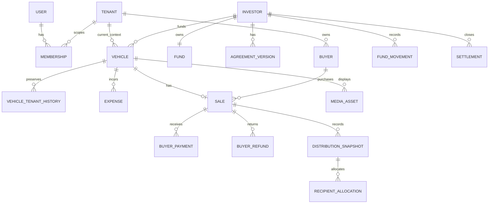
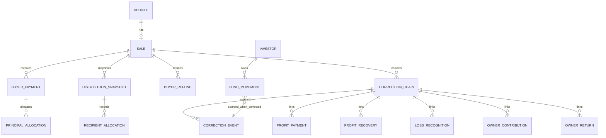

# 04 — Data and persistence design

> **Reconciliation status: HISTORICAL / SUPERSEDED V1-DERIVED TECHNICAL DESIGN.** **CURRENT TARGET:** `/docs-final-v2/`. **CURRENT IMPLEMENTED:** repository source, as distinguished in the four living maps. The former `/docs-final/` and `/docs-legacy/` are historical. This document was derived from V1 rules and is not an approved V2 schema, API, permission, financial workflow, or implementation contract. Reuse a statement only where its business meaning is explicit in V2 and its technical claim is independently verified. Missing V2 code is an **IMPLEMENTATION GAP**, not evidence for V1. Unresolved meaning is **BUSINESS DECISION REQUIRED**. The remaining unreconciled content below is **HISTORICAL / SUPERSEDED**. See `/architecture/03-ARCHITECTURE-CONFLICT-MAP.md`.

Canonical sources: docs-final/01, 02, 04, 05 and supporting Tenant Merge. This is a conceptual PostgreSQL model, not migrations. Financial formulas live in 05-financial-engine-design.md.

## Identity and relationships

Every persistent business/system row has a backend-generated immutable UUID (or equivalent opaque globally unique identity). Human labels, names, phone, registration and storage URLs are attributes, never join keys. Foreign keys enforce the one funding Investor per Vehicle and the Tenant consistency of linked Buyer, Sale, Expense, Labour, Media and audit context. Investor and Fund are global; activity events retain the original Tenant/Vehicle context.

The diagram omits many correction links for readability. Every authoritative financial event is linked to a source operation/correction chain and, where applicable, Fund movement, Investor, Vehicle, Sale, Tenant, actor and timezone-aware instant. A source ID is unique within the ledger-effect type so one real action cannot post the same Fund movement twice.

The last relationship is conceptual: only corrections with an actual principal Fund effect create a Fund movement. Recognition, payable opening and reserve designation can be non-cash. Physical migrations will represent optional links without forcing a movement for every correction.

## Conceptual entity inventory

| Entity / root | Scope and essential links | Lifecycle / mutability | Delete and audit policy |
|---|---|---|---|
| Tenant | Global system boundary | Active, controlled cutover, inactive/archived | Retain UUID and history; audit administration |
| User, Role, Permission | Global | Provisioned, first-password-change required, active/inactive/reactivated | Retain identity/access history; never store plaintext password |
| Membership / role assignment | User × Tenant or approved global role scope, with effective interval | Changes append/history-preserving | No destructive history deletion; audit actor/old/new |
| Business Owner / Profit Recipient | Global recipient identity | Active/effective as configured | Retain payout allocation history |
| Investor | Global; one Fund, many Vehicles/agreements/settlements | Active → Exit Requested → Settlement Pending → Closed, later return preserved | No hard delete of financial history |
| Investor Agreement Version | Investor; effective percentage and audit scope | Versioned; old version immutable | Retain all effective history |
| Owner-visible agreement change notice | Derived from Investor Agreement Version/audit and authorized Owner scope | Current notice/read state may change; source version remains immutable | Preserve change visibility without making notice a finance source |
| Owner Split Version / Recipient Row | System or Tenant configuration, ordered recipients | Versioned; percentage validation before use | Retain old versions and deal snapshots |
| Fund Ledger Movement | Investor, type, source, optional Vehicle/Tenant | Append-only principal movement; corrections linked | No hard delete; reconcile with source |
| Vehicle / Purchase | One Investor, current Tenant, purchase source | Lifecycle and editable descriptive attributes; purchase finance immutable after confirmation | Sold Vehicle and financial history retained |
| Vehicle Tenant History | Vehicle, source/target Tenant, actor/time | Append-only transfer record | Retain original contexts |
| Expense Category | Tenant | Configurable, active/archive | Preserve category identity on past Expenses |
| Vehicle Expense | One Vehicle, category, approved cost, Fund link | Confirmed cost immutable; correction linked | No hard delete of confirmed cost |
| Buyer | One Tenant; phone required, not unique | Editable contact attributes | Past Sale references retained; no auto-merge |
| Sale | At most one normal authoritative Sale per Vehicle; Buyer same Tenant | Confirmed price/history; later corrections linked | No destructive rewrite |
| Buyer Payment | Sale, actor/time, receipt identity | Append-only confirmed actual receipt | Preserve original; reversal/correction linked |
| Buyer Refund Payable adjustment / Buyer Refund Payment | Sale, correction chain, principal-backed component where relevant | Current payable derived from immutable correction/payment chain; actual refunds append-only | Retain payable changes, actual refund and original receipt |
| Distribution Snapshot / Recipient Allocation | Sale, historical agreement/configuration version, calculated result | Original confirmed snapshot immutable; corrected positions linked separately | Retain original amounts forever as history |
| Principal allocation/reclassification | Buyer receipt, Vehicle and linked Fund movement or reserve | Append-only allocation adjustment | Never create another Buyer receipt |
| Investor Loss Recognition / Reversal | Investor, Vehicle/Sale, snapshot/correction | Append-only non-cash claim movement and linked reversal | Each effect counted once |
| Owner Contribution Obligation / Receipt | Recipient, Investor Fund, Vehicle/Sale | One current derived obligation; actual receipt append-only | Retain both obligation adjustments and real receipt |
| Owner Contribution Return Payable / Payment | Recipient, Investor Fund, correction chain | One current payable; actual return append-only | Retain unpaid and paid history separately |
| Profit Entitlement / Payment / Recovery | Recipient, Sale, snapshot and correction chain | Derived current entitlement; actual payment/recovery append-only | Retain old entitlement and confirmed transactions |
| Exit Request / Settlement / Principal Payment | Global Investor; linked open positions | Status changes and actual payments separately recorded | Closed record retained; post-closure correction linked |
| Labour / Labour Payment | Tenant, manual amount/date/note | Active/inactive; manual payments append-only | Preserve payment history; no login or Vehicle cost inference |
| Media Asset / Variant / Publication | Vehicle-derived Tenant; storage references | Processing and publication states; active/archive | Retain image identity/audit; safe deferred binary cleanup |
| Optional GST/Tax/Invoice data | Linked to applicable transaction | Optional and validated when used | Preserve alongside parent history |
| Audit / Correction Link | Actor, object, Tenant, source, before/after, reason and time | Append-only evidence and current-position linkage | No silent alteration |
| Tenant Merge Manifest / Operation | Source/Target Tenant, reviewed mapping and validation | Draft/preflight, approved execution, checkpoint/result | Retain operation and recovery evidence |
| Idempotency Record | Actor/command/resource/key and payload fingerprint | Claimed, committed outcome, bounded retention under technical policy | Keep enough evidence to replay the same outcome safely |

The table describes conceptual records. A physical schema may combine or separate tables where a reviewed phase plan proves equivalent constraints and traceability. No independent editable balance is authorized.

## Database constraints and indexes

- Use foreign keys and check constraints for valid relationships, positive confirmed amounts, two-decimal INR postings, percentage bounds, nonnegative projected positions where material, and one normal Sale per Vehicle.
- Enforce one Fund per Investor; one Investor per Vehicle; one current primary among active Vehicle images when images exist. The maximum four active images needs a transaction lock/count check as well as database-backed protection against concurrent writes.
- Unique source-event-to-Fund-movement linkage and scoped idempotency key prevent duplicate economic effects. Historical Membership versions may repeat a User/Tenant pair across time, while overlapping active effective assignments must be prevented.
- Index Investor/time and Investor/Vehicle for global Fund and settlement queries; Tenant/current-status/time for operational lists; Vehicle/Expense and Vehicle/Sale; Sale/payment/refund; correction-chain/sequence; configuration scope/effective time; audit object/time; media Vehicle/status/order; and User/Membership effective scope.
- Use filtered/selective indexes only when measured query patterns justify them. Large reports paginate or use rebuildable summaries. Tenant filtering is part of query planning, never an after-fetch privacy filter.

## Event and projection model

Confirmed source events are immutable. Corrections append a linked event with original ID, chain ID, actor, timezone-aware instant, reason, old/current targets and any reversal or adjustment. The current economic position is a deterministic fold of valid source events, actual payments/returns/recoveries and linked corrections. Store a materialized current-position projection only to support bounded operational reads or locking; include source version/watermark, reconcile it in the same transaction or rebuild it, and never expose it as a manually editable truth.

Persist UTC or another normalized timezone-aware instant while retaining the exact point in time; display timezone is presentation. No retention duration is invented. Historical finance, membership, Tenant transfer, account, audit and merger evidence remain preserved until an approved retention/legal policy explicitly governs archival.
