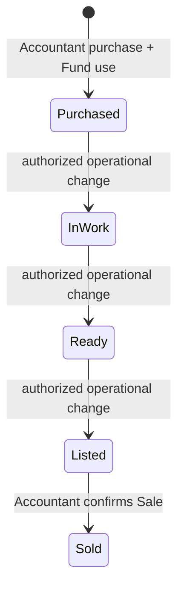
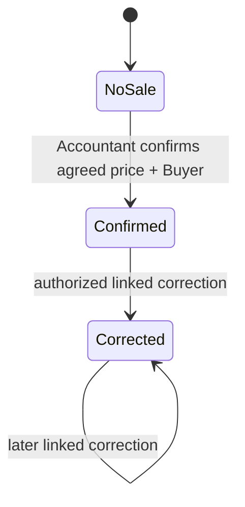
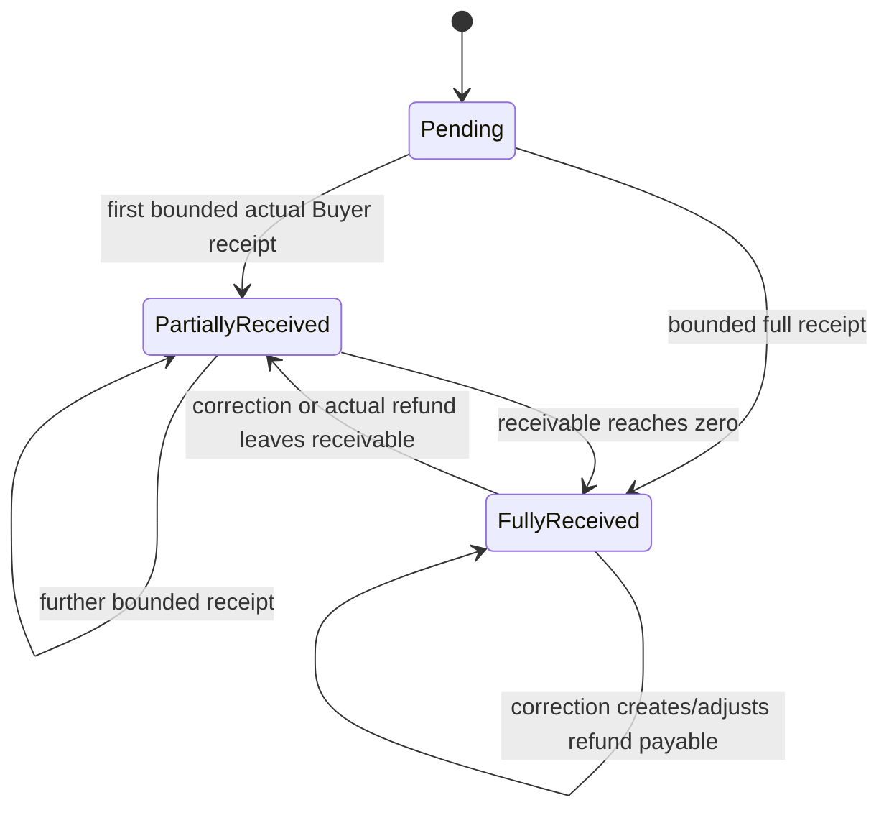
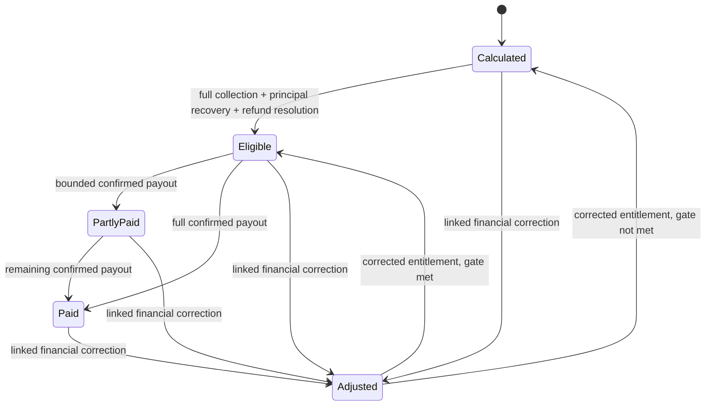
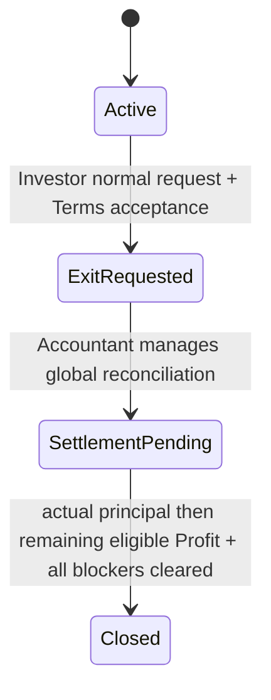
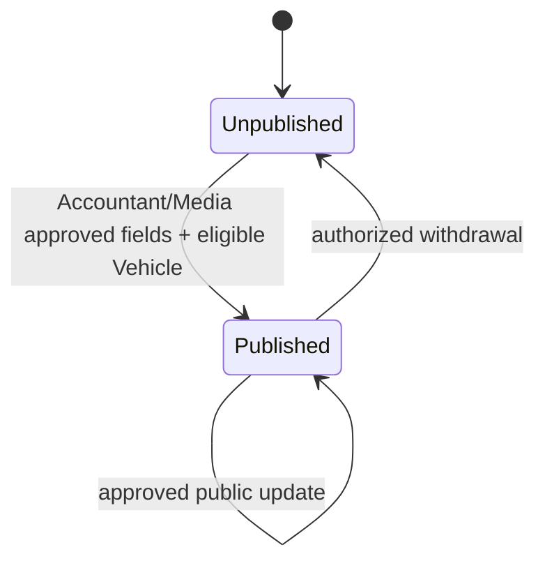
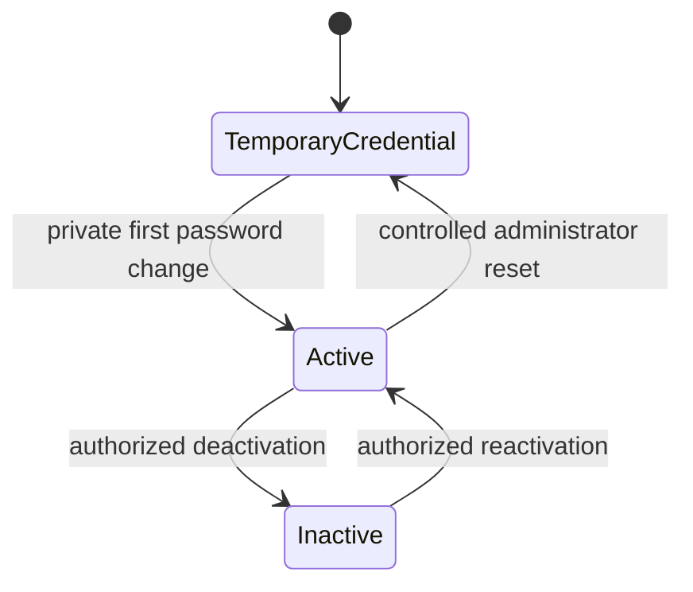
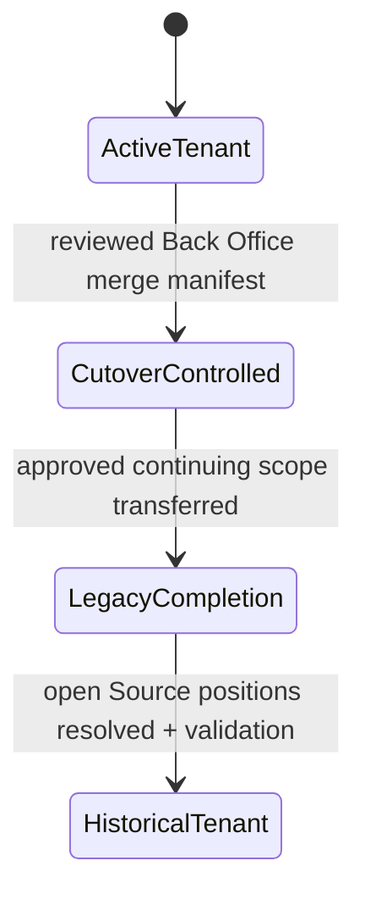

# 06 — Workflows, state machines and corrections

> **Reconciliation status: HISTORICAL / SUPERSEDED V1-DERIVED TECHNICAL DESIGN.** **CURRENT TARGET:** `/docs-final-v2/`. **CURRENT IMPLEMENTED:** repository source, as distinguished in the four living maps. The former `/docs-final/` and `/docs-legacy/` are historical. This document was derived from V1 rules and is not an approved V2 schema, API, permission, financial workflow, or implementation contract. Reuse a statement only where its business meaning is explicit in V2 and its technical claim is independently verified. Missing V2 code is an **IMPLEMENTATION GAP**, not evidence for V1. Unresolved meaning is **BUSINESS DECISION REQUIRED**. The remaining unreconciled content below is **HISTORICAL / SUPERSEDED**. See `/architecture/03-ARCHITECTURE-CONFLICT-MAP.md`.

Canonical sources: docs-final/01, 02, 04, 05, 07, 08 and supporting authentication/Tenant Merge. These diagrams show valid conceptual transitions. Derived labels such as partially paid/open are read-model states, not permission to post a transaction without the canonical command gate in 05.

## Vehicle and Sale

The exact core progression is Purchased → In Work → Ready → Listed → Sold. Accountant/authorized operations enforce current Tenant and one Investor. Sale confirmation creates one authoritative Sale, snapshots percentages/cost/result and marks Sold even if no Buyer money arrived. Media cannot move a core state. A financial correction after Sold updates linked economic positions, not a reverse lifecycle or a second normal Sale. Tenant transfer uses its own history event; completed financial origin remains intact.

The Sale is Tenant-consistent with Buyer and Vehicle. A draft UI review is not an authoritative Sale state. Direct overwrites of confirmed price/history and a second normal Sale are forbidden.

## Collection and refund read states

Pending/Partially Received/Fully Received describe applied collection relative to the current agreed price. A corrected Sale can show Fully Received and an open refund payable at once; payout and final settlement still remain blocked by the payable. Each new payment is bounded by current Remaining Receivable, posted by Accountant with atomic revalidation. A price correction can change the derived collection label without deleting a receipt.

| Buyer refund view state | Entry, actor and side effect | Exit / forbidden behavior |
|---|---|---|
| None | No correction-created excess payable | New Buyer overpayment cannot create an automatic refund |
| Open | Accountant's valid Sale correction creates current payable and principal-backed reserve where applicable | No amount is considered returned; blocks payout/final resolution |
| Partially paid | Accountant confirms a bounded actual refund | Remaining payable/reserve persists; original receipt preserved |
| Resolved by actual payment | Confirmed refunds reach current payable target | Actual cash returned and linked Fund debit only for principal-backed part |
| Adjusted to zero | Later valid Sale correction removes unpaid excess | Release unused reserve only, no new cash/receipt/recovery |

Every further correction recomputes one target from valid payments, actual refunds and current price. If a price rise after refund creates receivable, it is shown separately. Refund component allocation reverses the latest applied receipt portions first as canonical 05 specifies.

## Profit and Loss

Calculated, Eligible and Paid are canonical distinctions. Partly Paid and Adjusted are derived UI/history views, not new entitlement authority. Accountant confirms actual payment. Investor stage must be complete before Owner stage for the same deal, with Investor Additional Payable and Recovery / Adjustment Obligation resolved. Valid Investor Profit may be paid before Exit. A correction preserves already paid history and opens one current additional payable or recovery target; an actual recovery changes Net Retained Profit Payment, while an open recovery does not.

| Loss adjustment view state | Trigger and effect | Exit gate |
|---|---|---|
| Calculated Loss | Confirmed negative deal result and historical snapshot | No cash from allocation |
| Recognition/coverage open | Investor recognition and Owner obligation target determined | Recognition is non-cash; Owner cash must actually arrive |
| Partially covered | Some bounded Owner contributions confirmed | Remaining obligation and OVP remain open |
| Principal resolved | Full collection, net Investor recognition and all required actual Owner coverage recorded | OVP reaches zero; other settlement blockers still checked |
| Return payable open | Same-side Loss decrease or Loss-to-Profit leaves excess retained Owner contribution | Actual same-Fund return or later valid correction resolves current payable |
| Corrected/crossover | Linked correction changes Profit/Loss side or amount | Reconcile net events and current positions; no historical rewrite |

Investor Loss recognition additions/reversals are separate from Owner actual contribution/return. Loss-to-Profit reverses only net recognition. Profit-to-Loss creates payout recovery and Loss positions separately. Correction chains may cross repeatedly; each amount already settled remains settled.

## Investor exit and settlement

Normal request includes recorded Terms acceptance and three months' notice. Exit Requested blocks new Vehicle purchases from that Investor, while already-funded approved work, Sale, collection and recovery continue. Accountant may initiate/manage exceptional early closure with audit; it never creates cash or skips reconciliation. Notice expiry is not financial closure. Settlement Pending may include partial principal payment. Final payment order is remaining Principal Settlement Payable to zero, then remaining eligible Investor Profit. Prior eligible Profit paid while Active remains valid history and is not repeated.

Closure requires every canonical blocker in docs-final/01 and 05 to resolve, including Locked/Vehicle principal, receivables/refunds, Owner obligations/returns, Profit adjustments/recoveries and actual settlement payments. A post-closure correction records a linked new unresolved position while preserving the historical Closed event; it does not silently rewrite that event.

## Publication, account and Tenant

Publication and public availability are independent of the core Vehicle lifecycle. Public access requires the current published/eligible gate and safe projection. Image processing states are Pending → Ready or Failed, with safe retry/replacement; a failed variant must not block Vehicle text or finance. Removal/archive preserves image identity and repairs Primary selection.

Reset revokes prior sessions and never reveals an existing password. Authentication cannot proceed for inactive accounts. Membership/role changes retain history.

Tenant labels here are controlled administration phases, not a routine Tenant Merge button. Source UUID and historical records remain. Target membership does not grant Source legacy access. Blocking preflight conflicts prevent cutover.

## Reusable immutable correction protocol

Original confirmed event → linked correction with actor/reason/time/old/new → corrected target from the original configuration snapshot → comparison with net confirmed prior effects → append only the required delta/open-position adjustment → atomic validation and audit. This applies to Sale price, cost, principal allocation, Profit, Loss, Buyer refund/reserve, Owner coverage, recognition and post-settlement adjustments. No command may delete a confirmed event or treat a current projection as an independent payment.
