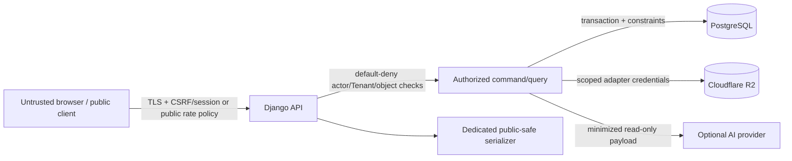

# 10 — Security, audit and compliance design

> **Reconciliation status: HISTORICAL / SUPERSEDED V1-DERIVED TECHNICAL DESIGN.** **CURRENT TARGET:** `/docs-final-v2/`. **CURRENT IMPLEMENTED:** repository source, as distinguished in the four living maps. The former `/docs-final/` and `/docs-legacy/` are historical. This document was derived from V1 rules and is not an approved V2 schema, API, permission, financial workflow, or implementation contract. Reuse a statement only where its business meaning is explicit in V2 and its technical claim is independently verified. Missing V2 code is an **IMPLEMENTATION GAP**, not evidence for V1. Unresolved meaning is **BUSINESS DECISION REQUIRED**. The remaining unreconciled content below is **HISTORICAL / SUPERSEDED**. See `/architecture/03-ARCHITECTURE-CONFLICT-MAP.md`.

Canonical sources: docs-final/02, 04, 06, 08 and supporting authentication/production standards. "Compliance" here means enforcing these locked project controls and preserving evidence; no tax, legal retention period or certification is invented.

## Threat boundaries

| Threat | Control and verification point |
|---|---|
| Credential theft/brute force | Secure password hashing, long passphrases, first-login private replacement, session rotation/revocation, generic login failure, rate limit and progressive delay |
| Unauthorized account reset | Administrator-assisted identity verification; temporary credential; no public self-service reset or security questions; reset audit without secret |
| CSRF/session abuse | Django-controlled HttpOnly Secure session cookie and CSRF enforcement for unsafe browser requests; revoke on compromise/reset |
| XSS/HTML injection | React escaping, careful rich-text policy, output encoding and restrictive browser policy where practical; never trust public description HTML |
| SQL injection | Parameterized Django ORM/query construction; controlled filter/sort allowlists |
| SSRF or file abuse | Server-side URL/redirect restrictions for any fetch, actual image signature/dimension/corruption validation, bounded size and processing resource limits |
| IDOR and Tenant breakout | Queryset scoping before object lookup; role, active membership, self/global/object/field checks in every API, report, export, image and job |
| Private/public data leakage | Separate public projection; no internal serializer reuse; publication gate; private R2 originals; no secret/private storage paths in public API |
| Financial tampering/duplicate | Domain command validation under transaction locks, immutable events, source linkage, exact amount caps and idempotency; see 05 and 11 |
| Secret leakage | Environment/secret store, least privilege, no committed env secrets, no credentials in frontend, Docker image, logs, API or AI prompts |
| AI over-disclosure | Deterministic authorized selection and minimization before provider call; no broad Tenant export and no AI write capability |
| Unsafe release/data migration | Environment identity, backup/restore evidence, staged deployment, migration rehearsal, rollback/forward-fix and health/readiness checks |

## Audit architecture

Sensitive commands append an audit record with event UUID, actor User, effective role/scope, entity UUID, Tenant context if any, action, source/correction link, timezone-aware instant, previous/current values and required reason. Record successful and denied security-relevant administrative activity without putting passwords, reset secrets, session tokens or raw private payloads in logs. Audit is append-only evidence, not a second Fund Ledger. A financial source event and its audit commit atomically.

Account, membership, percentage/configuration, Tenant transfer/merge, Vehicle lifecycle, Sale/Buyer payment/refund, Fund movement, Profit/Loss, payout/recovery, Owner contribution/return, settlement, publication and correction histories remain linked. Reads of sensitive audit data are themselves scoped; Back Office's authorized financial review does not supply normal posting authority.

## Data handling and operational review

Persist timezone-aware instants and immutable UUID identities. Preserve business history through closure, inactivation and consolidation. Exact retention/deletion durations require a separately approved policy and are not invented here. Restrict access to backups and production diagnostics; use redacted structured logs with correlation ID, safe User/Tenant references and failure class. Restore validation must prove financial reconciliation and Tenant isolation, not merely database availability.

Security verification includes cross-Tenant/object denial, Investor self-scope, Owner read-only, Back Office Financial Review read-only, Media/public privacy, login/reset/session controls, CSRF, upload abuse, idempotent financial commands and safe error responses. Security and business authorization are backend concerns; frontend state is presentation only.
