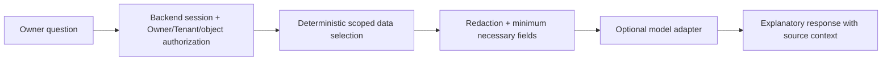

# 15 — AI and automation design

> **Reconciliation status: HISTORICAL / SUPERSEDED V1-DERIVED TECHNICAL DESIGN.** **CURRENT TARGET:** `/docs-final-v2/`. **CURRENT IMPLEMENTED:** repository source, as distinguished in the four living maps. The former `/docs-final/` and `/docs-legacy/` are historical. This document was derived from V1 rules and is not an approved V2 schema, API, permission, financial workflow, or implementation contract. Reuse a statement only where its business meaning is explicit in V2 and its technical claim is independently verified. Missing V2 code is an **IMPLEMENTATION GAP**, not evidence for V1. Unresolved meaning is **BUSINESS DECISION REQUIRED**. The remaining unreconciled content below is **HISTORICAL / SUPERSEDED**. See `/architecture/03-ARCHITECTURE-CONFLICT-MAP.md`.

Canonical sources: docs-final/02 Public and AI access; 03 Owner AI; 06 Security/privacy; supporting production standards.

Owner AI is an in-scope, Owner-only, read-only, Tenant-aware and non-authoritative capability. Its provider availability cannot become required for a core financial workflow. It cannot post commands, change configuration, generate financial truth or bypass role scope.

The backend classifies the requested read scope and executes approved deterministic queries over canonical read models. It selects only the records reasonably needed for that question, removes secrets and unrelated private/sensitive fields, and sends a minimized payload to an approved model adapter. A whole-Tenant dump is never the default. The response may explain a verified balance with references to authorized source records, but its text is not a ledger event, audit source or automated decision.

The AI adapter has no write credentials or call path to application commands. Request/response logging is redacted; prompts do not contain passwords, tokens or storage credentials. Timeout, provider rejection or model error gives local explanatory failure while the normal application remains usable. Authorization is re-evaluated on every request; Tenant selection or a guessed Investor UUID cannot expand the result.

Other automation, when justified for image processing, notifications or reporting, uses bounded Tenant-aware jobs with idempotent source identities, observable retries and failure states. It cannot autonomously confirm financial payments, contributions, refunds, settlements or corrections.
